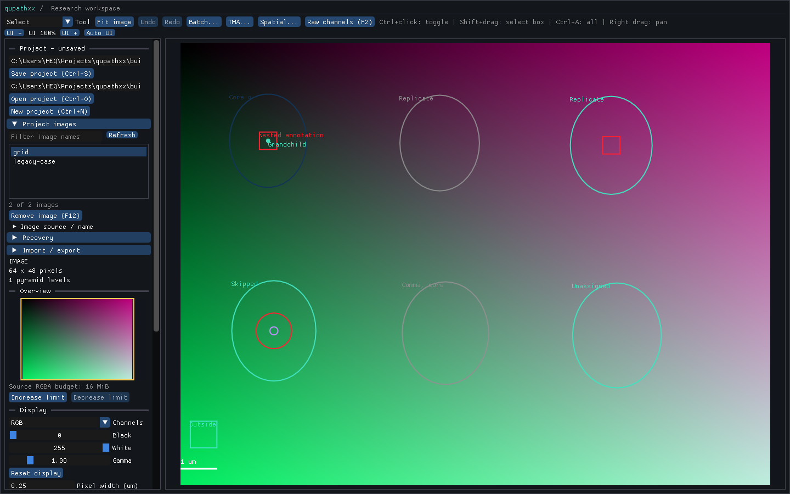

# Assisted saved-state retention — R5-ASSISTSTATE1

Product `25b342fc1346e4220398c2966b18a6325aed54b4` adds explicit exchange/2
native/GeoJSON selection, retaining the existing exchange/1 contract. Native
entries bind saved data and use the complete native geometry/state authority
once. No alternate state codec, public API, store schema or binding changed.
The [receipt](receipt.json) declares the accepted scope and retained failures.

The [derived fixture manifest](../../../tests/fixtures/qupath-assisted-state-0.7.0/manifest.json)
binds six successful pinned-runtime exports: historical facts, analysis defaults,
portable/unsupported properties, valid/legacy TMA grids, explicit GeoJSON and a
mixed bundle. Existing parent binary/TIFF inputs and independent state references
are reused. The mixed second image has a synthetic equal-length producer-header
change; it is not represented as a capture from another runtime.

| Evidence | Result |
| --- | --- |
| [Original staged run](staged.xml) and [log](staged.log) |76 passes, one test-harness failure and five explicit desktop skips across new/legacy import cohorts |
| [First observer repair](observer-repair.xml), [final repair](absent-member-repair.xml) | Four changed-member controls pass; absent classes correctly refuse as appeared-since-review. Final observer checks that specific message and passes. Combined staged scope is77 unique passes |
| [Native roles](native.xml) | TMA, QuPath-project, project and save pass |
| [Actual desktop](desktop.xml) | Bundle-open/save retains both grids, core count, children and missing flags; screenshot below was inspected |
| [Installed wheel](installed.xml) | Mixed native/GeoJSON import/reopen and five public-stub checks pass |
| [Producer controls](producer-controls.json) | Forced native refuses alternate producer; GeoJSON refuses TMA; separate native output succeeds |
| [Integrity](integrity.json) | All461 recorded compiler inputs unchanged and65 installed hashed members match wheel/RECORD; repaired Python observer hashes recorded separately |

State tests compare parent references for type/stain basis/names/white, typed
properties, root facts and complete TMA UUID/slot/child/case geometry. Refusal
controls cover ambiguous native fields, stale hashes, rehashed malformed streams,
unsupported producer and missing data; no unrelated GeoJSON rescues native data.
Reviewed input changes prevent publication, including absent metadata appearing.
Existing exchange/1 project and native saved-data cohorts remain in the run.

One cached build took45.55s, followed by one successful retained-wheel install
and zero stub generations. The [failed pip attempt](install.log) is retained;
discovered uv installed the same wheel. Two observer assumptions were repaired
without rebuilding or repeating passing cohorts. Producer refusal logs remain
beside the control commands. Successful original captures were not replayed.

This closes the declared assisted-state engineering route only. Wider calibration,
project metadata, builders/versions/records, geometry losses and source/recovery
races remain R5; biological parity, speed, host support and release are separate.
Next inspect the remaining saved Z/time calibration override contract against
existing source-axis/calibration authorities before adding any new model or codec.
