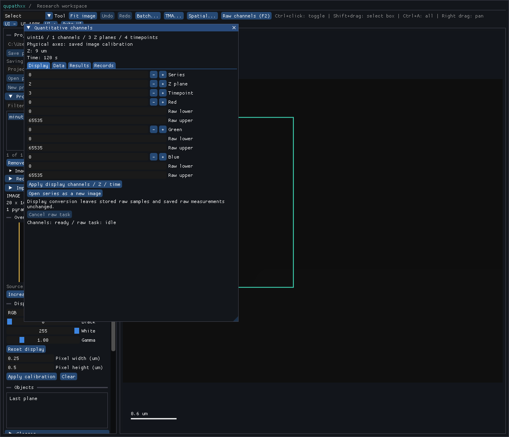

# Saved physical Z/time calibration — local R5-CALIB1 acceptance

Product `5c179651e4d1e265a1e04f11bb2acd4634d7a081` retains recognized saved
Z spacing and explicit timestamps through direct/v2 native project import,
owning document state, undo/redo, snapshots, schema22 save/reopen, Python and the
existing quantitative inspector. The [receipt](receipt.json) keeps initial and
repaired product/observer evidence distinct. No reader metadata is overwritten.

The [pinned corpus](../../../tests/fixtures/qupath-axis-calibration-0.7.0/manifest.json)
has ten cases covering all seven Java TimeUnits, offset/irregular/nonmonotonic
times, partial prefixes and explicit unknown physical axes. Direct saved-data
references match independently declared physical values. Seven valid first-attempt
binaries were reused exactly after QuPath refused a NaN timestamp; a resume parse
failure and project-builder substitution readout are also retained. The source
has Z spacing1.75um/interval0.25s, deliberately different from saved values.

| Evidence | Result and scope |
| --- | --- |
| [Initial staged run](candidate1/staged.xml), [log](candidate1/staged.log) |252 passes/12 GUI skips/two observer API failures at e5d39e44 |
| [Observer repair](candidate1/observer-repair.xml) |Two corrected nodes pass against unchanged e5 product; its combined scope is254 unique passes |
| [Initial malformed probe](candidate1/malformed-results.json) |Eight refusals; missing timeUnit was incorrectly accepted, prompting a native repair |
| [Final targeted imports/refusals](staged-fixed.xml) |117 pass/five declared GUI skips at5c179651; includes native/direct/v2 state references and nine malformed calibration controls |
| [Native roles](native.xml) |Document edits, project, save, QuPath-project, TMA and spatial records pass; migration witness covers all21 older schema versions |
| [Actual desktop](desktop.xml) |Saved calibration inspector displays Z9um/time120s for z2/t3, then saves/reopens retained calibration |
| [Installed snapshot/upgrade](installed.xml) |Owned asynchronous save and schema21 migration/rollback pass on the installed final wheel |
| [Installed limits](coordinate-limits.xml) |Computed Z/time overflow refuses; saved calibration stays inspectable with missing source |
| [Typing](typing-commands.json) and [packaged stubs](public-stubs.xml) |Positive typing passes, exactly three negative diagnostics and five stub checks pass |
| [Integrity](integrity.json) |All465 recorded compiler inputs match;65 installed hashed members match wheel/RECORD. Final observer/stub hashes are separate |

Unchanged constructor/history/store/source-adoption and Python migration evidence
retains its original e5 scope. Only two compiler inputs changed for5c: the native
decoder and the native migration witness. Relevant imports were rerun, rather
than repeating every unaffected numerical or constructor suite. The installed
final workflow additionally verifies current snapshot/persistence plumbing.

The screenshot was inspected: the existing panel identifies saved image calibration
and shows the independently expected9um/120s. Reopen assertions establish saved
state; screenshot timing still shows the asynchronous save in progress.

One initial header/ABI build took687.96s, including the large binding module.
The targeted decoder/witness repair took41.08s. One stub generation, one repackage
of unchanged native bytes and one uv install followed. Failed captures, missing-unit
behavior and observer failures remain in this record. No full platform/science
campaign or raw-fixture recapture was run for these changes.

This is scoped engineering acceptance. Version1/GeoJSON limits, broader project
metadata/builders/versions/records and source/recovery races remain R5. Reader
acquisition metadata and retained analysis recipes/results keep their original
meaning; no new 3D/temporal algorithms, biological or speed claim is established.
Next inspect QuPath project-entry metadata against current ProjectImage state.
