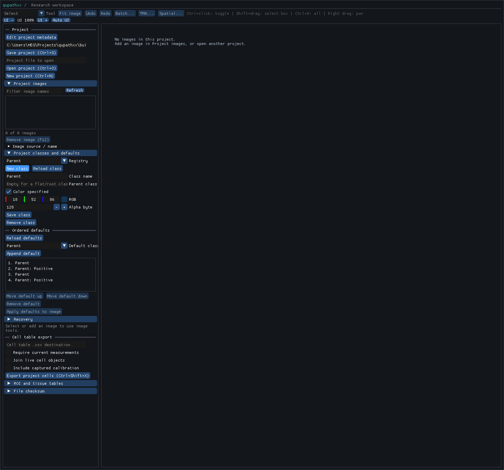

# CLASS1 reference and default-color preflight

**Locally verified** for the declared C++/Python/ImGui class workflow at runtime
8722d96d. Earlier checkpoints retain their tested sources; full R4/R5, M0-M7 and
performance/biology/host/release support remain open.

CLASS1 remains in progress. This evidence proves captured class facts and one
internal color primitive; it does not prove public hierarchy/palette support.
The published product at native408f383e still has the [recorded gaps](baseline.json).
See the [contract/route](../../class-hierarchy.md) and [receipt](receipt.json).

The [fixture](../../../tests/fixtures/qupath-class-hierarchy-0.7.0/manifest.json)
reuses the root-facts builder/ROI without new image servers, pixels or numerical
comparison. Five capture/provenance tests pass. The producer and fresh readback
establish explicit paths/parents, ARGB, ordered/repeated palette entries,
zero-image defaults and NULL-sentinel omission. Palette color wins an older
native/GeoJSON color. A cleared raw color becomes a generated default on fresh
reload, and QuPath rejects its own colorless GeoJSON. Preserve that upstream
failure instead of relabeling a same-process cache value as saved-state evidence.

A third, small color-only process was justified by that discovered fallback.
The native [classes role](primitive-native.xml) passes39 independent color cases
and the existing flat class/history checks:38 standard/parent/Tumor/ARGB/Unicode/
normalization/dark-rejection outputs plus the fresh cleared-color readback.
The [primitive scope](primitive-scope.json) records exact inputs/source/binary.
Its internal resolver uses explicit paths and parent context; it never infers a
parent from a display label. The documented Java Random/UTF16 protocol is shared
by this primitive, with no frontend copy. No Java algorithm source was copied.

The classes-role build refreshed core provenance in the shared cache; its
source46358eb4 is distinct from the installed408f383e baseline. No wheel or stub
was regenerated and no package installed. Future CLASS1 integration needs its
own settled native/public candidate and affected workflow checks.

Waste review: a guessed adapter filename and a web-tool tree request failed;
discovering the pinned upstream tree located the nested GsonTools adapter.
Three short upstream processes have different necessary scopes, not repeated
pixel/math captures. Retain all references; do not repeat this preflight or
full qualifications. Palette duplicates need separate ordered selection and
unique definitions. Group parent/raw/resolved colors and project defaults before
the next public-layout build; otherwise each newly discovered field incurs the
same long bindings compilation. Next implement that class authority through
existing history/import/store/SDK/GUI paths, using these unchanged references.

Native foundation (subsequent source be834edf): the [four affected roles](foundation-native.xml)
pass. The [exact input/configuration/binary scope](foundation-scope.json) is
separate from the earlier color-only observer and installed baseline. Explicit
parent/raw ARGB/resolved RGB, native definition/registry edits, subtree rename
along actual edges, raw/resolved color undo/redo, collision/orphan/depth refusal,
unchanged geometry/spatial index and synchronous schema26 document/project
roundtrips are verified. Project defaults preserve order/repeats and do not
silently edit image classes; explicit application is one image history step.
Empty-project registry roundtrip passes. The spatial role covers all25 older
schemas. Specific new async snapshot/recovery/budget/corrupt-row cases and
import/export/SDK/GUI flows still need their CLASS1 integration checks.

Foundation waste review: parent/ARGB/resolution/default storage were grouped
before an affected core build; all four roles passed on the first attempt.
Definitions are checked once at their boundary, trusted ancestors are reused,
and palette application deduplicates affected definitions while preserving stored
order/repeats. History remains sparse and geometry avoids reindexing. No new
capture, wheel, stubs or install was needed. Finish common native/GeoJSON class
wire and project-context precedence, then thin SDK/GUI consumers before the
single installed workflow candidate; do not repeat the completed preflight.

GeoJSON integration (source de8f9889): [classes/interchange checks](wire-native-leaf.xml)
pass for explicit parent paths, raw ARGB/absence, native version2 metadata,
selected-export ancestor closure, literal flat and explicit delimiter-bearing
native leaves, geometry retention, undo/redo and atomic identity/corrupt-color
refusal. Legacy flat RGB export keeps version1; its feature color remains a
readable RGB projection. Derived features use names arrays; partial alpha adds
a fourth channel. Native metadata owns exact raw bits/absence while foreign
projection uses resolved color, so cleared colors remain readable.

The [input/binary scope](wire-scope.json) identifies the built dirty tree and its
matching committed compiler inputs without relabeling runtime provenance. The
[first compile failure](wire-build.log) is preserved: ObjectClass only defines
C++17 equality; negation repaired both new inequality comparisons. The repair
and a subsequent native-leaf case each changed compiler inputs; both passing
runs are retained. No new wheel, stubs/install or upstream capture occurred.
A failed Windows wildcard search was corrected to a directory plus -g filter;
manifest inspection should print only requested fields, not entire hash maps.

This closes the native GeoJSON substep, not CLASS1. Next adapt the existing
binary decoder and shared project palette context, preserving palette order,
repeats and zero-image registries. Remove flattening/loss notices only when
those routes retain the state. SDK/editor and new-field integrity checks remain
pending. Fold duplicate per-object ancestor traversal into the next wire edit;
walk each distinct class chain once rather than adding a separate optimization
build now. Keep that cleanup within the existing interchange authority.

Binary/project integration (source3d5156f2): [three affected native roles](project-wire-native.xml)
pass on the first build/run. The [recorded inputs/configuration/binaries](project-wire-scope.json)
retain the dirty-build identity and matching committed inputs. The existing
bounded binary decoder now retains explicit parent links and complete raw color
through native version2 class metadata; repeated serialized references use its
class-ID cache. The project class-list parser preserves an ordered/repeated
palette separately from unique definitions, including zero images. Only that
pinned field is decoded as a colon path, with Java-strip whitespace semantics;
[the pinned PathClass source](https://raw.githubusercontent.com/qupath/qupath/v0.7.0/qupath-core/src/main/java/qupath/lib/objects/classes/PathClass.java)
provides the fromString/strip contract. No source implementation was copied.

The retained RGB, alpha, cleared-color and conflicting-color binary/GeoJSON
fixtures retain exact ancestry/raw state, UUID association and ROI area120.
Native and v1-assisted project imports preserve palette precedence, repeats,
empty projects and synchronous save/reopen; the conflicting palette wins over
the older0x101112 value in both routes. Cleared raw state stays absent with
resolvedRGB0xc81767. Invalid packed colors, conflicting repeated definitions,
empty path components and flat/derived identity collisions refuse. Unicode
whitespace normalization and signedARGB match the declared wire policy.
The old flattening/empty-project class losses are removed only from these
now-retained routes. This is native engineering coverage, not an installed SDK,
editor, biological, display, host or broad performance qualification.

Waste review: one combined cached build/three roles; no failed attempt or repair,
new pixels, upstream capture, wheel, stubs or install. Both import routes share
the existing GeoJSON parser/context and native definitions. Ancestor export now
stops at previously visited classes, avoiding repeated chain walks for dense
objects; this cleanup was merged into the necessary wire build. Next expose the
settled native operations to owning Python values and existing editor controls,
then make the one complete installed candidate with remaining integrity checks.

## Installed workflow closeout (2026-11-05)

The [exact source/configuration/package scope](candidate-integrity.json) records
475 compiler inputs and65 installed hashed members matching wheel/RECORD.
Runtime source8722d96d retains the native/Python/ImGui class authority; generated
SDK artifacts change only _native.pyi and RECORD, with native members unchanged.
The existing probe/install environments were reused with source/path assertions,
without the root editable import hook.

| Boundary | Evidence and actual scope |
| --- | --- |
| Native authority / migrations / controls | [Seven affected roles](repair-native.xml) pass: class definitions/history, native and GeoJSON/project transport, project/save, all25 older schemas and actual ImGui controls. Parent/raw alpha/absence, repeats/order, zero-image save/reopen, no-op/stale/refusal guards, explicit application and image rename/undo pass |
| Staged Python | [Initial run](staged.xml):319 passed/nine declared desktop skips at b66ed9cf. Three failures exposed lost specific empty/NUL diagnostics, not accepted behavior. [Targeted repair](staged-repair.xml):49 class/failed-node cases pass at8722d96d. Only the validator diagnostic header changed; earlier passing results retain their source scope |
| New-field integrity | The staged class-registry cases cover owning values, explicit defaults, independent document/project async snapshots, budget refusal, recovery/workspace restoration, malformed graph/raw/cache/default rows and atomic failed writes. Pinned manifest/v1/v2-native/v2-GeoJSON import plumbing retains palettes and raw state |
| Installed SDK | [Eight installed ownership/recovery/stub checks](installed.xml) pass, including five public-stub checks; [positive typing](typing.log) passes and [negative typing](typing-negative.log) reports exactly the three intended errors |
| Installed desktop | [Actual mouse authoring](editor-authoring.json), [execution record](author_classes.py) and [fresh-process readback](editor-readback.json) verify select/append/reorder/Ctrl+S/reopen with zero images. Exact repeated defaults, raw alpha/absence, ancestry and clean saved state are retained |

Public ObjectClass definitions accept signed or unsigned32-bit raw ARGB or None;
getters expose owning name/parent/leaf/raw/resolved values. Document definition/
registry/path and subtree-rename/history operations remain native. Project owns
unique definitions separately from ordered/repeated default keys; applying them
to an image is explicit. Flat native delimiter keys stay flat. Native transport
preserves their identity; unrepresentable foreign flat identities are not a
claim of unrestricted QuPath-format compatibility. Supported pinned source
paths and declared refusals/losses define this workflow's scope.

Waste review: one639.17s combined candidate followed by a66.08s private-validator
repair; no repeat binding compilation for the diagnostic change. One stub pass,
one stub-only repackage and one install. Early GUI compilation caught obsolete
selection resets. Actual input found ImGui193's deferred scalar commits; enable
live scalar editing so Save consumes visible RGB/alpha drafts. Preserve those
failed builds and [input diagnostics](editor-observer.xml). Keep precise empty/
NUL messages instead of weakening assertions. No extra pixel capture, numerical
campaign, new decoder/model, host dispatch or overall speed claim.

The native class-definition/color history is sparse, but subtree rename still
uses annotation patches whose admission charges geometry payloads. That existing
R4/R12 resource concern is the next bounded probe; it does not claim a dense
rename budget was measured here. Use the installed candidate once to establish
whether a class-only rename is rejected by an otherwise reasonable history
budget, then reuse the existing classification journal if a repair is needed.
Do not reopen CLASS1 imports or repeat its capture/package campaign.
