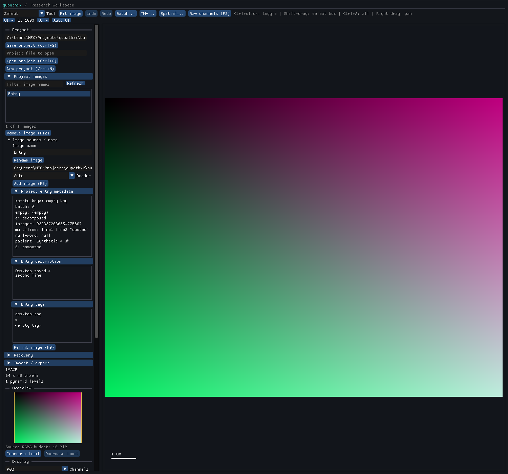

# Entry tags and description — local R5-ENTRYDETAILS1 acceptance

Product `fb5d714d3ac41ad36304591733b8a99264c1f5ff` retains nullable descriptions
and ordered unique tags on existing ProjectImage/Project state, independently of
short metadata, ImageData properties and historical facts. One atomic pair setter,
owning getters/listings, snapshot accounting and sparse schema24 preserve both
through native/assisted imports, save/reopen and the existing inspector. See the
[contract](../../project-entry-details.md) and [receipt](receipt.json).

The [entry-only supplement](../../../tests/fixtures/qupath-entry-details-0.7.0/manifest.json)
reuses the earlier captured builder without opening an image server or reading
pixels/ROIs. QuPath save/reload independently verifies None versus empty description,
first-occurrence order after duplicate tags, empty tags, case/normalization forms
and Unicode/multiline text. The prior ordinary tag/description capture is reused.
The [baseline](baseline.json) lacks the API and reports four losses, including an
explicit empty description; the new reader imports these fields without loss.

| Evidence | Result and scope |
| --- | --- |
| [Staged210](staged.xml) |203 pass/seven declared desktop skips across44 new plus affected metadata/project/import/legacy controls |
| [Native roles](native.xml) |Project, save, QuPath-project and spatial records pass; native migration witness covers all23 older schemas |
| [Combined desktop](desktop.xml) |Metadata, description and tags change after the initial save; inspector displays them and Ctrl+S/reopen proves all changed fields persisted |
| [Installed snapshot/budgets](installed.xml) |An empty linked snapshot fits100KB; description alone and tags alone each exceed that budget. Snapshot strings/order stay independent of later edits |
| [Typing](typing-commands.json) and [public stubs](public-stubs.xml) |Positive typing, three exact negative diagnostics and five packaged-stub checks pass |
| [Integrity](integrity.json) |465 compiler inputs unchanged and65 installed hashed members match wheel/RECORD; final observer/SDK hashes recorded separately |

The44 new cases include captured exact state, optional/default/duplicate order,
atomic invalid pair updates, owning/no-op/clear behavior, exact byte/count bounds,
separate snapshot costs, corrupt/duplicate/orphan/sequence store controls,
schema23 rollback/upgrade, rich attributes with retained actual v1 GeoJSON/v2
GeoJSON/v2 native geometry, stale/missing-source behavior and actual UI save.
Source tag arrays normalize duplicates like LinkedHashSet; stored duplicate/gapped
sequences refuse as corruption. No native product repair was required.

The screenshot was inspected: metadata retains its independent namespace, the
description shows both lines and tags keep desktop-tag/alpha/empty-tag order.
The observer adds metadata coverage after freeze because the shared sidebar helper
was factored; compiled inputs are unchanged.

One grouped ABI/header build took585.09s, followed by one stub generation/repackage
and one uv install with unchanged native bytes. [Baseline attempt1](baseline-attempt1.json)
corrects the expected loss count; [attempt2](baseline-attempt2.json) records a glob
matching its own receipt instead of a directory. Those diagnostics and the oversized
collection-ID finding led to explicit directory checks and short semantic IDs,
without recapturing inputs or rebuilding products.

This closes attribute retention/native-Python editing/read-only inspection only.
Next build GUI authoring on the now-settled setters/getters, with no new public
model/codec/header unless a concrete missing operation requires it. Global project
metadata, broader R5 versions/builders/records/races and scientific/resource/host/
release requirements remain open. No full QuPath parity or speed claim is made.
