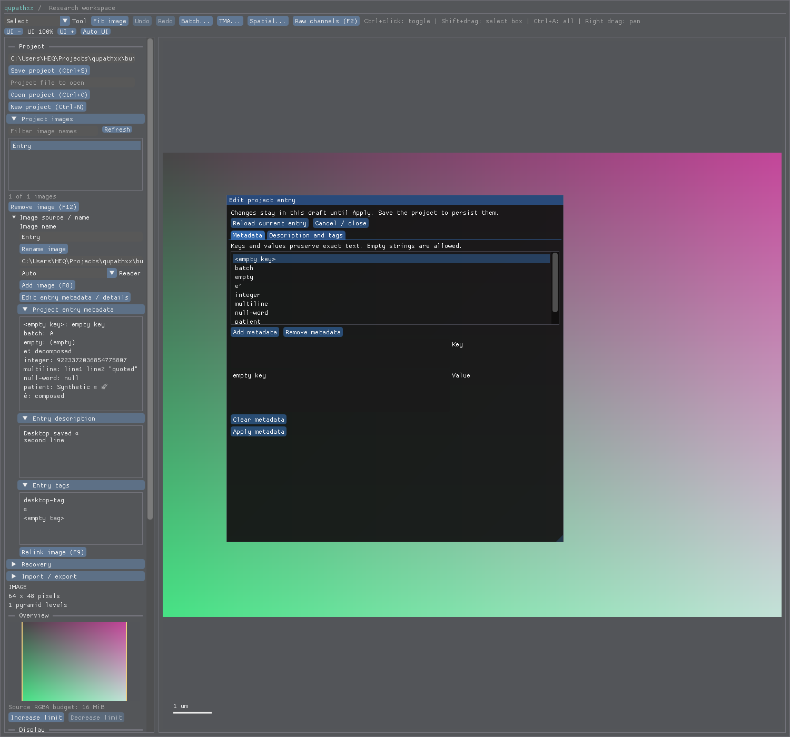
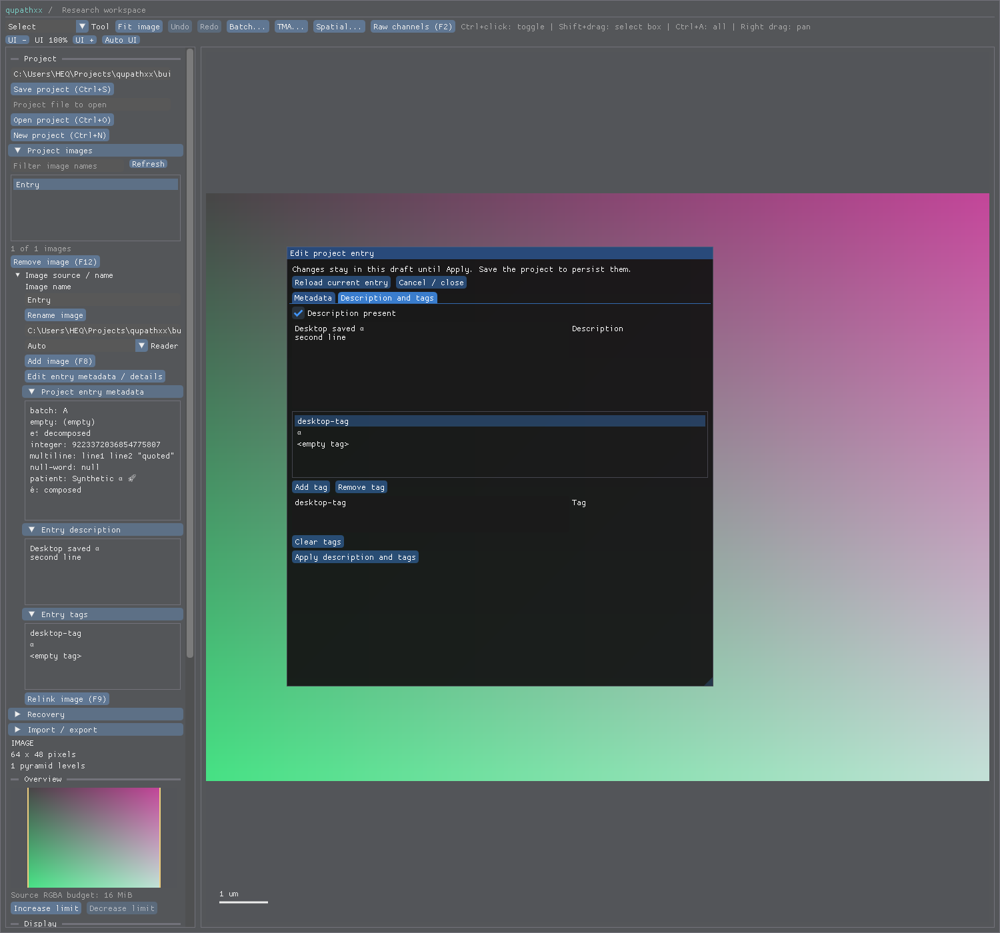

# Entry editor — local R5-ENTRYEDIT1 acceptance

Product `db90985d59c8b50635a6445d1a45f680ee64a047` adds an entry editor to the existing source/name
sidebar. Metadata and the description/tag pair have separate Apply actions,
Cancel/close and reload. Drafts are bounded and Project remains the publication
and validation authority; no public API, schema, codec or numerical change.
See the [receipt](receipt.json) and [unchanged native contract](../../project-entry-details.md).

The [GUI observer](native.xml) drives actual ImGui activation, text and Tab key
input. It checks UTF8/multiline/tab values, metadata add/edit/remove/duplicate
refusal, explicit empty tags/insertion order, absent/empty description, clear,
no-op dirty state, cancel, stale fields, project/image replacement, removed
entries, aggregate native tag-budget refusal without partial publication and
save/reopen. Opening under a different parent ID stack covers the sidebar popup
wiring. It also retains the existing Unicode/replay/font checks.

The installed [authoring script](author_entryedit_r5.py) asserts the compiled
source, removes a metadata row using actual mouse events, applies, closes,
saves with Ctrl+S and reopens exact state with independent details unchanged.
Its [result](editor-authoring.json) records that final source. The earlier
[installed smoke](installed-command.json) explicitly belongs to the first
candidate; it is retained as history, not relabeled as final-product evidence.

Both corrected installed dialogs were visually inspected:

[Integrity](integrity.json) verifies all compiler inputs unchanged and every
installed hashed wheel member against both wheel bytes and RECORD. The native
stub is byte-identical to the tracked stub; no generation was needed. Reuse
[entry-details evidence](../entry-details-r5/README.md) for the unchanged owning
APIs, migrations, snapshot budgets, imports and SDK contracts. Those results
keep their original source and scope.

Waste review: the initial tag observer found an active ImGui text cache copied
into a newly selected row; clearing active input on buffer rebind fixes it.
Two additional observer probes narrowed that failure; future first-failure
output should include actual values and widget visibility together. The new tab
check initially injected a tab as UTF8 text, which ImGui intentionally skips;
actual Tab key events fixed the observer without another wheel/install.
Installed capture then found OpenPopup/BeginPopupModal used different tree ID
scopes. Queueing open in draw fixes the product; the changed GUI input justified
the second cached wheel and install. Both candidates and failed captures remain
recorded. A tab pointer warp needed a separate hover/move before clicking; that
capture-only repair needed no rebuild. Computer Use failed to initialize its
kernel assets, so the existing q.show replay/capture path supplied inspection.

No independent numerical/migration campaign, new corpus capture, stub pass or
UI automation framework was added. This receipt closes the declared authoring
workflow, not every dense/multiline-list, scale/host or display behavior under
R3, broader R4/R5 migration, biology, performance or release support. Next
reconcile the remaining R4/R5 inventory once and select its first ready gap;
advance to R6 context/halo when no independent R4/R5 implementation is ready.
