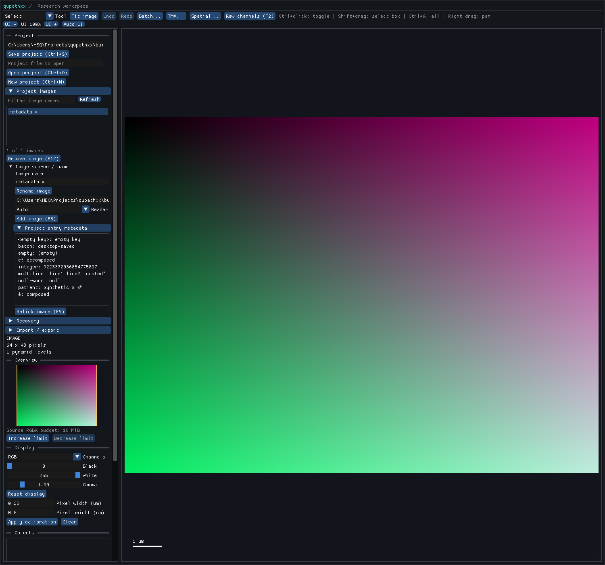

# Project-entry metadata — local R5-ENTRYMETA1 acceptance

Product `b4abea1be50153da46f5c910aafdd84558b6aa1a` retains short string metadata
on the existing ProjectImage/Project authority. Native/Python getters return
owning copies; replacement/clear is atomic and equal maps are no-ops. Project
snapshots and schema23 preserve values without changing document revisions,
root/ROI facts or ImageData properties. See the [contract](../../project-entry-metadata.md)
and [receipt](receipt.json).

The [pinned fixture](../../../tests/fixtures/qupath-entry-metadata-0.7.0/manifest.json)
saves/reloads three actual QuPath0.7 entries with Unicode normalization forms,
empty keys/values, multiline text and numeric-looking strings. It reuses an
existing parent TIFF and captures no saved ImageData/ROI. Separate tags/description
remain reported losses, while metadata survives plain manifest and exchange1/2
imports. The [old-product baseline](baseline.json) reports four losses and has no
entry-map API; the new route retains both rich maps and only the two other-field losses.

| Evidence | Result and scope |
| --- | --- |
| [Staged cohort](staged.xml) |155 passes/six declared desktop skips across161 new/affected project/save/restore/import/legacy cases |
| [Actual geometry routes](geometry-routes.xml) |Rich metadata stays bound to the correct image while retained v1 GeoJSON, v2 GeoJSON and v2 native saved geometry imports/reopens with two objects per image |
| [Optional-map controls](optional-map.xml) |Absent/null maps import as empty sparse state on the same installed product |
| [Native roles](native.xml) |Project, save, QuPath-project and spatial records pass; native migration witness covers all22 older schemas |
| [Actual desktop](desktop.xml) |The imported map is changed before showing the UI; the panel displays it and Ctrl+S/reopen confirms the changed value |
| [Installed snapshot/budget](installed.xml) |An empty linked snapshot fits100KB, metadata alone crosses that limit, and captured maps stay independent of later edits |
| [Typing](typing-commands.json) and [public stubs](public-stubs.xml) |Positive typing, three exact negative diagnostics and five packaged-stub checks pass |
| [Integrity](integrity.json) |465 compiler inputs unchanged;65 installed hashed members match wheel/RECORD; final observer/stub identities recorded separately |

The 41 new cases comprise36 in the initial module (35 headless plus one actual
desktop case), followed by two optional-map and three actual geometry-route
observer controls. The latter close an audit finding: initial versioned-bundle
map tests had empty image lists and covered only outer bundle binding. Exact map
values/IDs, getter/listing isolation, no-op/clear, invalid native/foreign/store
input, duplicate/orphan rows, byte/count/payload bounds, metadata snapshot budget,
schema22 rollback/upgrade, missing sources and stale review/existing destinations
are covered. No failing product or observer attempt occurred in this slice.

The screenshot was inspected: the existing sidebar shows all nine captured keys,
including empty and multiline previews, and `batch: desktop-saved`. Reopen checks
prove the UI persisted that change; source text is retained exactly in the API/store.
The list clips to visible rows and offers full values on hover.

One cached ABI/header build took553.51s, followed by one stub generation and one
uv install. Native bytes were repackaged unchanged. The exact
[executed backend](executed-backend.py) is preserved: it inherited two unneeded
native targets, whose separate time is unknown. The future target list was trimmed
to the selected four roles. No raw corpus, unrelated numerical campaign or full
platform qualification was repeated. The successful source capture was run once.

Tags and description remain separate open entry attributes. Next reuse their
already captured case and settle both contracts together before another shared
header edit. Global project metadata, broader versions/builders/records/races,
scientific/resource/host/release work remain in the full queue; no overall speed
or full QuPath parity claim is made here.
