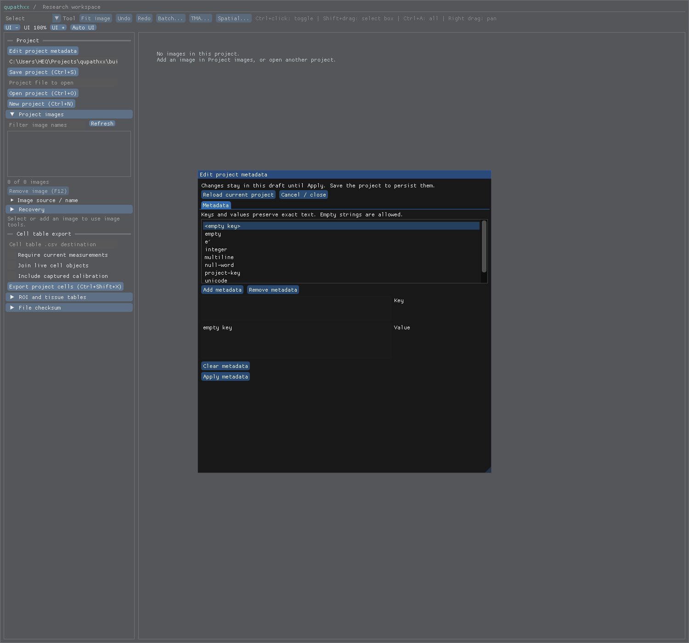

# Project metadata — local R5-PROJECTMETA1 acceptance

Native product `408f383e78e7f235ec2d444c3a7d2488a81c5d64` retains project-wide string maps separately
from entry metadata, descriptions/tags and image/ROI state. Owning getter,
atomic replace/clear/no-op, shared validation, normalized schema25, snapshot
budgets and recovery workspace adoption use the existing Project authority.
The existing editor has project mode, including zero images. See the
[contract](../../project-metadata.md) and [receipt](receipt.json).

The [project-only fixture](../../../tests/fixtures/qupath-project-metadata-0.7.0/manifest.json)
reuses the retained builder/runtime/source with no image server, pixel or ROI
capture. QuPath saves/reloads rich, empty and zero-image maps, distinguishing
project-key=project-scope from entry-key project-key=entry-scope. Strings keep
empty values/keys, Unicode/normalization forms, newline/tab and numeric-looking
text. The [old product](baseline.json) drops nine global pairs, has no map API
and refuses empty projects. The candidate imports genuinely empty projects;
nonempty projects with no available images still refuse. Class defaults without
images remain an explicit project_classes_dropped loss until their registry is
delivered; this change does not claim those classes retained.

| Evidence | Result and scope |
| --- | --- |
| [Affected run](staged-attempt1.xml) and [repairs](staged-repair.xml), [final repair](staged-repair2.xml) |249 unique non-GUI passes, nine declared desktop skips; only failed observers rerun |
| [Native](native.xml) |Five roles pass; migration witness covers all24 older versions; actual ImGui project/entry editing remains covered |
| [Desktop](desktop.xml) |Zero-image and one-image changed metadata saved/reopened |
| [Installed](installed.xml) |Ownership/namespace separation, independent snapshot budget, saved state and recovery restoration pass |
| [Actual installed authoring](editor-authoring.json) / [script](author_projectmeta_r5.py) |Observed mouse remove/Apply/close/Ctrl+S/reopen verifies exact zero-image global map |
| [SDK](public-stubs.xml), [typing](typing-commands.json) |Five public-stub checks and positive/three exact negative diagnostics pass |
| [Integrity](integrity.json) |467 compiler inputs unchanged;65 installed hashed members match wheel/RECORD; native members unchanged by stub repackage |

The48 new cases cover captured imports with manifest/v1/v2 routes, exact limits,
no-op/clear/atomic invalid replacement, sparse rows and malformed types/UTF8/
duplicates/count/payload, schema24 fallback/failed migration rollback, snapshot
ownership and budgets, recovery/adoption, missing/stale metadata and source
refusal, actual saved v1/v2 geometry and explicit empty-project class loss.

The screenshot was inspected: the project has no images, the project-mode modal
is open with all global keys, metadata controls and no image-details tab. Native
and installed GUI checks keep entry/global namespaces separate.

Waste review: one557.16s grouped header/API build, one2.77s upstream process,
one stub generation/repackage and one install. No product repair was needed.
Python-only setup repairs create the absent classifiers directory, use the real
.qpxrecover suffix, and avoid unlinking a TIFF owned by a live preview. The final
observer expects the existing exact missing_image code, not unavailable_image.
Preserve the initial247-pass/two-failure run and first repair; reuse passing
results and rerun only the failing nodes. Final Python observer/SDK hashes are
separate from frozen compiler inputs. No numerical campaign, repeated corpus
capture, alternate model/codec/editor or full qualification was added.

Next settle derived-class hierarchy and project-default registry contracts
against the existing class/history/import authority before the next public
layout/binding edit. Broader formats/versions/records/races, biology, resources,
hosts and release remain open. No overall parity or speed claim is made.
