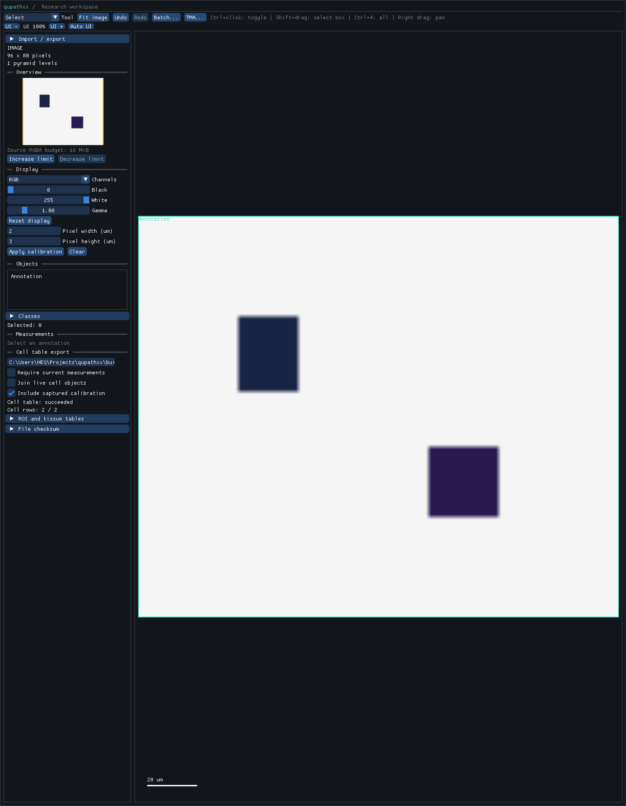

# Capture-time calibrated cell features

`CellResult.calibrated_feature(label)` returns a native, read-only value for one
one-based cell label. It uses the effective pixel calibration captured by the
analysis request. Changing document calibration, editing or deleting an object,
closing the reader, or reopening a saved project does not change these values.
Invalid labels raise `IndexError` in Python (`std::out_of_range` in C++).

The value exposes `label`, `pixel_width_um`, `pixel_height_um`,
`nucleus_sample_area_um2`, `cell_sample_area_um2`,
`cytoplasm_sample_area_um2`, `nucleus_centroid_um` and `cell_centroid_um`.
Point coordinates are measured from the level-zero image origin in micrometers.
They are returned by value. Feature lookup uses retained statistics and takes
constant time; it does not scan label images or read source pixels.

For native pyramid downsample `d` and captured level-zero pixel sizes `sx, sy`,
each labelled sample contributes `d*d*sx*sy` square micrometers. Centroids use
the retained level-zero sample-center coordinates, scaled by `sx, sy`. This
supports anisotropic calibration and fractional native pyramid downsamples.
Sampled area describes the detection grid's coverage; it is distinct from the
analytic area of a clipped or subsequently edited object contour.

If either calibration axis is unknown, physical areas and points are `None`.
Available individual calibration axes remain visible. Archives without capture
provenance also return unknown values, even if the document currently has a
calibration. A known empty cytoplasm has area zero. A final positive value that
cannot be represented as a finite nonzero double raises `OverflowError`; a
representable final product is retained even if a naive intermediate product
would overflow or underflow.

```python
feature = result.calibrated_feature(1)
print(feature.nucleus_sample_area_um2, feature.nucleus_centroid_um)

options = qupathxx.CellTableOptions()
options.include_capture_calibration = True
qupathxx.save_cell_measurements_csv(document, "cells.csv", options=options)
```

CSV opt-in adds nine fields: `capture_pixel_width_um`,
`capture_pixel_height_um`, `nucleus_sample_area_um2`, `cell_sample_area_um2`,
`cytoplasm_sample_area_um2`, `nucleus_centroid_x_um`,
`nucleus_centroid_y_um`, `cell_centroid_x_um` and `cell_centroid_y_um`.
The table schema becomes `/2` for document/project and archived/published-object
variants. The default remains `/1` with its existing columns and bytes.
Missing captured values and manual objects have blank fields. Existing joined
`export_pixel_*` and live geometry fields retain their export-time semantics.
`CellTableRequest` freezes both capture-derived values and joined live state.
Background exports use the same immutable request and atomic output policy.

The desktop cell-table controls provide **Include captured calibration**.
Embedded callers can set `GuiOptions.cell_table_capture_calibration = True`.
The selected-annotation export uses its latest archived run, as in schema `/1`;
the project export covers the selected table mode across project images.
The standalone command exports historical records from a saved project:

```text
qupathxx_batch --export-cell-table input.qpxproj output.csv --capture-calibration
```

`--published` selects joined published objects; `--require-current` requires
current records under the existing cell-table policy. Reopened historical runs
normally require rechecking before they qualify as current. Output cannot replace
the input project or its external images, including hard-link aliases. Unknown
or duplicate flags fail. Cancellation or a failed export preserves an existing
destination. The command shares the default table byte limit of 256 MiB.

This feature does not change segmentation, add physical-unit detection filters,
resample images to an arbitrary resolution, or establish agreement with QuPath
cell detection. Those remain separate analysis acceptance requirements.

The [Linux validation receipt](benchmarks/calibrated-cell-features-linux.json)
records 42 native suites, 157 focused Python tests and a full suite with 1,655
passes, 392 optional skips and four scientific expected failures. Installed
workflows, runtime relocation, stubs and strict typing pass. The native calibration
regression also passes address/undefined sanitizers with leak detection in a
minimal optional-feature configuration; this does not accept the full sanitizer
suite. Hosted candidate acceptance remains pending. The [Windows receipt](benchmarks/calibrated-cell-features-windows.json)
adds 43 native suites, 76 focused Python/GUI checks, installed workflows and
strict typing. The full Windows suite passes 2,035 tests, with 13 optional skips
and four strict scientific expected failures. An existing export-recheck
test times out once, then passes both alone and in the full focused repeat;
the original result is retained and its cause remains unresolved.
After supplying the generated large-pyramid fixture, two Linux checks and three
Windows checks (including desktop navigation) that were skipped in those full
runs pass separately. The receipts preserve the original full-suite counts.

The completed native frame shows the checked capture option and successful
two-row export while the document displays its later calibration. The CSV retains
the original 0.5/0.25 micrometers per pixel, with zero reported UI overflow.



To verify calibrated table throughput
on a quiet machine, use `tools/benchmark_cell_tables.py --capture-calibration`;
`--gui` additionally exercises desktop export. The recorded small smoke check
ran under concurrent load and establishes output correctness only.

Separate [export observations](benchmarks/calibrated-cell-table-profile-validation.json)
use the same 4,096-cell immutable result retained as eight records: 32,768 rows
and 17,110,689 CSV bytes. An excluded warm-up precedes seven fresh-process calls
on each platform, with Windows and Linux passes serialized. Every measured CSV
has identical bytes across all fourteen calls. Physical areas are checked
against the known five-sample nuclei before recording results.

| Native worker export | Median | Observed range |
| --- | --- | --- |
| [Windows](benchmarks/calibrated-cell-tables-windows.json) | 101.6 ms | 57.3–112.7 ms |
| [Linux/WSL](benchmarks/calibrated-cell-tables-linux.json) | 71.6 ms | 57.5–102.9 ms |

Owner capture medians are 0.031 ms Windows and 0.00695 ms Linux; observed maximum
poll durations are 0.108 ms and 0.0327 ms. Snapshot accounting estimates are
retained as ranges, including allocator-dependent variation; they are not process
RSS. The host is an Intel i7-12700K. Windows and WSL use different temporary-file
storage contexts. Startup, image construction, detection and validation are outside
the native worker export timer. These observations do not establish a speedup,
segmentation throughput, universal performance or a GUI frame budget.
