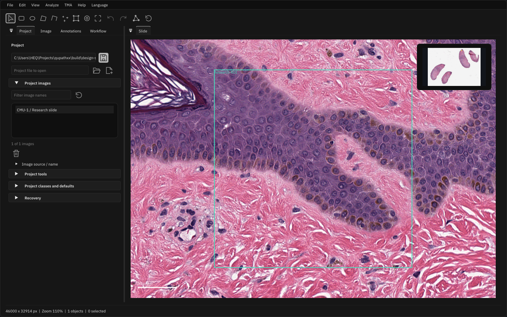
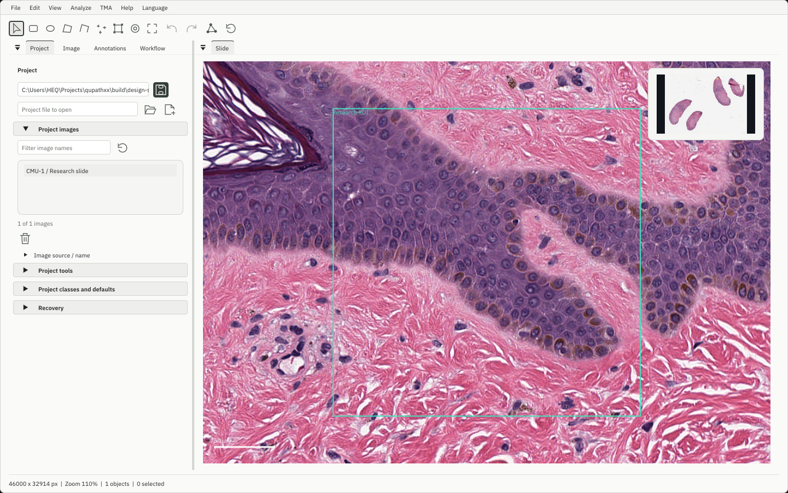
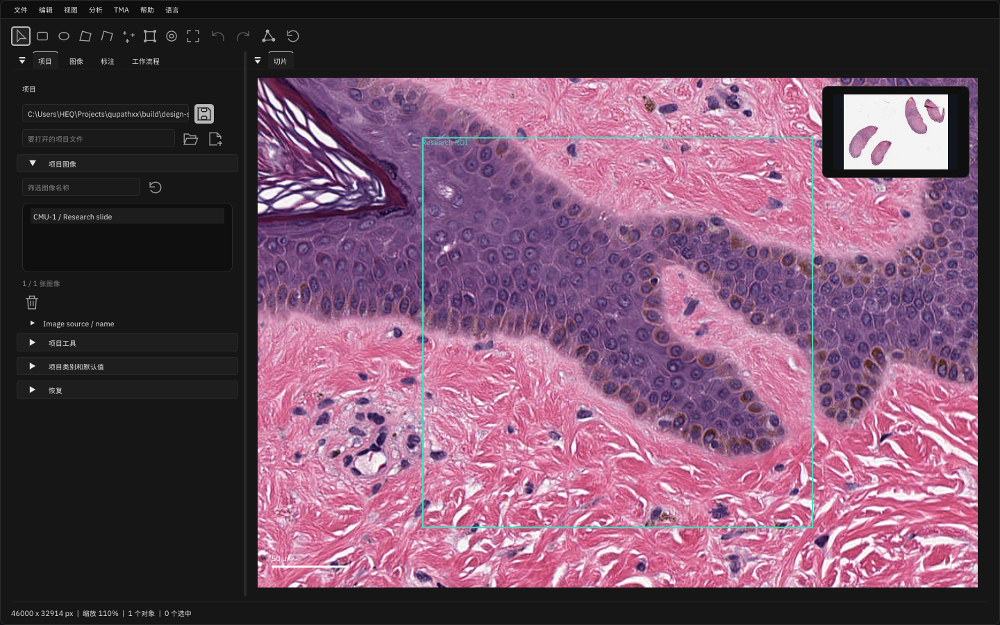

# Native design system

The desktop uses the design system from
`../colmap_webview/colmap-webview` at commit
`121bd73ae77686e42093918944cec1baa1164aa5`. Its Load Dataset panel is the visual
reference: muted neutral surfaces, fine outlines, rounded floating panels,
restrained typography and consistent spacing. This is a native ImGui port;
the application has no React/CSS dependency on the sibling checkout.

## Ownership

| Concern | Owner | Use |
| --- | --- | --- |
| Palettes, spacing, geometry, typography scale | `cpp/gui_design_tokens.hpp` | Semantic values matching the captured upstream CSS tokens |
| ImGui style, appearance preference, heading/action recipes | `cpp/gui_design_system.hpp` | One shared mapping for every native panel |
| Responsive fields, buttons, menus, modal sizing | `cpp/gui_layout.hpp` | Controls retain their IDs as labels, language and layout change |
| Command/drawing glyphs | `cpp/gui_icons.hpp` | One vector stroke family without font or platform substitutions |
| Icon buttons and toolbar adapters | `cpp/gui_layout.hpp`, `cpp/gui_theme.hpp` | Shared targets, translated hover/focus hints and selected/disabled behavior |
| Font sources and authenticated loading | `cmake/GuiFonts.cmake`, `cpp/gui_fonts.cpp` | Packaged IBM Plex Sans with existing international fallbacks |
| Default panel composition and separate settings | `cpp/gui_workspace.hpp` | Attached panes, detached panels, bounded layout/language/theme preferences |

Use these owners instead of adding per-panel colors, font sizes or alternate
button implementations. Scientific display channels, class colors, annotations,
mask colors and image pixels remain owned by their existing rendering services.

## Tokens and components

| Token | Value |
| --- | --- |
| Body text | IBM Plex Sans Regular, 14 logical pixels |
| Section/modal title | IBM Plex Sans Semibold, 14 logical pixels |
| Spacing ladder | 4, 8, 12, 16, 24, 32 logical pixels |
| Panel body inset | 16 horizontal / 12 vertical |
| Floating panel radius / outline | 8 / 1 logical pixels |
| Control radius | 4 logical pixels |
| Standard text action | Minimum 32 logical pixels high |
| Compact utility action | Minimum 24 logical pixels high |
| Vector toolbar action | 28 logical pixels square |

All geometry scales through the existing monitor/framebuffer/user scale model.
Docked edges stay attached; floating panels and dialogs use the rounded surface.
Keep layout and scroll ownership in the panel instead of forcing every shell to
the same width. Dialogs remain constrained to the current viewport.

`ui::Button` is the neutral secondary action. Use `ui::PrimaryButton` for the
main confirmation, `ui::DangerButton` for explicit destructive confirmations and
`ui::GhostButton` for low-emphasis actions. Disabled controls keep their recipe
with reduced opacity and native disabled behavior. `SmallButton` uses compact
geometry. `ui::IconButton` provides localized hover and keyboard-focus hints.

Use icon buttons for familiar project/file, add/remove, copy/paste, refresh/reset,
list navigation/reordering and dismiss actions. All use the shared28px square,
stroke weight, theme foreground, hover treatment and focus ring. Primary Save and
danger actions retain their semantic colors. The label argument is the complete
English command caption, including a shortcut where available; it becomes the
translated tooltip and preserves the original widget ID. Keep distinct captions
and existing ID scopes for repeated controls. Never use an icon glyph as the ID.

Drawing tools, project/image controls, clipboard, overview budgets, class/default
editors, metadata/tags and model-file controls use this same recipe. Existing
replay targets, keyboard shortcuts and native validation stay attached to each
command. Disabled icons are native disabled buttons and still explain their
command on hover. Selected drawing tools retain their outlined state.

Keep visible text on complex scientific commands and explicit destructive
confirmations so the action and its scope remain clear. Use the same shared text
button variants for those cases. The icon family belongs in gui_icons.hpp;
panels must not draw their own command glyphs.

The toolbar uses compact vector controls to keep localized labels from consuming
the workspace at 200% scaling. Full command names remain in menus and tooltips.
Project metadata and density controls are grouped under **Project tools**, keeping
Save/Open accessible in the main flow. Section titles and collapsible groups use
the shared semibold role; field values and user text use the regular role.

## Palettes and preferences

| Role | Dark | Light |
| --- | --- | --- |
| Primary background | `#0f0f0f` | `#f5f5f4` |
| Panel surface | `#161616` | `#fafaf9` |
| Tertiary surface | `#1e1e1e` | `#eeeeec` |
| Input background | `#1a1a1a` | `#ffffff` |
| Primary text | `#e8e8e8` | `#202322` |
| Secondary text | `#a8a8a8` | `#4f5552` |
| Muted text | `#858585` | `#626861` |
| Border | `#2a2a2a` | `#d4d6d1` |
| Accent | `#b8b8b8` | `#343e38` |

Dark is the default, matching COLMAP WebView. **View > Appearance** offers Dark,
Light and System, with immediate application and a separate workspace `.ini`
preference. Reset layout retains appearance and language. System follows Windows
app appearance and macOS appearance; Linux reads `GTK_THEME`, falling back to
dark when no preference is available. Windows is the visually verified host.
`QUPATHXX_UI_THEME=dark|light|system` overrides the saved choice at startup.
Viewer contexts restore their prior theme state on exit, just as language does.

## Fonts and language

Regular/semibold static TTFs are derived from the same licensed
`@fontsource-variable/ibm-plex-sans@5.3.0` WOFF2 used by the reference project.
`assets/fonts/font-source.json` records conversion and source/output hashes.
The complete OFL notice ships under `qupathxx/licenses/ibm-plex-sans`.
Native builds authenticate font sizes/hashes before parsing and locate assets
beside the owning executable/module. No source-tree or working-directory fallback
is used. Headless builds do not load GUI fonts.

Both font roles merge the retained Noto CJK/emoji fallbacks. Dynamic glyph loading,
32-bit character support, atlas limits and GL-owner-thread texture handling stay
in place. The earlier bitmap-font appearance is intentionally superseded by this
design change. The existing 16-language system remains available; Ctrl+Shift+L
opens its chooser without depending on menu widths.

## Validation and extension

`tests/fixtures/colmap-design-system.json` captures the reference palette and
geometry contract. `test_gui_design_contract.py` checks native palettes against
that snapshot and authenticates font resources/notices. `gui_design_tests.cpp`
checks explicit/system theme resolution, text/action contrast and target sizes.
Real-GL tests cover appearance persistence, unchanged image pixels and project
bytes, camera geometry, localized save at 200%, modal routing, compact spatial
actions and existing docking/Unicode behavior.

The [command-icon follow-up](benchmarks/design-system/icons/README.md) adds80
focused passing checks of icon-based file/save/load, clipboard, model-file,
overview and localized/scaled flows. Model file controls precede the long feature
form; shorter classifier windows fold feature options. The raw-file panel fits
the viewport with enough initial height for its common commands.

When updating from the sibling project, review its `docs/design-system.md`,
`src/index.css`, `src/theme/panelStyles.ts`, `buttonStyles.ts`, `formStyles.ts` and
`selectionStyles.ts` together. Update the token snapshot deliberately. Keep
scientific rendering colors separate and inspect both palettes, a translated
screen and a scaled/narrow screen before handoff.
