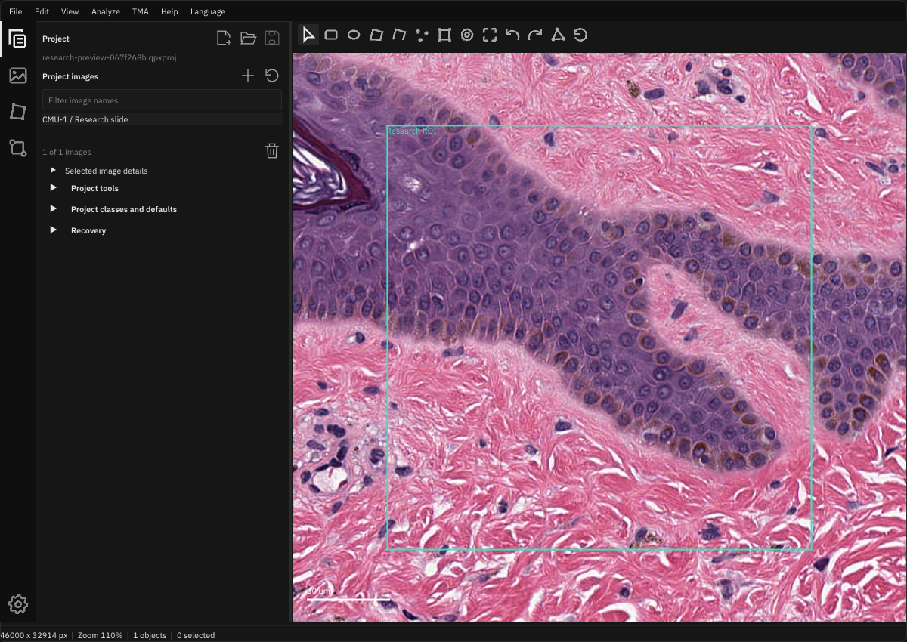

# Native design system

The workbench has one native semantic token owner and shared component recipes
for RmlUi and ImGui. Navigation follows VS Code's
[Activity Bar guidance](https://code.visualstudio.com/api/ux-guidelines/activity-bar)
and its [48px rail / separated utility group](https://github.com/microsoft/vscode/blob/main/src/vs/workbench/browser/parts/activitybar/media/activitybarpart.css):
full-row targets, unboxed glyphs, an outer-edge active indicator and bottom
workspace settings. Utility buttons are a separate component from navigation.

The neutral palette and licensed typography retain the COLMAP WebView reference
at `121bd73ae77686e42093918944cec1baa1164aa5`. The application has no React/CSS
dependency on that sibling checkout. [RmlUi](rmlui.md) renders the shell; native
inspectors use the same role sizes, colors and states.

## Ownership

| Concern | Owner | Use |
| --- | --- | --- |
| Activity rail and slide toolbar presentation | `assets/ui/workspace.rml`, `assets/ui/workspace.rcss` | Reloadable structure, themes, density, focus/selected/disabled recipes |
| Presentation state and commands | `cpp/gui_shell.hpp` | Owned snapshot and typed command contract without runtime pointers |
| Palettes, spacing, geometry, typography scale | `cpp/gui_design_tokens.hpp` | Reference palettes and explicit workbench component metrics |
| RCSS token bridge | `cpp/gui_stylesheet.hpp` | Resolves semantic dimensions/colors from the native owner during load/reload; unknown tokens reject transactionally |
| ImGui style, appearance preference, heading/action recipes | `cpp/gui_design_system.hpp` | One shared mapping for every native panel |
| Responsive fields, buttons, menus, modal sizing | `cpp/gui_layout.hpp` | Controls retain their IDs as labels, language and layout change |
| Command/drawing glyphs | `cpp/gui_icons.hpp` | One vector stroke family without font or platform substitutions |
| Icon buttons and toolbar adapters | `cpp/gui_layout.hpp`, `cpp/gui_theme.hpp` | Shared targets, translated hover/focus hints and selected/disabled behavior |
| Font sources and authenticated loading | `cmake/GuiFonts.cmake`, `cpp/gui_fonts.cpp` | Packaged IBM Plex Sans with existing international fallbacks |
| Default panel composition and separate settings | `cpp/gui_workspace.hpp` | Attached panes, detached panels, bounded layout/language/theme preferences |

Use these owners instead of adding per-panel colors, font sizes or alternate
button implementations. Scientific display channels, class colors, annotations,
mask colors and image pixels remain owned by their existing rendering services.

## Tokens and components

| Token | Value |
| --- | --- |
| Body text / field values | IBM Plex Sans Regular, 16 logical pixels |
| Secondary captions / help | IBM Plex Sans Regular, 14 logical pixels |
| Section / modal title | IBM Plex Sans Semibold, 16 / 18 logical pixels |
| Spacing ladder | 4, 8, 12, 16, 24, 32 logical pixels |
| Panel body inset | 8 horizontal / 8 vertical |
| Floating panel radius / outline | 8 / 1 logical pixels |
| Control radius | 2 logical pixels |
| Button radius / horizontal text padding | 4 / 8 logical pixels |
| Standard text action minimum width | 64 logical pixels, clamped to available room |
| Input / inline text action | 28 logical pixels high, independent of priority color |
| Modal-dialog text action | Minimum 32 logical pixels high |
| Compact utility action | Minimum 24 logical pixels high |
| Vector toolbar action | 28 logical pixels square |
| Activity rail / row | 48 / 48 logical pixels |
| Activity glyph box / active indicator | 32 / 2 logical pixels |
| Disclosure / section row | 24 logical pixels, no enclosing frame |
| Form label column / minimum value room | 112 / 96 logical pixels |
| Checkbox glyph | 18 logical pixels |
| Workspace outer / slide inset | 0 logical pixels |

All geometry scales through the existing monitor/framebuffer/user scale model.
The compact workspace uses a vertical activity rail for Project, Image,
Annotations and Workflow, with Ctrl+1..4 and translated hover/navigation hints.
A full-height edge indicator marks the selected activity. Hover/focus changes the
glyph or focus outline; navigation never uses the small rounded command-button
background. The bottom gear opens existing appearance, language and workspace
commands. Selection is saved separately from the project. The sidebar retains
its splitter. Only nodes containing primary workbench views hide their tabs.
Docked and detached tool groups retain normal title/tab close controls, including
when reopening an older layout. Tool selection must not be overwritten by the
activity-view selection. Menu arrows remain hidden without suppressing close.
Initial tool sizing/centering uses FirstUseEver. Reappearing windows must retain
their saved dock/position; SetNextWindowPos(Appearing) implicitly undocks them.
Cancellation of classifier work is a labeled busy-state action, distinct from
the title-bar X that closes its panel.

The drawing toolbar belongs to the slide pane and wraps within it. It stays above
the image as the window or sidebar changes size. The image has no inner gutter;
the toolbar keeps8px horizontal/4px vertical inset. Fields use8px horizontal/6px
vertical inset for a28px control. This density is an explicit owner override of the reference's
looser16px/12px body inset; palettes, fonts and action hit areas remain shared.
Docked edges stay attached; floating panels and dialogs use the rounded surface.
Keep layout and scroll ownership in the panel instead of forcing every shell to
the same width. Dialogs remain constrained to the current viewport.

The slide toolbar has three groups: drawing/editing, undo/redo, and view/panel
controls. Noninteractive 1px vertical rules use the light-border token, with 4px
space on each side and a 16px height centered on the 28px target. History precedes
view controls. Retained groups wrap as units; drawing controls can wrap inside
their group on narrower surfaces. The compact native adapter uses the same
spacing/order and reserves its grouped row height. Command IDs and shortcuts
are independent of group placement. Hit/visibility checks use measured bounds.
See the [grouped toolbar in the workbench](images/toolbar-groups.png).

`ui::Button` is the neutral secondary action. Use `ui::PrimaryButton` for the
main confirmation, `ui::DangerButton` for explicit destructive confirmations and
`ui::GhostButton` for low-emphasis actions. Disabled controls keep their recipe
with reduced opacity and native disabled behavior. `SmallButton` uses compact
geometry. `ui::IconButton` provides localized hover and keyboard-focus hints.

Use icon buttons for familiar project/file, add/remove, copy/paste, refresh/reset,
list navigation/reordering and dismiss actions. All use the shared28px square,
stroke weight, theme foreground, hover treatment and focus ring. Persistent
toolbar commands, including project Save, use neutral ghost styling. Reserve
filled primary styling for explicit confirmations; danger actions retain their
semantic colors. The label argument is the complete
English command caption, including a shortcut where available; it becomes the
translated tooltip and preserves the original widget ID. Keep distinct captions
and existing ID scopes for repeated controls. Never use an icon glyph as the ID.

Drawing tools, project/image controls, clipboard, overview budgets, class/default
editors, metadata/tags and model-file controls use this same recipe. Existing
replay targets, keyboard shortcuts and native validation stay attached to each
command. Disabled icons are native disabled buttons and still explain their
command on hover. Selected drawing tools use the same muted fill and thin
outline in RmlUi and native panels. Keyboard focus is an independent ring;
pointer focus does not leave a keyboard outline on the shell.

Body values use16px for readability, headings use16px semibold and modal titles
use18px semibold. Secondary/help text uses14px. These are explicit text roles;
geometry scale comes from the base style and must not change inside a caption
or title scope. The owner's typography refinement overrides the reference's
14px body size. Shared label/control and checkbox gaps use4px rather than8px.

Buttons use their own4px corner role while fields retain2px corners. Secondary
text actions have a restrained outline and tertiary-surface fill; ghost icons
stay unboxed until hover, press or selection. Hover uses the brighter shared
hover surface; pressed uses the elevated surface. Hover/focus/selection also
brighten ghost glyphs. Disabled opacity applies to both glyph and target without
hover feedback that suggests availability. Text actions use8px horizontal
padding and a64px minimum width, clamped to the parent; compact and ghost actions
keep content-sized widths. Wrapped labels remain vertically centered.

The shared32-unit vector family uses a1.35-unit stroke, antialiased stroke ends,
smooth explicit circle/
ellipse tessellation and consistent centered bounds. Save, pointer and slider
glyphs avoid doubled/intersecting interior strokes. Keep these rules in the
component owners, including the shell's state rings; no per-panel overrides.

RmlUi must preserve the stroke coverage texture as well as vertex alpha. The
pinned ImGui renderer uses atlas UVs for antialiasing along line sides; copying
positions/colors alone produces opaque jagged strips. `gui_icon_coverage.hpp`
repackages only the used coverage rows into an owned premultiplied white-alpha
strip and remaps the mesh UVs. It copies no glyph images or complete font atlas
and borrows no GPU texture. Cache invalidation includes icon size/color and
atlas replacement/dimensions. This affects UI chrome only; scientific images
retain their original rendering and sampling.

Keep visible text on complex scientific commands and explicit destructive
confirmations so the action and its scope remain clear. Use the same shared text
button variants for those cases. The icon family belongs in gui_icons.hpp;
panels must not draw their own command glyphs.

Utility glyphs use a24px drawing canvas centered in28px square action targets,
shared by native and RmlUi toolbar controls. Context-menu glyphs are compact
vertical dots. Row actions remain square and are vertically centered in the40px
row; hover/focus treatment belongs to that square, not a separate tall strip.
Dropdown arrows share their field surface. Fields, actions/popups and panels use
the existing2/4/8px corner roles respectively.

The toolbar uses compact vector controls to keep localized labels from consuming
the workspace at 200% scaling. Full command names remain in menus and tooltips.
Project metadata and density controls are grouped under **Project tools**, keeping
Save/Open accessible in the main flow. Section titles and collapsible groups use
the shared semibold role; field values and user text use the regular role.

Scalar fields use a shared left label column and value alignment. Narrow forms
stack the caption; multi-component vectors use the full row with the caption
above. Checkbox labels wrap beside the smaller checkbox glyph. Disclosure rows
remain flat, with hover feedback and a chevron. Primary/secondary inline buttons
have equal heights; priority changes color, not row alignment.

`workspace.rcss` references native values such as `${activity-row}` and
`${dark.foreground}`. `resolve_stylesheet` expands them once during resource
load/reload. Both palettes, geometry and disabled opacity have one owner, without
per-frame CSS generation. Native literal buttons/checkboxes/headers must use the
component adapters; the source contract rejects bypasses outside the adapter.
Data colors and scientific rendering remain separate from these chrome rules.

## Palettes and preferences

| Role | Dark | Light |
| --- | --- | --- |
| Primary background | `#0f0f0f` | `#f5f5f4` |
| Panel surface | `#161616` | `#fafaf9` |
| Tertiary surface | `#1e1e1e` | `#eeeeec` |
| Input background | `#1a1a1a` | `#ffffff` |
| Primary text | `#e8e8e8` | `#202322` |
| Secondary text | `#a8a8a8` | `#4f5552` |
| Muted text | `#858585` | `#626861` |
| Border | `#2a2a2a` | `#d4d6d1` |
| Accent | `#b8b8b8` | `#343e38` |

Dark is the default, matching COLMAP WebView. **View > Appearance** offers Dark,
Light and System, with immediate application and a separate workspace `.ini`
preference. Reset layout retains appearance and language. System follows Windows
app appearance and macOS appearance; Linux reads `GTK_THEME`, falling back to
dark when no preference is available. Windows is the visually verified host.
`QUPATHXX_UI_THEME=dark|light|system` overrides the saved choice at startup.
Viewer contexts restore their prior theme state on exit, just as language does.

## Fonts and language

Regular/semibold static TTFs are derived from the same licensed
`@fontsource-variable/ibm-plex-sans@5.3.0` WOFF2 used by the reference project.
`assets/fonts/font-source.json` records conversion and source/output hashes.
The complete OFL notice ships under `qupathxx/licenses/ibm-plex-sans`.
Native builds authenticate font sizes/hashes before parsing and locate assets
beside the owning executable/module. No source-tree or working-directory fallback
is used. Headless builds do not load GUI fonts.

Both font roles merge the retained Noto CJK/emoji fallbacks. Dynamic glyph loading,
32-bit character support, atlas limits and GL-owner-thread texture handling stay
in place. The earlier bitmap-font appearance is intentionally superseded by this
design change. The existing 16-language system remains available; Ctrl+Shift+L
opens its chooser without depending on menu widths.

## Validation and extension

`tests/fixtures/colmap-design-system.json` captures the reference palette and
geometry contract. `test_gui_design_contract.py` checks native palettes against
that snapshot, authenticates font resources/notices and rejects literal native
control bypasses or duplicate RCSS colors. Workbench geometry has its own role
contract, replacing the earlier reference action sizes. `gui_design_tests.cpp`
checks explicit/system theme resolution, text/action contrast and target sizes.
Real-GL tests cover appearance persistence, unchanged image pixels and project
bytes, camera geometry, localized save at 200%, modal routing, compact spatial
actions and existing docking/Unicode behavior.

The [command-icon follow-up](benchmarks/design-system/icons/README.md) adds80
focused passing checks of icon-based file/save/load, clipboard, model-file,
overview and localized/scaled flows. Model file controls precede the long feature
form; shorter classifier windows fold feature options. The raw-file panel fits
the viewport with enough initial height for its common commands.

The [desktop organization review](ui-ux-review.md) defines pane ownership and
task navigation: Project owns sources; Image owns display/calibration;
Annotations owns object identity/editing/exchange; Workflow keeps one selected
task above its scrolling content. Reuse `CollectionHeight` for short collections
and `SetNextToolWindow` for bounded native tool windows. Keep primary actions,
progress and cancellation reachable; asynchronous status must not move its
retry controls. These are presentation rules over the existing native services.

Use `ui::ActionRow` for a field with trailing icon commands. The field grows to
the available width after reserving the command targets; both share the28px
control height and4px gap. Call `next()` before each trailing icon, and keep the
original field/command IDs. Narrow rows put the commands below the field. Label
save/open destinations explicitly rather than relying on similar path hints.
Keep Add/Save at the Project heading's trailing edge. Object collections
use `BeginCollection` on the pane surface, without another rounded box or child
padding. Short object collections fit their rows; the primary Project catalog
fills the upper section and clips off-screen rows.
Fold secondary details instead of wrapping the primary collection in a
collapsible bar. Filtered/total image counts belong in the global bottom status
bar, alongside image geometry, zoom and object counts. Image removal targets
the selected row, with the existing F12 confirmation route.

The Project pane defaults to an explorer: a heading with Add/Save, a named
project switcher, full-width search, then the thumbnail catalog and lower metadata
inspector. A horizontal divider resizes the two independently scrolling sections;
its fraction is a workspace preference. The
switcher holds eight recent projects and New/Open/Save As/Refresh/settings.
It reuses the native loader and unsaved-project confirmation. Recent paths and
grouping are workspace preferences, never project data. Names with matching
stems include their parent-folder name; full paths appear on hover.
Metadata grouping lives under the switcher > Group images by; an active
grouping displays a removable status row. Missing files display a count/action
only when sources are absent, with a removable active-filter state. Counts cover
the entire catalog, independent of search. Repairing the last missing source
clears that filter on refresh, keeping selection and the viewed image intact.
See the [thumbnail Project entries](images/project-thumbnails.png).
Rename, metadata, relink
and removal follow the selected entry, including entries that are not viewed.
Full paths belong in hover details and on-demand Open/Save As/Add/Relink forms.
Do not leave destination/source/reader forms visible during normal browsing.
An unchanged saved project disables Save; an asterisk on its filename represents
unsaved changes. First Save requests a destination. Leaving an unconfirmed Save
As restores the current native project path, and successful writes adopt the
native canonical path. Keep job polling/reconciliation independent of these forms
and the bounded Project settings window.

## Dialog and popup recipes

`gui_dialog_contract.hpp` registers every modal and declares its typed actions.
`gui_dialogs.hpp::RenderDialog` owns the complete frame over the existing native
palette and typography. Call `OpenDialog(kind)`, construct explicit owner/busy
state, and pass draft-body and typed-handler callbacks. Use `DialogInput` for
labelled fields. Header, notices, footer, dismissal and action roles are private
to the renderer; callers cannot compose independent modal frames. See the
[normative dialog contract](ui-dialog-contract.md) and its enforcement checks.
Dialog surfaces have16px insets,18px semibold titles,14px context/field labels,
16px values and32px minimum action targets. Editor and confirmation size roles
live in `gui_design_tokens.hpp`; surfaces remain inside the current viewport.

Headers identify the affected project or image. Long context uses one ellipsized
line with the full text on hover. Reload and close are header utilities. Body
content scrolls independently; it must not carry Cancel, Apply or a primary
closing decision below the viewport. Field labels sit above full-width inputs.
Error notices stay above the action footer, with full scrollable text for long
messages. Preserve the distinction between a draft, applied native state and
saved project state.

Measure footer labels in the selected language. Align a fitting action row to
the trailing edge; otherwise stack full-width actions. Cancel precedes the
destructive/primary choices, and the one primary action stays last. Keep the
same command IDs and native operation guards when reordering controls.

The metadata editor uses the shared frame and a grouped add/remove/clear toolbar.
Image entries have Metadata and Description and tags tabs; project metadata has
one form without an unnecessary single-tab bar. Apply metadata and Apply details
publish only their named scope through the existing native setters, keep the
dialog open and preserve stale-draft/selection/project checks. Save project is
still required for persistence. The close dialog groups Cancel/Discard/Save in
its footer. Recovery is a secondary body option, with its destination disclosed
on demand. An unsaved or changed save destination remains visible and editable;
only an unchanged current-project destination uses the compact summary.
Workspace replacement and image removal use the same frame/actions.

Native popup menus use the shared28px row role, normal16px text and consistent
insets. `BeginPopupMenu` and `BeginContextMenu` bound row-action menus to the
viewport; `MenuItem` and `BeginMenu` share row spacing without enlarging the menu
bar. Keyboard shortcuts occupy the trailing column, with stable original command
IDs. Newly opened dialogs default to footer Cancel rather than a header utility.
All nine existing modal surfaces use the registered frame, including language,
source verification, recovery deletion and the local file picker. Source guards
reject unregistered modal frames, unmanaged dismissal and raw menu entry points.
The language selector applies preferences immediately; its footer says Close.
Other Cancel actions discard local drafts without publishing native changes.

## Panel workflow recipes

Each default panel should answer one immediate question. Show the common action
and context first, and disclose expert settings without changing their values.

| Panel | Default focus | Secondary controls |
| --- | --- | --- |
| Project | Browse images above; inspect the selected entry's metadata below | Rename/Relink/Remove row actions, inspector Edit, Project settings/recovery |
| Image | Channels, black/white/gamma and calibrated pixel-size summary | Calibration editing, imported image details and overview budgets |
| Annotations | Select/draw, name/class/apply and lock | Geometry, multi-selection combination, appearance/reported values, classes and exchange |
| Workflow | Choose task, inspect selected context, configure essentials, run, inspect result | Advanced sampling/model/resource settings; result retention/export after results exist |

Use the existing flat disclosure component for advanced settings. Keep errors,
stale-result status, progress and cancellation visible outside settings groups.
Preserve configured values when a group closes. Known image defaults and retained
object properties can reveal their relevant groups. A failed overview reveals
repair controls. Disclosures are presentation state and never mutate project data.

The Project browser uses catalog snapshots for search across names, metadata and
tags. Group only by a metadata key chosen from that catalog, with an Unassigned
group for missing values. One click on an available entry opens its image through
the existing native activation service and restores that image's saved view;
keyboard focus can browse and Enter opens. Shared `CatalogEntry` rows reserve
space for the trailing row actions, keeping names clipped and missing-file status separate
within the40px image-row role (40x30 thumbnail, centered28px-square actions).
Row content has4px edge insets and8px between the thumbnail box and caption.
Group headers use disclosure chevrons and counts; clicking folds their children.
Search temporarily reveals matching children of folded groups. Each row has a
More menu, revealed on row hover, keyboard focus or an open popup; missing files also expose
Locate file. Those actions and context menus must target their entry without
opening it. A removal confirmation retains the original project/entry. The list
uses a continuous active-image highlight across the thumbnail, caption and action
slots, without a redundant Viewing label. A different entry's open menu does not
move the active highlight; keyboard focus remains independently visible. The list
owns its scroll above the resize divider. The lower Image metadata inspector follows
the selected entry, including keyboard/context selection of an unopened image.
Its name, dimensions/calibration, wrapped key/value metadata, description and tags
share one scroll; source/reader details use ordinary rows in that same metadata
table, with no separate Source and files disclosure. One Edit icon opens the
existing native metadata draft editor. Source repair belongs to the image row,
with no Relink/Locate command in the metadata inspector. Row menus contain Rename
and Remove; linked images also expose Relink, labeled Locate file when missing.
Missing images retain a direct row Locate action. Embedded images need neither.
Rename edits the name in the inspector; Enter
applies and Escape cancels without triggering canvas commands. No separate image
details window or repeated Viewed/Source available/Open controls are needed.
Choosing a dedicated Workflow task must expose its primary controls directly.
The File checksum task therefore has no second File checksum disclosure and
shows job status only after a request exists. Keep compact API-layout grouping,
background polling, visible errors and source-verification review intact.
At narrow sizes, controls use measured ImGui coordinate widths rather
than scaling those widths again. Project administration belongs in a bounded
separate settings window. Keep native jobs/polling independent of window visibility.

Image thumbnails reuse the native bounded reader and saved display transform,
without annotations or scientific processing. A single background decode serves
visible rows, with at most64 cached64px previews (1MiB raw and1MiB GL pixels).
The source-level pixel allowance is8M; source/decoder buffers are additional.
Display changes reuse the tiny cached raw preview. Project/source changes
invalidate the relevant entries. Missing/unreadable/over-budget sources show a
neutral image placeholder with failure details on hover, rather than fake pixels.

QuPath's default project is a managed directory containing `project.qpproj`,
per-entry `data.qpdata`/thumbnails, scripts and classifiers; slide files usually
remain external. It offers Recent projects and metadata organization. See its
[project guide](https://qupath.readthedocs.io/en/stable/docs/tutorials/projects.html)
and [project structure](https://qupath.readthedocs.io/en/stable/docs/reference/projects_structure.html).
This UI keeps qupathxx's `.qpxproj` storage and switches one active project;
collapsible metadata groups do not move files or add disk folders.

The tool launcher has one searchable chooser with grouped native commands.
Search matches displayed/localized captions and English command names. Selecting
a tool opens it directly, with its native image/model prerequisites. F2/F4/F5 and
the existing menu routes remain available. Do not add a wizard or a second set of
recipe settings to simplify entry.

Task titles should not repeat the chooser caption. Use that space for the selected
object name. Result preview/keep/publish controls appear with their result; native
availability and saved-result recheck policies still govern each action. Object
Apply disables until its draft differs from the current object. Common inputs use
available width so scientific method names remain readable at enlarged scales.

When updating from the sibling project, review its `docs/design-system.md`,
`src/index.css`, `src/theme/panelStyles.ts`, `buttonStyles.ts`, `formStyles.ts` and
`selectionStyles.ts` together. Update the token snapshot deliberately. Keep
scientific rendering colors separate and inspect both palettes, a translated
screen and a scaled/narrow screen before handoff.

## Review workflow presentation contract

The Show objects eye control is workspace presentation state, outside document
plane visibility. Toolbar, View menu and bare O share one guarded dispatcher;
active gestures block the toggle. Hidden canvas picking/marquee do nothing, and
the first non-repeating Delete restores visibility. Editing tools restore it
before geometry interaction. The overlay cache and every status-bar branch carry
the state. RML schema 3 requires the control; schemas 1/2 may omit it.

Annotations and Workflow reuse native shape measurements with explicit primary
object and calibration units. Keep retains results; Save project persists them.
Tables displays cheap kept-run counts and native prepared-request row counts.
Jobs poll independently of collapsed panels and expose errors outside the collapse.

Fresh docked workspaces start with Annotations; legacy layouts and compact API
viewers retain All objects. Filtering does not change native selection or exports.
Rows retain literal names and stable ### object IDs, kind and appearance cues.
Filtered ranges follow displayed order through the shared native helper. Hidden
selected objects get an explicit Show all action; canvas picks never change the
user’s filter automatically.
