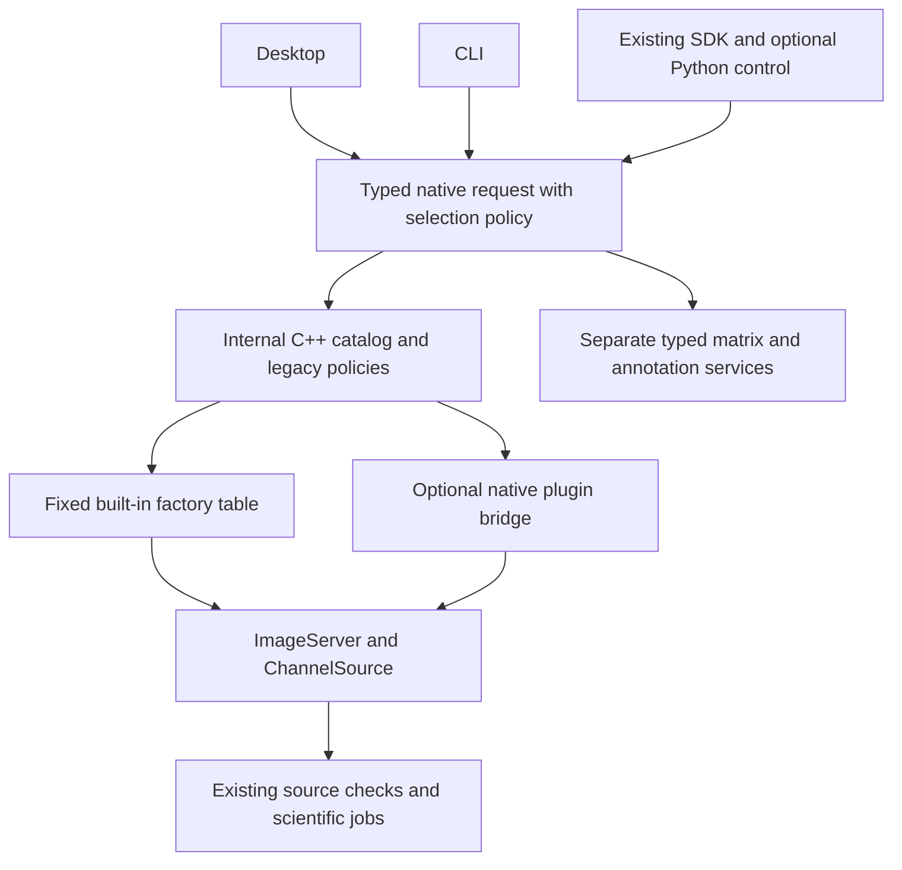

# Native format reader plugin plan

Centralize existing reader selection in C++, preserving each caller's current
behavior. Then prove independently installed native image plugins through a
versioned C ABI. Reuse the decoders, scientific services and project authorities;
additional formats and other importer families remain separately selected work.

Status: reviewed with Claude CLI `fable` at `max` effort. Phases 1–2 are
implemented and locally validated: 15 focused native/CLI/GUI tests and four
application startup scenarios pass. See the [source-scoped receipt](benchmarks/reader-registry/README.md).
Published candidate8 and the completed 22-item checklist remain frozen.
Phase 3 is also implemented and locally verified: the real independently built
P6 module runs through a relocated installed host. See the
[pilot guide](reader-plugins.md) and [source-scoped receipt](benchmarks/reader-plugin-pilot/README.md).
Phase 4 native saved-source contracts are implemented. The
[phase 4 receipt](benchmarks/reader-plugin-project/README.md) records the exact
source, native tests and relocated SDK/module use, replay and removal scope.
This is local development scope, with no new wheel, publication or release claim.
The phase 3 receipt remains evidence for its frozen standalone source and does
not qualify the phase 4 implementation.
Preserve the independent UI work recorded in [current-task.md](current-task.md).

## Existing authorities and migration points

| Authority or caller | Responsibility |
| --- | --- |
| [ImageServer](../cpp/include/qupathxx/image_server.hpp) | Keep native ownership, display buffers, metadata, optional raw access and close behavior. Wrap existing factories. |
| [ChannelSource](../cpp/include/qupathxx/channel_source.hpp), [raw types](../cpp/include/qupathxx/raw_image.hpp) | Preserve original sample types, validity, axes, calibration, currentness and budgets. Display RGBA cannot substitute for quantitative samples. |
| [ReaderSource and FileVersion](../cpp/include/qupathxx/source_identity.hpp) | Retain existing identities and compound/directory coverage. Add plugin implementation provenance through a new contract. |
| [Project](../cpp/project.cpp), [source review](../cpp/project_source.cpp) | Separate saved-reader validation from availability; preserve lazy opening, relink, recovery and legacy persistence. |
| [Private plugin link](../cpp/reader_plugin_link.hpp), [project wrapper](../cpp/project_plugin.cpp) | Bind exact implementation/options and host-observed source facts without changing public source layouts or built-in encodings. |
| [Native bootstrap](../cpp/include/qupathxx/reader_plugins.hpp) | Configure one absolute manifest before catalog/source use; expose an owned catalog report to SDK and application consumers. |
| [Application](../cpp/application.cpp), [desktop](../cpp/gui.cpp), [raw controller](../cpp/gui_raw.hpp) | Preserve reader choice, options and asynchronous versus synchronous attachment routes. |
| [Region CLI](../cpp/region_main.cpp), [raw CLI](../cpp/raw_cli.cpp), [RGB preview](../cpp/rgb_preview.cpp) | Centralize their distinct selection rules without changing existing positional commands or direct factory behavior. |
| [Spatial import](../cpp/spatial_import.cpp), [QuPath project import](../cpp/qupath_project.cpp) | Preserve admitted-image restrictions, saved series/options and explicit per-entry selection. |
| [ExpressionMatrixSource](../cpp/include/qupathxx/expression_matrix.hpp), [H5AD](../cpp/include/qupathxx/h5ad.hpp), [interchange](../cpp/include/qupathxx/interchange.hpp) | Keep separate typed families and their existing import/publication authorities. |

The registry calls `open_tiff`, `open_ome_zarr`, `open_slide` and existing PPM
adapters. Factories never call the registry. No decoder, measurement, segmentation
or import parser is rewritten for the first delivery.

## Architecture

Use one fixed built-in table in a translation unit that references all four
factories and feature probes. Avoid static self-registration: the application
core is a static library, and unused registration objects can disappear at link
time. Keep `cpp/reader_registry.hpp` internal initially; putting it under
`cpp/include/qupathxx` would immediately make it installed SDK surface. Existing
public factories and `Project` signatures remain the first delivery's SDK API.

The catalog lists all four built-ins, including known but unavailable backends.
Availability describes build/module readiness, independently of whether an image
file exists. Use owned descriptors and diagnostics. A small native reader listing
is sufficient; no plugin-management UI is required.
In phase 3, freeze the catalog before the first open: built-ins plus configured
modules in stable provider order. A rejected/colliding module gets a diagnostic
and cannot shadow or disable a built-in. There is no catalog reload.

## Preserve current selection policies

Current automatic selection is a pure function of path text and build features.
It performs no file I/O, including during saved-row validation for missing sources.
Keep it that way in the first delivery. Transcribe these rules into a pre-edit
table test, then move their implementation into the shared native service.
The policy names below are proposed IDs; the rules describe current behavior.

| Policy and callers | Current automatic rule |
| --- | --- |
| `project/1`: Project, desktop add-image and startup | `.zarr` selects OME-Zarr; `.ppm` selects file-observed PPM; OME-TIFF names select TIFF when enabled, otherwise OpenSlide; everything else, including plain `.tif/.tiff`, selects OpenSlide. |
| `region-cli/1` | PPM and OME-TIFF behave as above, but `.zarr` has no special branch and selects OpenSlide. |
| `rgb-nominal/1` | `.zarr` selects OME-Zarr; `.ppm` uses the existing in-memory dense RGB adapter; `.tif/.tiff` selects TIFF regardless of availability; other suffixes select OpenSlide. |
| `spatial-import/1` | `.ppm` selects PPM; `.tif/.tiff` selects TIFF; other suffixes refuse the admitted-image profile. |

Preserve these additional behaviors:

- RGB-nominal PPM returns `qpx.dense-rgb/1`, memory scope and no file observation.
  Replacing it with the file-observed PPM adapter changes identity.
- OME suffix recognition differs: Project accepts `.ome.btf/.ome.tf2/.ome.tf8`,
  while RGB-nominal follows only `.tif/.tiff` suffixes. Preserve case handling.
- QuPath-project import keeps its explicit entry choice: TIFF/OME with the
  declared series, PPM, or OpenSlide. Raw CLI, dark/flat and unmixing already
  request TIFF explicitly.
- Desktop TIFF selection on a `.zarr` path currently opens OME-Zarr; application
  `--tiff-series` currently replaces `--reader` with TIFF. Record these exceptions
  before editing. Their removal is outside this behavior-preserving milestone.
- Desktop attachment retains its native asynchronous TIFF/Zarr route and the
  other project-add route, chosen from the returned selection result.

Equal path, policy, normalized options and build features must produce the same
selection from every consumer. Callers retain no extension/build-flag decisions.
After selection, return the chosen factory's existing error; do not retry another
decoder. Preserve public exception types/messages on legacy paths.

Content probes, ambiguity handling and merging these divergent policies are
unscheduled behavior changes. A future opt-in policy must distinguish
not-applicable, supported, recognized-but-unsupported and operational failure,
with bounded I/O and explicit display/quantitative requirements. It cannot change
saved-row validation, existing callers or old replay implicitly.

## Identity and capability rules

Built-in provider IDs are exactly `ppm`, `openslide`, `tiff` and `ome-zarr`;
they are not aliases of new names. Reserve `auto`, `embedded`, `external` and
`qpx.dense-rgb/1` for their existing roles. Keep `ImageServer::reader_id()`,
`ReaderSource.reader`, `images.reader`, view/link payloads and their derived
scientific digests unchanged. Built-in format and implementation descriptors
are catalog metadata, not new input to legacy digests.

Known and available are different checks. Saved built-in rows accept a known
reader even when that backend is disabled; opening its source fails through the
existing unavailable-backend path. A malformed or unknown legacy reader still
refuses. Do not turn saved-project validation into probing or module loading.

Plugin IDs use a namespaced lowercase ASCII grammar with at least one dot and a
128-byte limit. Each segment begins with a letter and continues with letters,
digits or hyphens; empty segments and colons refuse. They cannot collide with
reserved IDs or legacy reader prefixes. Plugin `ImageServer::reader_id()` and
`images.reader` hold that provider ID. Their `ReaderSource.reader` additionally
binds the private implementation snapshot as `PROVIDER:plugin/1:SHA256`; the
public source layout and existing serializers remain unchanged.

Catalog capabilities are per-provider upper bounds for listing and later intent
checks. Actual sample types, axes and calibration come from the opened source.
Do not replace legacy reader-ID gates with capability tests in the first delivery.
Existing `TiffView` encodings remain format-specific, not a universal plugin schema.

## Implementation milestones

| Phase | Deliverable | Completion condition |
| --- | --- | --- |
| 1. Internal catalog and policies | Add the fixed built-in table, private header, typed selection result and native policy tests. List actual availability and reasons. | Every policy reproduces the pre-edit path table under injected feature combinations without filesystem access. All executables expose the same built-in catalog. |
| 2. Consumer migration | Route project validation/open/relink/recovery, desktop/application, region/RGB preview and applicable imports through that authority. Keep direct factories and public SDK signatures. | Selection, adapter route, metadata, bytes, source identity and old saved payloads match their existing authorities. No caller retains selection rules. This completes the first delivery. |
| 3. Standalone binary plugin pilot | Add the C ABI, bridge, verified native loader, plugin-development kit and an independently built P6 display module. | The frozen phase 3 receipt proves relocated host/CLI decoding without an application checkout or core-library link, including refusal of project attachment at that stage. ABI, descriptor, dependency and ownership failures preserve built-ins. |
| 4. Saved plugin sources and local development handoff | Add schema-30 saved links, offline metadata/reports, exact native review/adoption and an external SDK consumer. | Native tests and one relocated SDK/module use/replay/removal must bind exact implementation/options and preserve research data. The source-scoped receipt owns validation claims. Distributable release membership remains a separate selected checkpoint. |
| 5. Matrix and annotation catalogs | Add separate private typed catalogs over existing QMX/Matrix Market/H5AD and GeoJSON/object-CSV services; migrate existing native workflows and expose CLI discovery. | Preserve exact counts/domains/frames/IDs/geometry, source/store/export bytes, loss reports and native failure/publication contracts. Existing factories stay authoritative; no new family ABI or format. |

Phases 1 and 2 formed the first delivery, settled before its combined cached
build. Phase 3 has its own frozen standalone proof. Phase 4 extends the native
source contract; claim compatibility only for the ABI/platform/calls and local
deployment checks covered by its source-scoped receipt.

The owner selected phase5 after completion of the image-reader milestone. Its
[family contract](format-family-catalogs.md) and [current task](current-task.md)
record implementation and source-scoped validation. A family-specific ABI is
needed only for a selected independently distributed importer. Preserve exact
counts/domains, IDs, coordinates, loss reports and atomic native publication;
do not stretch `ImageServer` into a universal data or project-mutation interface.

## Binary plugin contract and pilot

Use a versioned C function table across modules and C++ adapters inside the host.
Specify fixed-width types, structure sizes, explicit lengths, calling convention
and version/capability negotiation. ABI version is independent of project version
and source digest. The first supported build profile matches the native SDK:
Windows x64, recorded MSVC series, Release `/MD`. Other binary profiles are unclaimed.

ABI v1 uses host-allocated output buffers. The bridge allocates owned display
RGBA or raw native-endian HWC samples plus a raw validity byte per pixel, and
passes pointers, capacities and expected shape/type. Text is copied into bounded
host buffers with a returned required length. No module-owned buffer remains
referenced after a call returns. No STL, C++ exceptions, `shared_ptr`, atomics or
allocator ownership crosses the ABI.

Validate reported metadata, shapes, strides, byte counts, sample type and fill
lengths at the bridge before exposing native results. Preserve integer precision,
nonfinite raw values and validity; use existing metadata/overflow/work rules.
Opaque reader handles are created/destroyed by the module. Calls serialize per
handle; close takes the same lock and destroys once. Cancellation uses a native
host callback; display reads have no cancellation argument, matching the current
interface. Use fixed statuses for success, cancellation, unsupported operation,
invalid request, I/O failure and internal failure; the bridge maps them to native
errors. Each module entry point catches its own exceptions. None of this invokes Python.

Loaded modules remain loaded until process exit. Host shutdown joins jobs and
destroys handles first. No unload, reload or update is supported.

Extract the existing P6/max-255 parser from [core.cpp](../cpp/core.cpp) into one
dependency-free decoder component used by both the core and pilot. This is
required because the current parser returns the core `Image` type and its server
is an internal dense class. Preserve built-in PPM bytes and errors. The plugin
kit installs its C header explicitly, plus decoder source/component and example;
the current SDK header glob installs only `*.hpp`. The example links no
`qupathxx::core`; compiler/CRT checks must also apply to this independent kit.
Check extraction against existing expected P6 bytes and error fixtures, not only
two paths that share the newly extracted decoder.

The installed pilot proves 8-bit P6 display decoding and refuses quantitative
access. A test-only module proves typed raw transfer; do not install it or imply
that the P6 decoder is quantitative. The host owns file observation and project,
job and source-review services.

Name the user entry points: `qupathxx_region --readers` lists providers, reasons
and capabilities; an optional `--reader ID` prefix selects a provider for existing
display region modes. Existing positional invocations remain unchanged. Raw CLI
keeps its explicit TIFF contract. Phase 3's frozen proof covered standalone reads
and project refusal. Phase 4 adds native project add/attach, saved links, relink
and source review under the contract below. The bridge still exposes no legacy
TIFF/Zarr view/options objects and refuses view mutation. Cached raw metadata or
typed raw transfer does not supply a `raw_view()` or expand recipe admission.

Compound sources use the optional `source_files` capability and separate
`qpx_reader_files_entry_v1` count/path table. The base v1 table stays 72 bytes on
the supported x64 profile. Single-file v1 modules need no extra symbol. Discovery
runs before decoder open under the primary file guard and repeats around reads;
only the host constructs file observations. This preserves base-table binary
compatibility without treating arbitrary module-owned file facts as identity.

## Saved plugin sources and scientific fidelity

Project schema 30 stores canonical, checksummed `qpx.reader-plugin-link/1` records
in `plugin_links`. The private link owns display metadata, optional raw metadata
and observed source facts, plus an implementation snapshot containing provider,
version, semantic contract, ABI, compiler/CRT profile, capability bits, module
SHA-256, sorted dependency basenames/SHA-256 values and normalized explicit options.
Implementation identity contains no installed module paths. It therefore changes
for different module/dependency bytes under the same version while surviving
relocation. Built-in `images.reader`, `tiff_views`, source-verification payloads
and source/provenance encodings retain their existing representations.

Link storage is bounded to 2 MiB separately from existing project budgets; raw
metadata is bounded to 1 MiB. Options must be a JSON object within 4096 UTF-8
bytes, with canonical key order and an empty representation for `{}`. Saved
options remain explicit on reopen even if manifest defaults later change. A new
source opened with different explicit options receives a different binding.
Exact decode/re-encode checks reject malformed or noncanonical saved records.

Single-file and compound observations use host file guards with at most 63
companions and 128 KiB source payload. Duplicate paths/identities and primary
aliases refuse. Directory coverage remains the existing OME-Zarr contract;
new directory formats require a selected host inventory contract.

Project parsing creates a lazy native wrapper without loading a module or
freezing the catalog, including with the loader disabled. Missing providers leave
images, cached display/raw metadata and self-contained retained reports readable
and re-savable. Pixel reads refuse without decoder fallback. A successful lazy
open checks exact implementation, cached metadata and observed file facts.
Malformed/unknown legacy rows still fail, and older hosts reject schema 30.
Raw metadata/access forwards through the declared plugin contract without
borrowing TIFF/Zarr views or silently declaring a quantitative recipe supported.

The existing native source-review authority reports `changed_implementation`
before matching-byte comparisons when the implementation digest differs.
`apply_source_review` requires explicit `accept_changed=true`; stale review,
source generation, baseline and file guards retain their existing checks.
Adoption installs a new source binding and baseline while historical records stay
immutable. RegionAnalysis input digests bind plugin implementation identity as
well as RGBA bytes. Tissue/Cell pixel hashes retain their existing formats, but
native verification rejects adopting an archived run under another plugin
binding even for identical masks/values; recompute and keep a new result.

Configured providers now append to the existing desktop open choices, preserving
the legacy positions and automatic policies. Public native consumers configure
an absolute manifest through `qupathxx/reader_plugins.hpp` before catalog/source
use; `Project::open` may precede that configuration. Application and batch use an
initial `--reader-plugins ABS_MANIFEST` prefix. The external
[SDK example](../examples/reader_plugin_project/main.cpp) calls the same native
add/analyze/keep/review/save/reopen/replay services. Python remains optional.

Existing raw-analysis/classifier, dark/flat and unmixing reader/view requirements
remain unchanged. Generalizing them requires a selected quantitative workflow and
its own persistence/replay tests. Provider capabilities alone do not expand
scientific admission, and the P6 module remains display-only.

## Loader admission and packaging

Descriptor/hash/dependency/ABI checks belong to phase 3, before its first load;
phase 4 adds saved provenance and local SDK/module deployment checks. Resolve
configured paths under
the installed package root, or an explicit external absolute directory, into
controlled absolute paths. This supports relocation without searching CWD/PATH.
Keep the module observed through verification/load; compare the returned ABI and
provider data with the admitted descriptor. Restrict plugin dependency resolution
to its admitted package and system dependencies, without changing process-wide
OpenSlide/GEOS search behavior. Verify actual resolved dependency identity and
refuse an unexpected non-system dependency.

Reuse [reader licensing](reader-license-policy.md), the additional
[open-format rule](fluorescence-omics-plan.md#format-admission),
[restricted-material separation](licensing/restricted-materials.md) and
[native material admission](native-release-materials.md). A module's self-reported
license does not admit its code, codecs, data or formats. Bind exact binary/source/
dependency hashes and notices to the existing inventories and member guard;
create no second licensing database.

`QUPATHXX_BUILD_READER_PLUGINS=OFF` is the default, with loader code
compiled only when enabled. Built-in readers/registry remain usable with it OFF;
plain native builds retain `QUPATHXX_BUILD_PYTHON=OFF`. No Python reader fallback,
marketplace, automatic downloads/updates, proprietary adapter or Java/Groovy
compatibility is selected. Admitted native modules execute in process; this is
not a sandbox.

## Focused validation and build cost

| Boundary | Decisive check |
| --- | --- |
| Selection | Freeze expected results before editing for every legacy policy and injected feature combination: `a.ppm`, `A.PPM`, `s.zarr`, `x.ome.tif`, `x.OME.TIFF`, `x.ome.btf`, `x.tif`, `x.tiff`, `x.svs`, `noext`, `dir.ome/x.tif`, `x.ome.tif.bak`. Paths need not exist. Check recorded overrides, reserved/duplicate IDs and one identical catalog in every executable. |
| Read oracle | In-process direct-factory versus registry opens on existing admitted fixtures: equal legacy IDs, stable file observations, metadata/calibration, region bytes, and raw samples/validity/channel digest where supported; absent capabilities must also agree. Preserve the RGB-nominal memory adapter separately. Compare existing errors for missing/truncated/wrong-format inputs; prove no fallback after selection. |
| Persistence and consumers | Reopen/re-save authored or existing projects with identical built-in reader, view/link and source-verification payloads. Relink/review keeps the saved reader even when the new path would auto-select another. Replay a retained native recipe with unchanged source identity. Assert selected route and results through affected CLI/GUI/SDK callers. |
| Disabled builds | Inject feature combinations in unit tests and add the registry target/case to the existing [native-only job](../.github/workflows/native-only.yml), which already builds a mixed on/off reader profile. Do not create a second engine configuration solely for this migration. |
| ABI and lifecycle | External kit/module build, metadata/shape/short-fill errors, cancellation, close during read, serialization, status translation and exactly-once handle destruction. The host owns buffers and modules never unload. |
| Saved plugin identity | Schema-30 lazy/offline load and exact re-save with the loader OFF; raw metadata/access forwarding without borrowed views; module/dependency changes under the same version; saved explicit options versus changed defaults; compound file guards and malformed-link refusal. Equal pixels must not authorize old implementation identity. |
| Retained workflows | RegionAnalysis digest/replay binds the plugin snapshot. Tissue/Cell verification refuses a changed binding before mutating retained current state, preserves historical payloads, and allows a newly retained result under the adopted implementation. Built-in hashes and verification rules remain unchanged. |
| Plugin failures and deployment | Missing module/dependency, changed hash under the same version, descriptor/ABI disagreement and ID collision refuse without disabling built-ins. Test relocated discovery, saved missing-provider handling and manifest-owned removal preserving user files. Admit actual binary/notice/source members. |

Use stable file comparisons such as `same_reader_files`, plus the required reader
strings and canonical options. Exclude fresh process generations and observation
timestamps when comparing separate opens; do not normalize persisted payloads or
relax exact recipe/model identity. A whole SQLite file need not remain byte-equal
when re-saved; the declared scientific and reader payloads do.

Reuse affected native suites: `image_server`, `raw_image`, `source_identity`,
`application_entry`, `ome_zarr_server`, `ome_zarr_project` and the relevant
project/source/replay tests. Add meaningful catalog/ABI cases. Author a small
fixture with the existing builders if no admitted saved project covers the
required payload combination. Non-image tests run only when that family is selected.

Name changed inputs and the decisive risk in the current card before an expensive
operation. Preserve the live UI preview and use one integration checkout/cache.
Settle interfaces before one combined cached build, cheap native/CLI targets
before optional bindings. No binding build is needed for the private registry.
Batch any later selected public/binding changes after native contracts settle.

Local development kit/SDK installs support the selected relocation checks; they
do not select a wheel or publication. Package a distributable only at an owner
release checkpoint after the interface/module set is frozen. New source gets a
new candidate identity; never transfer candidate8's
qualification. Do not replay qualification308, old corpus/platform campaigns or
old installs to refresh status. Additional hosts need a claimed platform or a
concrete risk.

## Completion and next action

The first delivery finishes with behavior-preserving shared selection, honest
availability and unchanged legacy scientific/persistence contracts. The plugin
milestone finishes with a real external decoder, versioned saved-source behavior
and an admitted relocated deployment. Neither adds format coverage by itself.

Implementation uses the private [catalog](../cpp/reader_registry.hpp) and its
[fixed factories and policies](../cpp/reader_registry.cpp). Project, desktop,
region/RGB and the admitted spatial/QuPath import routes call that authority.
Native [baseline/read/persistence tests](../cpp/tests/reader_registry_tests.cpp)
and [CLI checks](../tools/ci/check_reader_routes.cmake) cover the first delivery.
`qupathxx_region --readers` reports the shared catalog as JSON;
`qupathxx_region --reader ID` prefixes an existing display-region command.
The raw CLI retains its explicit TIFF contract. Capability fields are provider
upper bounds, not source-specific scientific admission.

Local evidence is in `build/reader-registry`: frozen scoped inputs, configure/build
logs, the corrected CLI-fixture failure, passing native tests and unchanged binding
object hashes. This is development validation, not candidate8 qualification or a
new release. Desktop compilation, native Zarr controls/save/reopen and PPM,
OME-TIFF, OME-Zarr and TIFF-series-override startup checks pass. Phases 1–2 close.
The frozen standalone phase 3 receipt covers the C ABI, host-buffer bridge,
verified optional loader, installed development kit and independent P6 module,
with project attachment refused in that source. Phase 4 now implements native
schema-30 links, exact implementation/options binding, offline cached metadata
and reports, source review/adoption, the optional companion-file ABI and native
SDK/application/batch bootstrap. Its selected retained workflow is RegionAnalysis;
other existing RGB retained verification authorities reject cross-implementation
reuse without changing their pixel hashes.

The [phase 4 receipt](benchmarks/reader-plugin-project/README.md) records native
tests and relocated SDK/module create/reopen/replay and removal checks, with their actual
source/dependency/member identities at handoff. No phase 3 or candidate8
qualification transfers, and no wheel, distributable publication or additional
quantitative workflow is selected.
