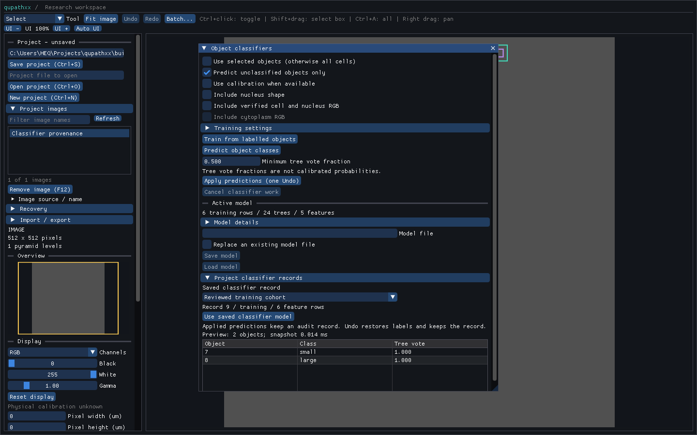
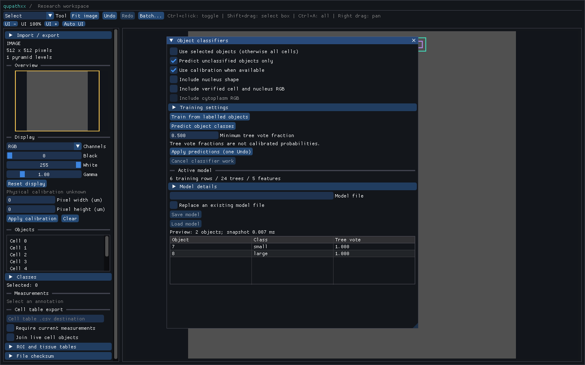

# Object classification

The C++ object workflow captures feature inputs, trains from existing labels,
previews predictions and applies class changes as one compound document edit.
C++, Python and Dear ImGui use the same implementation. Retained classifier
records in project/recovery storage, richer feature-source manifests, pixel
classification, training validation and QuPath comparisons remain open.

## Features and snapshots

`ObjectFeatureRequest(document, ids, options)` runs on the owner thread. It
requires 1–100,000 unique IDs, orders them by native ID and captures immutable
geometry, labels, revisions, kinds, calibration and requested cell measurements.
Non-area geometry and missing requested nuclei are rejected. The default
snapshot budget is 64 MiB, configurable from 1 to 256 MiB. Its charge includes
retained geometry; it is not a process RSS measurement. Shape-only snapshots
allocate no RGB array and retain no unused nucleus geometry.

Every row has area, perimeter, bounds width/height and
`4*pi*area/perimeter^2` circularity. Optional nucleus shape adds the same five
features. Calibration applies independently to x/y, including perimeter.
Units are `um2`/`um` when both calibration values are available and requested,
otherwise `px2`/`px`; circularity uses `1`. Nonfinite values, float32 overflow
and nonzero values that underflow to zero are rejected.

The RGB preset adds cell and nucleus red/green/blue means from current verified
published cell features in `device-rgb8` units. Optional cytoplasm adds three
more means and rejects missing cytoplasm. These are historical sampled device
RGB values, not fresh reads, normalized stains or ICC-managed colors. Changed
linked geometry, missing archives or unverified reopened runs prevent capture
until the existing cell workflow supplies current verified measurements.

`extract_object_features()` uses only captured native values. Its immutable
table exposes IDs, revisions, kinds, original classes, schema, options, digest
and an anchor provenance snapshot for the first row. The anchor identifies the
common image, capture time, effective calibration and build; every row has its
own identity fields. `numpy()` is an owned read-only float32 view;
`numpy(copy=True)` is independently writable. Feature descriptors/options are
copies. The table digest covers ordered row identities/labels, schema and
float32 bits; the model has a separate labelled numeric training digest.

## Training and publication

`train_object_forest(table, parameters)` excludes unclassified rows, sorts class
names deterministically and requires at least two classes with two rows each.
It uses the [native engine](classifier-engine.md). Validation splits, class
balancing and probability calibration are not automatic.

Prediction requires exact names, order and units. Reconstruct the supported
preset with `ObjectFeatureOptions.from_model(model)`. Pixel-column models select
pixel geometry even when another image has calibration. Matching units does
not establish comparable staining, resolution or biological populations.
The object panel rejects unknown schemas. Prediction checkpoints cancellation
every 512 rows and limits retained output to eight million class votes.

Publication requires the original request's authority, open reader generation
and unchanged document revision. Edits, Undo/Redo, calibration changes and
source replacement invalidate it. A result from another equivalent-looking
request cannot be substituted. Below-threshold rows remain unchanged. Remaining
changes use one compound edit, preserving names, geometry, nuclei, hierarchy
and cell links while updating classes/counts/history together. The document's
configured history limits apply.

`ObjectClassifierJob` has one in-flight operation and no backlog. Workers do
not read live documents or call image-server/Python methods. Controllers retain
reader ownership until workers join on the controller thread. `poll()`/`wait()`
reconcile against the live owner; `apply()` is owner-only. Cancellation during
OpenCV training suppresses publication and waits for its bounded,
noninterruptible training call to finish.

```python
import qupathxx as q

job = q.ObjectClassifierJob()
job.train(q.ObjectFeatureRequest(doc, training_ids))
assert job.wait(doc).state == "ready"
model = job.model
assert model is not None
q.save_forest_model(model, "tumor-v1.qpxforest")

loaded = q.load_forest_model("tumor-v1.qpxforest")
targets = q.ObjectFeatureRequest(doc, prediction_ids,
                                 q.ObjectFeatureOptions.from_model(loaded))
job.predict(targets, loaded)
assert job.wait(doc).state == "ready"
changed_ids = job.apply(doc, min_vote_fraction=0.6)
doc.undo()
```

## Model files and ImGui

Loading verifies a regular file's length/version around reading/decoding, with
a 64 MiB ceiling. New saves use flushed temporary storage and atomic
non-replacing publication. `replace_existing=True` first decodes the existing
file as a valid stable model. Its handle closes after the final version check
for Windows replacement. Callers coordinate concurrent writers. Invalid images,
projects, unknown model versions and failed writes are preserved; temporary
files are cleaned up.

Press **F4**, or choose **Object classifiers** in the selected-object inspector.
The panel defaults to all cells, labelled training rows and unclassified
prediction targets. Selected scope accepts area objects explicitly. Controls
cover feature presets, training, a virtualized preview, minimum tree vote,
one-Undo application and background model load/save. Votes are visibly
distinguished from calibrated probabilities. Loading restores the feature
preset while preserving the configured snapshot budget. Accepted models can be
reused across images; pending results become stale on document changes.
Selected-scope changes also cancel pending work.

Class publication uses a compact reversible field transaction. It retains object
IDs and class strings in history, preserving geometry, nuclei, hierarchy and
cell-feature links. Apply, undo and redo each advance the document/render
revision once; geometry and calibration revisions remain unchanged. Immutable
project-save blocks are copied before publication, so an already captured save
keeps its original labels and object revisions. Copied documents own independent
undo payloads.

The same owner-thread operation is available from Python for bulk labelling:

```python
document.apply_classifications([(cell_id, "Tumor"), (other_id, "")],
                               label="Review cells")
```

An empty class clears the label. Unknown or duplicate IDs, invalid text and an
insufficient enabled history budget reject the entire batch. Unchanged batches
preserve revision and redo. The history budget can be raised explicitly or
recording disabled using `set_history_limits`; publication never silently
disables undo to fit a batch.

GUI defaults use 64 trees/depth eight; native defaults remain 64/depth twelve.
The training estimate includes working/packed trees, portable copies and vector
growth at 512 bytes per bounded node, plus matrix/row scratch. Large/deep
configurations may need an explicit larger work budget.

Model files preserve schema, parameters, backend and numeric training identity.
Schema 8 projects and recovery snapshots also retain immutable classifier
records: the model, complete captured cohort, original labels/revisions/kinds,
selected geometry, captured object-ID namespace, calibration, original float32 matrix, feature schema, source
and build provenance. RGB cohorts retain per-row measurements and links to
deduplicated cell-run manifests, including input identity, source ROI, sampling
level, algorithm, producer, parameters, stains and white reference. These
manifests survive removal of the original cell raster archive.

`ObjectClassifierJob` prepares its archive on the native worker. After training,
call `job.retain_training(document, name="Reviewed training cohort")`, or choose
**Keep training record in project**. Unlabelled rows remain visible in the
captured table but are excluded from the model's training identity. Retention
requires the same current request; it advances the document revision and marks
the project dirty.

A prediction record preserves its prediction cohort. Preserve the original
training cohort with a training record; importing a bare forest file does not
invent missing training rows. Model SHA-256 identifies matching models across
records and images.

`job.apply(document, min_vote_fraction=0.5)` retains an application audit and
publishes labels in one document revision, preserving one-Undo behavior. A
failed history or archive quota check publishes neither. The audit stores the
threshold and exact changed IDs. Undo restores labels and retains the audit:
`applied` describes the historical event, rather than the current class state.
An application that changes no labels still retains its decision and advances
the revision. The explicit `retain_record=False` option skips retention.
The lower-level `apply_object_classification` function remains a class-edit
operation; callers can use the job API for retained provenance.

Records are available through `document.classifier_records` and
`document.classifier_record(id)`. Inspect a cohort with `record.archive.table`,
including `body_roi(row)`, `nucleus_roi(row)`, `cell_origin(row)` and
`cell_feature(row)`. Remove a retained record explicitly with
`document.remove_classifier_record(id)`. In the GUI, **Project classifier
records** selects an archive and **Use saved classifier model** activates its
model. Prediction always captures a fresh request. Reopening an artifact never
restores permission to apply an old prediction to a live document.

The bounded, checksummed record format embeds the existing portable forest.
It validates cohort/model training identity, table identity, metadata and source
links on load, and regenerates prediction votes from the preserved float32
matrix. Reopening and prediction require no OpenCV training backend. Project
migration from versions 1–7 to 8 shares the save transaction; failed saves roll
back both migration and data. Save capture shares immutable artifacts and
charges their precomputed payload, without traversing cohort rows on the owner
thread. Limits are 10,000 records/256 MiB charged retained payload per document,
128 MiB encoded artifacts, 160 MiB encoded records, and the existing per-request
snapshot budget. Artifact limits leave room for the application envelope. These
accounting limits are distinct from process RSS.



Native ImGui rendering of a reopened synthetic project: its retained training
cohort supplies the active model, with two fresh predictions ready for review.

## Evidence and performance limits

Native/installed tests cover formula oracles, archived RGB values, metadata/
NumPy ownership, atomic class changes, history, staleness/cancellation, model
files and real ImGui train/preview/apply/undo/save/load. They include a 125%
smaller window and invalid-file preservation.

The [local artifact record](benchmarks/object-classifier-local-windows-linux.json)
ties the 1,340-test passing installed suite, 23 focused tests, native test
configurations, typing, screenshots and samples to the same native/source/wheel
identities. Hosted validation is tracked in the project plan.



Native rendering of the synthetic rectangle fixture with two object predictions.

The [10,000-object](benchmarks/object-classifier-10000-windows.json) and
[100,000-object](benchmarks/object-classifier-100000-windows.json) samples use
overlapping rectangles with repeated discrete sizes and no image reads.
Each phase is measured once, including Python conversion. At 100,000 objects,
capture is 11.6 ms with 24.7 MB charged payload; extraction/prediction is 27.1 ms.
The original publication path took **238 ms on the owner thread**, with history
explicitly disabled.

The [paired publication comparison](benchmarks/object-classification-publication-comparison-windows.json)
compares that wheel with compact class commands, using A B B A order and two
fresh-process observations per implementation/configuration. Model/table
identities and changed-object counts match in every pair. At 10,000 objects,
median publication falls from 20.4 to 3.9 ms; at 100,000 objects, from 272.9 to
44.6 ms with history disabled. With the same explicit 256 MiB history budget,
100,000-object publication falls from 291.2 to 46.1 ms, undo/redo from about
190/187 to 25/25 ms, and charged history payload from 67.8 to 5.5 MB. A separate
candidate sample also verifies all labels through undo/redo using the default
64 MiB budget. These payload figures describe command accounting, not process RSS.

The shared workstation was not reserved exclusively; two observations per
version are limited local evidence. Large publication still exceeds a 16 ms
frame budget. Large polygons, real cells, hardware rendering and biological
accuracy need separate work.

The [compact-command validation record](benchmarks/classification-publication-local-windows-linux.json)
verifies 1,342 distinct passing installed cases: 1,337 in the complete run plus
the exact five Aperio cases rerun after setting the missing fixture variable.
Six expected platform/headless/opt-in skips remain. It also records focused GUI/
snapshot tests, Windows/Linux native configurations, stubs/typing, installed
workflow and matching wheel/native/source/benchmark identities.

The [archive validation record](benchmarks/classifier-archive-local-windows-linux.json)
verifies the subsequent archive implementation against 1,357 passing installed
cases/six expected skips, 40 focused cases, Windows/Linux native tests, ASan/UBSan
and a project build without OpenCV. It retains the investigated clean-project
autosave fixture and batch schema integration failure, followed by final passing
reports. It also ties installed workflow, typing, rendered UI and samples to the
same wheel/native/source identities.

The [10,000](benchmarks/classifier-archive-10000-windows.json) and
[100,000-object](benchmarks/classifier-archive-100000-windows.json) archive samples
measure the complete retained pipeline. At 100,000 objects, worker extraction/
inference/archive preparation takes 110 ms, owner publication 65 ms, and native
save capture 0.04 ms. The writer takes 373 ms and reopen 317 ms; charged retained
archive payload is 76.5 MB and history 5.5 MB. Each phase is observed once on a
shared workstation. This workload adds persistence to the earlier class-only
comparison and is not a paired speed comparison. Bulk publication remains above
the 16 ms frame target.
