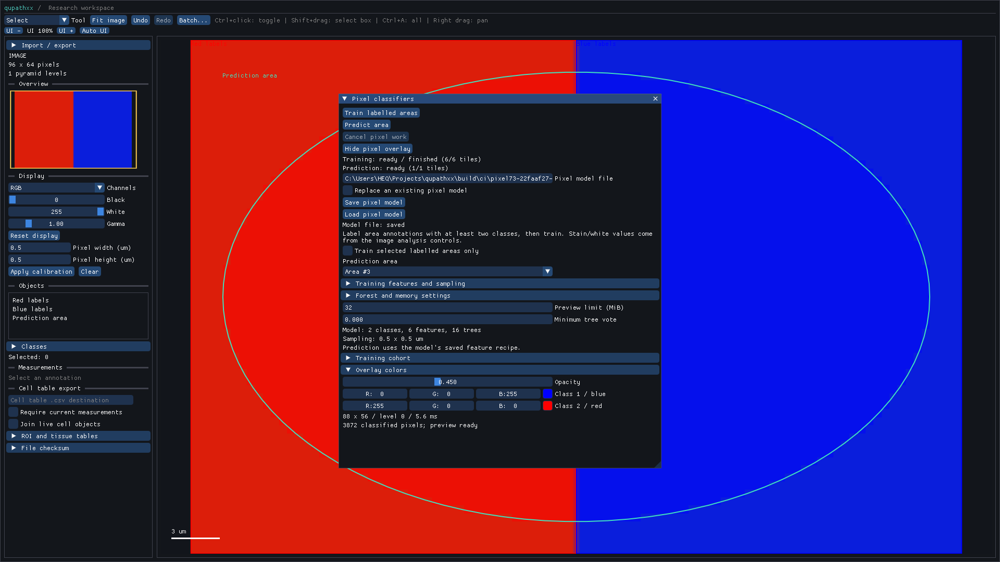
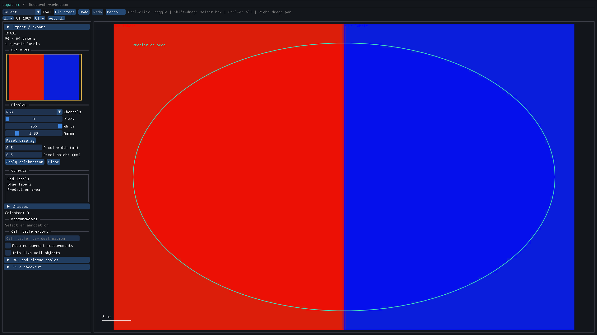

# Pixel classifiers in the desktop viewer

Press **F5**, or use **Pixel classifiers (F5)** in the image/analysis controls.
The panel runs the native [annotation/source workflow](pixel-classifiers.md):
workers sample labelled areas, train a portable model, read source tiles and
produce class/vote masks. The ImGui thread owns capture, reconciliation and GL
resources. Python callbacks do not enter the workers.



This captured synthetic RGB scene has two classes, 128 training rows, 16 trees,
a 0.5×0.5 um grid and a completed ellipse preview. The image was captured from
the installed application; the mask and model were computed through its buttons.

## Train, predict and reuse

1. Draw area annotations and assign at least two class names with the existing
   object/class controls. **Train labelled areas** uses labelled annotations
   by default. Enable **Train selected labelled areas only** to explicitly use
   selected labelled area objects, including detections/cells. Conflicting class
   overlaps are excluded, while same-class overlaps count once.
2. Choose **Prediction area**, or leave **Current selection** and select an area
   on the image. **Predict area** uses the model's saved feature/resolution recipe.
   Missing calibration or no matching natural level produces a clear error;
   the viewer does not silently resample or reinterpret feature scales.
3. Save/load resolution-bound `.qpc` recipes with **Pixel model file**. Reads and
   atomic writes run on a native worker. Existing files require the explicit
   replacement checkbox and must validate as pixel recipes. An invalid file
   preserves the active model. Unbound buffer recipes remain supported by the
   Python buffer API, but the panel requires declared source resolution.

The controls distinguish training from prediction: feature channels, comma-
separated scales, gradient/Laplacian, natural level, balancing, sample caps/seeds
and forest settings affect the next training operation. Stain/white values come
from the image's existing analysis controls. Changing them does not alter a
previous model's saved recipe. The default high-level pixel forest is 32 trees,
depth 8; explicit settings and work budgets are validated by the native kernels.

**Training cohort** shows eligible and retained counts per class and excluded
conflicts. **Minimum tree vote** controls prediction filtering; fractions are
not calibrated probabilities. The preview masks both ROI holes/outside pixels
and nonopaque source pixels. No labels or document geometry are changed by
training, prediction, palette edits or model-file operations.

**Overlay colors** starts from configured document class colors, with a cycling
categorical fallback for the default class color. Palette and opacity are local
preview settings; numeric recipe files do not persist this presentation state.
**Hide pixel overlay** retains the computed result and textures for reuse.
Close the floating panel with F5 to inspect the canvas unobstructed.



## Responsiveness and lifetime

The annotation catalog advances by at most 1,024 map entries per frame while the
panel is open. It is invalidated by live document identity/revision, so document
replacement and map edits cannot leave a stale iterator. The unused closed
panel does not scan the catalog. The default training list keeps at most 4,097
IDs so the 4,096-area limit can be reported without building an unbounded list.
The prediction combo lists the first 10,000 area annotations; others remain
available through **Current selection**.

Training, prediction and model-file tasks have no backlog. **Cancel pixel work**
requests cancellation; an in-progress forest backend call is reconciled after
it returns. Source/document changes retire current worker results and clear
GPU previews. An adopted model remains a portable historical model that can be
used with a new compatible image and a fresh prediction request.

The preview prepares at most four 256×256 RGBA tiles per frame, at most 1 MiB
of pixel payload. It reveals only a completely prepared mask. Default GPU
payload allowance is 32 MiB, adjustable to 128 MiB, with at most 4,096 textures.
If the preview is too large, the numeric result remains available and a smaller
area or larger preview allowance can be chosen. This is a payload estimate,
not a driver VRAM or process RSS bound.

Texture creation/deletion stays on the GL context thread. Palette, budget and
result changes invalidate the canvas cache using preview generation/readiness
and visibility. Resets are reconciled before drawing the next frame, preserving
textures referenced by already queued draw commands. Neither a partially
uploaded mask nor a retired image's cached overlay is presented as current.

## Python and replay

`GuiOptions` accepts `pixel_open`, `pixel_model`, `pixel_model_path`,
`pixel_object_id`, `pixel_selected_only`, `pixel_show_overlay`,
`pixel_replace_model`, `pixel_preview_budget`, `pixel_training_options`,
`pixel_prediction_options` and `pixel_parameters`. Training/prediction options
and models are copied into native controller state before worker execution.

`GuiInputKind.PIXEL_CLASSIFIERS_KEY` and named targets `PIXEL_TRAIN`,
`PIXEL_PREDICT`, `PIXEL_CANCEL`, `PIXEL_SAVE_MODEL`, `PIXEL_LOAD_MODEL` and
`PIXEL_TOGGLE_OVERLAY` drive actual ImGui widgets. Readiness conditions
`PIXEL_TRAINED`, `PIXEL_PREDICTED`, `PIXEL_PREVIEW_READY`, `PIXEL_MODEL_SAVED`
and `PIXEL_MODEL_LOADED` avoid fixed sleeps in desktop tests.

`qupathxx.GuiReport` is now publicly exported. Reports include pixel states,
errors, model/table/result, preview payload/generation, catalog bounds and capture
timing. `canvas_content_bounds` records the actual logical drawable rectangle,
separately from docked pane/window bounds. To map an image point `(x,y)` into
the framebuffer, use:

```
logical = content_origin + viewport_origin + (x,y) * zoom
physical = logical * framebuffer_scale
```

The viewport origin is a screen translation. This mapping is verified against
rendered mask pixels, including an asymmetric polygon, a hole and overlay hide.
Finite callers should wait for `PIXEL_PREVIEW_READY` before capturing a preview;
`settle_tiles=True` also waits for pending pixel work/upload settlement.

## Measurements and limits

The [real-window benchmark](../tools/benchmark_gui_pixel.py) drives Train/Predict
buttons, checks every mask label and verifies exact GPU payload. It uses 128
sampled rows, six features, 16 trees/depth 4 and an explicit 64 MiB forest
allowance. Synthetic unlabelled cells lie outside the fixed camera view.

| Catalog stress | Frames including replay waits | Frame CPU p95 | Maximum frame | Catalog step cap | Mask payload |
| --- | --- | --- | --- | --- | --- |
| [10,000 cells](benchmarks/gui-pixel-10000-windows.json) | 106 | 1.95 ms | 3.37 ms | 1,024 objects | 119,040 bytes |
| [100,000 cells](benchmarks/gui-pixel-100000-windows.json) | 196 | 1.78 ms | 16.44 ms | 1,024 objects | 119,040 bytes |

Prediction capture takes about 0.013 ms in both. These are single observations
on a shared Windows workstation using llvmpipe, not dense visible-cell drawing,
full-slide classification, biological accuracy, process RSS, or hardware/frame-
budget acceptance. The worst frame exceeds 16 ms. The bounded per-frame catalog
and upload policies do not guarantee any particular device's frame latency.

The [local artifact record](benchmarks/gui-pixel-local-windows-linux.json) verifies
1,410 installed tests with six expected skips, 17 focused pixel/object desktop
cases, 39 Windows GUI native and 38 each Windows headless/Linux training/minimal/
sanitizer. Exact stubs, strict positive/seven-error negative typing and installed
software-GL launch pass. Working-source/native/wheel, benchmark and losslessly
converted framebuffer-image identities agree. The record retains the corrected
framebuffer-coordinate and project-property fixtures and the public report-type
export fix. Hosted CI for this UI increment is pending.

Project/recovery retention of pixel cohorts/results, contour publication,
full-slide streaming masks, viewport-limited prediction, unmatched-resolution
resampling and expanded features remain open. Model files preserve the numeric
recipe, not the original labelled training cohort or project audit history.
