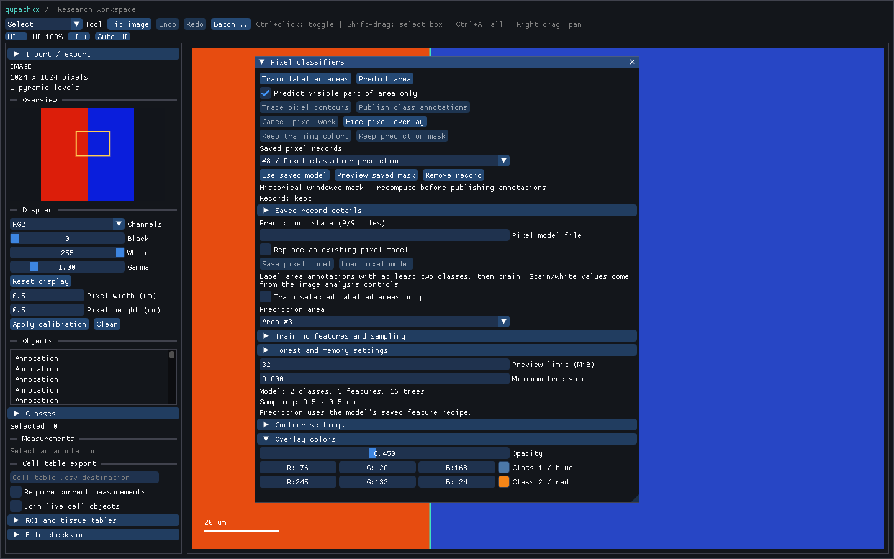

# Windowed pixel prediction

`PixelPredictionRequest` accepts an optional level-zero `window`. The original
annotation remains the prediction target, source/provenance anchor and
publication parent. Output arrays cover only the intersection of its bounding
box with the requested window, snapped to the model's natural sampling grid.
This permits bounded prediction over a large target without allocating its
entire mask or modifying its geometry.

```python
options = q.PixelPredictionOptions()
options.work_bytes = 8 * 1024 * 1024
request = q.PixelPredictionRequest(
    document, target_id, model, options,
    window=q.Rect(1000, 900, 64, 64),
)
result = q.predict_pixel_region(request)
assert result.windowed
assert result.estimated_work_bytes <= options.work_bytes
```

Omitting the window preserves full-target prediction. `windowed` on the request
and result records whether a window was explicitly supplied; a window covering
the entire target is still marked windowed. A window must have finite positive,
representable extents. Negative origins and portions outside the image are
allowed and clipped by the original target's bounds. Empty intersections and
intersections containing no sampled pixel centers fail during capture. The
target itself must still lie inside the source image.

For downsample `s`, a grid center `(i + 0.5) * s` is selected when it lies in
the half-open window `[left, right) × [top, bottom)`. `level_bounds` reports the
integer grid and `bounds` reports its pixel footprints in level-zero units.
Those footprints may extend outside the requested rectangle by up to half a
sample step. Original ROI membership and source opacity still determine
validity, so holes and background remain invalid. A window intersecting a
polygon's bounds but no polygon interior can produce an all-invalid mask.

Feature context is read beyond the window by the model's halo, clipped only
at the source-image boundary. Window edges do not change Gaussian/gradient/
Laplacian context. The same natural-grid centers therefore agree with a full
prediction. Natural-level resolution matching, calibration checks, cancellation,
memory accounting and exact request identity follow the existing
[source workflow](pixel-classifiers.md). Windowing adds no unmatched-grid
resampling or whole-slide streaming output.

## Desktop use

In **F5**, enable **Predict visible part of area only**, choose the target and
press **Predict area**. The request captures the current canvas rectangle when
the button is pressed, including the visible canvas behind floating panels.
Panning afterward leaves that captured mask anchored to image coordinates;
press Predict again to capture the new view. Changing the checkbox clears the
old live preview. Model features and resolution are unchanged.

Use **Keep prediction mask** for a durable cropped artifact, or trace and publish
the current mask through the usual atomic contour workflow. Only predicted
centers contribute contours. Clipped publication remains parented to the
original annotation. A reopened historical mask has no live publication
authority, regardless of its window.

## Persistence

Full-target masks and training cohorts retain the QPA1 encoding. A windowed
mask uses QPA2: the same bounded field/array layout, with the explicit version
marker permitting a sampled subgrid of the original target. Its exact snapped
grid and original annotation are retained. Unsnapped user-window coordinates
are not retained; `bounds`/`level_bounds` describe the emitted artifact.

The reader validates source/ROI containment of that subgrid, numeric arrays,
votes/counts, work bounds, hashes and checksums. QPA2 training cohorts are
rejected. Older QPA1 readers reject QPA2 rather than interpreting a cropped mask
as full-target coverage. Project schema 9 and its record envelope remain
unchanged. Loading restores values and audit information without live requests.

## Reproduction and observed limits



The [10,000-object viewport probe](benchmarks/gui-pixel-windows-10000-windows.json)
uses the actual prediction/retention/browser controls. The full 1,024-square
mask exceeds its configured 8 MiB work budget. The visible 372×269 grid fits:
3,820,632 estimated work bytes, 2,073,317 retained artifact bytes and 400,272 GL
mask bytes. All saved labels and winning votes match a fresh windowed native
request. Object indexing inspects at most 1,024 entries per frame.

CPU frame p95/max were 2.65/5.03 ms in this single shared Windows llvmpipe run.
Cells are outside the fixed camera. These observations do not establish RSS,
dense visible-object performance, hardware or biological acceptance, or the
broader frame-budget gate. Reproduce with
`python tools/benchmark_gui_pixel_archives.py --viewport --output report.json`.

A [full-mask probe from the same installed build](benchmarks/gui-pixel-full-10000-windows.json)
provides an allocation comparison on the same synthetic image/object count:

| Output | Full target | Visible window |
| --- | ---: | ---: |
| Grid | 1,024×1,024 | 372×269 |
| Estimated native work | 12,357,204 bytes | 3,820,632 bytes |
| Retained artifact charge | 19,146,461 bytes | 2,073,317 bytes |
| GL mask storage | 4,194,304 bytes | 400,272 bytes |

The full run's CPU frame p95/max was 2.35/23.07 ms. These separate observations
use different cameras and work budgets; they establish allocation differences,
not a controlled timing speedup. The full case still exceeds the 16 ms maximum
frame gate.

The portable corpus includes a Windows QPA2 rectangle-window artifact with an
explicit generating source fingerprint. Linux without GUI, GEOS or training
backends reads and canonically re-encodes it byte-for-byte, along with the
existing QPA1 training and rectangle fixtures. The original polygon fixture
requires GEOS. These checks prove fixture-level numeric/encoding interoperability;
they do not establish cross-platform retraining identity or biological accuracy.

The [local verification record](benchmarks/pixel-prediction-windows-local-windows-linux.json)
binds the current source manifest, installed wheel/native module, both probes,
portable fixture hashes and lossless screenshot. It verifies 1,531 full-suite
passes with six expected skips, 119 API and 57 GUI/layout focused passes, all
native configurations, exact stubs, strict typing and installed software-GL launch.
