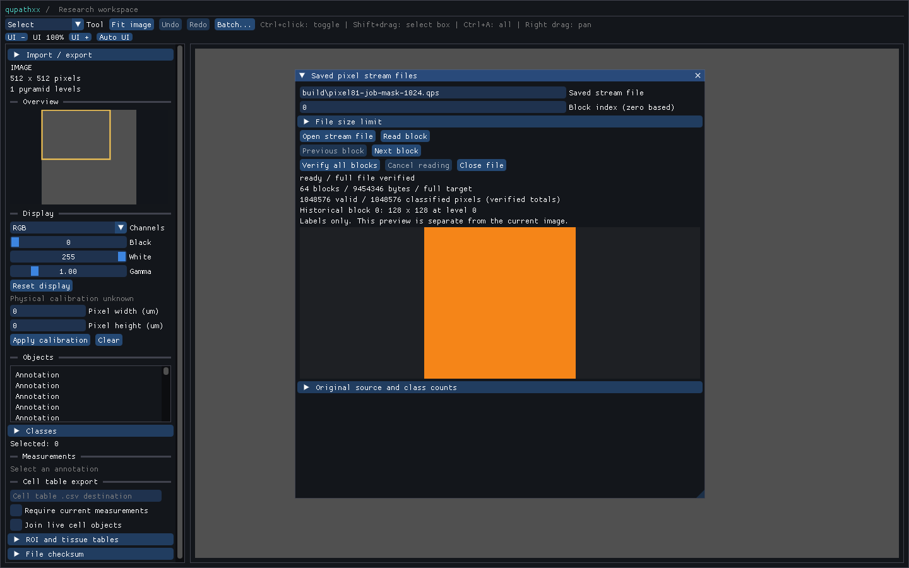

# Inspecting saved pixel stream files

Open **Saved stream files** in F5, choose a QPS1 file and select **Open stream
file**. Enter a zero-based index and use **Read block**, **Previous block** or
**Next block** to inspect individual blocks. **Verify all blocks** checks the
complete stream and its aggregate totals. File size limits are configurable
before opening. **Cancel reading** stops pending work; reopen after cancellation.
**Close file** releases the reader and its preview after work has been collected.



The inspector displays one block in its own canvas, using local block coordinates.
It does not align a historical mask with the current slide or adopt its model
into live analysis. The original source, grid position, sampling information,
class colors and block/whole-file counts are available under **Original source
and class counts**. Footer totals are labelled **declared** until a complete
scan succeeds. A selected block is individually validated before display.
Verified status describes the last successful scan, not continuous filesystem
monitoring. Changed files fail on subsequent guarded access.

The same controller is available without the desktop or a training backend:

```python
import qupathxx as q

job = q.PixelStreamReadJob()
assert job.open("mask.qps", index=7)
selected = job.wait()  # Releases the Python GIL.
assert selected.state == "ready" and selected.block is not None
labels = selected.block.labels_numpy()  # Native read-only block ownership.
assert job.verify()
assert job.wait().verified
assert job.read(2)
second = job.wait()
assert second.state == "ready" and second.block_index == 2
assert job.close()
# Previously returned arrays still own their historical values.
```

`open`, `read`, `verify`, `close`, `poll`, `wait`, `busy` and `cancel` belong to
the controller's owner thread. A single worker performs each operation; there
is no request queue. Busy controllers reject additional operations and close
with `False`. Collect completion before starting the next operation. Invalid
file limits and missing-reader operations raise synchronously; file, decoding
and index failures appear in returned `failed` stats. An invalid indexed read
can be retried on the same reader; a changed or cancelled file needs reopening.

States are `idle`, `opening`, `reading`, `verifying`, `ready`, `cancelling`,
`cancelled` and `failed`. `generation` increases for every started operation,
including failures. `declared_summary` is bounded header/footer metadata, not
a claim that every block has been checked. `verified` becomes true only after
a complete successful scan. `block` is cleared before a new indexed read and
on failure/cancellation; verification can retain the last individually checked
block while the scan runs. Stats and returned arrays are value snapshots.

Cancellation wins over a completed but uncollected read/verification result.
It discards the pending value and makes the underlying reader terminal. During
initial opening, the bounded metadata constructor can finish before cancellation
is observed; the cancelled result is never adopted. Destruction cancels and
joins. OS calls may finish before cancellation takes effect. The job restores
no live source, prediction request or annotation-publication authority.

The reader retains its bounded QPA2 header and selected block. Verification also
uses one transient block and bounded I/O buffers. The desktop uploads at most
four 256-square tiles for a selected block, with at most 1 MiB of mask GPU data;
no whole-stream output mask or block index list is assembled. Worker/future,
snapshot and caller-retained array owners are additional storage. These are
allocation/encoding limits, not process RSS or shutdown-latency guarantees.

`GuiOptions.pixel_stream_browser_open`, `pixel_stream_read_path`,
`pixel_stream_read_index` and `pixel_stream_read_max_bytes` configure replay.
`GuiReport.pixel_stream_read` reports native stats; the separate
`pixel_stream_read_gpu_bytes`, `pixel_stream_read_peak_gpu_bytes`,
`pixel_stream_read_preview_ready` and `pixel_stream_read_preview_bounds` describe
the inspector preview. Live prediction/overlay fields continue to describe the
main image's analysis.

See the [QPS1 file contract](pixel-stream-file.md) and
[background export](pixel-stream-export.md). [Project-linked historical descriptors](pixel-stream-records.md) are available.
Resume, source reconciliation for current-slide overlays and stitched
whole-stream contour publication remain open.


The [local verification record](benchmarks/pixel-stream-browser-local-windows-linux.json)
links the installed wheel, complete suite, native configurations, public types,
portable fixture and read/GUI probes. Reproduce read-only inspection with
`python tools/benchmark_pixel_stream_read.py --file mask.qps --output read.json`.
The real-window probe is
`python tools/benchmark_gui_pixel_stream_read.py --file mask.qps --output gui.json --capture gui.ppm`.
