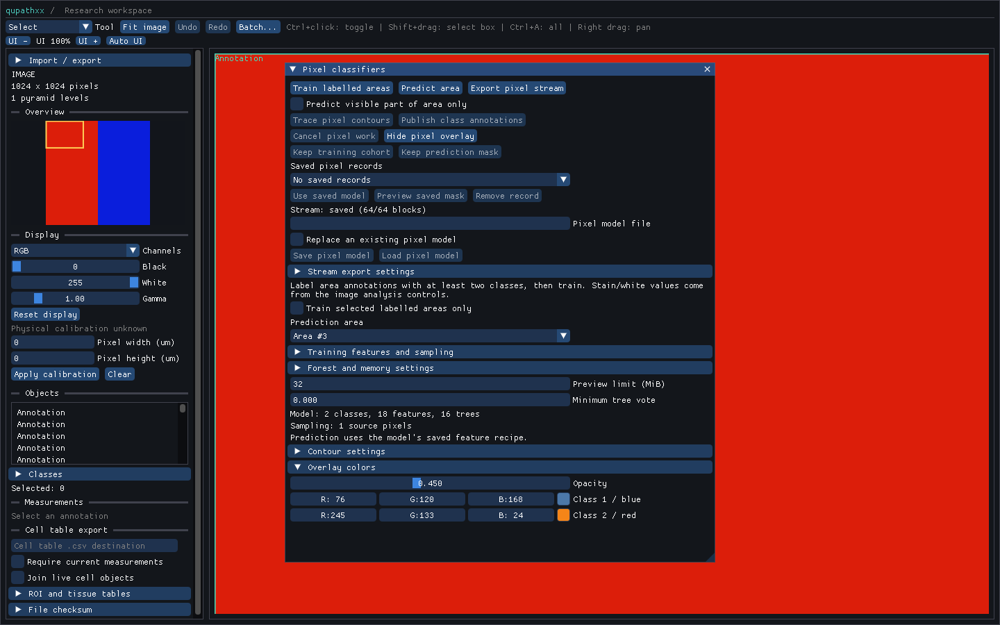

# Background pixel stream export

The F5 **Export pixel stream** action and Python `PixelStreamExportJob` use the
same native controller and QPS1 writer. One worker consumes bounded native
blocks into an atomic complete file. The owner thread captures the original
source, target, model recipe and optional window before starting; the worker
never reads a mutable `Document` or edits annotations.

```python
import qupathxx as q

prediction_options = q.PixelPredictionOptions()
prediction_options.work_bytes = 8 * 1024 * 1024
job = q.PixelStreamExportJob()
options = q.PixelStreamOptions()
options.block_size = 128
options.prediction = prediction_options
assert job.request(document, target_id, model, "mask.qps", options)
stats = job.poll(document)  # A value snapshot; no mask transfer.
stats = job.wait(document)  # Releases the Python GIL.
assert stats.state == "saved"
saved = q.PixelStreamFile("mask.qps")
saved.verify()
```

`request`, `poll`, `wait`, `busy` and `cancel` belong to the controller's owner
thread. Workers communicate through futures and native atomics. A busy job
rejects another request with `False`; collect its completion with `poll` or
`wait` before starting another. Invalid capture/options raise synchronously;
file errors appear in the final `failed` stats. Completed and failed jobs can
be reused, incrementing `generation`. Previously returned stats/summary values
remain stable. Destruction cancels and joins the worker while retaining native
source/model owners through the join.

States are `idle`, `running`, `cancelling`, `cancelled`, `failed` and `saved`.
`completed_blocks` counts completed prediction blocks, not committed disk
records. Live counters are observations; successful final counters agree with
the saved footer. `summary` is available only after a committed export.
`elapsed_ms` records completed worker time. Polling checks authority and counters
without reading blocks, scanning a file or copying a complete mask.

`cancel()` requests both producer and writer I/O cancellation, including final
writer checkpoints. An uncancellable decoder/OS call may finish first. A file
that has already committed is reported as `saved` even if cancellation arrives
before the owner collects completion. Cancellation cannot retract that file.
Default no-overwrite, explicit verified replacement, output limits and temporary
cleanup follow the [QPS1 file contract](pixel-stream-file.md).

`current` reports whether the captured request still matches the document passed
to the latest poll. Editing that document does not rewrite the capture or stop
a historical export. Polling another document reports `current=False`. Saved
files always contain historical values and restore no live publication
authority. The F5 panel cancels pending export when switching active documents;
closing an interactive viewer also cancels and joins. Finite replay waits for
unfinished work before returning its final report.

In F5, open **Stream export settings**, choose a file, block size, work allowance
and file limit, then select **Export pixel stream**. The existing visible-only
checkbox selects the captured viewport intersection instead of the full area.
**Cancel pixel work** cancels export as well as other active pixel work. Export
progress is shown in blocks. The panel keeps no stream output mask or GPU
preview. Its normal prediction/overlay controls remain available after export.
`GuiOptions.pixel_stream_path`, `pixel_stream_options`, `pixel_stream_replace`
and `pixel_stream_max_bytes` configure the same controls for replay;
`GuiReport.pixel_stream` contains final native stats.



The producer work estimate excludes caller-owned source/model storage. File
encoding retains one bounded QPA2 metadata header plus a block and I/O buffer;
the controller also owns worker/future/stats bookkeeping. None is a process RSS
or hard shutdown-latency guarantee. The [saved-file inspector](pixel-stream-browser.md) provides historical block navigation and verification. Resume, project-linked files and whole-stream contour stitching remain open.


The [local validation record](benchmarks/pixel-stream-export-local-windows-linux.json)
checks the full installed suite, native configurations, exact public stubs,
strict typing, installed launch and native/source/benchmark identities.
Reproduce the job probe with `python tools/benchmark_pixel_stream_file.py --job --size 2048 --output report.json`;
run `python tools/benchmark_gui_pixel_stream.py --size 2048 --output gui.json`
for the real F5 path on a supported desktop. Default uniquely named files are
retained under `build/pixel-stream-files`.
