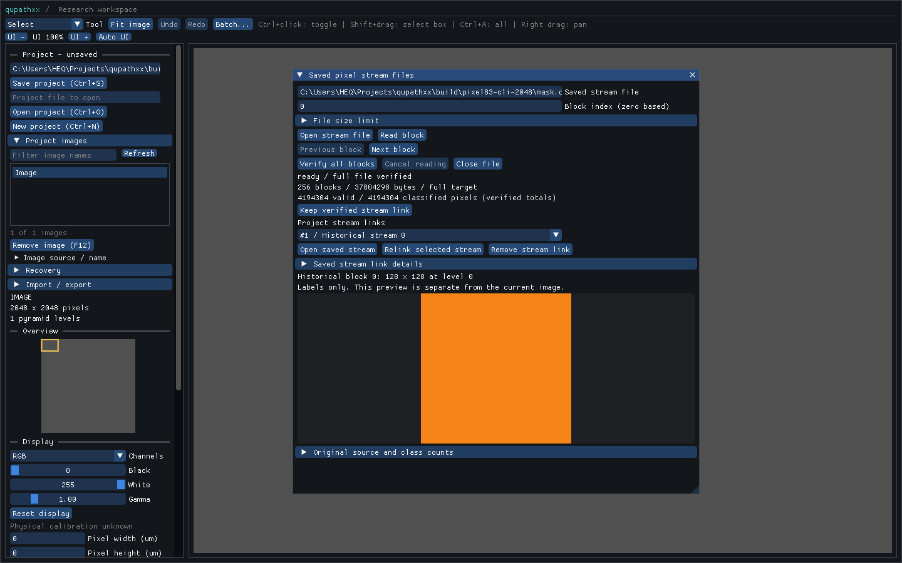

# Project links to historical pixel streams

Projects store external QPS1 descriptors in schema 10. Each descriptor records
the path, content commitment, file/block/pixel totals, class counts, model hash,
source dimensions and captured target/grid metadata. Stream arrays and models
remain in the external file. Opening a project validates descriptor metadata
without reading that file; missing or inaccessible output does not prevent
the project from opening.

```python
import qupathxx as q

link = q.prepare_pixel_stream_link("mask.qps")  # Full verification; releases GIL.
record_id = document.keep_pixel_stream(link, "Historical pixel output")
project.save("project.qpxproj")

record = document.pixel_stream_record(record_id)
job = q.PixelStreamReadJob()
assert job.open_link(record.link)
loaded = job.wait()
assert loaded.state == "ready" and loaded.verified
```

Preparation verifies every block, numeric value and completion total. An
already verified `PixelStreamFile` can produce the same descriptor with
`file.link()`. `PixelStreamReadStats.link` becomes available after complete
verification. Prepared descriptors and stats are immutable historical values,
not continuous filesystem observations. Document adoption performs no file I/O.

The destination document must have the recorded source dimensions. Equal
dimensions permit an explicit historical attachment; they do not prove source
pixel identity, annotation identity or that the model is appropriate for that
slide. Original target IDs/revisions are historical metadata, not references to
current objects. Links restore no live prediction or publication authority.
Editing or deleting an area does not rewrite or remove its historical links.

Opening a saved link explicitly verifies the entire external file on the reader
worker and compares its commitment and metadata with the descriptor before
exposing a block. A missing, corrupt, changed or different file fails without
discarding the saved project record. Cancellation is supported during the scan;
the existing bounded header constructor and uninterruptible OS calls can finish
before cancellation is observed.

Paths are stored relative to the destination project directory when possible.
Moving a project and its stream files together preserves their relationship.
Save-as rebases paths without modifying the in-memory descriptor. Autosave,
recovery and batch checkpoints use their own final output directories when
encoding links. Project loading does not follow these paths. Moving only the
stream requires an explicit relink:

```python
replacement = q.prepare_pixel_stream_link("moved/mask.qps")
document.relink_pixel_stream_record(record_id, replacement)
```

Relinking requires the same fully verified content and captured metadata;
different output cannot silently replace the historical reference. Removing a
record with `remove_pixel_stream_record(id)` removes only metadata. It never
deletes an external file. Retained record/descriptor objects remain usable after
removal. Keep/relink/remove advance the document revision and project dirty
state, following the existing analysis-record policy rather than object edit
undo/redo history.

In **Saved stream files**, verify a file and select **Keep verified stream
link** to attach it to the active image. **Project stream links** lists saved
records. **Open saved stream** performs complete verification before preview;
**Relink selected stream** uses the independently opened and verified matching
file. **Remove stream link** retains the external file. The original source and
label preview stay separate from the current slide. The record catalog inspects
at most 1,024 entries per frame and clips its dropdown rows.



Each document allows at most 10,000 stream records with a 64 MiB charged retained
payload allowance. Each checksummed QSL1 descriptor encoding is at most 128 KiB;
paths and names are limited to 32,768 and 256 UTF-8 bytes. Models and mask arrays
are not copied into descriptors. Project snapshot budgets charge descriptors and
their pointer vector in addition to existing document/image storage. These are
allocation/encoding bounds, not process RSS limits.

Schema 1–9 projects remain readable and upgrade transactionally on save.
Background saves, recovery snapshots and batch checkpoints preserve links. The
batch checkpoint digest includes descriptor rows, so modifying a link in a
completed checkpoint invalidates reuse. Older application builds reject schema
10 rather than silently dropping the new records.

See [file integrity](pixel-stream-file.md), [historical inspection](pixel-stream-browser.md)
and [background export](pixel-stream-export.md). Stream-copy packaging, source
reconciliation for current-slide overlays, restart/resume and stitched
whole-stream contour publication remain open.


The [10,000-link probe](benchmarks/pixel-stream-records-10000-windows.json)
references a 37.8 MB external stream with 256 blocks. Descriptors encode to 4.19 MB
in total (at most 419 bytes each); the 17.44 MB project includes its synthetic
12.58 MB RGB source image. Preparing the file takes 316 ms, adopting all 10,000
links 3.63 ms, saving 97.0 ms and opening 48.8 ms in this single shared-workstation
observation. GUI catalog work stays at 1,024 entries per frame and a selected
block uses 65,536 mask GPU bytes. CPU frame p95/max are 2.66/18.63 ms. View
preferences can dirty the project; the document revision and link descriptors
remain unchanged. These timings are observations, not RSS or hardware/frame
acceptance gates.


The [local verification record](benchmarks/pixel-stream-records-local-windows-linux.json)
links the full installed suite, native configurations, public types, Linux
checkpoint roundtrip and catalog probe to their wheel/source identities.
Reproduce the probe with
`python tools/benchmark_pixel_stream_records.py --file mask.qps --gui --output records.json`.
The generated project is retained under a unique `build/pixel-stream-records`
path unless `--project` explicitly selects a destination.
