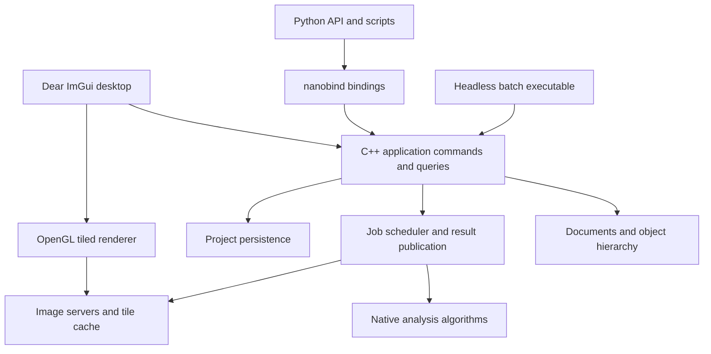

# qupathxx project plan

Build a C++ bioimage analysis application with a nanobind Python interface and
Dear ImGui desktop UI. The first useful release must open real whole-slide
images, edit and save annotations, run reproducible tissue and cell analysis,
and expose the same workflows to Python and headless batch execution.

Use `../naparixx` as the reference for native ownership, thin bindings,
standalone core tests and installed-package validation. QuPath defines the
workflow reference. Python API design and the ImGui frontend are new work.

## Current execution map

Planning update: 2026-10-26. This document defines the full M0–M7 scope and the
next delivery order. See [API delivery paths](api-delivery-plan.md) for the
shortest implementation route, existing entry points and acceptance per workflow.
The original packet narrative is preserved in [implementation history](project-plan-history.md).
The [Astra max review](plan-review-astra.md) records the problems and adopted changes.

The qualified application source on public main is `61e546e`, including the
shared scientific RGB/cell and typed raw-grid workflows, quantitative TIFF
layout/decoder checks and bounded raw capture/materialization. The
[combined receipt](benchmarks/raw-grid-191-qualification.json) accepts the
complete engine, both-architecture Mac native and portable builder/fresh-consumer
gates at that source. Documentation-only receipts follow it. Later TMA APIs on
the feature branch require their own campaign. Earlier failed candidates remain
preserved and unqualified.
This does not establish biological equivalence, hardware budgets or supported
release status. Use the [current task](current-task.md), [workflow inventory](feature-matrix.md)
and [API delivery paths](api-delivery-plan.md) for exact scope and remaining work.
All M0-M7 remain Partial.

TMA `19371b7`, normal multi-file OME `9e7d0be` and the expanded multi-file
fault campaign `bfa416e` have separate engineering acceptance. The
[complete campaign213 receipt](benchmarks/multifile-fault-213-qualification.json)
accepts all 11 verified archives, full engine, both Mac-native architectures
and portable builders/fresh consumers on the original handles. E1/E2 and the
later E3/E4 tooling keep their own implementation/local evidence and are included
in that source. Preserve the earlier partial observation and every source identity.

The next product workflow is [typed raw pixel classification](api-delivery-plan.md#sci1-a-typed-raw-classifier-delivery-checkpoints).
Native features, reusable models and bounded owner-captured annotation
sampling/prediction jobs have [local acceptance at `7beb80b`](benchmarks/raw-pixel-workflows-local.json).
Archive candidate `220304d` implements native retention and project/snapshot/
recovery persistence, but both hosts still fail test-owned directory cleanup
after the persistence assertions (10/11 selected suites pass per host).
First fix that fixture and publish source-bound passing archive evidence.
Then complete live replay verification, owner-stage apply/undo, phase-preserving
tiled/checkpoint execution and the existing frontends. New raw models use QRM1;
explicit pre-release QPR1 compatibility preserves original bytes and hashes.
Positive backend-enabled forest training is still required; local caches have
training OFF. Both axes and captured document calibration, channel and
normalization semantics must survive that complete workflow.
RGB models remain compatible. The new classifier source is not covered by the
older multi-file campaign. Scientific/model and eligible hardware evidence
continue alongside implementation with explicit consumer dependencies.

Use the [current task](current-task.md) for source-bound observations and the
[ordered queue](api-delivery-plan.md#dependency-lanes-and-immediate-queue) for
scheduling. The [compilexx review](reviews/compilexx-efficiency-review.md)
records adopted process changes. No milestone or release gap is closed by this
local classifier packet.

## Scope and release boundaries

Reader scope is limited to open-source-licensed implementations and decoder
dependencies under the [reader licensing policy](reader-license-policy.md).
Proprietary SDK readers are excluded from required parity. Vendor formats
remain eligible through open-source readers.

Target Windows x64 first, while keeping portable C++17 and CMake targets.
Add supported Linux and macOS packages after the Windows workflow is stable.
Keep GUI and Python optional so the native analysis engine runs without either.

Freeze the initial comparison baseline to
[QuPath v0.7.0](https://github.com/qupath/qupath/tree/v0.7.0), tag revision
`04ccfa4fb7d43e9b566393e08e83690b72248d44`. Track future upstream upgrades
explicitly. The [QuPath feature overview](https://qupath.readthedocs.io/en/stable/docs/intro/about.html)
identifies the major areas to inventory: image servers, annotations, detection,
classification, scripting and integrations.

| Release | User outcome | Scope boundary |
| --- | --- | --- |
| Starting 0.1 foundation | View demo/PPM images, draw rectangles, access measurements from Python | Historical starting point; later implementation packets below track current behavior |
| 0.2 slide annotation alpha | Open supported slides, navigate, annotate, save and reopen projects | Milestones M0 through M4 |
| 0.3 research analysis beta | Run calibrated tissue/cell workflows from UI and Python, batch export results | Milestones M5 and M6 |
| 1.0 defined workflow release | Install supported packages and reproduce accepted research workflows | M7; only the published support matrix is promised |
| Later parity releases | Broader QuPath functionality and interchange | Individually gated backlog; 1.0 does not imply full QuPath parity |

The long-term target includes QuPath's major research workflows. Java binary
compatibility, JavaFX widget parity, Java extensions and executing Groovy scripts
are outside the initial release. Python provides the new scripting surface.

## Starting foundation (historical; not the current backlog)

This section records the initial state. The workflow inventory and the latest
implementation packets below track current capabilities and validation.

The first image-access packet has been implemented. See the
[workflow inventory](feature-matrix.md) and [image-server contract](image-server-contract.md)
for current scope and evidence. Synchronous dense/OpenSlide regions, optional
calibration, Python bindings and native region extraction are available; M0/M1
remain open for the decisions and capabilities listed in the inventory.

The C++ core owns image-server references, rectangles, stable annotation IDs,
calibration and measurements. Nanobind exposes that model. The GUI has a single
dense-image texture, pan/zoom, drawing, selection and deletion. Twenty Python
tests, two native tests and GUI startup/render/shutdown have passed on Windows.

Important changes before real research use:

- Extend synchronous image servers with asynchronous reads and bounded caching.
- Preserve the implemented unknown-calibration behavior when adding more readers.
- Replace per-frame measurement computation with revision-keyed cached results
  and background jobs where appropriate.
- Introduce command-based document mutations before adding editable polygons,
  undo/redo, persistence and asynchronous analysis.
- Add actual GUI interaction and rendering checks; startup alone does not
  verify annotation tools or visual correctness.

## Architecture and ownership

The C++ model is the authority for project state, object geometry, classes,
measurements and job status. Python and the UI issue the same commands. The UI
owns presentation state such as active panels and pointer gestures. Python may
orchestrate external scientific packages without owning a second document model.

| Module | Responsibility | Main dependencies |
| --- | --- | --- |
| `core` | IDs, documents, image metadata, object hierarchy, revisions, commands | Standard library |
| `geometry` | ROI shapes, holes, clipping, topology, spatial queries | GEOS C API; retain the adapter boundary |
| `io` | Image servers, metadata normalization, read requests, format capabilities | OpenSlide and quantitative TIFF/OME; broader adapters remain |
| `jobs` | Priorities, cancellation, resource limits, result publication | Native threads; no Python dependency |
| `render` | Tile selection, GPU cache, overlays, picking, display transforms | OpenGL |
| `analysis` | Stains, masks, detection, features, classification | OpenCV where useful; native workflow policy |
| `project` | Versioned storage, transactions, migration, export and provenance | SQLite; already integrated |
| `gui` | Docked workspace, tools, inspectors, measurement tables | Dear ImGui and GLFW |
| `bindings` | Typed Python API, array exchange, lifetimes, exceptions | nanobind |

Split the current `core.cpp`, `bindings.cpp` and `gui.cpp` incrementally as these
responsibilities become real. Avoid creating empty modules ahead of working
features. Keep public headers under `cpp/include/qupathxx` and Python facades
under `src/qupathxx`.

## Contracts to establish first

**Images and coordinates.** Use signed 64-bit image dimensions and level-zero
pixel locations, double-precision ROI geometry, explicit pyramid transforms,
and explicit channel, Z and time axes. Readers declare supported axes, dtype,
color layout, calibration and region semantics. Preserve raw quantitative data
separately from display conversion. Normalize OpenSlide premultiplied ARGB
output deliberately; its region coordinates and output layout are documented in
the [OpenSlide API](https://openslide.org/api/openslide_8h.html).

**State and commands.** Give objects stable IDs, a document identity and revision,
and a validated hierarchy. Define selection independently of object ownership.
Publish changes only after a command succeeds. Group a gesture or detection
result into one undoable operation. Specify whether deleting a parent deletes
or reparents its children, and reject hierarchy cycles.

**Jobs and shutdown.** The application thread applies model mutations. Workers
read immutable inputs and publish results tagged with document identity,
image identity and input revisions. Reject stale results. Cancellation stops
publication immediately; a decoder that cannot be interrupted may finish its
current read. Retain reader handles until outstanding work completes. GPU
creation and destruction stay on the context thread.

**Python ownership.** Expose handles or snapshots with documented invalidation
rules. Array exports retain the native allocation; zero-copy views are read-only
unless an explicit editing transaction owns them. Validate dtype, shape, strides
and device. Release the GIL only around native operations that do not touch
Python. Queue document changes while the UI runs. The current blocking `show`
API stays supported until these rules are implemented and tested. Array exchange
will use [nanobind ndarray support](https://nanobind.readthedocs.io/en/latest/ndarray.html).

**Persistence and reproducibility.** Use one versioned project database for image
references, objects, classes, calibration and workflow provenance. Keep source
pixels external, with relative-path resolution and explicit missing-image
handling. Save changes transactionally; caches remain disposable. Record input
identity, parameters, software version, algorithm revision and model identity
alongside analysis results. Define image identity independently of file path;
support optional content hashes where their cost is acceptable.

## Milestones and acceptance criteria

### M0 Baseline and representative workloads

Create an upstream feature inventory with one row per workflow, linked source
areas, desired behavior, implementation owner, fixtures and acceptance checks.
Mark each row as missing, partial, accepted or deferred. Inventory is evidence
of scope; a feature becomes accepted only after its workflow passes.

Choose representative brightfield slides, a synthetic multiresolution image,
malformed/truncated inputs, and annotation fixtures including holes and overlaps.
Record redistribution rights and hashes. Define benchmark hardware, cold/warm
cache conditions and numerical tolerances before optimizing or comparing results.
Select geometry and persistence dependencies through small implementation probes;
record the project license and dependency distribution requirements before release.

Exit: pinned upstream source identity, fixture manifest, feature matrix,
coordinate/ownership decisions and reproducible build/test commands are recorded.
No real-data validation depends on private files that cannot be identified.

### M1 Image servers and whole slide access

Introduce `ImageServer`, `ImageMetadata`, `RegionRequest` and typed `PixelBuffer`.
Wrap the existing dense image as a server and implement OpenSlide with RAII,
error handling, thumbnails, level selection and calibration extraction.
Add cancellation-aware read scheduling, bounded decoded-tile caching and request
deduplication. Default to conservative per-handle read serialization until the
chosen reader's concurrency contract is tested. Add a native region-reading CLI
and bind the same server API to Python.

Exit: read matching regions at multiple levels from synthetic and supported
vendor fixtures; verify level-zero mappings, edge padding, alpha conversion,
missing metadata and decoder errors. Close/reopen while reads are pending
without a crash or stale result. Memory is bounded by configured budgets.

### M2 Tiled viewer and ImGui workspace

Replace the single texture with visible-tile selection, coarse-level fallback,
prioritized reads, bounded GPU residency and background decoding. Introduce a
render origin near the viewport so large coordinates retain overlay precision.
Add overview navigation, scale bar, channel/display controls and clear loading
and reader-error states. Track per-monitor DPI and framebuffer scaling.

Use an explicitly pinned ImGui docking revision when introducing docking.
Arrange the workspace around a central slide canvas: project/object browser on
the left, image/channel controls on the right, measurements and jobs below,
and annotation tools above. Persist layout preferences separately from projects.
Keep native implementation details out of ordinary research interactions.

Exit: navigate a real slide without loading the whole image or blocking the UI
on decoding; zoom stays anchored; overlays remain aligned through pyramid
changes and DPI scaling. Verify fit, pan, zoom, resize, minimize and close via
interaction tests and captured reference views.

### M3 Objects and annotation editing

Add rectangle, ellipse, polygon, polyline and point ROIs; implement holes and
multipart areas before claiming general polygon interchange. Add annotation,
detection and cell object types, classes, hierarchy, spatial index and multi-
selection. Route creation, geometry editing, classification and deletion through
commands with undo/redo. Cache features by object and calibration revision.

Exit: edit overlapping objects, undo/redo a compound operation, and preserve IDs,
hierarchy and class assignments. Invalid geometry follows a documented reject
or repair policy. Verify area, perimeter, containment and pixel sampling against
independent geometry fixtures, including anisotropic and unknown calibration.

### M4 Projects and interchange

Implement transactional save/load, schema versions, recovery from failed saves,
autosave, image relinking and migrations. Support GeoJSON annotations and CSV
measurement export with documented coordinate and class conventions.
Add QuPath-assisted export/import as the first migration route and measure
round-trip losses. Treat direct `.qpproj` and `.qpdata` support as separate
format-specific work; do not assume they share one serialization strategy.

Exit: save, restart and restore a multi-image project with matching IDs, geometry,
classes, calibration and measurements. Inject a failed write without losing the
previous valid state. Test moved image paths, missing images, unknown schema
versions and deterministic exports. Publish an interchange capability matrix.

Accept the 0.2 slide annotation alpha only after the M0–M4 exit evidence is recorded for its defined workflows.

### M5 Reproducible native analysis

Implement an analysis request/result API on the job system. Start with optical
density, fixed stain-vector color deconvolution, threshold tissue detection,
connected components, region measurements and tiled execution with defined
halos and edge reconciliation. Then add stain estimation and watershed cell
detection, nucleus/cell geometry and intensity features. Make display transforms
independent of raw measurements. Never recompute expensive features every frame.

Exit: run identical parameterized jobs through C++, Python and the GUI and obtain
matching native results. Compare masks, object counts and features against pinned
QuPath workflows with tolerances set in M0. Quantify overlap, split/merge behavior
and feature errors; distinguish an intentional algorithm difference from a parity
failure. Tile borders do not duplicate or lose detections. Cancellation and
stale-result rejection leave the document consistent.

### M6 Python workflows and batch execution

Add NumPy region exchange with tested ownership, typed stubs, examples and a
stable public API for projects, ROIs, jobs and measurements. Support scripting
against a live viewer through queued commands and job notifications after the
GIL/thread contract is verified. Implement headless project processing, structured
logs, progress, restartable per-image results and parameter manifests.

Keep the C++ engine usable without Python. External models such as Cellpose or
StarDist may run through Python adapters that submit versioned results through
the same native publication path. Defer these adapters until native analysis
and array exchange are stable.

Exit: a script opens a slide, creates an ROI, runs analysis, exports measurements
and saves a project that reopens correctly in the UI. Test array lifetime after
document closure, concurrent job completion, exceptions and interpreter shutdown.
Batch failure on one image is reported with an explicit continuation policy.

Accept the 0.3 research analysis beta only after M5/M6 scientific and workflow evidence is recorded; engineering CI alone is insufficient.

### M7 Distribution and supported workflow release

Produce standalone Windows installers/archives and GUI/headless Python wheels
with bundled or explicitly installed runtime dependencies. Add clean-machine
installation tests and CI for supported platforms, native tests, Python tests,
GUI smoke/interaction tests and workflow comparisons. Exercise address/undefined
behavior sanitizers on supported toolchains and concurrency checks where feasible.

Exit: a clean supported machine can install, open a fixture slide, annotate,
analyze, save, reopen and export using only documented steps. Ship notices,
versioned schemas, sample workflows and a known-limitations list. Require the
same workflow gates for standalone and Python-hosted builds. The release's
support matrix, numerical tolerances and performance budgets are published.

## Validation and performance targets

Use synthetic fixtures for exact transforms and pixel semantics; real slides
exercise decoding and workflow behavior. Keep pinned QuPath outputs independent
of the implementation under test. Record parameters and image regions alongside
each comparison. A test that calls the same implementation twice cannot establish
upstream parity.

The following are proposed engineering targets, to be frozen with benchmark
hardware and datasets in M0. They are not current performance claims.

| Workload | Initial target |
| --- | --- |
| Cached pan/zoom on a 2560 x 1440 viewport | p95 frame time at most 33 ms |
| Main-thread image decoding | None; decoding stays on workers |
| Decoded tile cache | Configurable cap; initial default 1 GiB |
| GPU tile cache | Configurable cap; initial default 512 MiB |
| Very large images | Open a fixture at least 100,000 pixels wide without full-image allocation |
| Object overlays | Benchmark 100,000 stored objects with visibility culling; apply cached-frame target |
| Job completion after document close | No publication, crash or leaked reader/GPU resource |
| Long batch runs | Stable steady-state memory within cache budgets plus documented job buffers |

Cache caps do not cover all process memory. Measure decoder caches, in-flight
buffers, analysis halos, object storage and GPU staging allocations separately.
Cold read latency is reported by format/storage rather than hidden inside a
universal frame-rate claim. Profile before optimizing individual kernels.

## Broader QuPath parity backlog

| Area | Planned extension | Prerequisite |
| --- | --- | --- |
| Formats and axes | TIFF/OME metadata, fluorescence, Z/time, higher bit depths, channel composites | Typed image servers and format fixtures |
| Classification | Object classifiers, pixel classifiers, training UI, portable model persistence | Measurements and analysis provenance |
| Tissue microarrays | Grid creation, core assignment, missing-core handling and per-core analysis | Object hierarchy and projects |
| Spatial analysis | Distances, neighborhoods, density maps and tiled feature aggregation | Spatial index and stable measurements |
| External integrations | Cellpose, StarDist, OMERO and ImageJ data exchange | Python adapters and interchange contracts |
| Workflow automation | Recorded native commands and parameterized pipelines | Stable commands and batch execution |
| QuPath project migration | Broader classes, detections, metadata and workflow exchange | Pinned format fixtures and loss reporting |
| Plugin system | Versioned C++ and Python extension interfaces | Stable engine API and lifecycle contract |

Expand the feature matrix before calling any of these areas complete. Similar
screenshots, source-line counts or a number of native bindings do not establish
workflow parity.

## Execution order from the present state

The [API delivery queue](api-delivery-plan.md#dependency-lanes-and-immediate-queue)
is the sole detailed scheduling authority. MFO1 campaign213 is engineering
accepted; continue SCI1-A owner-captured raw classification in the active
integration checkout. Continue
SCI1-B, the decision lane and REL1 through every remaining M0-M7 criterion.
The current task card records observed status, not another ordered backlog.

Retain the accepted `61e546e` baseline and original failed candidates. Reuse
unchanged native products for observer/package-only changes with explicit
identity/applicability proof; a changed source label alone does not require a
compiler run. Independent dataset, scientific, hardware and release decisions
keep their own dependencies and do not become substitutes for implementation.

Estimate remaining work per complete user workflow after identifying its actual
code, fixture, scientific, hardware and decision dependencies. The historical
4-7 engineer-month estimate and percentages derived from test counts are not
current estimates. No workflow is complete from a preparatory parser, fixture
or green job count alone.

## Planning and validation discipline

Use one active integration source, one frozen qualification source and a
read-only comparison checkout only when needed. An exception needs a concrete
isolation reason and a retirement condition. Never reset the divergent local
root branch. Retire obsolete builds/worktrees only after preserving source
refs, evidence and logs and checking active processes; use bounded native
cleanup operations. Do not delete fixtures or an installed comparison engine
because its directory is named `build`.

Complete a vertical slice through native API, thin binding, persistence where
applicable, CLI/UI entry point, documented example and meaningful tests before
starting a neighboring feature. A preparatory parser or reference capture can
be a useful substep, but does not become the release acceptance unit.

Validation has three scopes:

- During edits, run affected native/installed tests and an independent oracle
  when numerical or interchange behavior changes. Verify enabled capability
  markers; a passing disabled branch proves only feature-disabled behavior.
- After the slice works, install the wheel in an isolated environment, regenerate
  stubs once, check typing and relevant desktop/persistence regressions. Inspect
  installed compiled-source and package identities. Rebuild native code only
  when its consumed inputs/configuration change or the required qualification
  needs a fresh build; package/stub/observer-only changes reuse proved native
  products and qualify the changed layer.
- Freeze a candidate for full cross-platform engine, Mac and portable audits.
  Keep one dispatch per source/mode. Observe its exact run through completion;
  a polling timeout is not a build failure. No promotion until required audits
  pass at that source. A compiler-input change during qualification creates a
  new candidate and requires affected qualification; documentation-only changes
  retain a separate tooling/docs identity and a demonstrated input comparison.

Use a shared evidence reader for JUnit status, capability markers, source hashes
and publication receipts, with small domain contracts. Consolidate the duplicated
existing auditors incrementally only while touching a relevant workflow; avoid
an unrelated framework rewrite. Require semantic outcomes and explicit fixture
coverage rather than continually increasing global test-count constants. Keep
negative controls for the auditor itself. Text source normalization must not
normalize byte-addressed fixtures or artifacts.

Before optimizing, name the user workload and bottleneck, freeze expected
outputs and compare elapsed time, allocations/peak memory, decode/IO and UI
latency appropriate to that workload. Retain failed and excluded samples. Reuse
existing accepted component improvements by byte/behavior evidence; do not
repeat them simply because a new packet number exists. Component timings stay
component claims. Scientific tolerances and eligibility criteria cannot be
relaxed after seeing results. End-to-end hardware gates still require eligible
runs on the declared machine and cache state.

The [workflow inventory](feature-matrix.md) owns current capability status;
individual contracts own numerical/lifecycle details; the tables above own
milestone acceptance; [history](project-plan-history.md) retains earlier packets.
Add short evidence links and update the affected status row after a result. Do
not append another long chronological status report to this active plan.
