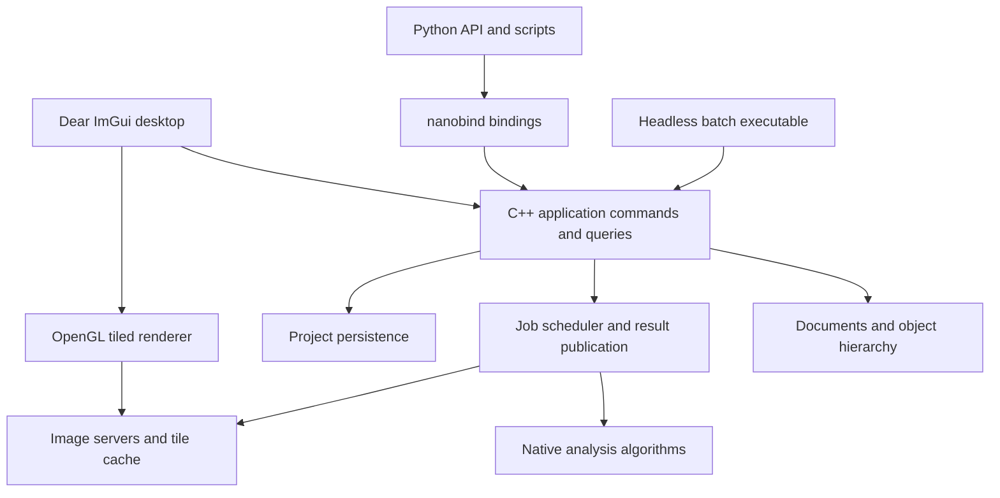

# qupathxx project plan

Build a C++ bioimage analysis application with a nanobind Python interface and
Dear ImGui desktop UI. The first useful release must open real whole-slide
images, edit and save annotations, run reproducible tissue and cell analysis,
and expose the same workflows to Python and headless batch execution.

Use `../naparixx` as the reference for native ownership, thin bindings,
standalone core tests and installed-package validation. QuPath defines the
workflow reference. Python API design and the ImGui frontend are new work.

## Scope and release boundaries

Target Windows x64 first, while keeping portable C++17 and CMake targets.
Add supported Linux and macOS packages after the Windows workflow is stable.
Keep GUI and Python optional so the native analysis engine runs without either.

Freeze the initial comparison baseline to
[QuPath v0.7.0](https://github.com/qupath/qupath/tree/v0.7.0), tag revision
`04ccfa4fb7d43e9b566393e08e83690b72248d44`. Track future upstream upgrades
explicitly. The [QuPath feature overview](https://qupath.readthedocs.io/en/stable/docs/intro/about.html)
identifies the major areas to inventory: image servers, annotations, detection,
classification, scripting and integrations.

| Release | User outcome | Scope boundary |
| --- | --- | --- |
| Starting 0.1 foundation | View demo/PPM images, draw rectangles, access measurements from Python | Historical starting point; later implementation packets below track current behavior |
| 0.2 slide annotation alpha | Open supported slides, navigate, annotate, save and reopen projects | Milestones M0 through M4 |
| 0.3 research analysis beta | Run calibrated tissue/cell workflows from UI and Python, batch export results | Milestones M5 and M6 |
| 1.0 defined workflow release | Install supported packages and reproduce accepted research workflows | M7; only the published support matrix is promised |
| Later parity releases | Broader QuPath functionality and interchange | Individually gated backlog; 1.0 does not imply full QuPath parity |

The long-term target includes QuPath's major research workflows. Java binary
compatibility, JavaFX widget parity, Java extensions and executing Groovy scripts
are outside the initial release. Python provides the new scripting surface.

## Starting foundation (historical)

This section records the initial state. The workflow inventory and the latest
implementation packets below track current capabilities and validation.

The first image-access packet has been implemented. See the
[workflow inventory](feature-matrix.md) and [image-server contract](image-server-contract.md)
for current scope and evidence. Synchronous dense/OpenSlide regions, optional
calibration, Python bindings and native region extraction are available; M0/M1
remain open for the decisions and capabilities listed in the inventory.

The C++ core owns image-server references, rectangles, stable annotation IDs,
calibration and measurements. Nanobind exposes that model. The GUI has a single
dense-image texture, pan/zoom, drawing, selection and deletion. Twenty Python
tests, two native tests and GUI startup/render/shutdown have passed on Windows.

Important changes before real research use:

- Extend synchronous image servers with asynchronous reads and bounded caching.
- Preserve the implemented unknown-calibration behavior when adding more readers.
- Replace per-frame measurement computation with revision-keyed cached results
  and background jobs where appropriate.
- Introduce command-based document mutations before adding editable polygons,
  undo/redo, persistence and asynchronous analysis.
- Add actual GUI interaction and rendering checks; startup alone does not
  verify annotation tools or visual correctness.

## Architecture and ownership

The C++ model is the authority for project state, object geometry, classes,
measurements and job status. Python and the UI issue the same commands. The UI
owns presentation state such as active panels and pointer gestures. Python may
orchestrate external scientific packages without owning a second document model.

| Module | Responsibility | Main dependencies |
| --- | --- | --- |
| `core` | IDs, documents, image metadata, object hierarchy, revisions, commands | Standard library |
| `geometry` | ROI shapes, holes, clipping, topology, spatial queries | Evaluate GEOS C API in M0; keep an adapter boundary |
| `io` | Image servers, metadata normalization, read requests, format capabilities | OpenSlide first; TIFF/OME readers later |
| `jobs` | Priorities, cancellation, resource limits, result publication | Native threads; no Python dependency |
| `render` | Tile selection, GPU cache, overlays, picking, display transforms | OpenGL |
| `analysis` | Stains, masks, detection, features, classification | OpenCV where useful; native workflow policy |
| `project` | Versioned storage, transactions, migration, export and provenance | SQLite proposed for local project storage |
| `gui` | Docked workspace, tools, inspectors, measurement tables | Dear ImGui and GLFW |
| `bindings` | Typed Python API, array exchange, lifetimes, exceptions | nanobind |

Split the current `core.cpp`, `bindings.cpp` and `gui.cpp` incrementally as these
responsibilities become real. Avoid creating empty modules ahead of working
features. Keep public headers under `cpp/include/qupathxx` and Python facades
under `src/qupathxx`.

## Contracts to establish first

**Images and coordinates.** Use signed 64-bit image dimensions and level-zero
pixel locations, double-precision ROI geometry, explicit pyramid transforms,
and explicit channel, Z and time axes. Readers declare supported axes, dtype,
color layout, calibration and region semantics. Preserve raw quantitative data
separately from display conversion. Normalize OpenSlide premultiplied ARGB
output deliberately; its region coordinates and output layout are documented in
the [OpenSlide API](https://openslide.org/api/openslide_8h.html).

**State and commands.** Give objects stable IDs, a document identity and revision,
and a validated hierarchy. Define selection independently of object ownership.
Publish changes only after a command succeeds. Group a gesture or detection
result into one undoable operation. Specify whether deleting a parent deletes
or reparents its children, and reject hierarchy cycles.

**Jobs and shutdown.** The application thread applies model mutations. Workers
read immutable inputs and publish results tagged with document identity,
image identity and input revisions. Reject stale results. Cancellation stops
publication immediately; a decoder that cannot be interrupted may finish its
current read. Retain reader handles until outstanding work completes. GPU
creation and destruction stay on the context thread.

**Python ownership.** Expose handles or snapshots with documented invalidation
rules. Array exports retain the native allocation; zero-copy views are read-only
unless an explicit editing transaction owns them. Validate dtype, shape, strides
and device. Release the GIL only around native operations that do not touch
Python. Queue document changes while the UI runs. The current blocking `show`
API stays supported until these rules are implemented and tested. Array exchange
will use [nanobind ndarray support](https://nanobind.readthedocs.io/en/latest/ndarray.html).

**Persistence and reproducibility.** Use one versioned project database for image
references, objects, classes, calibration and workflow provenance. Keep source
pixels external, with relative-path resolution and explicit missing-image
handling. Save changes transactionally; caches remain disposable. Record input
identity, parameters, software version, algorithm revision and model identity
alongside analysis results. Define image identity independently of file path;
support optional content hashes where their cost is acceptable.

## Milestones and acceptance criteria

### M0 Baseline and representative workloads

Create an upstream feature inventory with one row per workflow, linked source
areas, desired behavior, implementation owner, fixtures and acceptance checks.
Mark each row as missing, partial, accepted or deferred. Inventory is evidence
of scope; a feature becomes accepted only after its workflow passes.

Choose representative brightfield slides, a synthetic multiresolution image,
malformed/truncated inputs, and annotation fixtures including holes and overlaps.
Record redistribution rights and hashes. Define benchmark hardware, cold/warm
cache conditions and numerical tolerances before optimizing or comparing results.
Select geometry and persistence dependencies through small implementation probes;
record the project license and dependency distribution requirements before release.

Exit: pinned upstream source identity, fixture manifest, feature matrix,
coordinate/ownership decisions and reproducible build/test commands are recorded.
No real-data validation depends on private files that cannot be identified.

### M1 Image servers and whole slide access

Introduce `ImageServer`, `ImageMetadata`, `RegionRequest` and typed `PixelBuffer`.
Wrap the existing dense image as a server and implement OpenSlide with RAII,
error handling, thumbnails, level selection and calibration extraction.
Add cancellation-aware read scheduling, bounded decoded-tile caching and request
deduplication. Default to conservative per-handle read serialization until the
chosen reader's concurrency contract is tested. Add a native region-reading CLI
and bind the same server API to Python.

Exit: read matching regions at multiple levels from synthetic and supported
vendor fixtures; verify level-zero mappings, edge padding, alpha conversion,
missing metadata and decoder errors. Close/reopen while reads are pending
without a crash or stale result. Memory is bounded by configured budgets.

### M2 Tiled viewer and ImGui workspace

Replace the single texture with visible-tile selection, coarse-level fallback,
prioritized reads, bounded GPU residency and background decoding. Introduce a
render origin near the viewport so large coordinates retain overlay precision.
Add overview navigation, scale bar, channel/display controls and clear loading
and reader-error states. Track per-monitor DPI and framebuffer scaling.

Use an explicitly pinned ImGui docking revision when introducing docking.
Arrange the workspace around a central slide canvas: project/object browser on
the left, image/channel controls on the right, measurements and jobs below,
and annotation tools above. Persist layout preferences separately from projects.
Keep native implementation details out of ordinary research interactions.

Exit: navigate a real slide without loading the whole image or blocking the UI
on decoding; zoom stays anchored; overlays remain aligned through pyramid
changes and DPI scaling. Verify fit, pan, zoom, resize, minimize and close via
interaction tests and captured reference views.

### M3 Objects and annotation editing

Add rectangle, ellipse, polygon, polyline and point ROIs; implement holes and
multipart areas before claiming general polygon interchange. Add annotation,
detection and cell object types, classes, hierarchy, spatial index and multi-
selection. Route creation, geometry editing, classification and deletion through
commands with undo/redo. Cache features by object and calibration revision.

Exit: edit overlapping objects, undo/redo a compound operation, and preserve IDs,
hierarchy and class assignments. Invalid geometry follows a documented reject
or repair policy. Verify area, perimeter, containment and pixel sampling against
independent geometry fixtures, including anisotropic and unknown calibration.

### M4 Projects and interchange

Implement transactional save/load, schema versions, recovery from failed saves,
autosave, image relinking and migrations. Support GeoJSON annotations and CSV
measurement export with documented coordinate and class conventions.
Add QuPath-assisted export/import as the first migration route and measure
round-trip losses. Treat direct `.qpproj` and `.qpdata` support as separate
format-specific work; do not assume they share one serialization strategy.

Exit: save, restart and restore a multi-image project with matching IDs, geometry,
classes, calibration and measurements. Inject a failed write without losing the
previous valid state. Test moved image paths, missing images, unknown schema
versions and deterministic exports. Publish an interchange capability matrix.

This completes the 0.2 slide annotation alpha.

### M5 Reproducible native analysis

Implement an analysis request/result API on the job system. Start with optical
density, fixed stain-vector color deconvolution, threshold tissue detection,
connected components, region measurements and tiled execution with defined
halos and edge reconciliation. Then add stain estimation and watershed cell
detection, nucleus/cell geometry and intensity features. Make display transforms
independent of raw measurements. Never recompute expensive features every frame.

Exit: run identical parameterized jobs through C++, Python and the GUI and obtain
matching native results. Compare masks, object counts and features against pinned
QuPath workflows with tolerances set in M0. Quantify overlap, split/merge behavior
and feature errors; distinguish an intentional algorithm difference from a parity
failure. Tile borders do not duplicate or lose detections. Cancellation and
stale-result rejection leave the document consistent.

### M6 Python workflows and batch execution

Add NumPy region exchange with tested ownership, typed stubs, examples and a
stable public API for projects, ROIs, jobs and measurements. Support scripting
against a live viewer through queued commands and job notifications after the
GIL/thread contract is verified. Implement headless project processing, structured
logs, progress, restartable per-image results and parameter manifests.

Keep the C++ engine usable without Python. External models such as Cellpose or
StarDist may run through Python adapters that submit versioned results through
the same native publication path. Defer these adapters until native analysis
and array exchange are stable.

Exit: a script opens a slide, creates an ROI, runs analysis, exports measurements
and saves a project that reopens correctly in the UI. Test array lifetime after
document closure, concurrent job completion, exceptions and interpreter shutdown.
Batch failure on one image is reported with an explicit continuation policy.

This completes the 0.3 research analysis beta.

### M7 Distribution and supported workflow release

Produce standalone Windows installers/archives and GUI/headless Python wheels
with bundled or explicitly installed runtime dependencies. Add clean-machine
installation tests and CI for supported platforms, native tests, Python tests,
GUI smoke/interaction tests and workflow comparisons. Exercise address/undefined
behavior sanitizers on supported toolchains and concurrency checks where feasible.

Exit: a clean supported machine can install, open a fixture slide, annotate,
analyze, save, reopen and export using only documented steps. Ship notices,
versioned schemas, sample workflows and a known-limitations list. Require the
same workflow gates for standalone and Python-hosted builds. The release's
support matrix, numerical tolerances and performance budgets are published.

## Validation and performance targets

Use synthetic fixtures for exact transforms and pixel semantics; real slides
exercise decoding and workflow behavior. Keep pinned QuPath outputs independent
of the implementation under test. Record parameters and image regions alongside
each comparison. A test that calls the same implementation twice cannot establish
upstream parity.

The following are proposed engineering targets, to be frozen with benchmark
hardware and datasets in M0. They are not current performance claims.

| Workload | Initial target |
| --- | --- |
| Cached pan/zoom on a 2560 x 1440 viewport | p95 frame time at most 33 ms |
| Main-thread image decoding | None; decoding stays on workers |
| Decoded tile cache | Configurable cap; initial default 1 GiB |
| GPU tile cache | Configurable cap; initial default 512 MiB |
| Very large images | Open a fixture at least 100,000 pixels wide without full-image allocation |
| Object overlays | Benchmark 100,000 stored objects with visibility culling; apply cached-frame target |
| Job completion after document close | No publication, crash or leaked reader/GPU resource |
| Long batch runs | Stable steady-state memory within cache budgets plus documented job buffers |

Cache caps do not cover all process memory. Measure decoder caches, in-flight
buffers, analysis halos, object storage and GPU staging allocations separately.
Cold read latency is reported by format/storage rather than hidden inside a
universal frame-rate claim. Profile before optimizing individual kernels.

## Broader QuPath parity backlog

| Area | Planned extension | Prerequisite |
| --- | --- | --- |
| Formats and axes | TIFF/OME metadata, fluorescence, Z/time, higher bit depths, channel composites | Typed image servers and format fixtures |
| Classification | Object classifiers, pixel classifiers, training UI, portable model persistence | Measurements and analysis provenance |
| Tissue microarrays | Grid creation, core assignment, missing-core handling and per-core analysis | Object hierarchy and projects |
| Spatial analysis | Distances, neighborhoods, density maps and tiled feature aggregation | Spatial index and stable measurements |
| External integrations | Cellpose, StarDist, OMERO and ImageJ data exchange | Python adapters and interchange contracts |
| Workflow automation | Recorded native commands and parameterized pipelines | Stable commands and batch execution |
| QuPath project migration | Broader classes, detections, metadata and workflow exchange | Pinned format fixtures and loss reporting |
| Plugin system | Versioned C++ and Python extension interfaces | Stable engine API and lifecycle contract |

Expand the feature matrix before calling any of these areas complete. Similar
screenshots, source-line counts or a number of native bindings do not establish
workflow parity.

## Delivery order and planning assumptions

The critical sequence is M0, M1, M2, M3, M4, M5, M6, then M7. Add Python bindings
and focused tests alongside each native capability; M6 matures those APIs rather
than postponing Python integration. Project persistence can begin once M3 object
contracts settle, and packaging checks should run throughout development.

For capacity planning, allow roughly 4 to 7 engineer-months for the defined 1.0
scope, assuming one experienced full-time developer, Windows first, ready access
to representative slides, and external segmentation adapters deferred. This is
a rough scope estimate, not a delivery commitment. Geometry, numerical parity
and runtime packaging may extend it. Re-estimate after M1 and after the first
cell-detection comparison. Broader QuPath parity is a separate multi-release effort.

## First implementation packet

Implemented and validated on Windows: the installed editable package and a
fresh wheel installation each pass 20 Python tests, including identified Aperio
and synthetic pyramid reads. Two native tests pass with and without OpenSlide.
Unknown calibration is preserved. Detailed boundaries are in the workflow
inventory and image-server contract linked above.

Start with image access, not additional UI decoration:

1. Record the M0 feature matrix, fixture manifest and coordinate/pixel contracts.
2. Add optional calibration, signed 64-bit image metadata and typed pixel buffers.
3. Implement `ImageServer` and adapt the existing RGB image to it without breaking
   current rectangle and measurement tests.
4. Add OpenSlide discovery in CMake, reader lifetime management, error handling
   and a region-read CLI/Python API.
5. Verify multilevel region reads against independent expected pixels on a
   synthetic pyramid and at least one identified supported vendor slide.

The packet is complete when the installed Python package and standalone CLI
read the same requested regions and preserve unknown calibration correctly.
Only then begin the asynchronous tiled viewer work.

The second packet implements a bounded native read scheduler: request priorities,
deduplication, cancellation, source-scoped request generations and a decoded-tile
LRU cache. Its native and Python tests cover shutdown during reads, stale-result
rejection, bounded work reservations and cache pressure. See the
[scheduler contract](tile-scheduler-contract.md). The next packet connects it to
viewport tile selection and a bounded GPU cache in the ImGui viewer.

The third packet implements that tiled viewer, coarse-level fallback, scale bar,
background mean measurement and CLI slide opening. Its framebuffer tests verify
exact RGB output and real Aperio rendering. See [tiled-viewer.md](tiled-viewer.md)
for measured scope and remaining M2 gates. The project remains incomplete across
M0 through M7; no milestone is accepted from a screenshot or test count alone.

The fourth packet adds click/drag overview navigation, RGB channel/window/gamma
controls, ImGui pointer replay, and a generated large-image pyramid. Its 2560 x
1440 navigation benchmark performs 31 request generations with under 10 MiB of
GPU tile payload and approximately 17 ms p95 CPU frame work on the recorded
development host. This is a synthetic workload result, not full performance
acceptance. Continue with M3 while retaining all unfinished M0/M2 and M4–M7 gates.

The fifth packet adds indexed rectangular objects, atomic command batches,
parent/class edits, subtree deletion, revisions and bounded undo/redo to the GUI
and Python. The [command contract](document-commands.md) records validation and
large-document timing. M3 remains open for general geometry, object kinds, class
registries, multi-selection and spatial indexing.

The sixth packet adds immutable general ROIs, GEOS-validated holes and multipart
regions, analytic ellipse metrics and a native spatial index shared by picking
and overlay culling. Shape tools and undo/redo replay pass. See
[geometry-spatial.md](geometry-spatial.md) for dependency, numerical and benchmark
boundaries. Detection/cell kinds, class registries, multi-selection, vertex
editing and Boolean clipping remain M3 work; all unfinished M0-M7 gates persist.

The seventh packet adds detection/cell object kinds, optional independent nucleus
geometry, compartment area/RGB means and nucleus overlays. Atomic history and
spatial deltas retain both shapes. See [object-kinds.md](object-kinds.md) for
validation, import/history timings and remaining M3/M5 scope.

The eighth packet adds native class definitions/colors, indexed assignment counts,
atomic rename and batch classification. Class patches share the bounded document
journal; color edits preserve object revisions and spatial indexes. See
[classes.md](classes.md) for contracts, framebuffer evidence and the 100000-object
benchmark. Multi-selection, vertex editing and Boolean clipping remain M3 work;
the full M0-M7 plan remains active.

The ninth packet adds native multi-selection with primary/range/window semantics,
canvas/list gestures and group deletion through atomic commands. Classification
uses the existing batch command. Membership revisions avoid scanning selected
IDs after metadata/color changes. See [selection.md](selection.md) for input
replay evidence, packaging checks and the 100000-object selection workload.
Vertex/hole editing, Boolean clipping, QuPath comparisons and unfinished
M0-M7 gates remain active.

The tenth packet adds immutable vertex/hole edits and GEOS area overlays, shared
by Python commands and GUI vertex/hole/Boolean tools. Drag previews avoid
per-frame validation; release commits once. See [geometry-editing.md](geometry-editing.md)
for empty-result policy, ellipse approximation, hierarchy safeguards and
4096-vertex performance scope. M3 numerical comparisons and feature-cache
contracts remain open. Begin the M4 schema/persistence probe while retaining
all unfinished M0-M7 gates.

The eleventh packet implements native multi-image SQLite projects, an exact
versioned ROI encoding, canonical document restoration, relative file links,
lazy pixel readers and verified metadata relinking. Generation checks reject
stale writers; injected mid-save SQL failure verifies rollback. CLI project
opening and GUI Ctrl+S use the same container. See [project-storage.md](project-storage.md).
M4 remains open for in-window browsing, autosave/recovery UX, migrations and
GeoJSON/CSV plus QuPath-assisted interchange. M3 numerical/cache contracts and
all unfinished M0-M7 gates persist.

The twelfth packet adds deterministic native GeoJSON and measurement CSV,
staged atomic import, analytic ROI hints, parent remapping, explicit conversion
losses and ImGui import/export controls. See [interchange.md](interchange.md).
Protocol-shaped fixtures do not establish a QuPath runtime round trip. M4 still
requires that comparison, in-window browsing, autosave/recovery and migrations;
all unfinished M0-M7 gates remain active.

The thirteenth packet adds in-window project image browsing, file addition,
renaming and relinking. Frame-boundary switching retains independent session
views, display settings, selections and native document histories; old GPU
textures and measurement publication state are invalidated. See
[project-browser.md](project-browser.md). Persistent views, project-file open/
replacement UX, removal/dirty-close decisions, autosave/recovery and migrations
remain M4 work. Retain all unfinished M0-M7 gates and QuPath runtime comparisons.

The fourteenth packet persists native image centers, zoom and display settings
in schema 2, including inactive image views. GUI saves include the current frame's
navigation, and restore preserves the center at a different window size without
dirtying an unchanged project. A real schema-1 fixture verifies read-only loading,
save-as preservation and transactional schema/data rollback during migration.
See [project-workspace.md](project-workspace.md). Autosave/recovery, project-file
open/replacement and removal/dirty-close workflows remain M4 work; all unfinished
M0-M7 gates stay active.

The fifteenth packet adds native immutable recovery snapshots, one background
writer, payload budgeting, session ownership, protected destinations and atomic
publication. Dedicated recovery application IDs keep them distinct from primary
projects. ImGui periodic/manual autosave, staged recovery replacement and dirty-
close choices share the native backend; both launchers accept `--recover`.
Tests include live mutation isolation, replacement failure, lock contention and
abnormal process exit. See [project-recovery.md](project-recovery.md). Checkpoint
maintenance, abandoned work cleanup, moved-recovery association, ordinary project
open/removal and background explicit IO remain M4 work. QuPath runtime comparisons
and all unfinished M0-M7 requirements remain active.

The sixteenth packet adds in-window ordinary project opening on a single worker,
with ongoing live editing, cancellable adoption and staged Save/Discard/Cancel
replacement. Failed loading/saving preserves authority; saving over the selected
source reloads its new generation. Frame-boundary rebinding restores the opened
active view and catalog. Python-origin documents retire on the owner thread to
avoid shared-pointer GIL deadlocks. See [project-opening.md](project-opening.md).
Empty desktop workspaces, image removal, checkpoint maintenance, abandoned work
cleanup, moved-recovery association and background explicit saves/recovery loads
remain M4 work. All unfinished M0-M7 requirements remain active.

The seventeenth packet adds empty desktop workspaces, `show(project)` and native
`run_project_gui`, `--empty` in both launchers, New project dirty-work decisions,
and confirmed active-image removal through the empty-last-image transition.
Frame-boundary rebinding restores surviving state, removes old views/caches and
releases unreferenced Python-owned documents on the owner thread. Source files
and external document references are preserved. A 100000-object/1000-image run
records 14.1 ms removal/binding and 17.0 ms p95 CPU frame work. See
[project-lifecycle.md](project-lifecycle.md). Checkpoint maintenance, abandoned-work
cleanup, moved-recovery association and background explicit saves/recovery loads
remain M4 work. QuPath runtime comparisons and all unfinished M0-M7 gates persist.

The eighteenth packet adds native `ProjectSaveJob`, immutable bounded snapshots
for explicit saves, worker SQLite transactions and owner-thread baseline-only
acknowledgment. Newer live edits remain dirty; stale/detached results cannot
rewrite another workspace's baseline. ImGui ordinary save remains editable,
while close/replacement choices wait for durable completion. Tests include
competing writers, cancellation, rollback, legacy migration, live undo and
process kill with a verified hot journal. The loader retries SQLite's precise
rollback-required condition with temporary write access, then returns read-only.
See [project-save.md](project-save.md) for the 100000-object timing and limits.
Checkpoint maintenance, abandoned-work cleanup, moved-recovery association and
background recovery loads remain M4 work. All unfinished M0-M7 gates remain active.

The nineteenth packet shares the existing worker loader between ordinary projects
and recovery files, with cancellation of adoption, live editing until staging and
separate recovery timing. Native reviewed deletion fingerprints a validated
checkpoint under its publication lock and rejects changed files at confirmation;
ImGui review/confirmation/removal also run off the render thread. Stale discovery
results are invalidated by workspace/catalog revisions. See
[recovery-maintenance.md](recovery-maintenance.md). The 100000-object run exposes
a 38.4 ms maximum replacement frame when the old graph has no external owner;
retirement remains an optimization target. Automatic retention, abandoned-work
cleanup, moved recovery association and initial CLI loading progress remain M4
work. QuPath runtime comparisons and all unfinished M0-M7 gates remain active.

The twentieth packet adds explicit moved-primary recovery association through
native/Python APIs, the desktop optional-primary field and both launchers.
Identity-based bounded discovery finds renamed/custom sidecars, while captured
generations continue to reject stale writes. Metadata-only inspection caches the
primary identity instead of decoding unrelated graphs. It also moves eligible
native-factory graphs/selections to one retirement worker, while external/mixed
control blocks retain owner-thread/GIL safety. See
[recovery association](recovery-association.md) and [retirement](project-retirement.md).
The 1001-checkpoint/100000-object run records 17.0 ms frame p95 and 26.7 ms maximum
frame work; external graph release and broader pressure remain unoptimized.
Automatic retention, abandoned work cleanup, initial CLI loading progress, QuPath
runtime comparisons and all unfinished M0-M7 requirements remain active.

The same packet fixes image-server round-trip ownership: `enable_shared_from_this`
lets nanobind retain the native factory control block when a server is passed back
through Python. Save/autosave subprocess regressions verify worker snapshot release
after live server/document owners are dropped, without a GIL deadlock. Native
control-block identity is checked independently in the reader suite.

The twenty-first packet marks exclusively created autosave work directories and
reclaims recognized interrupted files under the exact destination's publication
lock. Publication precedes automatic cleanup, which deletes at most 32 directories
per write on the single existing worker; failures are
reported separately and allow publication/retry. The native/Python explicit API
can reclaim a known earlier session's destination without a published checkpoint.
Preflight preserves unexpected files, old unmarked debris and link/reparse entries;
there is no recursive deletion. Real killed-writer tests verify the interpreter
PID, including corrected Windows hot-journal fixtures. See
[recovery work cleanup](recovery-work-cleanup.md). Automatic cross-session work
discovery, checkpoint retention, initial CLI progress and all unfinished M0-M7
requirements remain active.

The cleanup benchmark exposed seconds of deletion before publication, so the
final writer publishes first and collects a bounded batch. With 1000 marked
directories present, the new checkpoint became visible after 256 ms; worker
completion including 32 removals took 330 ms. A later explicit sweep removed the
remaining 968. The desktop run records 16.9 ms p95 and 37.0 ms maximum frame work,
including a 34.5 ms capture pause, which remains unfinished performance work.

The twenty-second packet adds opt-in checkpoint retention through native/Python
policy APIs and desktop settings. Publication precedes metadata-only age/count
selection, with bounded newest/candidate heaps and removals. User-state native
leases protect idle sessions across project-folder moves/copies; closed markers
identify managed files. Unknown/legacy/foreign-state checkpoints and recent edits
are preserved. See [retention](recovery-retention.md). Cross-session orphan-work
discovery, obsolete lock-sidecar collection, maintenance progress/cancellation,
initial CLI loading progress and all remaining M0-M7 requirements remain open.

The distinct-session 1000-file benchmark publishes its new 100000-object snapshot
after 255 ms, then spends 8.48 s in headless retention. The 900-frame desktop run
records an 8.67 s background scan/collection, 16.9 ms frame p95 and 17.3 ms maximum
frame work. Native private snapshot release precedes the scan. Bounded memory and
publication priority are verified; scan duration/progress/cancellation remain
performance work. All 330 installed-wheel tests pass with two unavailable file-
symlink cases skipped, and all fourteen native suites pass in three configurations.

The twenty-third packet separates native checkpoint publication from maintenance
completion, publishes atomic scan/collection counters and adds safe cancellation
between entries/removals. Partial scans never authorize deletion. Ctrl+F10 stops
post-publication maintenance while retaining the checkpoint; finite embedded
viewer reports acknowledge the worker result. Native metadata/ownership/removal
timings guide optimization while preserving alias, liveness and bounded-selection
contracts. See [maintenance progress](recovery-maintenance-progress.md).
Cross-session orphan work, initial CLI progress, broader performance campaigns
and all unfinished M0-M7 requirements remain active.

The final stage-instrumented 1000-session pass records 8.90 s retention, with
ownership accounting for 7.78 s; no full-scan speedup is claimed. Cancelling after
100 observed headers completes about 9.4 ms after the request with zero removals
and an intact new recovery. The concurrent viewer records 16.9 ms frame p95 and
17.7 ms maximum frame work. Marker I/O remains the next scan optimization target.
Verification records 337 passing installed-wheel tests, two unavailable file-
symlink cases skipped and all fourteen native suites passing in three configurations.

The twenty-fourth packet adds four native marker readers with a four-record
pending window inside each retention pass. The coordinator still ranks all
headers, acquires inactive-session leases and validates/deletes serially. Marker
data is not cached or bypassed. Cancellation drains/discards prefetched results;
all readers join before acknowledgement. Oversized markers and immediate
directory move/retry after cancellation extend the existing liveness, alias,
same-session and partial-collection regressions. See
[marker prefetch](recovery-marker-prefetch.md). Cross-session orphan work,
initial CLI progress and all unfinished M0-M7 requirements remain active.

The final headless comparison records 1.92 s retention versus the preserved 8.90 s
single-reader baseline, with all 1001 headers inspected, 32 old files removed and
at most four pending records. Cancellation after 100 headers completes in 9.2 ms
with no removals. Viewer metadata/capture timing remains variable (7.67 s pass,
13.5 ms frame p95 and a 51.1 ms capture pause in the final run), so broader viewer
latency is not declared optimized. A lease-failure overwrite now invalidates an
old matching ownership tag before publication or preserves the previous file on
failure. All 341 installed-wheel tests pass with two unavailable file-symlink
cases skipped; all fourteen native suites pass across three configurations.

The twenty-fifth packet extends marked work collection across old destination
names for the same project/base scope. New v2 provenance and each destination's
existing publication lock prove ownership/inactivity; automatic cleanup shares
the existing 32-directory budget after publication. Recovery headers and canonical
rows now commit together. Completed private snapshots are rescued to distinct
non-overwriting checkpoint names before directory removal; rolled-back empty
SQLite work is reclaimed. Legacy cross-session work, ordinary/corrupt/unknown
snapshots, busy writers and distinct bases remain protected. See
[work cleanup](recovery-work-cleanup.md) for the API, compatibility and crash
boundaries. Obsolete lock sidecars, broader storage performance and all unfinished
M0-M7 requirements remain active.

Verification: 357 installed-wheel Python tests pass, with two unavailable file-
symlink cases skipped; all fourteen native suites pass in full/core/minimal
builds. The 1000-destination/100000-object workload records 521 ms checkpoint
visibility and 833 ms worker completion including a 32-directory batch. The
explicit full sweep takes 12.24 s. Selected desktop frame p95 is 16.83 ms,
maximum is 38.90 ms and capture is 36.45 ms. Full-sweep/capture latency and
unmeasured POSIX behavior remain explicit limitations.

The twenty-sixth packet defers initial project, recovery and image input in both
launchers until the empty workspace has painted a frame. One native worker
reports read/validation stages and counts; it checks cancellation during SQL,
row decoding and between document restores. Initial SQLite lock waits check a
shared cancellation flag between 5 ms sleeps. Validated candidates (including
requested stored image IDs) publish at a frame boundary; failure/cancel/close
preserves the empty authority. Smoke mode reserves settled frames after loading.
See [project opening](project-opening.md) for API, lifetime and I/O boundaries.

The 100000-object project/recovery startup runs record 237.7/240.7 ms native
loading and about 16.9 ms frame p95. Including early startup frames exposes
202.69/274.77 ms maxima, so startup rendering is not declared optimized. A
preserved temporary trace places the largest stall in second-frame rendering
before model adoption; file loading remains on the native worker. First-scene
UI work, initial GL rendering, capture/metadata latency, M3 numerical/feature
contracts and all other unfinished M0-M7 requirements remain active.

Verification records 375 passing installed-wheel Python tests, two unavailable
file-symlink cases skipped, eighteen startup/retry checks, and all fourteen
native suites passing in full/core/minimal builds. The loading screen was
visually inspected with an exclusively locked SQLite source. Initial project,
recovery and image loading progress is implemented; the wider M2-M7 completion
claims still require their remaining measurements and feature work.

The twenty-seventh packet optimizes validated bulk reconstruction of private
native documents. Canonical object/class maps and derived indexes are built once;
shared live-edit validation still checks geometry, classes and containment.
Memoized ancestor depths and a bounded path retain cycle/depth rules without
per-object visited-set allocation for flat documents. Stored IDs/revisions,
calibration, history reset and persistence contracts remain intact. See
[validated bulk restoration](project-storage.md#validated-bulk-restoration).

The 100000-object worker loads measure 105.9 ms for projects and 113.6 ms for
recovery, versus preserved startup baselines of 237.7/240.7 ms. Nineteen added
storage regressions bring the installed-wheel suite to 394 passing tests with
two file-symlink cases skipped; all fourteen native suites pass in three builds.
Early rendering spikes remain (238/207 ms in the final project/recovery runs and
276 ms with only 1000 objects). State-query traces narrow the rendering wait;
vSync and worker-prestart experiments did not fix it and are reverted. All
unfinished M0-M7 work, including this rendering issue, numerical/feature
contracts and broader storage/hardware performance, stays active.

The startup benchmark now supports its short-row minimum and grows image height
for its advertised upper limit. The one-million-object endpoint is verified:
891.3 ms native loading, 16.94 ms CPU frame p95, 295.17 ms maximum, all one million
objects selected, 792 visible and 4096000 GPU payload bytes. This is additional
flat-rectangle evidence; complex shapes, cache pressure, cold/network storage and
wider numerical/hardware comparisons remain open.

The twenty-eighth packet adds native shape-measurement bundles and a bounded
per-document LRU shared by C++, Python and ImGui. Object/calibration revision
keys cover body and optional nucleus pixel/physical area and length. Unknown
calibration is explicit; isotropic lengths reuse pixel length and anisotropic
lengths transform each boundary/path edge or ellipse axis. Calibration history,
copy/move lifetime, source-independent values, capacity/disable and cold storage
restoration are defined in
[shape measurements](geometry-spatial.md#revision-keyed-shape-measurements).
Ellipse integration and area multiplication now avoid unnecessary intermediate
range failures. The inspector labels primary-object results for multi-selection
and uses calibration/membership stamps for its drafts and ID-list cache.

Independent geometry/quadrature and cache tests cover the new contract; this is
not upstream QuPath numerical acceptance. The 100000-object anisotropic hot-set
workload records 1240.7 ms disabled versus 21.25 ms warm for 65536 calls with
matching checksums; pressure retains 4096 entries. The selected viewer records
16.79 ms sampled frame p95, 17.12 ms maximum, 789 visible overlays, 3 MiB GPU tile
payload and 176 measurement hits without recomputation. Initial rendering stalls,
upstream comparisons, image/analysis feature versioning, and every remaining
M0-M7 requirement remain active.

Final validation records 411 passing Python tests (two unavailable file-symlink
cases skipped), seventeen measurement/cache regressions and all fourteen native
suites passing in full/core/minimal builds. The isotropic workload records
491.8 ms disabled versus 21.15 ms warm for the same call count within that case.
The shape cache is a geometry contract; upstream acceptance, image-source keys
for intensity features, reproducible analysis jobs and all other unverified
M0-M7 requirements remain open.

The twenty-ninth packet starts M5 with native optical density and fixed supplied
two/three-vector stain separation. Immutable transforms normalize a validated
basis, precompute per-channel OD/concentration tables and produce owned float32
results through C++ and GIL-releasing Python calls. Cancellation, 256 MiB result
limits, invalid/padded pixels and signed concentrations have explicit contracts;
see [stain transforms](stain-transforms.md). Twenty-four Python tests compare
independent scalar formulas and matrix solves, partitioned execution, lifetimes
and concurrent reuse. Native checks add malformed RGBA, partial alpha, memory
limits and cancellation. All 435 installed-wheel Python tests pass with two
unavailable file-symlink cases skipped; all fifteen native suites pass in three configurations.
The synthetic 1048576-pixel workload records 4.39 ms median OD and 5.49 ms
separation, with 2.42/3.90 ms Python byte copies measured separately. This does
not complete M5: shared versioned analysis jobs, GUI result publication,
provenance, stain estimation, tissue/cell algorithms and upstream runtime
acceptance remain required. All unfinished M0-M7 requirements stay active.

The thirtieth packet adds immutable native analysis requests and a one-worker,
no-backlog job controller for ROI body/nucleus OD/stain means. Capture fixes ROI,
normalized parameters and object provenance; runtime document/source/object keys
govern owner-thread publication. Relink, close, graph replacement, selected-object
edits and selection changes invalidate results; unrelated edits and calibration
do not invalidate dimensionless features. Bounded tiles, cooperative cancellation,
numeric-only results and owner-thread source release are shared by C++, Python
and ImGui. Built-in closed-state queries now avoid waiting behind a tile read.
See [analysis jobs](analysis-jobs.md) for sampling, lifecycle and limitations.

Twenty-one headless and four GUI tests compare independent numerical references,
native/GUI results, masks, partitions, revisions, relink/reopen and external-source
teardown. Native checks add graph copy/move/assignment, a controlled blocked
reader, cancelled/stale publication and all-transparent failure. All sixteen
native suites pass in full/core/minimal builds, and the final installed wheel
passes 460 Python tests with two unavailable file-symlink cases skipped.
The 4194304-pixel headless job
records 0.0076 ms capture, 0.085 ms submission, 43.7 ms worker work and 0.012 ms
maximum poll with 1 MiB tile payload. The 100001-object selected viewer records
25.4 ms analysis, 876 visible objects, 16 MiB GPU payload, 16.88 ms sampled frame
p95 and 17.17 ms maximum. Runtime identity does not replace durable source
fingerprints or saved analysis provenance. Those, tissue/cell algorithms, batch
execution, upstream runtime comparisons and all remaining M0-M7 gates stay open.

The thirty-first packet retains native analysis records with original ROI,
normalized coefficients, summaries and a versioned SHA-256 stream over actual
decoded input tiles. Explicit Keep/Recheck paths share C++/Python/ImGui APIs;
reopening starts with unverified history, and a native replay compares digests,
parameters and exact summaries before session trust is granted. Schema 3 stores
records in projects and recovery snapshots, with transactional schema-1/2
migrations, bounded archives and validated restoration. See
[analysis provenance](analysis-provenance.md) for scope and ownership contracts.

Twenty-eight archive regressions cover independent hashlib reconstruction, changed
same-size/timestamp pixels, finite-summary corruption, history, stale rollback,
save/recovery baselines, malformed records and migration rollback. A GUI replay
keeps, saves, reopens and rechecks a retained result. All 489 installed-wheel
Python tests pass with two unavailable file-symlink cases skipped; all seventeen
native suites pass in full/core/minimal builds. The 100000-record/100001-object
benchmark records 76.3 ms append, 3.24 ms for 10000 latest lookups, 484 ms worker
save, 244 ms reopening and 16.84 ms selected-view frame p95. Its 50.1 ms owner-
thread snapshot capture remains a responsiveness target. The capacity endpoint
rejects record 100001 without a revision change. This is a repeated-ROI archive
stress case, not 100000 independent analyses. Full-source/environment provenance,
archive snapshot optimization, tissue/cell algorithms, upstream comparisons and
all remaining M0-M7 requirements stay active.

The thirty-second packet replaces per-record archive capture copies with native
immutable payloads and sealed 256-slot blocks. Worker snapshots copy block
references, while live changes clone only their affected block. Native document
copy/assignment also seals shared blocks; source proofs and lookup maps remain
owner-only. Freed slots are reused, full clear starts a new live block set and
snapshot budgets charge retained sparse blocks. Schema 3 and scientific values
are unchanged. See [snapshot sharing](analysis-snapshot-sharing.md).

Five Python regressions preserve the captured baseline during locked-writer
removal/reuse, full clear/reuse, recovery and last-owner teardown, and verify
sparse-block budgets. Native tests independently mutate 520-record copies and
assignments. All 494 installed-wheel Python tests pass with two unavailable
file-symlink cases skipped; all seventeen native suites pass in three builds.
The fresh 100000-record/100001-object comparison reduces capture from 52.56 ms
to 17.17 ms, with a 16.86 ms sampled viewer frame p95. A blocked-writer recording
keeps the saved old record and excludes its post-capture replacement, measuring
0.0217 ms removal and 0.0167 ms append. Remaining object-map capture/budget work,
broader archive/source workloads, initial rendering, tissue/cell algorithms and
all unfinished M0-M7 requirements remain active.

The thirty-third packet adds bounded native level-zero ROI tissue masks and
global connected components. OD-sum or supplied-stain thresholding, 4/8-neighbor
labeling, pixel-size filters and component statistics share C++/Python/ImGui
APIs. Shared request identities reject stale results, jobs support cancellation
and the viewer prepares its bounded GPU overlay incrementally. Component bounds
remain statistics; detection does not create annotation shapes. See
[tissue masks](tissue-detection.md) for the numerical and ownership contracts.

Forty-five Python cases compare independent numerical formulas and flood filling,
with tile-boundary reconciliation, holes, nucleus masks, filtering, resource
limits and lifetime checks. Three GUI cases verify result agreement, framebuffer
pixels and stale-preview removal. Native tests add a controlled blocked reader.
All 542 installed-wheel Python tests pass with two unavailable file-symlink
cases skipped; all eighteen native suites pass in full/core/minimal builds.
The 4194304-pixel recording labels 285 components in 58.66 ms with 0.105 ms
submission and 0.0224 ms maximum sampled poll. The 100001-selected-object viewer
records 17.34 ms sampled frame p95, 18.88 ms maximum and 16 MiB mask GPU payload.
These synthetic measurements do not establish broader reader/hardware behavior.
Downsampling, physical filters, morphology, hole filling, contours and annotation
conversion, mask persistence, cell detection and QuPath runtime comparisons
remain open. All unfinished M0-M7 requirements stay active.

The thirty-fourth packet extends tissue masks to native pyramid levels. The
default selects the finest available level fitting the work budget; explicit
level selection fails rather than silently changing resolution. Request/result
metadata separates sampled dimensions from level-zero bounds and component
geometry. ImGui scales mask textures into the same image coordinates and exposes
the level choice. Level-aware SHA-256 streams record native grid, scale, rounded
read origins and decoded bytes; level-zero digests stay compatible. See
[tissue masks](tissue-detection.md) for fractional-scale reader phase semantics.

Native fixtures cover non-integer scales, tile-crossing connectivity, tiny coarse
ROIs and pre-decode selection on a 205520896-pixel source. Python comparisons
reconstruct real native pyramid reads, independent OD/stain values, component
geometry and SHA-256 streams. Native-level sampling does not provide arbitrary
resampling or physical-area filters. Morphology, hole filling, contour/annotation conversion, mask
persistence, cell detection and upstream runtime comparisons remain open, along
with all unfinished M0-M7 requirements.

The native-level recording covers a 205520896-pixel synthetic TIFF source with
3211264 samples at 8x downsample. The two measured worker runs take
153.79/134.65 ms; capture takes 0.0052 ms with 33204224 estimated work bytes.
The 100001-selected-object viewer records 17.22 ms sampled frame p95 and
19.00 ms maximum, retaining 12845056 mask GPU bytes. Exact fixture pixels,
labels, centroid, bounds and SHA-256 match independent expectations. The sixteen
new Python cases include non-integer native reads, SHA-256 reconstruction,
budget endpoints and the scaled framebuffer overlay. These synthetic runs do
not establish cold-storage, vendor-reader or hardware-wide performance.
All 558 installed-wheel Python tests pass with two unavailable Windows
file-symlink cases skipped; all eighteen native suites pass in full/core/minimal
builds. The full project goal remains active.

The thirty-fifth packet adds native tissue cleanup before foreground component
filtering: square opening and closing, then domain-aware hole filling with an
inclusive sampled-area ceiling. A fixed ROI/opacity domain stays excluded from
every primitive. Background filling uses complementary 4/8 connectivity and
leaves crop-edge or excluded-domain-connected background untouched. Algorithm
`qpx.threshold-components/3` records the configured cleanup pipeline; raw input
digests remain compatible. C++, Python and ImGui share captured parameters,
cleanup progress, cancellation and threshold/cleaned/filled/final statistics.

Separable sliding counts and blocked column traversal make square-filter work
linear in crop pixels. Morphology, background filling and foreground labeling
reuse the same bounded queue allocation. Cleanup adds one domain byte per pixel
to capture-time budgets and automatic level selection. Independent NumPy window
and flood-fill references cover tile boundaries, kernel radii, topology, area
ceilings, ROI/nucleus exclusion, pyramid coordinates and the rendered filled-hole
preview. Native tests additionally exercise transparent/partial-alpha domains
and cancellation inside both cleanup kernels. Arbitrary kernels, physical radii,
Gaussian/median filtering, contour/annotation conversion, mask persistence, cell
detection, upstream comparisons and all unfinished M0-M7 requirements remain.

The 4194304-pixel analytic workload checks every cleaned mask pixel and preserves
the raw input digest. Three-run median cleanup times are 108.31/118.43/173.50 ms
at radii 1/8/64, using 45262848 estimated work bytes; total worker medians are
257.56/257.24/351.43 ms. The radius-8 selected viewer records 408.11 ms total
worker time, 17.33 ms sampled frame p95 and 20.05 ms maximum, with 100001 selected
objects and 16 MiB mask GPU payload. Timing variability is retained in the
recordings rather than treated as a latency guarantee. See the benchmark links
and reproduction commands in tissue-detection.md.
All 112 tissue cases pass in the final installed wheel, and eighteen native
suites pass in full/core/minimal builds. An initial full run failed the Aperio
readiness assertion with three tiles pending; its unchanged isolated check and
full rerun passed (606 passed, two unavailable file-symlink cases skipped).
After narrowing inspector fields to show full labels, the final wheel's full
run records 604 passed, two failed fixed-frame GUI replays and two skipped.
Both save-and-close and failed-startup replacement cases pass unchanged together
in isolation. Stabilizing asynchronous replay/readiness remains an open M2
validation task; the full M0-M7 goal remains active.

The thirty-sixth packet adds opt-in readiness conditions to native ImGui replay.
Targeted button presses wait for a fresh visible/enabled control and current
modal state; keyboard events can wait for initial startup to finish. A native
logical clock preserves ordered, exactly-once events and relative mouse release
while physical frames continue rendering and polling workers. Steady-clock
deadlines fail unavailable actions explicitly. Named button readiness excludes
underlying windows blocked by a modal. Existing C++ aggregate option prefixes
remain valid; default replays retain their original frame schedule.

Opt-in finite tile settlement continues bounded uploads beyond the logical
budget and captures the final completed frame, including post-startup captures.
Physical/logical/wait/settlement counters expose the actual work. The cache and
upload budgets are unchanged. Save-baseline/dirty-state, project identity and
GPU/framebuffer assertions remain in the repaired workflows. Pure C++ clock
tests use injected readiness/time to verify ordering and timeout endpoints;
desktop tests cover missing/stale targets and timeout cleanup. See
[GUI replay readiness](gui-replay.md). This improves workflow validation without
accepting reader latency, OS/DPI delivery or the remaining M0-M7 requirements.

Fourteen new desktop cases cover missing/stale controls, deadlines, legacy
frame limits and post-startup/settled framebuffer pixels. The final installed
wheel passes 620 Python cases with two unavailable file-symlink cases skipped;
all nineteen native suites pass in three builds. Three real save-under-lock
rounds finish at logical frame 13 after 24/51/52 physical frames, with
11/38/39 readiness waits. Exact saved/live states are preserved. Four-tile
captures finish in 2/2/6 physical frames for a one-frame logical budget. The
100001-selected-object viewer records 17.25 ms sampled frame p95 and 19.51 ms
maximum with 16 MiB each of image/mask GPU payload. Synthetic timings do not
establish general latency guarantees. Contour conversion, persisted masks and
all unfinished M0-M7 work remain active.

The thirty-seventh packet adds native tissue contour conversion and atomic
annotation publication. Global raster linework is merged at straight runs,
polygonized once and mapped to dense component labels; integral face areas
must reproduce the original raster before clipping. Holes and diagonal
multipart components remain explicit. Default ROI/image clipping creates
children of the source; image-clipped raw footprints can be published at the
root. C++ and nanobind share the immutable kernel; ImGui exposes tracing and
publication with readiness-gated replay. One document command provides atomic
validation, Undo and Redo. Failed conversion retains its mask for retry;
cancellation or stale source/selection drops both results. See
[tissue contours](tissue-contours.md) for resource and numerical limits.
Persisted masks/provenance, cell detection and all other unfinished M0-M7
requirements remain active.

All 45 new Python/desktop cases pass. The final installed wheel passes 665
cases with two unavailable file-symlink cases skipped; all twenty native suites
pass in full/core/minimal builds. Exhaustive native topology checks cover all
512 three-by-three masks with both connectivity choices. The 4194304-pixel
analytic mask produces 285 contours with 1140 edges/vertices, 795440 estimated
work bytes and 95435 retained bytes. Standalone conversion records 47.40 ms;
publication records 0.35 ms, or 0.38 ms among 100001 existing objects. Two
selected-view recordings retain 100001 selected objects and add 285 children,
with p95 frame times of 29.20/17.30 ms and maxima of 42.83/45.32 ms. The mask-only
comparison records 17.30 ms p95 and 18.19 ms maximum. These synthetic recordings
retain the variability and frame spikes; they do not establish general latency
or QuPath parity. See tissue-contours.md for recordings and reproduction.

The thirty-eighth packet adds immutable tissue-mask archives to native documents,
Python and ImGui. Keeping a result shares its native raster and advances one
canonical revision. Schema 4 stores captured sampling, parameters, source ROI,
stains, algorithm/timings and input SHA-256 beside raw or run-length labels.
Load checks checksum and bounded metadata/label invariants, then reconstructs
component statistics with the original nominal level-zero formulas. Schemas
1-3 remain readable; migrations roll back with the save transaction. Saves and
recovery workers share sealed record blocks and clone a block for later live
slot changes. Session verification requires a fresh matching request/result,
compares exact labels and sampled input digest, and leaves canonical revisions
unchanged. Native mask ownership survives Python wrapper teardown without GIL
dependencies. See [tissue archives](tissue-archive.md). Complete source/environment
provenance, cell detection and all other unfinished M0-M7 work remain active.

Sixty-two new Python/desktop cases pass, including a subprocess ownership
regression that repeatedly drops Python references while a save worker retains
masks. The final installed wheel passes 727 cases with two file-symlink cases
skipped; all twenty-one native suites pass in full/core/minimal builds. A
4194304-label analytic mask encodes to 107548 bytes; the checkerboard selects
raw storage (16777724 bytes with metadata/checksum). Write/load recordings are
75.28/23.40 ms and 155.27/75.47 ms respectively. Eight shared masks capture in
0.019 ms while conservatively charging 198014935 snapshot bytes. The selected
100001-object viewer records 17.17 ms frame p95 and 20.28 ms maximum; keeping
records 0.043 ms and save capture 18.10 ms. General object capture remains linear.
See tissue-archive.md for the recordings, limitations and reproduction commands.

The thirty-ninth packet removes per-object copying and ROI budget traversal
from save/recovery capture. Project-enabled document transactions prepare
compact sorted immutable blocks covering at most 256 object IDs, publish replacement blocks
atomically with canonical edits, and maintain aggregate payload accounting.
Worker snapshots copy occupied block handles and retain captured object counts;
SQLite streams the immutable values in ID order. Empty blocks are reclaimed,
sparse unsigned IDs allocate no intervening ranges, and loading initializes
blocks before publishing a document. Project-disabled builds omit maintenance.
See [object snapshots](object-snapshots.md) for the native-value/string memory
tradeoff and remaining class/image/view traversal costs. Full M0-M7 remains active.

Paired recordings preserve the previously verified wheel and record binary hashes.
The 100000-object headless capture falls from 16.50 to 0.0246 ms; request time is
0.0570 ms and worker write/release remains about 356 ms. Snapshot payload estimates
are 38749408/38793256 bytes. The selected 2560-by-1440 viewer records 0.0686 ms
capture, 17.26 ms sampled CPU frame p95 and 18.38 ms maximum, with 805 visible
objects and 3 MiB GPU tile payload. Rename p95 changes from 0.0021 to 0.0052 ms.
Batch creation/Undo/Redo timings are retained without asserting a batch-speed
improvement; the live cache adds object/string storage while sharing ROI data.
See object-snapshots.md for the paired records and reproduction commands.

Nine new Python cases and the native block-boundary suite cover payload
reclamation, sparse IDs, copied authorities, failed edits and recovery snapshots.
The final installed wheel passes 736 tests with two file-symlink cases skipped;
all twenty-two native suites pass in full/core/minimal builds. Two recovery-dialog
replays now wait for visible/enabled buttons using the existing readiness clock,
retaining identity, saved data, injected-failure and pixel assertions. Native
snapshot isolation and complete regression coverage pass after that repair.

The fortieth packet implements the first native cell detector across C++,
nanobind and ImGui. Domain-normalized Gaussian smoothing, exact squared distance,
regional-maximum markers and a deterministic watershed separate touching nuclei.
Post-filtered basins expand by exact Euclidean nearest-nucleus assignment;
nucleus/body/cytoplasm features use original samples. Native pyramid selection,
bounded worker reservations, input digests and incremental previews reuse the
existing reader and tissue infrastructure. GEOS traces clipped body/nucleus
geometry on the worker, then one owner transaction publishes the Cell batch
with Undo/Redo. Numerical detection also works without GEOS.

See [cell detection](cell-detection.md) for units, tie policy, memory accounting,
independent references and limitations. Published objects survive project and
GeoJSON round trips. Cell raster/feature/provenance archives, physical filters,
split/merge, full QuPath numerical comparisons and the remaining M0–M7 work are
still open. The 1024², 256-cell synthetic fixture records 235–262 ms worker time.
The 100001-selected-object viewer records 17.05 ms p95 with 911 visible objects;
showing the entire dense object set costs 109.39 ms p95. That existing overlay
limit remains a performance task. Timings are synthetic observations on one PC.

The full regression run passes 786 Python cases with two Windows symlink cases
skipped. After the final tiny-sigma numerical guard and control-width adjustment,
all 51 cell/desktop cases pass against the rebuilt installed wheel. All 23 native
suites pass in full/core/minimal builds. Fifty-one added Python cases include
independent references, source-domain/level/budget boundaries, stale jobs,
atomic publication, geometry persistence, rendered previews and the sigma limit.

The forty-first packet addresses unchanged dense-scene rendering with a bounded
GPU canvas cache. A draw callback copies already blended opaque canvas pixels
before vertex handles, drafts, marquee, status and scale bars. Matching later
frames submit one quad, preserving the complete base image and annotation pixels.
Source/selection revisions, viewport/clip, display, tile/mask readiness, font and
physical framebuffer bounds invalidate it; image/workspace replacement clears it.
Picking and edits continue against native geometry. Over-budget or failed GPU
resources fall back to the immediate renderer. See [canvas caching](overlay-cache.md).

The paired 100000-visible-object recording at 2560 by 1440 reduces sampled frame
p95 from 99.72 to 16.89 ms with equal framebuffer hashes, 12194160 retained GPU
payload bytes, four captures and 176 hits. Dense navigation/edits still require
normal rendering; this warm synthetic result is not a general hardware or GPU
completion guarantee. The remaining M0–M7 work stays open.

Fifteen new Python cases cover effective selection revisions and cached/immediate
framebuffer equality through selection, geometry creation, Undo/Redo, camera,
image switches, completed native previews and strict-budget fallback. The final
installed-wheel regression passes 802 cases with two Windows symlink cases
skipped; all 24 native suites pass in the full GUI build, and 23 pass in each
core/minimal build. Native checks cover fractional DPI/physical bounds, empty
or invalid surfaces, backend dimension rounding and exact budget endpoints.

The forty-second packet adds immutable cell-run archives to C++, Python and
ImGui. Schema 5 stores both lossless label planes, captured parameters/transform,
markers/remapping, compartment features and input digests. Native transport
validation rebuilds statistics and checks nearest-nucleus assignments. Reopened
runs start unverified; rechecks compare complete numeric output without changing
canonical revisions. Shared snapshots retain removed runs on save/recovery workers
without Python ownership. Schemas 1–4 remain readable and migrate transactionally.
See [cell archives](cell-archive.md). Complete source/environment manifests,
feature-table export, numerical QuPath comparisons and the remaining M0–M7 work
stay open.

Coarse ellipse tests expose zero-area GEOS boundary remnants between independently
clipped bodies/nuclei. Worker normalization is restricted to empty area differences
and must preserve coverage, source containment and contour budgets; generic ROI
predicates are unchanged. Numeric archive round trips and publication pass at
fractional native levels. The full wheel regression passes 837 cases with two
Windows symlink cases skipped; all 46 focused archive/desktop cases pass after
eleven more corruption/identity/budget checks were added. Native suites pass in
full/core/minimal builds (25/24/24).

The 1024², 256-cell fixture encodes each complete run to 259620 bytes. Eight shared
runs capture in 0.016 ms, charging 78227751 logical snapshot bytes; write/load are
53.21/245.06 ms. The all-visible selected 100001-object viewer records 16.90 ms
frame p95 and 114.68 ms maximum, with 0.0332 ms retention and 0.0258 ms save capture.
Invalidated views and other hardware remain limits; these synthetic observations
do not establish general storage/frame-latency guarantees.

The forty-third packet adds native archived-cell measurement CSV, shared by
Python and ImGui. Immutable captures retain native run handles, capture-time
status/revision and parameters without retaining documents or readers. A bounded
worker formats and atomically replaces the file, with cancellation, byte/snapshot
quotas, locale-independent round-trip values and exact unsigned identifiers.
The 71-column schema preserves missing cytoplasm and distinguishes OD channels
from signed stain coefficients. Existing GeoJSON/object-CSV publication shares
the atomic streaming helper. See [cell tables](cell-tables.md).

Independent CSV comparisons cover every compartment/channel, features and coarse
grids, full-width IDs, quoted text, capture survival, quotas, cancellation and
worker lifetime. The installed wheel passes 876 Python cases with two Windows
symlink cases skipped; native full/core/minimal suites pass (26/25/25).
The 32768-row, 15469017-byte recording improves from 78.32 to 38.17 ms by
formatting invariant metadata once per run, retaining identical output hashes.
Capture takes 0.0104 ms with 49722624 charged logical snapshot bytes. These warm
synthetic timings are scoped to this machine. During latest-run export, the
100001-object selected/all-visible viewer records 16.93 ms p95 and 17.25 ms
maximum CPU frame work, with 0.0024 ms GUI capture and 11.21 ms worker export.
Published object-feature identity,
project-wide tables, source/environment manifests and all unfinished M0-M7 work
remain active.

The forty-fourth packet adds persistent feature identity to published cells.
Native objects carry a typed run/label reference to immutable archived compartment
measurements. Live publication retains or reuses a run; a successfully rechecked
saved run publishes against its verified archive without duplication. Object
edits, classification, Undo/Redo, shared save snapshots and schema-6 project/
recovery storage preserve that reference. The inspector shows historical values
and explicit source/geometry/missing-archive status. Native loaders reconstruct
bounded derived contours from validated labels without reading current pixels;
numeric-only runs remain readable when contour limits cannot be met. GeoJSON
reports loss of links explicitly. Schemas 1-5 still read and upgrade transactionally.
See [published cell features](cell-feature-links.md).

The final installed wheel passes 902 Python cases with two Windows symlink cases
skipped, including 26 new cases for feature identity, historical status, storage,
malformed links, revision exhaustion, history rollback, migration, interchange and
desktop inspection. Native full/core/minimal suites pass (26/25/25). Publishing
4096 five-sample cells and retaining their run takes 5.15 ms; looking up all
statuses/features through Python takes 0.488/0.576 ms. With 100000 additional
objects, publication is 6.64 ms and the all-visible selected 104097-object viewer
records 16.93 ms p95 CPU frame work, with the final cell's feature inspector active.
Save capture is 0.0225 ms and validated load, including contour reconstruction,
is 814.15 ms. These synthetic warm observations are scoped to one PC, with
history disabled for throughput. Source/environment manifests, project-wide
tables, numerical QuPath comparisons and all unfinished M0-M7 work remain active.

The forty-fifth packet adds native project-wide archived cell CSV through Python
and ImGui. One immutable request captures selected image IDs, project identity/
generation/catalog revision, image names and per-document revisions/statuses.
The 76-column schema preserves document-local run/label identity with image
context, while document exports retain their original 71-column bytes. Aggregate
quotas bound snapshot and output payloads; the existing single worker streams
and atomically replaces the file. Catalog capture bypasses linked-file
availability checks and retains no project/document/reader/Python ownership.
Image/run deletion or workspace replacement cannot change captured output.
See [project cell tables](project-cell-tables.md).

Sixteen new Python/desktop cases cover ID collisions, all-field comparisons,
ordering/deduplication, quoted names, missing linked sources, empty runs/projects,
exact global quotas, currentness, full-width IDs, native worker lifetime and
atomic replacement. The final installed wheel passes 918 Python cases with two
Windows symlink cases skipped; native full/core/minimal suites pass (26/25/25).
The 32768-row export is 45.63 ms. A 1000-image catalog captures at 0.1417 ms p95;
the active 100001-object selected/all-visible viewer records 17.18 ms p95 CPU
frame work and 0.7876 ms GUI capture during export. The legacy document output
hash remains identical. These observations are scoped to synthetic data on one
Windows PC. Source/environment manifests, joined published-object metadata,
project-wide ROI/tissue feature tables, numerical comparisons and all unfinished
M0-M7 work remain active.

The forty-sixth packet adds capture-time source and build provenance to native
ROI, tissue and cell analysis. Requests copy pyramid metadata, reader/locator,
original and effective calibration, object revisions and wall-clock capture time.
Results retain that immutable value; later calibration, relinking and successful
numerical rechecks preserve historical facts. CMake fingerprints actual selected
source bytes and records compiler/configuration, enabled features and linked
GEOS/OpenSlide/SQLite versions. Schema 7 stores bounded checksummed metadata,
rejects malformed/orphaned captures and upgrades schemas 1-6 transactionally
without inventing history. Python exposes read-only values and atomic UTF-8 JSON
export; the desktop inspector displays captured calibration and legacy unknowns.
See [capture-time provenance](analysis-capture-provenance.md).

The installed GUI wheel passes 939 Python cases with two Windows file-symlink
cases skipped; native full/core/minimal suites pass (27/26/26). Twenty-one new
Python cases cover immutable capture, exact source fingerprints, all archive
kinds, legacy migration, rollback, malformed metadata, Unicode and native readers.
The 100000-record shared-result archive writes in 878 ms and reopens in 632 ms;
warm request capture is 0.0012 ms p95. With 1000 records in a selected/all-visible
100001-object scene, CPU frame work is 16.89 ms p95. These observations are scoped
to synthetic data on one Windows PC. Complete file/binary/runtime manifests,
joined published-object metadata, project-wide ROI/tissue tables, numerical
comparisons and all unfinished M0-M7 work remain active.

The forty-seventh packet adds native tables joining current cell-object identity,
name, class/color, parent, geometry and export-time calibration to immutable
archived detector values. Document/project exports use new 92/97-column schemas
through the existing request/options, bounded native worker and atomic file API.
Manual and missing-archive cells remain rows with explicit status and blank
measurements. Repeated publication yields distinct object keys, while referenced
runs are retained once per image. Strict currentness checks object geometry as
well as source verification. The ImGui checkbox and image/project shortcuts share
this implementation without requiring source selection. Existing historical-label
schemas remain available. See [joined cell object tables](cell-object-tables.md).

Immutable block capture and per-run status caching avoid per-cell name/geometry
copies. The 32768-row fixture captures at 3.83 ms p95 and writes in 90.45 ms.
A 1000-image catalog with an active 104097-object selected/all-visible viewer
records 16.87 ms p95 CPU frame work while exporting, with 5.68 ms GUI capture.
The 131072-row fixture writes in 333.39 ms but its 18.68 ms p95 strict capture
remains an interactive latency target. Original document CSV bytes still match
their historical SHA-256. These observations are scoped to synthetic warm data
on one Windows PC. Larger capture optimization, complete file/binary/runtime
manifests, project-wide ROI/tissue tables, numerical comparisons and all
unfinished M0-M7 work remain active.

The final installed GUI wheel passes 958 Python cases with two Windows symlink
cases skipped, including 19 new joined-table cases. Full/core/minimal native
suites pass (27/26/26), including the original C++ aggregate option initializer.
Final desktop review verifies readable controls and successful image/project
export without selecting a source annotation; all historical document CSV bytes
retain their earlier digest.

The forty-eighth packet optimizes joined-table capture by retaining immutable
blocks and per-image run/status/class maps instead of per-cell export rows.
The worker derives geometry status and formats cells from those frozen inputs;
constructor-time strict validation, exact row counts, filtering, quotas and CSV
schemas remain intact. A final emitted-row check precedes atomic publication.
Two new cases cover derived-status/class changes after capture and stale/manual
neighbors in strict filtered snapshots. A pre-change mixed-status fixture retains
identical document, filtered and project CSV bytes.

The 32768/131072-row strict capture p95 improves from 3.83/18.68 ms to 0.49/2.24 ms
on the recorded synthetic workloads. The larger logical snapshot payload falls
from 217745007 to 206938167 bytes. A 1000-image catalog with 104097 selected/visible
objects measures 16.85 ms p95 CPU frame work, with 2.85 ms GUI capture during export.
Historical document CSV retains its original digest. See
[joined cell tables](cell-object-tables.md) for all four raw recordings and limits.
These observations are scoped to one Windows PC. Full-file/binary/runtime
manifests, project-wide ROI/tissue tables, broader geometry/vendor performance,
numerical comparisons and all unfinished M0-M7 work remain active.

The final installed GUI wheel passes 960 Python cases with two Windows file-
symlink cases skipped. Native full/core/minimal suites pass (27/26/26), and the
focused table/archive/provenance/desktop selection passes 105 cases. Public
request/options and CSV schemas retain their previous meaning.

The forty-ninth packet adds explicit file fingerprints in the C++ core, nanobind
and ImGui. A bounded native worker hashes one regular file, validates handle and
path identity/length/write/change observations, reports progress and supports
cooperative cancellation. Optional JSON commits atomically and input/hardlink/
renamed aliases cannot become the output. Read-only results preserve observation
history without retaining a reader, document, Python owner or open file. The
sidebar supports manual/current-image paths, a JSON destination and keyboard
start/cancel commands. See [file fingerprints](file-fingerprints.md).

The installed GUI wheel passes 984 Python cases with two Windows file-symlink
cases skipped; native full/core/minimal suites pass (28/27/27). Twenty-four new
cases cover independent digests, chunk edges, Unicode, limits, alias preservation,
atomic files, writer conflicts, lifetime, GIL release and desktop flows. Visual
review verifies the complete digest and progress; a desktop cancel preserves its
old destination. A 1 GiB warm observation takes 658.47 ms (1555 MiB/s), with
0.074 ms request and 0.091 ms maximum sampled poll. The selected/all-visible
100000-object viewer measures 16.88 ms p95 CPU frame work while hashing.
These observations are scoped to synthetic files on one Windows PC. Reader/request
generation association, complete slide dependency and binary/runtime inventories,
portable manifests, project-wide ROI/tissue tables, numerical comparisons and all
unfinished M0-M7 work remain active.

The fiftieth packet adds immutable native project/document ROI and tissue tables
with nanobind bindings and ImGui controls. Rows preserve original source IDs,
verification status at export capture, algorithm/parameters, pixel digests,
calibration and build provenance. Empty tissue detections produce explicit
summary rows. Bounded CSV streaming, atomic output, a single cancellable worker,
GIL release, progress and GUI readiness gates use the same native request.
See [measurement tables](measurement-tables.md).

Twenty-seven new focused Python/desktop cases and all native full/core/minimal
suites pass (29/28/28). The combined workspace/export selection passes 40 cases;
the workspace same-file replay now waits for replacement image controls before
its final save rather than assuming asynchronous adoption finishes by a fixed
frame. The 1000-image synthetic benchmark captures 8000 ROI runs at 1.483 ms p95
and 8 tissue runs / 32768 component rows at 0.204 ms p95. With 100001 selected
objects, desktop CPU frame p95 is 16.997 / 16.852 ms respectively. These are one-
machine synthetic observations, not broad vendor or cross-platform evidence.

Complete portable manifests, reader-generation/file observation association,
slide dependency inventories, general feature registries and annotation joins,
classifiers, scripting, OS delivery and all other unfinished M0-M7 work remain
active. ROI/tissue table export completes this scoped workflow, not the full plan.

The final installed GUI wheel passes 1011 Python cases with two existing Windows
file-symlink permission skips in 238.56 s. Native suites remain 29/28/28. The final
sidebar is visually checked after correcting the measurement selector width;
its exact native/source fingerprints and benchmark values are recorded in the
measurement-table documentation and raw JSON.

The fifty-first packet connects native file observations to immutable reader
and analysis generations. PPM and OpenSlide opening guards compare regular-file
identity, length and write/change stamps around decoder initialization. Cached
snapshots require no source inspection during request capture; lazy project
readers publish observed descriptors independently of the decoder mutex and
retain explicit unopened snapshots for earlier requests. QPV2 persists these
values while QPV1 remains readable without fabricated generation identity.

A native source/fingerprint comparison and the existing cancellable hash worker
export association JSON, preserving the reader generation and both observations.
Python and ImGui expose comparison status and scope. Metadata matches are not
causal proof of historical image bytes. OpenSlide observations cover the primary
file only. Full dependency inventories, first-read continuity, binary/Python/
runtime manifests, vendor/platform evidence and all unfinished M0-M7 work remain
active. See [reader source association](reader-source-association.md).

The installed GUI wheel passes 1028 Python cases with two existing Windows
file-symlink permission skips in 240.06 s; 62 focused source/fingerprint/provenance
cases and all native suites pass (30/29/29). Visual review verifies the complete
association panel. A warm 128 MiB source observation plus association JSON takes
84.58 ms on the worker, with 0.066 ms request and 0.048 ms maximum sampled poll.
Cached descriptor and analysis capture p95 are 0.3 / 1.8 microseconds. With
100001 selected/visible objects, viewer CPU frame p95 is 16.87 ms. The raw result
and exact source/native fingerprints accompany the reader association docs;
this evidence remains scoped to a padded synthetic PPM on one Windows PC.

The fifty-second packet implements the previously missing M5 stain estimation
step. A native OD-plane fit uses deterministic bounded sampling and robust
angular quantiles, with automatic existing-pyramid selection, explicit read/work
limits and rejection of degenerate or unsuitable ROIs. Model identities and
atomic JSON preserve fitted vectors, original inputs, parameters and quality;
exact normalized reload and existing analysis archives preserve the basis used.
Python and ImGui estimate/apply/settings workflows use the same native controller.
See [stain estimation](stain-estimation.md).

Independent NumPy SVD, quantiles and integer sampling validate the native kernel.
The focused estimator suite passes 31 cases; the final installed GUI wheel passes
1059 with two existing Windows permission skips in 244.13 s. Native suites pass
31/30/30 and the sidebar is visually reviewed. A warm 1048576-pixel synthetic
mixture uses a 200000-tuple reservoir and about 6.99 MB logical work buffers,
with 25.48 ms worker estimation, 0.0071 ms p95 capture and 0.0128 ms maximum poll.
Directions recover within 0.184 / 0.0038 degrees of the known absorbers. A scene
with 100001 selected/visible objects verifies identical applied-model analysis;
its recorded CPU frame work is separate from presentation/refresh timing.

This evidence establishes the defined OD-plane method, not upstream algorithm
parity or broad stain variability. QuPath comparisons, project model registries,
headless processing/live scripting, complete portable manifests, reader continuity
and all remaining M0-M7 work stay active.

The fifty-third packet implements native headless project processing for ROI
OD/stain means, tissue and cell workflows. C++, nanobind snapshot/jobs and a
packaged standalone CLI share selection, bounded capture, per-image failure
policies and cancellation. Each completed image publishes an independent
SQLite project checkpoint containing archived results and generated-only CSV;
ordinary saves invalidate completion metadata. Verified restart recomputes
requested pixel-stream digests and checks canonical project/metadata/CSV
checksums before reuse. Linked pixel changes create new results, while edited
or damaged matching checkpoints fail explicitly. See [project batch
processing](project-batch.md).

All 22 focused installed-wheel cases pass, including direct-kernel/independent
CSV comparisons, snapshot lifetime, coarse-grid hashes, changed linked pixels,
corruption/invalidation, failure policies, budgets, output locking, Unicode CLI,
long-path repeated publication, optional cell publication and viewer reopening.
Native tests additionally verify cancellation after an image checkpoint and
restart of remaining images. Full/core/minimal native suites pass 32/31/31.

The 16-image synthetic tissue workload with 100000 background detections charges
51.34 MB of snapshot payload. Capture p95 is 3.129 ms, submit 0.0458 ms and maximum
sampled poll 0.0182 ms. First processing takes 1377.46 ms and verified restart
938.20 ms. With 100001 selected/visible objects, concurrent batch processing
records 16.85 ms p95 CPU frame work, excluding presentation wait. The raw Windows
benchmark records exact native/source hashes. These payload limits are not an
RSS cap; the CLI still loads the whole input model, and one writable image,
algorithm/table/codec buffers and SQLite can coexist with the snapshot.

This establishes the defined native headless workflows, not complete M6 parity.
Owned NumPy arrays, live scripting/stubs, a GUI batch launcher, abandoned-work
cleanup, portable/distributed workers and long-running real-slide memory and
throughput validation remain. All other unfinished M0-M7 scope remains active.

The final installed GUI wheel regression passes 1081 Python cases with two
existing Windows file-symlink permission skips in 247.04 s. Native full/core/
minimal suites pass 32/31/31; a separate storage-disabled build compiles the CLI
and passes the focused batch/digest/storage-rejection check. Source fingerprint
verification is included in the full installed-wheel run. The benchmark above
uses that same native artifact. The full M0-M7 goal remains active.

The fifty-fourth packet implements M6 NumPy exchange and public typed declarations.
Native RGB images share immutable backing; Document.image returns an owning Image
copy so wrappers and exported arrays survive reader replacement. RGB/RGBA imports
copy exact strided uint8 pixels into native buffers. Region, float and label views
are read-only, with explicit independent writable copies; masks materialize
independent uint8 arrays. The complete region example opens pixels, annotates,
analyzes, exports project measurements and saves/reopens in the viewer. See
[NumPy exchange](numpy-arrays.md) and [Python API declarations](python-api.md).

Wheels include generated native/public stubs and a PEP 561 marker. Generation
checks match the installed extension. Strict mypy accepts the declarations,
example and positive workflow and rejects five intended cases, including native-
only result construction. Installed tests cover public exports/class members,
ownership after relink/closure/eviction/archive removal, strided imports, exact
bytes/dtypes, read-only enforcement, concurrent native job completion, invalid
inputs, interpreter shutdown and example/UI reopening. All 41 focused cases pass
on NumPy 2.5.4 and 1.26.4. A clean environment without NumPy still imports and
reads native regions.

The full installed-native regression passes 1122 Python cases with two existing
Windows file-symlink permission skips in 272.65 s. Full/core/minimal native suites
pass 32/31/31; storage-disabled image-server and batch checks also pass. A final
static-only constructor annotation correction is packaged and the 41 focused
cases, stub regeneration and strict positive/negative type checks pass again;
the exact native binary remains unchanged.

The warm synthetic 1024x1024 benchmark records a 4 MiB region view and float32
view at about 0.0004 ms p95 (metadata/ownership work, near timer resolution).
Writable region copies take 1.905 ms p95 and the older Python-bytes copy route
1.429 ms. RGB import takes 1.309 ms p95 and a reversed/column-sliced import
2.538 ms. This establishes avoided payload copies for views, not universally
faster copies or a process memory cap. Raw data includes exact source/native
hashes. Live viewer queues, model adapters, beta API compatibility, broader
platform/long-running benchmarks and all unfinished M0-M7 work remain active.

The fifty-fifth packet implements managed live viewer scripting. A native-owned
workspace opens from a project filename through the background loader. Python
producer threads submit bounded typed commands while show(session) releases the
GIL on the main thread. Edits, selection, archival publication and save
reconciliation remain on the GUI owner; no mutable live Document/Project or
Python callback crosses into workers. Queries, region arrays, all three analysis
jobs, record-filtered tables, saves and normal/explicit-discard close produce
thread-safe ticket notifications. Workspace epochs, optional checked revisions
(including zero), captured requests and source-reader identity reject stale work.
See [live viewer sessions](live-viewer.md) and the complete live workflow example.

Twenty focused installed-wheel cases pass. Native tests cover independent owner
dispatch, simultaneous wait/take, cancellation/reclamation, source removal,
workspace epochs, stale results, resource limits and renderer revision semantics.
The full/core/minimal native suites pass 33/32/32; storage-disabled viewer and
reader probes also pass. The endpoint imports and handles queue cancellation in
a clean environment without NumPy. Public stubs regenerate exactly; strict mypy
accepts both examples/positive fixtures and rejects seven intended mistakes.
The script status/sidebar and scripted ROI are visually checked.

Performance investigation found avoidable canvas changes from variable-height
status and archival-only document revisions. The status row is now fixed-height,
geometry/class/calibration commands advance a distinct render revision, and the
loader prepares the active spatial index before native ownership handoff.
The same mixed 100001-selected-object workflow records 17.0061 ms p95 GUI CPU
work, 17.2125 ms p95 query round trips, 0.0068 ms p95 submission and 0.1032 ms maximum
dispatch/capture. The earlier run measured 49.838 ms p95 GUI work. Both raw runs
are retained with their exact binaries/sources and scope. No idle warm frames were
added to the mixed run; finite visual-capture runs use a distinct scope tag.

The maximum cold frame is still 313.73 ms and this mixed scene does not establish
the 16.7 ms target. Broader M2 rendering/startup optimization, live command
coverage, versioned external models, beta compatibility, real-slide/long-running
memory campaigns and all unfinished M0-M7 requirements remain active.

The final installed GUI wheel passes 1143 Python cases with two existing Windows
file-symlink permission skips in 279.33 s. The combined live-session/workspace
focused set passes 34 cases, including delayed save-and-replace at a finite frame
boundary. Full/core/minimal native suites pass 33/32/32; storage-disabled probes
pass. Stub regeneration matches the installed module, both examples and positive
fixtures pass strict mypy, and seven intended negative cases reject. The standalone
live CLI example saves/reopens its output, and visual inspection checks the fixed
status row and scripted ROI. The raw final performance record uses this exact
native artifact. The full project goal remains active.

Packet 56 adds bounded developer CPU phase traces and removes redundant
selection membership lookups from dense canvas rebuilds. Dense/sparse paths
preserve exact canvas pixels. First OpenGL submission (272.74 ms before visible
objects) is isolated from spatial queries and geometry. New versus baseline
profiled mixed runs measure 17.176 / 17.066 ms p95 and 276.13 / 272.91 ms maximum;
no overall speedup is established. Raw source/native-identified records and phase
traces are retained; docs/live-viewer.md documents the opt-in tool and scope.
Cold-render/M2 and remaining M0-M7 gates remain open.

Packet 56 validation: 1145 installed-wheel Python cases pass with two existing
Windows symlink permission skips (309.94 s), and all 33 native cases pass. Public
stubs match; dense/sparse selection pixels match and are visually inspected.

Packet 57 connects the native project batch engine to the desktop. The ImGui
launcher captures frozen requests, processes independently on the existing
worker and reports per-image checkpoints without changing the open project.
ROI/tissue/cell workflows, selected scope, current settings/typed presets,
Stop/Continue, resume, publication and cancellation share Python/CLI semantics.
Thirteen desktop cases and native full/core/minimal suites (33/32/32) pass.
Managed entry detaches preset ownership before GIL release; nullable public
fields have regenerated stubs and a strict typing fixture. Broader batch cleanup,
portable/distributed workers, M2 and all unfinished M0-M7 gates remain open.

Final packet 57 validation: 1158 installed-wheel Python cases pass with two
existing Windows symlink permission skips (268.18 s); native full/core/minimal
suites pass 33/32/32. Public stubs match and strict mypy accepts the typed fixture
and both workflow examples. The final launcher is visually inspected and its
focus regression passes. The matching source/native-identified benchmark records
3.837 ms capture and 17.049 ms all-frame p95 with a 220.86 ms cold maximum.
The full project goal and all unfinished M0-M7 requirements remain active.

The fifty-eighth packet adds reproducible comparisons against the official pinned
QuPath v0.7.0 Windows runtime. Bundle SHA/size and all 496 extracted file identities
are verified; a fresh public download/extraction is exercised. Independent Groovy
API output and a real native-export/QuPath-import/export round trip are retained
with generator/contract/data hashes. Ten primary objects cover flat classes/RGB,
Unicode, analytic and general shapes, cells/nuclei and UUID remapping. Exact
pixel-center masks and 108 tiled OD/stain mean jobs match in both directions;
OD/stain errors stay below 1.1e-7 for two white models and 260 RGB triples.

The corpus retains pre-export and decoded geometry/masks: QuPath serialization
changes a subpixel rectangle from 441 to 400 covered centers. Ellipse perimeter
methods differ explicitly, with a separate 0.05% engineering budget and independent
dense quadrature of the native result. A half-pixel hole agrees exactly. A very
thin ellipse has a genuine decoded-envelope disagreement of about 0.12 pixels;
it remains a named gate, strict expected failure and partial/exit-2 report.
No coordinate tolerance was widened to hide it. See qupath-comparisons.md and the
source/native-identified raw report for the exact scope, values and exclusions.

Sixty-five focused reference cases pass with one expected geometry failure,
including live regeneration from a freshly downloaded/verified runtime cache.
The combined reference/interchange/stain/analysis set passes 128 cases with that
one expected failure. Native application code is unchanged from the prior
1158-case installed-wheel validation. These checks introduce no new renderer or
whole-slide performance claim. Thin-ellipse decoder handling, broader workflow/
segmentation comparisons, CI/distribution, license/fixture decisions and all
unfinished M0-M7 requirements remain active.

The fifty-ninth packet resolves the captured thin-ellipse decoder gate with an
explicit native import policy. `qupath_ellipse_precision=True` runs GEOS valid
0.01-pixel precision reduction and then derives an envelope from separately
rounded float extrema, matching pinned QuPath v0.7.0. The default raw envelope
and native analytic hints remain exact. Changed matching bounds require loss
permission and emit a counted issue; collapsed/unrepresentable inputs reject
before objects/classes/IDs change. Undo/Redo and project persistence retain the
canonical matched geometry. Native, Python/file and ImGui import paths share it;
GUI choices and public stubs expose the policy without a Java dependency.

A fresh pinned runtime capture now reports passed with no unresolved captured
gates. Thin-ellipse bounds and area match exactly, its masks/counts/means agree,
and lengths satisfy the unchanged method-specific ellipse budget. The previous
strict expected failure is a passing regression. Raw-mode bounds remain in the
report rather than being erased. Full/core/minimal native suites pass 33/32/32;
a separate interchange-enabled, GEOS/project/Python/GUI-disabled native probe
also passes. Focused precision/interchange cases pass 27 with one backend-specific
skip; the combined precision/reference set passes 75 with that skip.

The final installed GUI wheel passes 1233 Python cases with three expected skips
(two Windows symlink permissions and the GEOS-disabled-only Python case) in
272.23 s, with no expected failures. Public stubs match and strict mypy accepts
the typed fixture and both workflow examples. The import controls and conversion
notice are visually inspected. A 1000-ellipse one-time import benchmark records
84.10 ms median raw / 342.22 ms matching (358.16 ms matching maximum), with exact
source/native identity and cost scope retained. This is import overhead, not a
new frame-rate claim. Broader interoperability, M2 cold rendering and all
unfinished M0-M7 requirements remain active.

The sixtieth packet adds automated native and clean installed-wheel gates on
GitHub Actions. Windows headless Python 3.11/NumPy 1, Linux headless Python
3.12/NumPy 2, Windows GUI/software OpenGL, Linux minimal native and Linux native
ASan/UBSan configurations share an explicit runner. SDK archives and extracted
files are verified, wheels install into new environments, loaded native binaries
are checked against the original wheel, and packaged workflow probes retain
analysis/tissue/cell records through save/reopen and CSV/GeoJSON export. Native
batch checkpoints, generated stubs and positive/negative strict typing are gated.
Headless Document/Project GUI fallbacks now retain the GuiReport return contract;
all three show overloads have an unavailable-GUI regression.

The Windows GUI job uses an isolated, verified Mesa llvmpipe launcher without
changing system OpenGL or the base interpreter. Its original wheel also supplies
a standalone candidate archive containing executables, dependency DLLs and
notices. A disposable copy checks project loading, native batch checkpoints,
exact dense pixels and a real Aperio slide with a system-only PATH. Mesa and
Python are excluded from the archive. An actual hosted-runner failure exposed
Windows Server 2022 tar's missing LZMA codec; extraction now uses 7-Zip and its
selected DLL hashes remain checked. A hosted fixture DNS failure also led to
bounded transport retries, size/checksum verification on cache hits and a shared
fixture cache. Integrity failures remain fatal; ten downloader regressions check
partial-transfer restart, retry limits, permanent HTTP errors and corrupt data.
External inputs are now checked before expensive compilation.
See [CI and distribution](ci-distribution.md)
for the matrix, reproduction steps, artifacts and scope.

The hosted GUI run exposed a smaller desktop that clipped the requested window,
changing replay geometry and leaving controls off screen. CI now prepares a
1920x1080 desktop and checks the actual requested 1440x900 framebuffer before
replays. No interaction assertion or pixel threshold is relaxed. Artifact review
also found missing direct GUI/binding notices: CMake now installs nanobind,
robin-map, GLFW/ImGui, embedded STB/font/GL loader and Khronos notices from the
actual sources and pinned upstream notice copies. Missing notice markers fail
configuration; the installed-wheel probe requires the enabled dependencies'
notices. Local configuration/install staging verifies these rules.

Final packet 60 validation: all five hosted jobs pass in
[run 39757130782](https://github.com/bipxx/qupathxx/actions/runs/39757130782).
Windows GUI/headless and Linux headless pass 1242/1015/1008 Python cases with
5/232/239 configuration/fixture skips. Native GUI passes 33, and all four other
native configurations pass 32 each, including ASan/UBSan. Installed workflows,
generated stubs and positive/negative strict typing pass for all three wheels.
The GUI uses verified llvmpipe at 1440x900. Native-only project loading, batch
checkpointing, exact dense pixels and Aperio opening/extraction pass with a
system-only PATH. The candidate's 40 files contain 33 notices, three executables,
three runtime DLLs and a README; payload hashes match the tested wheel and it
contains neither Python nor Mesa. Earlier incomplete wheel artifacts were
withdrawn. [Raw evidence](benchmarks/ci-windows-linux.json) retains exact
source/native/wheel/ZIP identities, file hashes, job links and skip reasons.

The fresh local software-rendered GUI wheel passes 1243 Python cases with four
expected skips in 351.55 s, all 33 native tests, matching stubs and strict typing.
It additionally executes the live pinned QuPath comparison and generated large
pyramid fixtures. The local skips are two Windows symlink permissions and the
GEOS-disabled/headless-only contracts. Hosted GUI skips its two ungenerated
large-pyramid cases plus the backend/headless/live-reference configurations.
No new hardware GPU or frame-time performance claim is made.

Packet 61 adds real native window resize/minimize/restore replay and a suspended
viewer path. Minimized iterations service native commands, job completion,
save reconciliation and recovery timers, then wait for events for up to 20 ms.
They skip UI preparation, spatial/overlay work, tile upload and drawing. Window
resize preserves the image center/zoom and does not dirty an unchanged saved
view; overlay-pixel translation is checked exactly. Window readiness gates image
input on the new rendered layout. Capture/settlement require restoration, and a
finite startup blocked before its first paint has a bounded failure path.

Activation failure detection now uses owner-pump cycles rather than rendered
frames, preserving queue progress while minimized. Native tests cover activation
success/failure with a frozen frame counter. Fifteen GUI cases cover window
operations, precise overlay pixels, saved views, image selection, no-frame
autosave, managed edit/inspect/activation/save/force-close, startup cancellation
and validation errors. Public stubs and the typing fixture expose the additions.
See [window lifecycle](window-lifecycle.md) and the
[source/native-identified benchmark](benchmarks/window-lifecycle-windows.json).

The paired 100000-object software-rendered workload retains six alternating runs
at 180 logical frames. Active runs draw 180 frames; minimized runs draw 24 and
service 156 suspended loops. All final framebuffer hashes match. Median whole-
invocation CPU per wall second is 2.2645 cores active / 1.2632 minimized, about
44% lower, including context setup/drawing/capture/teardown and driver threads.
Suspended-loop work totals 14.58–28.18 ms per run. This is reduced minimized
activity, not an improvement claim for the unresolved cold-first-render or dense
interactive frame-time gates. Docking/layout, per-monitor DPI, vendor campaigns
and all other unfinished M0-M7 requirements remain active.

A fixed-duration before/after capture separately compares the previous validated
wheel and the new wheel on the same 100000-object selected project and software
renderer. It uses own-PID Windows window control for both versions and excludes
loading/startup after an adoption-plus-30-frame warmup. Across three two-second
minimized intervals the previous wheel draws 58–67 frames and samples 1.81–2.02
CPU-seconds; the new wheel draws none and records zero sampled CPU increments.
Zero samples do not mean zero work. All twelve active/minimized control runs,
build/source hashes and the capture source are retained in the
[comparison record](benchmarks/minimized-cpu-comparison-windows.json).
The active controls vary and do not establish an active-rendering speedup.

Packet 61 final validation: all five jobs pass in
[run 39765232014](https://github.com/bipxx/qupathxx/actions/runs/39765232014).
Windows GUI passes 1257 Python cases with five configuration/fixture skips,
including all fifteen window cases. Windows/Linux headless pass 1015/1008 with
247/254 skips. Native GUI passes 33 and all four other native configurations
pass 32 each, including ASan/UBSan. Installed workflows, source-exact stubs,
positive/negative strict typing and native standalone project/slide/batch checks
pass. [Raw CI evidence](benchmarks/window-ci-windows-linux.json) identifies exact
native/source/wheel/ZIP artifacts and file hashes.

Local full validation passed 1257 cases with four skips in 388.32 s, collected
before the final dirty-close case was added. All fifteen focused window cases
then passed on the same artifact in 7.31 s, and all 33 native tests/stubs/strict
typing passed. The current hosted full run includes that final case. The resized
1040x660 canvas and annotation alignment also receive a visual check. M2's cold
rendering, dynamic interaction, docking/layout, hardware/DPI and remaining
workflow/platform gates remain open.

These are development candidates. Linux wheels still require the explicit GEOS
SDK/system OpenSlide runtime. Windows hardware/DPI campaigns, user-machine
installer acceptance, macOS, project license and fixture decisions, the M2 cold
frame target and all other unfinished M0-M7 requirements remain active.

### Packet 62: complete thumbnails and bounded overview publication

Native/Python thumbnail planning and reads now define no-upscaling aspect fit,
smallest adequate complete natural-level selection, source/output pixel budgets
and alpha-aware integer area filtering. A native single-owner background job
handles cancellation and reader/result lifetime. The region executable adds
`--thumbnail` without Python. The ImGui overview uses one asynchronous complete
texture with source-switch rejection and separate payload reporting, replacing
the previous potentially truncated overview tile plan. Empty workspaces reap
cancelled jobs and settle normally. See the [policy and evidence](thumbnails.md).

Managed activation publishes the adopted image statistics before notifying a
waiting Python producer of success. The full regression run exposed the prior
notification race in a minimized window; a concurrent native check covers
success visibility while the rendered frame counter stays frozen.

The fixed local native binary passes 34 CTest cases, 32 focused thumbnail/window
cases, generated-stub checks, strict positive/negative typing and the installed
workflow probe. Its full software-GL run passes 1274 Python cases with five
skips in 356.17 s. That full suite was collected before the TIFF fixture changed
to complete tiles; all twelve thumbnail cases then pass with the final fixture
on the same native binary. System-only-PATH native export checks cover exact
TIFF pixels and rejection of the over-budget single-level Aperio fixture.

Final hosted validation passes all five jobs in
[run 39773391727](https://github.com/bipxx/qupathxx/actions/runs/39773391727),
at code commit `17ca5233cb82e5b6635e31c19707991478dad842`.
Windows GUI passes 1273 Python cases with six skips in 404.61 s; Windows/Linux
headless pass 1026/1019 with 253/260 skips. GUI native passes 34 tests and all
other native configurations pass 33 each, including ASan/UBSan. Installed
workflows, generated stubs, strict positive/seven-error negative typing and
standalone project/slide/batch/thumbnail gates pass. The final portable TIFF
fixture is included in every applicable hosted suite. The
[raw validation record](benchmarks/thumbnail-ci-windows-linux.json) retains
test counts, skip reasons, artifact hashes and exact native/source identities.

### Packet 63: pinned Linux reader and small-level TIFF acceptance

The formerly excluded TIFF levels now receive exact decoded-pixel and Fraction
thumbnail checks: narrow, partial-tile and portrait pyramids. Direct C API
comparison reproduces corruption with Ubuntu OpenSlide 3.4.1 and exact output
with the pinned OpenSlide 4.0.1 SDK. Linux development wheels bundle that
SDK's self-contained ELF and notices, with `$ORIGIN` resolution for the module
and native executables. CI checks archive/cache integrity, version and actual
mapped reader identity. A relocated local wheel and CLI read all nine reference
levels exactly without an SDK loader path. See [reader runtime validation](reader-runtime.md).
This closes the identified fixture exclusion for the pinned configuration;
broader reader/vendor acceptance and other M0–M7 requirements remain open.

Hosted packet 63 validation at code commit
`aa0dcac8a417a1026e5c07163b33483925a3a768` passes Windows GUI/headless,
Linux headless and Linux sanitizer. Windows GUI passes 1278 Python cases and
34 native cases; headless Windows/Linux pass 1031/1025 and 33 native cases
each. The [raw evidence record](benchmarks/reader-ci-windows-linux.json) also
retains the remaining Linux minimal job as pending in prerequisite setup,
rather than claiming a completed five-job run. Full milestone acceptance
remains open.

M1's thumbnail policy is implemented for the current dense/OpenSlide readers.
Broader vendor, damage, axes, metadata and ICC acceptance remains open, alongside
all other unfinished milestone requirements.

### Packet 64: docked workspace and separate layout preferences

Desktop launchers now default to a split docked workspace around the slide
canvas. Existing embedded APIs retain the compact layout unless explicitly
enabled. Dear ImGui is pinned to the dereferenced v1.91.9b-docking commit;
DockBuilder integration is isolated in one controller. Layout files are bounded,
versioned and atomically saved separately from projects, with reset, error
reporting and source-file protection. Splitter resize preserves the source
center/zoom without changing a synchronized project view. Hidden canvas tabs
skip rendering work and preserve pending stored views while owner work and the
overview continue. See [docked workspace behavior and evidence](docked-workspace.md).

The Linux CI tool step now uses the available Ninja executable, with a pinned
binary-wheel fallback and a three-minute step bound. OpenSlide is already
provided by the verified self-contained SDK; no system package-index update is
needed for these jobs. This removes the prerequisite step that held the prior
minimal job before compilation. M2's hardware/DPI, dynamic/cold-frame targets
and remaining workflow/platform gates stay open.

Packet 64 local validation passes the full installed software-GL suite:
1293 Python cases with six skips in 494.62 s, all fourteen focused docking/
preference cases, 34 Windows native cases, 33 local Linux minimal native cases,
generated stubs, positive/seven-error negative strict typing, the installed
docked workflow and standalone layout smoke. Native/source identities are
retained with the navigation observations. The final workspace capture is
visually checked for panel placement and aligned image/annotation rendering.

Packet 64 hosted validation at `61d3eb2aef5eaa6429534b560f50ae86dca9ab71`
has all five jobs complete successfully in
[run 39787239562](https://github.com/bipxx/qupathxx/actions/runs/39787239562).
Windows GUI passes 1292 Python cases with seven skips and 34 native cases;
Windows/Linux headless pass 1033/1027 with 266/272 skips. Minimal, sanitizer
and both headless native configurations pass 33 each. Installed docked
workflow, source-exact stubs, strict positive/seven-error negative typing and
standalone layout/project/slide/batch/thumbnail gates pass. The
[raw artifact record](benchmarks/docking-ci-windows-linux.json) preserves exact
source/native/wheel/ZIP identities and the pending GitHub aggregate metadata
separately from the completed successful jobs. The Linux minimal job now reaches
and passes tests; the prior reader-only run ended cancelled during its old
package-index setup before compilation. All other unfinished M0-M7 gates remain
active; this packet does not establish a supported release or full QuPath parity.

### Packet 65: monitor-aware fonts and live UI size

The viewer separates GLFW monitor content scale from framebuffer density,
rebuilds fonts and theme sizes from the original style when effective scale
changes, and invalidates canvas overlays when font resources change. A bounded
per-viewer UI multiplier is available through C++/Python, both launchers and
visible UI controls. Repeated values skip rebuilds; small successive DPI changes
accumulate against the last built fonts rather than being lost to a per-frame
tolerance. Drawing gestures cancel on changes, and existing canvas resize
handling preserves the project camera. See [UI scaling](ui-scaling.md).
Visual checks at 200% in a 1440x900 window retain the centered canvas but show
clipped inspector labels and toolbar hints. Responsive wrapping and field-width
refinement remain required alongside the physical-monitor campaign.

This implements DPI handling and deterministic override checks; physical
mixed-monitor delivery, macOS Retina, fractional-density hardware and M0/M2
cold/dynamic frame-budget acceptance remain open. UI multipliers are not saved
in layout preferences or project history. ICC, fluorescence display and the
remaining M0–M7 workflow/release gates remain unfinished.

Local validation: 1,307 installed software-GL tests pass with six skips, plus a
47-case final docking/scaling/provenance run including compact scaled resize; Windows
native 34 and Ubuntu minimal 33 pass. Source-exact stubs, strict positive and
seven expected negative typing checks pass. The installed workflow verifies
125% scaling and one initial font build. Navigation samples with three live
scale changes record four font builds per run, no pending tiles and bounded
tile payload; p95 CPU observations span 4.31–24.15 ms on llvmpipe and do not
accept the hardware frame target. Raw samples and reproduction are linked in
[UI scaling](ui-scaling.md).

The final implementation lets the OpenGL backend create font textures in its
NewFrame after device initialization, avoiding the redundant initial upload
and untracked texture that an explicit earlier creation could leave behind.
The full 1,307-test local suite, 47 focused checks, native checks and navigation
samples were repeated on this corrected artifact; source/native identities
are recorded in the local validation record.
