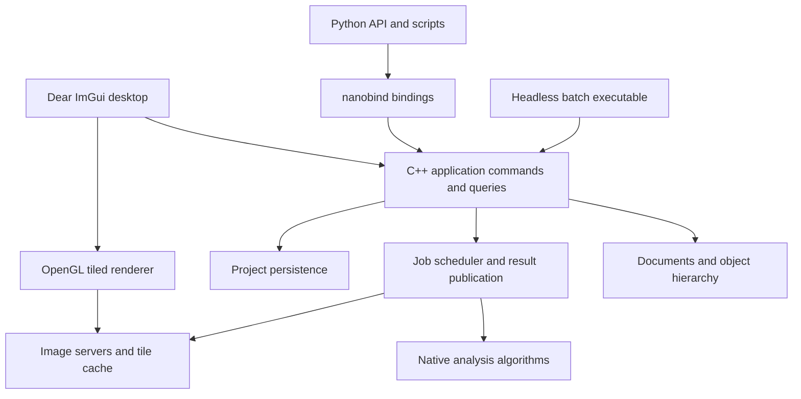

# qupathxx project plan

Build a C++ bioimage analysis application with a nanobind Python interface and
Dear ImGui desktop UI. The first useful release must open real whole-slide
images, edit and save annotations, run reproducible tissue and cell analysis,
and expose the same workflows to Python and headless batch execution.

Use `../naparixx` as the reference for native ownership, thin bindings,
standalone core tests and installed-package validation. QuPath defines the
workflow reference. Python API design and the ImGui frontend are new work.

## Scope and release boundaries

Target Windows x64 first, while keeping portable C++17 and CMake targets.
Add supported Linux and macOS packages after the Windows workflow is stable.
Keep GUI and Python optional so the native analysis engine runs without either.

Freeze the initial comparison baseline to
[QuPath v0.7.0](https://github.com/qupath/qupath/tree/v0.7.0), tag revision
`04ccfa4fb7d43e9b566393e08e83690b72248d44`. Track future upstream upgrades
explicitly. The [QuPath feature overview](https://qupath.readthedocs.io/en/stable/docs/intro/about.html)
identifies the major areas to inventory: image servers, annotations, detection,
classification, scripting and integrations.

| Release | User outcome | Scope boundary |
| --- | --- | --- |
| Current 0.1 foundation | View demo/PPM images, draw rectangles, access measurements from Python | Already implemented; no slide support or persistence |
| 0.2 slide annotation alpha | Open supported slides, navigate, annotate, save and reopen projects | Milestones M0 through M4 |
| 0.3 research analysis beta | Run calibrated tissue/cell workflows from UI and Python, batch export results | Milestones M5 and M6 |
| 1.0 defined workflow release | Install supported packages and reproduce accepted research workflows | M7; only the published support matrix is promised |
| Later parity releases | Broader QuPath functionality and interchange | Individually gated backlog; 1.0 does not imply full QuPath parity |

The long-term target includes QuPath's major research workflows. Java binary
compatibility, JavaFX widget parity, Java extensions and executing Groovy scripts
are outside the initial release. Python provides the new scripting surface.

## Current foundation

The first image-access packet has been implemented. See the
[workflow inventory](feature-matrix.md) and [image-server contract](image-server-contract.md)
for current scope and evidence. Synchronous dense/OpenSlide regions, optional
calibration, Python bindings and native region extraction are available; M0/M1
remain open for the decisions and capabilities listed in the inventory.

The C++ core owns image-server references, rectangles, stable annotation IDs,
calibration and measurements. Nanobind exposes that model. The GUI has a single
dense-image texture, pan/zoom, drawing, selection and deletion. Twenty Python
tests, two native tests and GUI startup/render/shutdown have passed on Windows.

Important changes before real research use:

- Extend synchronous image servers with asynchronous reads and bounded caching.
- Preserve the implemented unknown-calibration behavior when adding more readers.
- Replace per-frame measurement computation with revision-keyed cached results
  and background jobs where appropriate.
- Introduce command-based document mutations before adding editable polygons,
  undo/redo, persistence and asynchronous analysis.
- Add actual GUI interaction and rendering checks; startup alone does not
  verify annotation tools or visual correctness.

## Architecture and ownership

The C++ model is the authority for project state, object geometry, classes,
measurements and job status. Python and the UI issue the same commands. The UI
owns presentation state such as active panels and pointer gestures. Python may
orchestrate external scientific packages without owning a second document model.

| Module | Responsibility | Main dependencies |
| --- | --- | --- |
| `core` | IDs, documents, image metadata, object hierarchy, revisions, commands | Standard library |
| `geometry` | ROI shapes, holes, clipping, topology, spatial queries | Evaluate GEOS C API in M0; keep an adapter boundary |
| `io` | Image servers, metadata normalization, read requests, format capabilities | OpenSlide first; TIFF/OME readers later |
| `jobs` | Priorities, cancellation, resource limits, result publication | Native threads; no Python dependency |
| `render` | Tile selection, GPU cache, overlays, picking, display transforms | OpenGL |
| `analysis` | Stains, masks, detection, features, classification | OpenCV where useful; native workflow policy |
| `project` | Versioned storage, transactions, migration, export and provenance | SQLite proposed for local project storage |
| `gui` | Docked workspace, tools, inspectors, measurement tables | Dear ImGui and GLFW |
| `bindings` | Typed Python API, array exchange, lifetimes, exceptions | nanobind |

Split the current `core.cpp`, `bindings.cpp` and `gui.cpp` incrementally as these
responsibilities become real. Avoid creating empty modules ahead of working
features. Keep public headers under `cpp/include/qupathxx` and Python facades
under `src/qupathxx`.

## Contracts to establish first

**Images and coordinates.** Use signed 64-bit image dimensions and level-zero
pixel locations, double-precision ROI geometry, explicit pyramid transforms,
and explicit channel, Z and time axes. Readers declare supported axes, dtype,
color layout, calibration and region semantics. Preserve raw quantitative data
separately from display conversion. Normalize OpenSlide premultiplied ARGB
output deliberately; its region coordinates and output layout are documented in
the [OpenSlide API](https://openslide.org/api/openslide_8h.html).

**State and commands.** Give objects stable IDs, a document identity and revision,
and a validated hierarchy. Define selection independently of object ownership.
Publish changes only after a command succeeds. Group a gesture or detection
result into one undoable operation. Specify whether deleting a parent deletes
or reparents its children, and reject hierarchy cycles.

**Jobs and shutdown.** The application thread applies model mutations. Workers
read immutable inputs and publish results tagged with document identity,
image identity and input revisions. Reject stale results. Cancellation stops
publication immediately; a decoder that cannot be interrupted may finish its
current read. Retain reader handles until outstanding work completes. GPU
creation and destruction stay on the context thread.

**Python ownership.** Expose handles or snapshots with documented invalidation
rules. Array exports retain the native allocation; zero-copy views are read-only
unless an explicit editing transaction owns them. Validate dtype, shape, strides
and device. Release the GIL only around native operations that do not touch
Python. Queue document changes while the UI runs. The current blocking `show`
API stays supported until these rules are implemented and tested. Array exchange
will use [nanobind ndarray support](https://nanobind.readthedocs.io/en/latest/ndarray.html).

**Persistence and reproducibility.** Use one versioned project database for image
references, objects, classes, calibration and workflow provenance. Keep source
pixels external, with relative-path resolution and explicit missing-image
handling. Save changes transactionally; caches remain disposable. Record input
identity, parameters, software version, algorithm revision and model identity
alongside analysis results. Define image identity independently of file path;
support optional content hashes where their cost is acceptable.

## Milestones and acceptance criteria

### M0 Baseline and representative workloads

Create an upstream feature inventory with one row per workflow, linked source
areas, desired behavior, implementation owner, fixtures and acceptance checks.
Mark each row as missing, partial, accepted or deferred. Inventory is evidence
of scope; a feature becomes accepted only after its workflow passes.

Choose representative brightfield slides, a synthetic multiresolution image,
malformed/truncated inputs, and annotation fixtures including holes and overlaps.
Record redistribution rights and hashes. Define benchmark hardware, cold/warm
cache conditions and numerical tolerances before optimizing or comparing results.
Select geometry and persistence dependencies through small implementation probes;
record the project license and dependency distribution requirements before release.

Exit: pinned upstream source identity, fixture manifest, feature matrix,
coordinate/ownership decisions and reproducible build/test commands are recorded.
No real-data validation depends on private files that cannot be identified.

### M1 Image servers and whole slide access

Introduce `ImageServer`, `ImageMetadata`, `RegionRequest` and typed `PixelBuffer`.
Wrap the existing dense image as a server and implement OpenSlide with RAII,
error handling, thumbnails, level selection and calibration extraction.
Add cancellation-aware read scheduling, bounded decoded-tile caching and request
deduplication. Default to conservative per-handle read serialization until the
chosen reader's concurrency contract is tested. Add a native region-reading CLI
and bind the same server API to Python.

Exit: read matching regions at multiple levels from synthetic and supported
vendor fixtures; verify level-zero mappings, edge padding, alpha conversion,
missing metadata and decoder errors. Close/reopen while reads are pending
without a crash or stale result. Memory is bounded by configured budgets.

### M2 Tiled viewer and ImGui workspace

Replace the single texture with visible-tile selection, coarse-level fallback,
prioritized reads, bounded GPU residency and background decoding. Introduce a
render origin near the viewport so large coordinates retain overlay precision.
Add overview navigation, scale bar, channel/display controls and clear loading
and reader-error states. Track per-monitor DPI and framebuffer scaling.

Use an explicitly pinned ImGui docking revision when introducing docking.
Arrange the workspace around a central slide canvas: project/object browser on
the left, image/channel controls on the right, measurements and jobs below,
and annotation tools above. Persist layout preferences separately from projects.
Keep native implementation details out of ordinary research interactions.

Exit: navigate a real slide without loading the whole image or blocking the UI
on decoding; zoom stays anchored; overlays remain aligned through pyramid
changes and DPI scaling. Verify fit, pan, zoom, resize, minimize and close via
interaction tests and captured reference views.

### M3 Objects and annotation editing

Add rectangle, ellipse, polygon, polyline and point ROIs; implement holes and
multipart areas before claiming general polygon interchange. Add annotation,
detection and cell object types, classes, hierarchy, spatial index and multi-
selection. Route creation, geometry editing, classification and deletion through
commands with undo/redo. Cache features by object and calibration revision.

Exit: edit overlapping objects, undo/redo a compound operation, and preserve IDs,
hierarchy and class assignments. Invalid geometry follows a documented reject
or repair policy. Verify area, perimeter, containment and pixel sampling against
independent geometry fixtures, including anisotropic and unknown calibration.

### M4 Projects and interchange

Implement transactional save/load, schema versions, recovery from failed saves,
autosave, image relinking and migrations. Support GeoJSON annotations and CSV
measurement export with documented coordinate and class conventions.
Add QuPath-assisted export/import as the first migration route and measure
round-trip losses. Treat direct `.qpproj` and `.qpdata` support as separate
format-specific work; do not assume they share one serialization strategy.

Exit: save, restart and restore a multi-image project with matching IDs, geometry,
classes, calibration and measurements. Inject a failed write without losing the
previous valid state. Test moved image paths, missing images, unknown schema
versions and deterministic exports. Publish an interchange capability matrix.

This completes the 0.2 slide annotation alpha.

### M5 Reproducible native analysis

Implement an analysis request/result API on the job system. Start with optical
density, fixed stain-vector color deconvolution, threshold tissue detection,
connected components, region measurements and tiled execution with defined
halos and edge reconciliation. Then add stain estimation and watershed cell
detection, nucleus/cell geometry and intensity features. Make display transforms
independent of raw measurements. Never recompute expensive features every frame.

Exit: run identical parameterized jobs through C++, Python and the GUI and obtain
matching native results. Compare masks, object counts and features against pinned
QuPath workflows with tolerances set in M0. Quantify overlap, split/merge behavior
and feature errors; distinguish an intentional algorithm difference from a parity
failure. Tile borders do not duplicate or lose detections. Cancellation and
stale-result rejection leave the document consistent.

### M6 Python workflows and batch execution

Add NumPy region exchange with tested ownership, typed stubs, examples and a
stable public API for projects, ROIs, jobs and measurements. Support scripting
against a live viewer through queued commands and job notifications after the
GIL/thread contract is verified. Implement headless project processing, structured
logs, progress, restartable per-image results and parameter manifests.

Keep the C++ engine usable without Python. External models such as Cellpose or
StarDist may run through Python adapters that submit versioned results through
the same native publication path. Defer these adapters until native analysis
and array exchange are stable.

Exit: a script opens a slide, creates an ROI, runs analysis, exports measurements
and saves a project that reopens correctly in the UI. Test array lifetime after
document closure, concurrent job completion, exceptions and interpreter shutdown.
Batch failure on one image is reported with an explicit continuation policy.

This completes the 0.3 research analysis beta.

### M7 Distribution and supported workflow release

Produce standalone Windows installers/archives and GUI/headless Python wheels
with bundled or explicitly installed runtime dependencies. Add clean-machine
installation tests and CI for supported platforms, native tests, Python tests,
GUI smoke/interaction tests and workflow comparisons. Exercise address/undefined
behavior sanitizers on supported toolchains and concurrency checks where feasible.

Exit: a clean supported machine can install, open a fixture slide, annotate,
analyze, save, reopen and export using only documented steps. Ship notices,
versioned schemas, sample workflows and a known-limitations list. Require the
same workflow gates for standalone and Python-hosted builds. The release's
support matrix, numerical tolerances and performance budgets are published.

## Validation and performance targets

Use synthetic fixtures for exact transforms and pixel semantics; real slides
exercise decoding and workflow behavior. Keep pinned QuPath outputs independent
of the implementation under test. Record parameters and image regions alongside
each comparison. A test that calls the same implementation twice cannot establish
upstream parity.

The following are proposed engineering targets, to be frozen with benchmark
hardware and datasets in M0. They are not current performance claims.

| Workload | Initial target |
| --- | --- |
| Cached pan/zoom on a 2560 x 1440 viewport | p95 frame time at most 33 ms |
| Main-thread image decoding | None; decoding stays on workers |
| Decoded tile cache | Configurable cap; initial default 1 GiB |
| GPU tile cache | Configurable cap; initial default 512 MiB |
| Very large images | Open a fixture at least 100,000 pixels wide without full-image allocation |
| Object overlays | Benchmark 100,000 stored objects with visibility culling; apply cached-frame target |
| Job completion after document close | No publication, crash or leaked reader/GPU resource |
| Long batch runs | Stable steady-state memory within cache budgets plus documented job buffers |

Cache caps do not cover all process memory. Measure decoder caches, in-flight
buffers, analysis halos, object storage and GPU staging allocations separately.
Cold read latency is reported by format/storage rather than hidden inside a
universal frame-rate claim. Profile before optimizing individual kernels.

## Broader QuPath parity backlog

| Area | Planned extension | Prerequisite |
| --- | --- | --- |
| Formats and axes | TIFF/OME metadata, fluorescence, Z/time, higher bit depths, channel composites | Typed image servers and format fixtures |
| Classification | Object classifiers, pixel classifiers, training UI, portable model persistence | Measurements and analysis provenance |
| Tissue microarrays | Grid creation, core assignment, missing-core handling and per-core analysis | Object hierarchy and projects |
| Spatial analysis | Distances, neighborhoods, density maps and tiled feature aggregation | Spatial index and stable measurements |
| External integrations | Cellpose, StarDist, OMERO and ImageJ data exchange | Python adapters and interchange contracts |
| Workflow automation | Recorded native commands and parameterized pipelines | Stable commands and batch execution |
| QuPath project migration | Broader classes, detections, metadata and workflow exchange | Pinned format fixtures and loss reporting |
| Plugin system | Versioned C++ and Python extension interfaces | Stable engine API and lifecycle contract |

Expand the feature matrix before calling any of these areas complete. Similar
screenshots, source-line counts or a number of native bindings do not establish
workflow parity.

## Delivery order and planning assumptions

The critical sequence is M0, M1, M2, M3, M4, M5, M6, then M7. Add Python bindings
and focused tests alongside each native capability; M6 matures those APIs rather
than postponing Python integration. Project persistence can begin once M3 object
contracts settle, and packaging checks should run throughout development.

For capacity planning, allow roughly 4 to 7 engineer-months for the defined 1.0
scope, assuming one experienced full-time developer, Windows first, ready access
to representative slides, and external segmentation adapters deferred. This is
a rough scope estimate, not a delivery commitment. Geometry, numerical parity
and runtime packaging may extend it. Re-estimate after M1 and after the first
cell-detection comparison. Broader QuPath parity is a separate multi-release effort.

## First implementation packet

Implemented and validated on Windows: the installed editable package and a
fresh wheel installation each pass 20 Python tests, including identified Aperio
and synthetic pyramid reads. Two native tests pass with and without OpenSlide.
Unknown calibration is preserved. Detailed boundaries are in the workflow
inventory and image-server contract linked above.

Start with image access, not additional UI decoration:

1. Record the M0 feature matrix, fixture manifest and coordinate/pixel contracts.
2. Add optional calibration, signed 64-bit image metadata and typed pixel buffers.
3. Implement `ImageServer` and adapt the existing RGB image to it without breaking
   current rectangle and measurement tests.
4. Add OpenSlide discovery in CMake, reader lifetime management, error handling
   and a region-read CLI/Python API.
5. Verify multilevel region reads against independent expected pixels on a
   synthetic pyramid and at least one identified supported vendor slide.

The packet is complete when the installed Python package and standalone CLI
read the same requested regions and preserve unknown calibration correctly.
Only then begin the asynchronous tiled viewer work.

The second packet implements a bounded native read scheduler: request priorities,
deduplication, cancellation, source-scoped request generations and a decoded-tile
LRU cache. Its native and Python tests cover shutdown during reads, stale-result
rejection, bounded work reservations and cache pressure. See the
[scheduler contract](tile-scheduler-contract.md). The next packet connects it to
viewport tile selection and a bounded GPU cache in the ImGui viewer.

The third packet implements that tiled viewer, coarse-level fallback, scale bar,
background mean measurement and CLI slide opening. Its framebuffer tests verify
exact RGB output and real Aperio rendering. See [tiled-viewer.md](tiled-viewer.md)
for measured scope and remaining M2 gates. The project remains incomplete across
M0 through M7; no milestone is accepted from a screenshot or test count alone.

The fourth packet adds click/drag overview navigation, RGB channel/window/gamma
controls, ImGui pointer replay, and a generated large-image pyramid. Its 2560 x
1440 navigation benchmark performs 31 request generations with under 10 MiB of
GPU tile payload and approximately 17 ms p95 CPU frame work on the recorded
development host. This is a synthetic workload result, not full performance
acceptance. Continue with M3 while retaining all unfinished M0/M2 and M4–M7 gates.

The fifth packet adds indexed rectangular objects, atomic command batches,
parent/class edits, subtree deletion, revisions and bounded undo/redo to the GUI
and Python. The [command contract](document-commands.md) records validation and
large-document timing. M3 remains open for general geometry, object kinds, class
registries, multi-selection and spatial indexing.

The sixth packet adds immutable general ROIs, GEOS-validated holes and multipart
regions, analytic ellipse metrics and a native spatial index shared by picking
and overlay culling. Shape tools and undo/redo replay pass. See
[geometry-spatial.md](geometry-spatial.md) for dependency, numerical and benchmark
boundaries. Detection/cell kinds, class registries, multi-selection, vertex
editing and Boolean clipping remain M3 work; all unfinished M0-M7 gates persist.

The seventh packet adds detection/cell object kinds, optional independent nucleus
geometry, compartment area/RGB means and nucleus overlays. Atomic history and
spatial deltas retain both shapes. See [object-kinds.md](object-kinds.md) for
validation, import/history timings and remaining M3/M5 scope.

The eighth packet adds native class definitions/colors, indexed assignment counts,
atomic rename and batch classification. Class patches share the bounded document
journal; color edits preserve object revisions and spatial indexes. See
[classes.md](classes.md) for contracts, framebuffer evidence and the 100000-object
benchmark. Multi-selection, vertex editing and Boolean clipping remain M3 work;
the full M0-M7 plan remains active.

The ninth packet adds native multi-selection with primary/range/window semantics,
canvas/list gestures and group deletion through atomic commands. Classification
uses the existing batch command. Membership revisions avoid scanning selected
IDs after metadata/color changes. See [selection.md](selection.md) for input
replay evidence, packaging checks and the 100000-object selection workload.
Vertex/hole editing, Boolean clipping, QuPath comparisons and unfinished
M0-M7 gates remain active.

The tenth packet adds immutable vertex/hole edits and GEOS area overlays, shared
by Python commands and GUI vertex/hole/Boolean tools. Drag previews avoid
per-frame validation; release commits once. See [geometry-editing.md](geometry-editing.md)
for empty-result policy, ellipse approximation, hierarchy safeguards and
4096-vertex performance scope. M3 numerical comparisons and feature-cache
contracts remain open. Begin the M4 schema/persistence probe while retaining
all unfinished M0-M7 gates.

The eleventh packet implements native multi-image SQLite projects, an exact
versioned ROI encoding, canonical document restoration, relative file links,
lazy pixel readers and verified metadata relinking. Generation checks reject
stale writers; injected mid-save SQL failure verifies rollback. CLI project
opening and GUI Ctrl+S use the same container. See [project-storage.md](project-storage.md).
M4 remains open for in-window browsing, autosave/recovery UX, migrations and
GeoJSON/CSV plus QuPath-assisted interchange. M3 numerical/cache contracts and
all unfinished M0-M7 gates persist.

The twelfth packet adds deterministic native GeoJSON and measurement CSV,
staged atomic import, analytic ROI hints, parent remapping, explicit conversion
losses and ImGui import/export controls. See [interchange.md](interchange.md).
Protocol-shaped fixtures do not establish a QuPath runtime round trip. M4 still
requires that comparison, in-window browsing, autosave/recovery and migrations;
all unfinished M0-M7 gates remain active.

The thirteenth packet adds in-window project image browsing, file addition,
renaming and relinking. Frame-boundary switching retains independent session
views, display settings, selections and native document histories; old GPU
textures and measurement publication state are invalidated. See
[project-browser.md](project-browser.md). Persistent views, project-file open/
replacement UX, removal/dirty-close decisions, autosave/recovery and migrations
remain M4 work. Retain all unfinished M0-M7 gates and QuPath runtime comparisons.

The fourteenth packet persists native image centers, zoom and display settings
in schema 2, including inactive image views. GUI saves include the current frame's
navigation, and restore preserves the center at a different window size without
dirtying an unchanged project. A real schema-1 fixture verifies read-only loading,
save-as preservation and transactional schema/data rollback during migration.
See [project-workspace.md](project-workspace.md). Autosave/recovery, project-file
open/replacement and removal/dirty-close workflows remain M4 work; all unfinished
M0-M7 gates stay active.

The fifteenth packet adds native immutable recovery snapshots, one background
writer, payload budgeting, session ownership, protected destinations and atomic
publication. Dedicated recovery application IDs keep them distinct from primary
projects. ImGui periodic/manual autosave, staged recovery replacement and dirty-
close choices share the native backend; both launchers accept `--recover`.
Tests include live mutation isolation, replacement failure, lock contention and
abnormal process exit. See [project-recovery.md](project-recovery.md). Checkpoint
maintenance, abandoned work cleanup, moved-recovery association, ordinary project
open/removal and background explicit IO remain M4 work. QuPath runtime comparisons
and all unfinished M0-M7 requirements remain active.

The sixteenth packet adds in-window ordinary project opening on a single worker,
with ongoing live editing, cancellable adoption and staged Save/Discard/Cancel
replacement. Failed loading/saving preserves authority; saving over the selected
source reloads its new generation. Frame-boundary rebinding restores the opened
active view and catalog. Python-origin documents retire on the owner thread to
avoid shared-pointer GIL deadlocks. See [project-opening.md](project-opening.md).
Empty desktop workspaces, image removal, checkpoint maintenance, abandoned work
cleanup, moved-recovery association and background explicit saves/recovery loads
remain M4 work. All unfinished M0-M7 requirements remain active.

The seventeenth packet adds empty desktop workspaces, `show(project)` and native
`run_project_gui`, `--empty` in both launchers, New project dirty-work decisions,
and confirmed active-image removal through the empty-last-image transition.
Frame-boundary rebinding restores surviving state, removes old views/caches and
releases unreferenced Python-owned documents on the owner thread. Source files
and external document references are preserved. A 100000-object/1000-image run
records 14.1 ms removal/binding and 17.0 ms p95 CPU frame work. See
[project-lifecycle.md](project-lifecycle.md). Checkpoint maintenance, abandoned-work
cleanup, moved-recovery association and background explicit saves/recovery loads
remain M4 work. QuPath runtime comparisons and all unfinished M0-M7 gates persist.

The eighteenth packet adds native `ProjectSaveJob`, immutable bounded snapshots
for explicit saves, worker SQLite transactions and owner-thread baseline-only
acknowledgment. Newer live edits remain dirty; stale/detached results cannot
rewrite another workspace's baseline. ImGui ordinary save remains editable,
while close/replacement choices wait for durable completion. Tests include
competing writers, cancellation, rollback, legacy migration, live undo and
process kill with a verified hot journal. The loader retries SQLite's precise
rollback-required condition with temporary write access, then returns read-only.
See [project-save.md](project-save.md) for the 100000-object timing and limits.
Checkpoint maintenance, abandoned-work cleanup, moved-recovery association and
background recovery loads remain M4 work. All unfinished M0-M7 gates remain active.

The nineteenth packet shares the existing worker loader between ordinary projects
and recovery files, with cancellation of adoption, live editing until staging and
separate recovery timing. Native reviewed deletion fingerprints a validated
checkpoint under its publication lock and rejects changed files at confirmation;
ImGui review/confirmation/removal also run off the render thread. Stale discovery
results are invalidated by workspace/catalog revisions. See
[recovery-maintenance.md](recovery-maintenance.md). The 100000-object run exposes
a 38.4 ms maximum replacement frame when the old graph has no external owner;
retirement remains an optimization target. Automatic retention, abandoned-work
cleanup, moved recovery association and initial CLI loading progress remain M4
work. QuPath runtime comparisons and all unfinished M0-M7 gates remain active.

The twentieth packet adds explicit moved-primary recovery association through
native/Python APIs, the desktop optional-primary field and both launchers.
Identity-based bounded discovery finds renamed/custom sidecars, while captured
generations continue to reject stale writes. Metadata-only inspection caches the
primary identity instead of decoding unrelated graphs. It also moves eligible
native-factory graphs/selections to one retirement worker, while external/mixed
control blocks retain owner-thread/GIL safety. See
[recovery association](recovery-association.md) and [retirement](project-retirement.md).
The 1001-checkpoint/100000-object run records 17.0 ms frame p95 and 26.7 ms maximum
frame work; external graph release and broader pressure remain unoptimized.
Automatic retention, abandoned work cleanup, initial CLI loading progress, QuPath
runtime comparisons and all unfinished M0-M7 requirements remain active.

The same packet fixes image-server round-trip ownership: `enable_shared_from_this`
lets nanobind retain the native factory control block when a server is passed back
through Python. Save/autosave subprocess regressions verify worker snapshot release
after live server/document owners are dropped, without a GIL deadlock. Native
control-block identity is checked independently in the reader suite.

The twenty-first packet marks exclusively created autosave work directories and
reclaims recognized interrupted files under the exact destination's publication
lock. Publication precedes automatic cleanup, which deletes at most 32 directories
per write on the single existing worker; failures are
reported separately and allow publication/retry. The native/Python explicit API
can reclaim a known earlier session's destination without a published checkpoint.
Preflight preserves unexpected files, old unmarked debris and link/reparse entries;
there is no recursive deletion. Real killed-writer tests verify the interpreter
PID, including corrected Windows hot-journal fixtures. See
[recovery work cleanup](recovery-work-cleanup.md). Automatic cross-session work
discovery, checkpoint retention, initial CLI progress and all unfinished M0-M7
requirements remain active.

The cleanup benchmark exposed seconds of deletion before publication, so the
final writer publishes first and collects a bounded batch. With 1000 marked
directories present, the new checkpoint became visible after 256 ms; worker
completion including 32 removals took 330 ms. A later explicit sweep removed the
remaining 968. The desktop run records 16.9 ms p95 and 37.0 ms maximum frame work,
including a 34.5 ms capture pause, which remains unfinished performance work.
