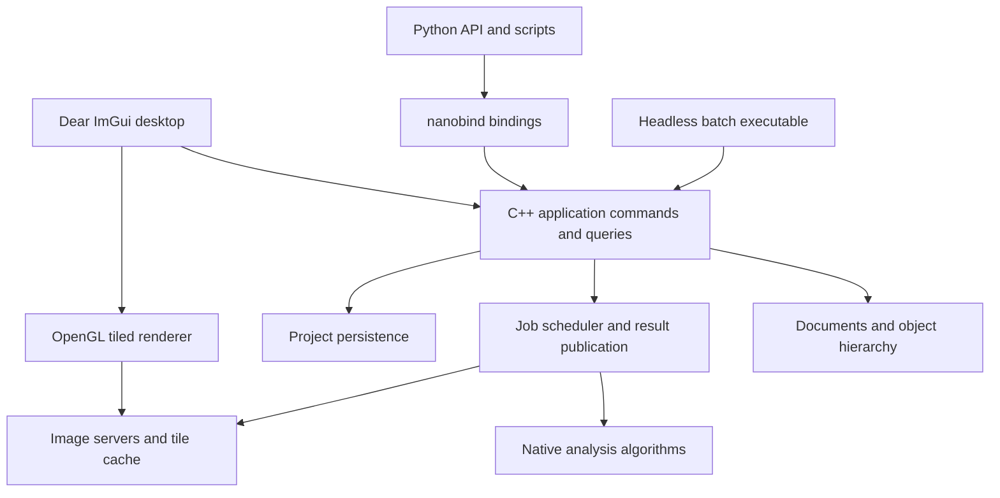

# qupathxx project plan

**Nominal cell Python SDK292 and shared ROI factory pass locally at nativeab706d47.**
The [receipt](benchmarks/nominal-cell-python-292/receipt.json) binds readonly owned
sampling descriptors on requests, results, masks and QCA6 origins, the explicit
CellRequest constructor and shared native `for_nominal_roi` bounds planner.
All31 new installed cases pass, including captured masks/features, ownership,
async keep, QCL6 project replay, typed CSV7/8 and QCA6 origins. Nominal CSV now
avoids the former area-grid-only dereference and records requested extents/counts
separately from nominal steps.55 Windows native/six affected GCC ASan+UBSan suites,
scientific628/eight declared GUI skips, consumer390/36 passes/skips,1076 audit
controls and9/6 typing files pass. Counts overlap.423 compiler inputs,887 source
paths,71 Windows/seven GCC products,39 installed members and43 wheel rows verify.
Only two generated stubs/RECORD change at observer8a90c43f after the native build.
An inspected real ImGui capture shows the original256x192 document and three
published nominal cells; it is not a derived-image preview. Direct/batch CLI,
checkpoint options, GUI creation controls and managed commands remain next.
OpenSlide is OFF and test dependencies are shared. Own-source full platform,
broader science/resource/hardware/support/release gates and all M0-M7 exits stay open.

**Native original-source nominal cells291 pass at37a7df51; frontend delivery is next.**
The [receipt](benchmarks/nominal-cells-291/receipt.json) binds an immutable nominal
sampling descriptor and original-document CellRequest, shared physical detector,
original-coordinate contours, QCL6 historical storage/project replay and QCA6
classifier origins. The pinned source reproduces processing RGB, three cells,
379 nucleus pixels and825 body pixels; RGB/OD features pass the original1e-6
checks. Added3x4 context preserves core labels. All55 Windows native suites and
six affected GCC13.3 ASan/UBSan suites pass. Installed regressions pass597/eight
declared scientific GUI skips and390/36 consumer passes/skips;1071 unique audit
controls pass across20 files. Counts overlap.423 compiler inputs,883 source paths,
71 Windows/seven repaired GCC products,39 package members and43 RECORD rows
authenticate. Public stubs are unchanged. Both earlier failed native runs remain
preserved: an external-reader embedding fixture, then a real source-pyramid versus
nominal-step provenance bug. The repaired project reopens and verifies against
its original source. Python nominal bindings and CLI/batch/ImGui/managed consumers
remain open; this package verifies native delivery and existing public interfaces.
OpenSlide is OFF and test dependencies are shared. Broader science, full source-
bound platform/resource/hardware/support/release gates and all M0-M7 exits stay open.

**Font285 is terminal and unaccepted overall.** Its [terminal291 receipt](benchmarks/gui-font-qualification-285/terminal291/receipt.json)
authenticates all11 archives. The complete original Mac auditor accepts54 native
suites per architecture at frozen1f71eb5; portable independently passes. Engine
remains failed. No redispatch, old-source rebuild or acceptance transfer occurred;
candidate281 remains the qualified feature baseline.

**Original-slide nominal cell integration is in progress; context290 passes locally.**
The [receipt](benchmarks/rgb-nominal-context-290/receipt.json) binds native65c03e4e:
one affected minimal native suite passes each MSVC/GCC13.3 ASan+UBSan profile.
All99 captured outputs stitch exactly at three tile sizes and keep unchanged cores
with added context; six source translations check negative context independently.
Each toolchain also passes99 real CLI hashes.136 scientific auditor controls use
the explicitly identified prior installed SDK289 runtime.418 canonical compiler
inputs,872 source paths, six new retained native products and71 unchanged SDK289
GUI products authenticate. Context windows keep the original nominal sampling
phase. No new Python/GUI package or original-document cell/archive/replay recipe
is delivered by this private primitive. The [implementation order](qupath-rgb-resampling.md#original-document-cell-recipe-implementation-order)
now names original-owner capture, shared kernels/result geometry, additive archive
and replay, then existing consumers. Both observer failures and available original
logs are preserved; no completed tests/builds were repeated for their recovery.
Full source-bound platform/science/hardware/release gates and all M0-M7 exits stay open.

**RGB nominal SDK289 is locally verified at native11f70cd1.**
The [receipt](benchmarks/rgb-nominal-sdk-289/receipt.json) binds an immutable
level-zero pixel request, native ImageServer adapter, thin GIL-releasing Python
binding and installed region CLI. All99 captured reads match through each public
Python/CLI route;55 Windows native suites and224 API cases pass. GCC13.3
ASan/UBSan passes the public native oracle and99 CLI processes. A separate owned
ImGui preview passes three cases, including rendered pixels and nominal per-axis
calibration. The final scientific cohort passes597/eight declared GUI skips,
1071 audit controls pass, and both scientific8/5 and raw7/5 typing groups verify.
Counts overlap.418 compiler inputs,872 current source paths,71 retained Windows
products, three GCC products,39 package members and43 wheel records authenticate.
Only two generated stubs and RECORD change in the final wheel; native source and
fingerprint stay11f70cd1/fa8fdd1c. Initial ZIP verifier failure and independent
fresh-reader recovery are preserved. Standalone delivery passes99 CLI hashes and
two layout/font smokes from the final wheel. This local GUI profile has OpenSlide
OFF and shared test dependencies; it is not clean-machine/platform acceptance.
Original-document detector/batch capture, archive/replay policy opt-in and a
corresponding application control remain open. The preview is a new image source,
not replay authority for the original slide. Default scientific sampling and
three strict legacy xfails are unchanged. Candidate281 remains qualified;
candidate285 engine remains unaccepted and its existing Mac arm64 job is pending.
All M0-M7, general speed, broader biology, hardware/support and release gates
remain partial/open.

**Private RGB nominal kernel287 passes99 pinned reads on Windows and GCC sanitizers.**
The [receipt](benchmarks/rgb-nominal-kernel-287/receipt.json) binds native23edd7ed,
36 original and63 held-out public QuPath reads. All72 held-out payloads repeat
exactly.32.32 coordinates, eight-bit interpolation fractions and one final
rounding reproduce every captured pixel. Crop interpolation uses global source
context; a cropped-input model fails eight held-out cases. The private planner
includes that halo, bounds buffers before IO and preserves large integer origins.
The native resampling suite passes each Windows minimal/GCC13.3 ASan+UBSan
profile, including opacity, admission, cancellation and malformed-window checks.
12 reference checks,371 scientific fixture passes/seven declared GUI skips and
1057 controls pass separately on the retained7231d95 Python runtime.418 canonical
compiler inputs,752 source paths and four new retained products authenticate;
all71 GUI products remain unchanged. SDK/readers/CLI/UI consumers and complete
own-source qualification remain open. Default quantitative sampling is unchanged.

**RGB input resampling286 is locally characterized at comparison83cd41df.**
The [receipt](benchmarks/qupath-rgb-resampling-286/receipt.json) binds36 pinned
public QuPath RGB reads, two complete byte-identical captures and82 new installed
checks. Related comparisons pass173 with the three legacy strict expected
failures unchanged; the full named scientific cohort passes359/seven declared
GUI skips and1054 audit controls pass. Counts overlap.661 scientific source paths
authenticate;415 compiler inputs and71 retained products remain unchanged at
native7231d95. No rebuild, native sampler change or acceptance transfer follows.
The [production route](qupath-rgb-resampling.md) now requires separate nominal
spacing, enlargement kernel, edge behavior and byte-rounding controls; the
earlier single1.5 case cannot define a general bilinear compatibility API.
Keep default quantitative policies and capture/replay authority explicit.
Frozen font285 continues independently with its original auditors: newer
scientific auditors require82 cases that its unchanged source does not contain.
Broader specimen/tolerance, physical UI, hardware/support/release and M0-M7 gates
remain open.

**Historical pre-terminal291 observation: candidate285 engine unaccepted; portable passed; Mac was pending.**
The [archive repair288](benchmarks/font-archive-288/receipt.json) retains all nine
currently available authenticated archives, the original engine rejection and
complete original-source portable acceptance at frozen1f71eb5. Windows GUI passes
55 native/4866 Python checks with14 declared skips including three legacy xfails;
its standalone layout/slide stages fail because archive_windows omitted fonts.
Observer01c3b9aa copies packaged font resources. The original CI archive fails
locally with missing fonts; a resource-only repack of the same CI wheel/native
bytes passes layout, reload and slide startup with clean PATH. Two unit cases
and1059 controls pass. No native rebuild, CI redispatch, binary relabeling or
combined acceptance follows. Observe the existing Mac run40743845473; preserve
the frozen ref/checkout. Candidate281 remains the qualified feature baseline.

**Current qualified feature baseline: candidate281 at `3f15c2b`.**
The [closeout283](benchmarks/stream-header-qualification-281/closeout283/receipt.json) authenticates all11 archives and successful complete original-source
engine, Mac-native and portable audits. Its source-specific GUI overview has
been inspected. This supersedes older campaign observations below; public main
is unchanged. The later font source `7231d95` is locally built and passes55 native
suites, five targeted font cases,395 installed GUI passes,348 nonrendering
passes,115 additional desktop passes and1053 audit controls. See the
[local font receipt](benchmarks/gui-font-delivery-283/receipt.json). Counts overlap. It inherits no281 platform acceptance. Three strict
scientific expected failures, representative speed/hardware, broader biology,
clean-machine support, licensing/release decisions and all M0-M7 exits remain open.
Real-GL [probe284](benchmarks/gui-font-gl-284/receipt.json) now verifies25 exact
texture readbacks and cleanup across six sessions of retained font source7231d95.
Peak queried live atlas storage is31.5MiB during quota growth; this is one-system
texture storage evidence. Physical DPI, new-runtime Name editing and source-bound
platform acceptance remain open.

Build a C++ bioimage analysis application with a nanobind Python interface and
Dear ImGui desktop UI. The first useful release must open real whole-slide
images, edit and save annotations, run reproducible tissue and cell analysis,
and expose the same workflows to Python and headless batch execution.

Use `../naparixx` as the reference for native ownership, thin bindings,
standalone core tests and installed-package validation. QuPath defines the
workflow reference. Python API design and the ImGui frontend are new work.

## Current execution map

Planning update: 2026-10-28 UTC, through engineering-qualified candidate281
at3f15c2b. Its combined closeout above accepts the complete original engine,
Mac-native and portable roles and preserves all11 archives. Original276 remains
terminal/unaccepted, while candidate273 remains a historical qualified source.
Later font283 has local Windows acceptance and requires its own platform gate.
Public main is unchanged. Do not repeat completed281 roles for documentation.
All **M0–M7 remain Partial**. Test totals measure their named
engineering scopes; they do not establish a percentage of QuPath parity.

The [API delivery queue](api-delivery-plan.md#dependency-lanes-and-immediate-queue)
is the sole scheduling authority. The [current task](current-task.md) records
observed state, the [workflow inventory](feature-matrix.md) records coverage,
and [implementation history](project-plan-history.md) preserves earlier packets.
The [Astra review](plan-review-astra.md) and
[compilexx review](reviews/compilexx-efficiency-review.md) explain adopted changes;
this update is a reconciliation, not a new independent model review.

| Scope | Current evidence | Remaining boundary |
| --- | --- | --- |
| Qualified public main | `61e546e`: [combined engineering receipt](benchmarks/raw-grid-191-qualification.json) | Later feature sources do not inherit this qualification |
| TMA and multi-file OME | Separate [TMA](benchmarks/tma-dearray-202-qualification.json) and [multi-file fault](benchmarks/multifile-fault-213-qualification.json) engineering acceptance | Biological, hardware and supported-release gates remain |
| Raw classification | [Campaign236](benchmarks/raw-classifier-236-campaign/closeout/receipt.json) at `530c6bb`: engine/portable audits accepted | Mac arm64 failure prevents complete T5 acceptance |
| Streamed contours | [Installed desktop/managed receipt](benchmarks/raw-stream-boundaries-local/frontends-245/receipt.json) at `7c77367`: nine native suites, 222 Python passes, three declared skips, typing and actual UI/save/reopen evidence | Later consumer rows record local delivery; integrated platform/scientific/resource/release gates remain |
| Historical QWS1 contours/replay | [Installed local receipt](benchmarks/raw-stream-boundaries-local/history-248/receipt.json) at `3039f0c`: nine Windows/five Clang suites, 298 Python passes/three skips, all 23 new cases, typing and inspected file/retained UI states | Mac repair and full integrated platform/scientific/resource/release gates remain |
| Streamed contour project batches | [Installed local receipt](benchmarks/raw-stream-boundaries-local/batch-247/receipt.json) at `f5ec3eb`: nine Windows/five Clang native suites, 274 Python passes/three skips, all 15 new batch cases, typing and actual UI launch/reuse | The history/replay row records local delivery; integrated platform/scientific/resource/release gates remain |
| Streamed contour CLI | [Installed local receipt](benchmarks/raw-stream-boundaries-local/cli-246/receipt.json) at `4e91d1e`: nine native suites, 240 Python passes/three declared skips, all 18 new CLI cases, stubs and typing | Later batch/history rows record local delivery; full platform/scientific/resource/release gates remain |
| Candidate257 / terminal Windows failure | `d57df01` retains complete Mac-native, Linux-only engine and portable acceptance. [Original Windows artifacts](benchmarks/raw-path-fixture-258/original257/engine-run.json) preserve one failed relocation fixture in each profile | Windows/Linux matrix is unaccepted. Continuing the fixture exposed real long-path checkpoint/fingerprint gaps; no old acceptance transfers to the repair |
| Qualified feature candidate258 | [Combined engineering receipt](benchmarks/raw-path-fixture-258/closeout/receipt.json) at `a5b5394`: all 11 archives authenticate; complete five-profile engine, both Mac-native architectures and portable builders/fresh consumers pass. Windows GUI: 51 native/4,429 Python; headless: 50/3,946; Linux headless: 50/3,942 | Explicit-root locator reuse (witness259), Unicode/broader UI, science/hardware/support/release and all remaining M0-M7 requirements stay open. Public-main baseline is unchanged |
| Locator serialization candidate260 | [Local receipt](benchmarks/root-locator-fix-260/receipt.json) at f9ad28f: image/QSL1/QWL1 locators stabilize, four red/green cases pass | [Terminal260](benchmarks/root-locator-fix-260/terminal/receipt.json): complete Mac/portable audits pass; engine fails one sanitizer viewer_session assertion, so the candidate remains unaccepted |
| Qualified feature candidate262 | [combined closeout262](benchmarks/owner-delivery-race-262/closeout/receipt.json) at e2282b8: all11 archives authenticate; full five-profile engine, both Mac-native architectures and portable builders/fresh consumers pass | Public main is unchanged. Mac Python/GUI/OpenSlide, scientific/hardware/UI/support/release gates remain; spatial263/264 inherits no acceptance |
| SPAT1 native CLI267 | [Receipt267](benchmarks/spatial-cli-267/receipt.json) at native9468ae3/observer65f2c5d: five affected native suites and30 real CLI process cases pass each Windows GEOS-ON/OFF profile. Measure/save, historical export and fresh verification reuse the installed266/native persistence foundation; bounded ID files avoid argv limits | Later frontend268 supplies locally packaged Windows desktop/managed delivery. Headless/fault/cohort admission and own-source platform/scientific/resource/release gates remain; no qualification transfers from262/266 |
| SPAT1 frontends268 | [Receipt268](benchmarks/spatial-frontends-268/receipt.json) at d9bba6b / stub observer c360ac9:55 native suites and132 installed passes; shared desktop/managed controller, history/verify/export/save/reopen, exact wheel/runtime/stubs/typing and inspected capture | Headless/GEOS-OFF, expanded desktop fault controls, qualification cohort admission and own-source platform gate remain; no general speed/science/release acceptance |
| SPAT1 fault/cohort269 | [Receipt269](benchmarks/spatial-faults-269/receipt.json):55 native suites,268 unique installed GUI-mode passes,993 auditor controls and exact native/typing/package admission; separate headless/OFF source passes six suites/30 CLI cases | Close planned M6 live-Document wait audit, then one combined own-source qualification. No science, general-speed, hardware or release acceptance |
| M6 Document waits270 | [Receipt270](benchmarks/document-waits-270/receipt.json):55 native suites,72 nine-controller controls,545 unique installed GUI-mode passes,1000 auditor controls and matching typing/package/runtime evidence | Freeze combined spatial/wait source for full own-source qualification. Broad M6, science, representative hardware/speed, support and release gates remain |
| Combined candidate271 | ee19be5 frozen; [terminal272](benchmarks/spatial-waits-271/terminal272/receipt.json) authenticates nine available archives and retains original logs/XML. Mac-native independently passes complete audit; engine/portable fail schema13 descriptor diagnostics and fresh consumers are skipped | Combined acceptance unavailable. Retain failed/skipped roles and original source; candidate262 remains the qualified baseline. No release/main promotion |
| Observer repair272 / original271 diagnosis | [Repair272](benchmarks/schema-observer-272/receipt.json) at3aca3d9: two red/two green benchmark process controls,10000-record headless/GUI benchmarks,1007 audit controls and exact installed admission307/one GUI skip,260/48 nonrendering skips. All410 compiler inputs unchanged;534 source paths authenticate | Freeze one successor own-source campaign. Original271 and262 acceptance never transfers to changed source; no broad science, speed or release acceptance |
| Qualified feature candidate273 | [Combined closeout275](benchmarks/schema-observer-273/closeout275/receipt.json) at5f1760a: all11 archives and complete engine/Mac-native/portable audits pass. Engine auditor432c36c corrects stale34to35 record-cohort count and requires all13 named schema14 migrations; original rejection preserved. No CI rerun or application rebuild | Later snapshot waits274 remain outside this qualification. No main promotion, science/general-speed/hardware/support/release acceptance or M0-M7 completion |
| Snapshot-controller waits274 | [Receipt274](benchmarks/snapshot-waits-274/receipt.json) at native048cf25/observer92bb6c2:55 native suites,48 new controls,459 unique installed passes,1015 auditor controls and exact package/runtime/stub/typing proof. Five older Document-free controllers reuse the guarded wait bridge | Own-source full qualification remains;273 predates274. Broad M6 and independent scientific/speed/hardware/support/release requirements remain open |
| Candidate276 qualification | [Campaign276](benchmarks/snapshot-waits-276/receipt.json) at9d92322: one identified full engine/Mac-native/portable run each,539 authenticated source paths and410 compiler Git blobs equal testednative048cf25. Initial metadata GET timeout and zero-run recovery observation are preserved | Terminal/unaccepted: all11 archives authenticate; original Mac-native/portable audits independently pass, engine rejects the header-mutation failure. [Terminal279](benchmarks/snapshot-waits-276/terminal279/receipt.json) preserves failure. Candidate273 stays qualified; no acceptance transfer, main promotion or release |
| Stream integrity279 / observers280 | [Local receipt](benchmarks/stream-header-integrity-279/receipt.json): native3bd6591;22 raw-header red/green controls,41 QPS file cases,55 native suites,588 unique installed passes and1039 audit controls. Wait/copy observers128b313/73b2f8e preserve410 compiler inputs; original failures remain | One own-source successor qualification; science, representative speed/hardware, broader UI, supported packages and release remain open |
| Mac link policy | [Original-object255](benchmarks/raw-original-object-255/receipt.json) isolates incorrect default-link folding of typed handlers; policy87b9dac disables it for project Darwin links. [Complete candidate257 Mac audit](benchmarks/raw-link-qualification-257/macos-terminal/macos-acceptance.json) accepts both 50-suite architectures, inventory and relocation | Mac Python/GUI/OpenSlide remain open. Original failures, binary observations and negative tiny witness remain under their original identities |

Candidate258 has complete declared engineering qualification at `a5b5394`.
The combined receipt binds all 11 archives and every required engine, Mac-native
and portable audit. Candidate257 remains terminal with original Windows failures;
its earlier successes retain their own source. The qualified feature checkout
and products stay immutable, with no main promotion or release.
M3-ALIAS1 is locally delivered at `f9ad28f`: the shared locator helper repairs
image and RGB/raw stream serialization while preserving source/model and
no-overwrite guards. Four regressions fail on the retained qualified baseline
and pass on that runtime. Original260 then exposed a distinct owner-delivery
race in the sanitizer preview test. Repair262 at e2282b8 now collects the future
before delivery; local checks and all original complete qualification audits now pass.
Candidate262 becomes the qualified feature baseline; candidate258 stays preserved.
Do not rebuild for a plan edit or transfer qualification to changed spatial code.
The [B6 checklist](api-delivery-plan.md#b6-execution-checklist) owns this sequence.
Original failures, observer249's setup failure, observer252's binary mismatch,
the negative tiny witness and original-object255's controlled link comparison
retain their source-bound evidence. This staged route avoids rebuilding the
repaired Mac profile twice while preserving the final all-role gate.
The [contract250 receipt](benchmarks/raw-classifier-contract-250/receipt.json)
now closes local domain admission at `20e0b07`: 183 controls, exact actual
GUI/headless cohorts, pinned mypy and retained native ON/OFF outputs pass.
Candidate257 retains its scoped Mac-native/portable successes and Windows
failure. Candidate258 separately accepts every required role at its repaired source.
The [broader local regression](benchmarks/raw-integration-regression-251/receipt.json)
adds a 4,420-identity installed observation. Its one GUI cancellation fixture
failure is corrected against the unchanged package, with two affected cases
passing; combined scope is 4,293 passes, 124 skips and three unresolved strict
scientific xfails. Original failures and source identities remain explicit.

[Resource253](benchmarks/raw-stream-resources-253/receipt.json) adds actual OS
process peaks for a fixed-budget synthetic stream: 29.254 to 33.371 MiB across 256x
as many samples, with exact two-class geometry and 22 verifier controls. This is a
local low-complexity characterization, not general or eligible-hardware acceptance.

Scientific/model comparisons, fixture rights/labels, measured resource/hardware
budgets, clean-machine support and release decisions remain independent open
gates. Use only open-source readers and required codecs, including eligible
copyleft implementations, under the [reader policy](reader-license-policy.md).
No main promotion, project-license choice, signing or release follows from this
planning update.

The [current execution card](current-task.md) records the current frozen
source, local evidence and original hosted run. Four inspected captures preserve
correct historical/apply states; Chinese filename glyphs still use placeholders
despite correct stored UTF8 metadata. General glyph coverage remains an M2/UI gap.

## Scope and release boundaries

Reader scope is limited to open-source-licensed implementations and decoder
dependencies under the [reader licensing policy](reader-license-policy.md).
Proprietary SDK readers are excluded from required parity. Vendor formats
remain eligible through open-source readers.

Target Windows x64 first, while keeping portable C++17 and CMake targets.
Add supported Linux and macOS packages after the Windows workflow is stable.
Keep GUI and Python optional so the native analysis engine runs without either.

Freeze the initial comparison baseline to
[QuPath v0.7.0](https://github.com/qupath/qupath/tree/v0.7.0), tag revision
`04ccfa4fb7d43e9b566393e08e83690b72248d44`. Track future upstream upgrades
explicitly. The [QuPath feature overview](https://qupath.readthedocs.io/en/stable/docs/intro/about.html)
identifies the major areas to inventory: image servers, annotations, detection,
classification, scripting and integrations.

| Release | User outcome | Scope boundary |
| --- | --- | --- |
| Starting 0.1 foundation | View demo/PPM images, draw rectangles, access measurements from Python | Historical starting point; later implementation packets below track current behavior |
| 0.2 slide annotation alpha | Open supported slides, navigate, annotate, save and reopen projects | Milestones M0 through M4 |
| 0.3 research analysis beta | Run calibrated tissue/cell workflows from UI and Python, batch export results | Milestones M5 and M6 |
| 1.0 defined workflow release | Install supported packages and reproduce accepted research workflows | M7; only the published support matrix is promised |
| Later parity releases | Broader QuPath functionality and interchange | Individually gated backlog; 1.0 does not imply full QuPath parity |

The long-term target includes QuPath's major research workflows. Java binary
compatibility, JavaFX widget parity, Java extensions and executing Groovy scripts
are outside the initial release. Python provides the new scripting surface.

## Starting foundation (historical; not the current backlog)

This section records the initial state. The workflow inventory and the latest
implementation packets below track current capabilities and validation.

The first image-access packet has been implemented. See the
[workflow inventory](feature-matrix.md) and [image-server contract](image-server-contract.md)
for current scope and evidence. Synchronous dense/OpenSlide regions, optional
calibration, Python bindings and native region extraction are available; M0/M1
remain open for the decisions and capabilities listed in the inventory.

The C++ core owns image-server references, rectangles, stable annotation IDs,
calibration and measurements. Nanobind exposes that model. The GUI has a single
dense-image texture, pan/zoom, drawing, selection and deletion. Twenty Python
tests, two native tests and GUI startup/render/shutdown have passed on Windows.

Important changes before real research use:

- Extend synchronous image servers with asynchronous reads and bounded caching.
- Preserve the implemented unknown-calibration behavior when adding more readers.
- Replace per-frame measurement computation with revision-keyed cached results
  and background jobs where appropriate.
- Introduce command-based document mutations before adding editable polygons,
  undo/redo, persistence and asynchronous analysis.
- Add actual GUI interaction and rendering checks; startup alone does not
  verify annotation tools or visual correctness.

## Architecture and ownership

The C++ model is the authority for project state, object geometry, classes,
measurements and job status. Python and the UI issue the same commands. The UI
owns presentation state such as active panels and pointer gestures. Python may
orchestrate external scientific packages without owning a second document model.

| Module | Responsibility | Main dependencies |
| --- | --- | --- |
| `core` | IDs, documents, image metadata, object hierarchy, revisions, commands | Standard library |
| `geometry` | ROI shapes, holes, clipping, topology, spatial queries | GEOS C API; retain the adapter boundary |
| `io` | Image servers, metadata normalization, read requests, format capabilities | OpenSlide and quantitative TIFF/OME; broader adapters remain |
| `jobs` | Priorities, cancellation, resource limits, result publication | Native threads; no Python dependency |
| `render` | Tile selection, GPU cache, overlays, picking, display transforms | OpenGL |
| `analysis` | Stains, masks, detection, features, classification | OpenCV where useful; native workflow policy |
| `project` | Versioned storage, transactions, migration, export and provenance | SQLite; already integrated |
| `gui` | Docked workspace, tools, inspectors, measurement tables | Dear ImGui and GLFW |
| `bindings` | Typed Python API, array exchange, lifetimes, exceptions | nanobind |

Split the current `core.cpp`, `bindings.cpp` and `gui.cpp` incrementally as these
responsibilities become real. Avoid creating empty modules ahead of working
features. Keep public headers under `cpp/include/qupathxx` and Python facades
under `src/qupathxx`.

## Contracts to establish first

**Images and coordinates.** Use signed 64-bit image dimensions and level-zero
pixel locations, double-precision ROI geometry, explicit pyramid transforms,
and explicit channel, Z and time axes. Readers declare supported axes, dtype,
color layout, calibration and region semantics. Preserve raw quantitative data
separately from display conversion. Normalize OpenSlide premultiplied ARGB
output deliberately; its region coordinates and output layout are documented in
the [OpenSlide API](https://openslide.org/api/openslide_8h.html).

**State and commands.** Give objects stable IDs, a document identity and revision,
and a validated hierarchy. Define selection independently of object ownership.
Publish changes only after a command succeeds. Group a gesture or detection
result into one undoable operation. Specify whether deleting a parent deletes
or reparents its children, and reject hierarchy cycles.

**Jobs and shutdown.** The application thread applies model mutations. Workers
read immutable inputs and publish results tagged with document identity,
image identity and input revisions. Reject stale results. Cancellation stops
publication immediately; a decoder that cannot be interrupted may finish its
current read. Retain reader handles until outstanding work completes. GPU
creation and destruction stay on the context thread.

**Python ownership.** Expose handles or snapshots with documented invalidation
rules. Array exports retain the native allocation; zero-copy views are read-only
unless an explicit editing transaction owns them. Validate dtype, shape, strides
and device. Release the GIL only around native operations that do not touch
Python. Queue document changes while the UI runs. The current blocking `show`
API stays supported until these rules are implemented and tested. Array exchange
will use [nanobind ndarray support](https://nanobind.readthedocs.io/en/latest/ndarray.html).

**Persistence and reproducibility.** Use one versioned project database for image
references, objects, classes, calibration and workflow provenance. Keep source
pixels external, with relative-path resolution and explicit missing-image
handling. Save changes transactionally; caches remain disposable. Record input
identity, parameters, software version, algorithm revision and model identity
alongside analysis results. Define image identity independently of file path;
support optional content hashes where their cost is acceptable.

## Milestones and acceptance criteria

### M0 Baseline and representative workloads

Create an upstream feature inventory with one row per workflow, linked source
areas, desired behavior, implementation owner, fixtures and acceptance checks.
Mark each row as missing, partial, accepted or deferred. Inventory is evidence
of scope; a feature becomes accepted only after its workflow passes.

Choose representative brightfield slides, a synthetic multiresolution image,
malformed/truncated inputs, and annotation fixtures including holes and overlaps.
Record redistribution rights and hashes. Define benchmark hardware, cold/warm
cache conditions and numerical tolerances before optimizing or comparing results.
Select geometry and persistence dependencies through small implementation probes;
record the project license and dependency distribution requirements before release.

Exit: pinned upstream source identity, fixture manifest, feature matrix,
coordinate/ownership decisions and reproducible build/test commands are recorded.
No real-data validation depends on private files that cannot be identified.

### M1 Image servers and whole slide access

Introduce `ImageServer`, `ImageMetadata`, `RegionRequest` and typed `PixelBuffer`.
Wrap the existing dense image as a server and implement OpenSlide with RAII,
error handling, thumbnails, level selection and calibration extraction.
Add cancellation-aware read scheduling, bounded decoded-tile caching and request
deduplication. Default to conservative per-handle read serialization until the
chosen reader's concurrency contract is tested. Add a native region-reading CLI
and bind the same server API to Python.

Exit: read matching regions at multiple levels from synthetic and supported
vendor fixtures; verify level-zero mappings, edge padding, alpha conversion,
missing metadata and decoder errors. Close/reopen while reads are pending
without a crash or stale result. Memory is bounded by configured budgets.

### M2 Tiled viewer and ImGui workspace

Replace the single texture with visible-tile selection, coarse-level fallback,
prioritized reads, bounded GPU residency and background decoding. Introduce a
render origin near the viewport so large coordinates retain overlay precision.
Add overview navigation, scale bar, channel/display controls and clear loading
and reader-error states. Track per-monitor DPI and framebuffer scaling.

Use an explicitly pinned ImGui docking revision when introducing docking.
Arrange the workspace around a central slide canvas: project/object browser on
the left, image/channel controls on the right, measurements and jobs below,
and annotation tools above. Persist layout preferences separately from projects.
Keep native implementation details out of ordinary research interactions.

Exit: navigate a real slide without loading the whole image or blocking the UI
on decoding; zoom stays anchored; overlays remain aligned through pyramid
changes and DPI scaling. Verify fit, pan, zoom, resize, minimize and close via
interaction tests and captured reference views.

### M3 Objects and annotation editing

Add rectangle, ellipse, polygon, polyline and point ROIs; implement holes and
multipart areas before claiming general polygon interchange. Add annotation,
detection and cell object types, classes, hierarchy, spatial index and multi-
selection. Route creation, geometry editing, classification and deletion through
commands with undo/redo. Cache features by object and calibration revision.

Exit: edit overlapping objects, undo/redo a compound operation, and preserve IDs,
hierarchy and class assignments. Invalid geometry follows a documented reject
or repair policy. Verify area, perimeter, containment and pixel sampling against
independent geometry fixtures, including anisotropic and unknown calibration.

### M4 Projects and interchange

Implement transactional save/load, schema versions, recovery from failed saves,
autosave, image relinking and migrations. Support GeoJSON annotations and CSV
measurement export with documented coordinate and class conventions.
Add QuPath-assisted export/import as the first migration route and measure
round-trip losses. Treat direct `.qpproj` and `.qpdata` support as separate
format-specific work; do not assume they share one serialization strategy.

Exit: save, restart and restore a multi-image project with matching IDs, geometry,
classes, calibration and measurements. Inject a failed write without losing the
previous valid state. Test moved image paths, missing images, unknown schema
versions and deterministic exports. Publish an interchange capability matrix.

Accept the 0.2 slide annotation alpha only after the M0–M4 exit evidence is recorded for its defined workflows.

### M5 Reproducible native analysis

Implement an analysis request/result API on the job system. Start with optical
density, fixed stain-vector color deconvolution, threshold tissue detection,
connected components, region measurements and tiled execution with defined
halos and edge reconciliation. Then add stain estimation and watershed cell
detection, nucleus/cell geometry and intensity features. Make display transforms
independent of raw measurements. Never recompute expensive features every frame.

Exit: run identical parameterized jobs through C++, Python and the GUI and obtain
matching native results. Compare masks, object counts and features against pinned
QuPath workflows with tolerances set in M0. Quantify overlap, split/merge behavior
and feature errors; distinguish an intentional algorithm difference from a parity
failure. Tile borders do not duplicate or lose detections. Cancellation and
stale-result rejection leave the document consistent.

### M6 Python workflows and batch execution

Add NumPy region exchange with tested ownership, typed stubs, examples and a
stable public API for projects, ROIs, jobs and measurements. Support scripting
against a live viewer through queued commands and job notifications after the
GIL/thread contract is verified. Implement headless project processing, structured
logs, progress, restartable per-image results and parameter manifests.

Keep the C++ engine usable without Python. External models such as Cellpose or
StarDist may run through Python adapters that submit versioned results through
the same native publication path. Defer these adapters until native analysis
and array exchange are stable.

Exit: a script opens a slide, creates an ROI, runs analysis, exports measurements
and saves a project that reopens correctly in the UI. Test array lifetime after
document closure, concurrent job completion, exceptions and interpreter shutdown.
Batch failure on one image is reported with an explicit continuation policy.

Accept the 0.3 research analysis beta only after M5/M6 scientific and workflow evidence is recorded; engineering CI alone is insufficient.

### M7 Distribution and supported workflow release

Produce standalone Windows installers/archives and GUI/headless Python wheels
with bundled or explicitly installed runtime dependencies. Add clean-machine
installation tests and CI for supported platforms, native tests, Python tests,
GUI smoke/interaction tests and workflow comparisons. Exercise address/undefined
behavior sanitizers on supported toolchains and concurrency checks where feasible.

Exit: a clean supported machine can install, open a fixture slide, annotate,
analyze, save, reopen and export using only documented steps. Ship notices,
versioned schemas, sample workflows and a known-limitations list. Require the
same workflow gates for standalone and Python-hosted builds. The release's
support matrix, numerical tolerances and performance budgets are published.

## Validation and performance targets

Use synthetic fixtures for exact transforms and pixel semantics; real slides
exercise decoding and workflow behavior. Keep pinned QuPath outputs independent
of the implementation under test. Record parameters and image regions alongside
each comparison. A test that calls the same implementation twice cannot establish
upstream parity.

The following are proposed engineering targets, to be frozen with benchmark
hardware and datasets in M0. They are not current performance claims.

| Workload | Initial target |
| --- | --- |
| Cached pan/zoom on a 2560 x 1440 viewport | p95 frame time at most 33 ms |
| Main-thread image decoding | None; decoding stays on workers |
| Decoded tile cache | Configurable cap; initial default 1 GiB |
| GPU tile cache | Configurable cap; initial default 512 MiB |
| Very large images | Open a fixture at least 100,000 pixels wide without full-image allocation |
| Object overlays | Benchmark 100,000 stored objects with visibility culling; apply cached-frame target |
| Job completion after document close | No publication, crash or leaked reader/GPU resource |
| Long batch runs | Stable steady-state memory within cache budgets plus documented job buffers |

Cache caps do not cover all process memory. Measure decoder caches, in-flight
buffers, analysis halos, object storage and GPU staging allocations separately.
Cold read latency is reported by format/storage rather than hidden inside a
universal frame-rate claim. Profile before optimizing individual kernels.

## Broader QuPath parity backlog

| Area | Planned extension | Prerequisite |
| --- | --- | --- |
| Formats and axes | TIFF/OME metadata, fluorescence, Z/time, higher bit depths, channel composites | Typed image servers and format fixtures |
| Classification | Object classifiers, pixel classifiers, training UI, portable model persistence | Measurements and analysis provenance |
| Tissue microarrays | Grid creation, core assignment, missing-core handling and per-core analysis | Object hierarchy and projects |
| Spatial analysis | Distances, neighborhoods, density maps and tiled feature aggregation | Spatial index and stable measurements |
| External integrations | Cellpose, StarDist, OMERO and ImageJ data exchange | Python adapters and interchange contracts |
| Workflow automation | Recorded native commands and parameterized pipelines | Stable commands and batch execution |
| QuPath project migration | Broader classes, detections, metadata and workflow exchange | Pinned format fixtures and loss reporting |
| Plugin system | Versioned C++ and Python extension interfaces | Stable engine API and lifecycle contract |

Expand the feature matrix before calling any of these areas complete. Similar
screenshots, source-line counts or a number of native bindings do not establish
workflow parity.

## Execution order from the present state

The [API delivery queue](api-delivery-plan.md#dependency-lanes-and-immediate-queue)
is the sole detailed scheduling authority. MFO1 campaign213 is engineering
accepted. SCI1-B streamed consumers are locally delivered. Candidate258 now has
complete declared engine/Mac-native/portable engineering qualification at a5b5394.
Keep that checkout/products immutable. M3-ALIAS1 is locally repaired at frozen
f9ad28f. Its engine sanitizer failure led to the locally verified e2282b8 owner-
delivery repair. Finish the original262 engine/Mac/portable campaign before
claiming acceptance of that source. Then continue
the remaining SCI1-B workflows, decision lane and REL1 through every M0-M7 criterion.
The current task card records observed status, not another ordered backlog.

Retain the accepted `61e546e` baseline and original failed candidates. Reuse
unchanged native products for observer/package-only changes with explicit
identity/applicability proof; a changed source label alone does not require a
compiler run. Independent dataset, scientific, hardware and release decisions
keep their own dependencies and do not become substitutes for implementation.

Estimate remaining work per complete user workflow after identifying its actual
code, fixture, scientific, hardware and decision dependencies. The historical
4-7 engineer-month estimate and percentages derived from test counts are not
current estimates. No workflow is complete from a preparatory parser, fixture
or green job count alone.

## Planning and validation discipline

Use one active integration source, one frozen qualification source and a
read-only comparison checkout only when needed. An exception needs a concrete
isolation reason and a retirement condition. Never reset the divergent local
root branch. Retire obsolete builds/worktrees only after preserving source
refs, evidence and logs and checking active processes; use bounded native
cleanup operations. Do not delete fixtures or an installed comparison engine
because its directory is named `build`.

Complete a vertical slice through native API, thin binding, persistence where
applicable, CLI/UI entry point, documented example and meaningful tests before
starting a neighboring feature. A preparatory parser or reference capture can
be a useful substep, but does not become the release acceptance unit.

Validation has three scopes:

- During edits, run affected native/installed tests and an independent oracle
  when numerical or interchange behavior changes. Verify enabled capability
  markers; a passing disabled branch proves only feature-disabled behavior.
- After the slice works, install the wheel in an isolated environment, regenerate
  stubs once, check typing and relevant desktop/persistence regressions. Inspect
  installed compiled-source and package identities. Rebuild native code only
  when its consumed inputs/configuration change or the required qualification
  needs a fresh build; package/stub/observer-only changes reuse proved native
  products and qualify the changed layer.
- Freeze a candidate for full cross-platform engine, Mac and portable audits.
  Keep one dispatch per source/mode. Observe its exact run through completion;
  a polling timeout is not a build failure. No promotion until required audits
  pass at that source. A compiler-input change during qualification creates a
  new candidate and requires affected qualification; documentation-only changes
  retain a separate tooling/docs identity and a demonstrated input comparison.

Use a shared evidence reader for JUnit status, capability markers, source hashes
and publication receipts, with small domain contracts. Consolidate the duplicated
existing auditors incrementally only while touching a relevant workflow; avoid
an unrelated framework rewrite. Require semantic outcomes and explicit fixture
coverage rather than continually increasing global test-count constants. Keep
negative controls for the auditor itself. Text source normalization must not
normalize byte-addressed fixtures or artifacts.

Before optimizing, name the user workload and bottleneck, freeze expected
outputs and compare elapsed time, allocations/peak memory, decode/IO and UI
latency appropriate to that workload. Retain failed and excluded samples. Reuse
existing accepted component improvements by byte/behavior evidence; do not
repeat them simply because a new packet number exists. Component timings stay
component claims. Scientific tolerances and eligibility criteria cannot be
relaxed after seeing results. End-to-end hardware gates still require eligible
runs on the declared machine and cache state.

The [workflow inventory](feature-matrix.md) owns current capability status;
individual contracts own numerical/lifecycle details; the tables above own
milestone acceptance; [history](project-plan-history.md) retains earlier packets.
Add short evidence links and update the affected status row after a result. Do
not append another long chronological status report to this active plan.
