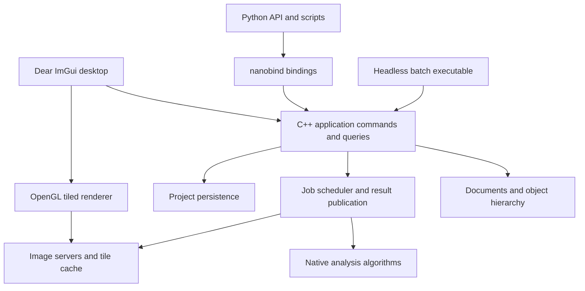

# qupathxx project plan

Build a C++ bioimage analysis application with a nanobind Python interface and
Dear ImGui desktop UI. The first useful release must open real whole-slide
images, edit and save annotations, run reproducible tissue and cell analysis,
and expose the same workflows to Python and headless batch execution.

Use `../naparixx` as the reference for native ownership, thin bindings,
standalone core tests and installed-package validation. QuPath defines the
workflow reference. Python API design and the ImGui frontend are new work.

## Scope and release boundaries

Target Windows x64 first, while keeping portable C++17 and CMake targets.
Add supported Linux and macOS packages after the Windows workflow is stable.
Keep GUI and Python optional so the native analysis engine runs without either.

Freeze the initial comparison baseline to
[QuPath v0.7.0](https://github.com/qupath/qupath/tree/v0.7.0), tag revision
`04ccfa4fb7d43e9b566393e08e83690b72248d44`. Track future upstream upgrades
explicitly. The [QuPath feature overview](https://qupath.readthedocs.io/en/stable/docs/intro/about.html)
identifies the major areas to inventory: image servers, annotations, detection,
classification, scripting and integrations.

| Release | User outcome | Scope boundary |
| --- | --- | --- |
| Starting 0.1 foundation | View demo/PPM images, draw rectangles, access measurements from Python | Historical starting point; later implementation packets below track current behavior |
| 0.2 slide annotation alpha | Open supported slides, navigate, annotate, save and reopen projects | Milestones M0 through M4 |
| 0.3 research analysis beta | Run calibrated tissue/cell workflows from UI and Python, batch export results | Milestones M5 and M6 |
| 1.0 defined workflow release | Install supported packages and reproduce accepted research workflows | M7; only the published support matrix is promised |
| Later parity releases | Broader QuPath functionality and interchange | Individually gated backlog; 1.0 does not imply full QuPath parity |

The long-term target includes QuPath's major research workflows. Java binary
compatibility, JavaFX widget parity, Java extensions and executing Groovy scripts
are outside the initial release. Python provides the new scripting surface.

## Starting foundation (historical)

This section records the initial state. The workflow inventory and the latest
implementation packets below track current capabilities and validation.

The first image-access packet has been implemented. See the
[workflow inventory](feature-matrix.md) and [image-server contract](image-server-contract.md)
for current scope and evidence. Synchronous dense/OpenSlide regions, optional
calibration, Python bindings and native region extraction are available; M0/M1
remain open for the decisions and capabilities listed in the inventory.

The C++ core owns image-server references, rectangles, stable annotation IDs,
calibration and measurements. Nanobind exposes that model. The GUI has a single
dense-image texture, pan/zoom, drawing, selection and deletion. Twenty Python
tests, two native tests and GUI startup/render/shutdown have passed on Windows.

Important changes before real research use:

- Extend synchronous image servers with asynchronous reads and bounded caching.
- Preserve the implemented unknown-calibration behavior when adding more readers.
- Replace per-frame measurement computation with revision-keyed cached results
  and background jobs where appropriate.
- Introduce command-based document mutations before adding editable polygons,
  undo/redo, persistence and asynchronous analysis.
- Add actual GUI interaction and rendering checks; startup alone does not
  verify annotation tools or visual correctness.

## Architecture and ownership



The C++ model is the authority for project state, object geometry, classes,
measurements and job status. Python and the UI issue the same commands. The UI
owns presentation state such as active panels and pointer gestures. Python may
orchestrate external scientific packages without owning a second document model.

| Module | Responsibility | Main dependencies |
| --- | --- | --- |
| `core` | IDs, documents, image metadata, object hierarchy, revisions, commands | Standard library |
| `geometry` | ROI shapes, holes, clipping, topology, spatial queries | Evaluate GEOS C API in M0; keep an adapter boundary |
| `io` | Image servers, metadata normalization, read requests, format capabilities | OpenSlide first; TIFF/OME readers later |
| `jobs` | Priorities, cancellation, resource limits, result publication | Native threads; no Python dependency |
| `render` | Tile selection, GPU cache, overlays, picking, display transforms | OpenGL |
| `analysis` | Stains, masks, detection, features, classification | OpenCV where useful; native workflow policy |
| `project` | Versioned storage, transactions, migration, export and provenance | SQLite proposed for local project storage |
| `gui` | Docked workspace, tools, inspectors, measurement tables | Dear ImGui and GLFW |
| `bindings` | Typed Python API, array exchange, lifetimes, exceptions | nanobind |

Split the current `core.cpp`, `bindings.cpp` and `gui.cpp` incrementally as these
responsibilities become real. Avoid creating empty modules ahead of working
features. Keep public headers under `cpp/include/qupathxx` and Python facades
under `src/qupathxx`.

## Contracts to establish first

**Images and coordinates.** Use signed 64-bit image dimensions and level-zero
pixel locations, double-precision ROI geometry, explicit pyramid transforms,
and explicit channel, Z and time axes. Readers declare supported axes, dtype,
color layout, calibration and region semantics. Preserve raw quantitative data
separately from display conversion. Normalize OpenSlide premultiplied ARGB
output deliberately; its region coordinates and output layout are documented in
the [OpenSlide API](https://openslide.org/api/openslide_8h.html).

**State and commands.** Give objects stable IDs, a document identity and revision,
and a validated hierarchy. Define selection independently of object ownership.
Publish changes only after a command succeeds. Group a gesture or detection
result into one undoable operation. Specify whether deleting a parent deletes
or reparents its children, and reject hierarchy cycles.

**Jobs and shutdown.** The application thread applies model mutations. Workers
read immutable inputs and publish results tagged with document identity,
image identity and input revisions. Reject stale results. Cancellation stops
publication immediately; a decoder that cannot be interrupted may finish its
current read. Retain reader handles until outstanding work completes. GPU
creation and destruction stay on the context thread.

**Python ownership.** Expose handles or snapshots with documented invalidation
rules. Array exports retain the native allocation; zero-copy views are read-only
unless an explicit editing transaction owns them. Validate dtype, shape, strides
and device. Release the GIL only around native operations that do not touch
Python. Queue document changes while the UI runs. The current blocking `show`
API stays supported until these rules are implemented and tested. Array exchange
will use [nanobind ndarray support](https://nanobind.readthedocs.io/en/latest/ndarray.html).

**Persistence and reproducibility.** Use one versioned project database for image
references, objects, classes, calibration and workflow provenance. Keep source
pixels external, with relative-path resolution and explicit missing-image
handling. Save changes transactionally; caches remain disposable. Record input
identity, parameters, software version, algorithm revision and model identity
alongside analysis results. Define image identity independently of file path;
support optional content hashes where their cost is acceptable.

## Milestones and acceptance criteria

### M0 Baseline and representative workloads

Create an upstream feature inventory with one row per workflow, linked source
areas, desired behavior, implementation owner, fixtures and acceptance checks.
Mark each row as missing, partial, accepted or deferred. Inventory is evidence
of scope; a feature becomes accepted only after its workflow passes.

Choose representative brightfield slides, a synthetic multiresolution image,
malformed/truncated inputs, and annotation fixtures including holes and overlaps.
Record redistribution rights and hashes. Define benchmark hardware, cold/warm
cache conditions and numerical tolerances before optimizing or comparing results.
Select geometry and persistence dependencies through small implementation probes;
record the project license and dependency distribution requirements before release.

Exit: pinned upstream source identity, fixture manifest, feature matrix,
coordinate/ownership decisions and reproducible build/test commands are recorded.
No real-data validation depends on private files that cannot be identified.

### M1 Image servers and whole slide access

Introduce `ImageServer`, `ImageMetadata`, `RegionRequest` and typed `PixelBuffer`.
Wrap the existing dense image as a server and implement OpenSlide with RAII,
error handling, thumbnails, level selection and calibration extraction.
Add cancellation-aware read scheduling, bounded decoded-tile caching and request
deduplication. Default to conservative per-handle read serialization until the
chosen reader's concurrency contract is tested. Add a native region-reading CLI
and bind the same server API to Python.

Exit: read matching regions at multiple levels from synthetic and supported
vendor fixtures; verify level-zero mappings, edge padding, alpha conversion,
missing metadata and decoder errors. Close/reopen while reads are pending
without a crash or stale result. Memory is bounded by configured budgets.

### M2 Tiled viewer and ImGui workspace

Replace the single texture with visible-tile selection, coarse-level fallback,
prioritized reads, bounded GPU residency and background decoding. Introduce a
render origin near the viewport so large coordinates retain overlay precision.
Add overview navigation, scale bar, channel/display controls and clear loading
and reader-error states. Track per-monitor DPI and framebuffer scaling.

Use an explicitly pinned ImGui docking revision when introducing docking.
Arrange the workspace around a central slide canvas: project/object browser on
the left, image/channel controls on the right, measurements and jobs below,
and annotation tools above. Persist layout preferences separately from projects.
Keep native implementation details out of ordinary research interactions.

Exit: navigate a real slide without loading the whole image or blocking the UI
on decoding; zoom stays anchored; overlays remain aligned through pyramid
changes and DPI scaling. Verify fit, pan, zoom, resize, minimize and close via
interaction tests and captured reference views.

### M3 Objects and annotation editing

Add rectangle, ellipse, polygon, polyline and point ROIs; implement holes and
multipart areas before claiming general polygon interchange. Add annotation,
detection and cell object types, classes, hierarchy, spatial index and multi-
selection. Route creation, geometry editing, classification and deletion through
commands with undo/redo. Cache features by object and calibration revision.

Exit: edit overlapping objects, undo/redo a compound operation, and preserve IDs,
hierarchy and class assignments. Invalid geometry follows a documented reject
or repair policy. Verify area, perimeter, containment and pixel sampling against
independent geometry fixtures, including anisotropic and unknown calibration.

### M4 Projects and interchange

Implement transactional save/load, schema versions, recovery from failed saves,
autosave, image relinking and migrations. Support GeoJSON annotations and CSV
measurement export with documented coordinate and class conventions.
Add QuPath-assisted export/import as the first migration route and measure
round-trip losses. Treat direct `.qpproj` and `.qpdata` support as separate
format-specific work; do not assume they share one serialization strategy.

Exit: save, restart and restore a multi-image project with matching IDs, geometry,
classes, calibration and measurements. Inject a failed write without losing the
previous valid state. Test moved image paths, missing images, unknown schema
versions and deterministic exports. Publish an interchange capability matrix.

This completes the 0.2 slide annotation alpha.

### M5 Reproducible native analysis

Implement an analysis request/result API on the job system. Start with optical
density, fixed stain-vector color deconvolution, threshold tissue detection,
connected components, region measurements and tiled execution with defined
halos and edge reconciliation. Then add stain estimation and watershed cell
detection, nucleus/cell geometry and intensity features. Make display transforms
independent of raw measurements. Never recompute expensive features every frame.

Exit: run identical parameterized jobs through C++, Python and the GUI and obtain
matching native results. Compare masks, object counts and features against pinned
QuPath workflows with tolerances set in M0. Quantify overlap, split/merge behavior
and feature errors; distinguish an intentional algorithm difference from a parity
failure. Tile borders do not duplicate or lose detections. Cancellation and
stale-result rejection leave the document consistent.

### M6 Python workflows and batch execution

Add NumPy region exchange with tested ownership, typed stubs, examples and a
stable public API for projects, ROIs, jobs and measurements. Support scripting
against a live viewer through queued commands and job notifications after the
GIL/thread contract is verified. Implement headless project processing, structured
logs, progress, restartable per-image results and parameter manifests.

Keep the C++ engine usable without Python. External models such as Cellpose or
StarDist may run through Python adapters that submit versioned results through
the same native publication path. Defer these adapters until native analysis
and array exchange are stable.

Exit: a script opens a slide, creates an ROI, runs analysis, exports measurements
and saves a project that reopens correctly in the UI. Test array lifetime after
document closure, concurrent job completion, exceptions and interpreter shutdown.
Batch failure on one image is reported with an explicit continuation policy.

This completes the 0.3 research analysis beta.

### M7 Distribution and supported workflow release

Produce standalone Windows installers/archives and GUI/headless Python wheels
with bundled or explicitly installed runtime dependencies. Add clean-machine
installation tests and CI for supported platforms, native tests, Python tests,
GUI smoke/interaction tests and workflow comparisons. Exercise address/undefined
behavior sanitizers on supported toolchains and concurrency checks where feasible.

Exit: a clean supported machine can install, open a fixture slide, annotate,
analyze, save, reopen and export using only documented steps. Ship notices,
versioned schemas, sample workflows and a known-limitations list. Require the
same workflow gates for standalone and Python-hosted builds. The release's
support matrix, numerical tolerances and performance budgets are published.

## Validation and performance targets

Use synthetic fixtures for exact transforms and pixel semantics; real slides
exercise decoding and workflow behavior. Keep pinned QuPath outputs independent
of the implementation under test. Record parameters and image regions alongside
each comparison. A test that calls the same implementation twice cannot establish
upstream parity.

The following are proposed engineering targets, to be frozen with benchmark
hardware and datasets in M0. They are not current performance claims.

| Workload | Initial target |
| --- | --- |
| Cached pan/zoom on a 2560 x 1440 viewport | p95 frame time at most 33 ms |
| Main-thread image decoding | None; decoding stays on workers |
| Decoded tile cache | Configurable cap; initial default 1 GiB |
| GPU tile cache | Configurable cap; initial default 512 MiB |
| Very large images | Open a fixture at least 100,000 pixels wide without full-image allocation |
| Object overlays | Benchmark 100,000 stored objects with visibility culling; apply cached-frame target |
| Job completion after document close | No publication, crash or leaked reader/GPU resource |
| Long batch runs | Stable steady-state memory within cache budgets plus documented job buffers |

Cache caps do not cover all process memory. Measure decoder caches, in-flight
buffers, analysis halos, object storage and GPU staging allocations separately.
Cold read latency is reported by format/storage rather than hidden inside a
universal frame-rate claim. Profile before optimizing individual kernels.

## Broader QuPath parity backlog

| Area | Planned extension | Prerequisite |
| --- | --- | --- |
| Formats and axes | TIFF/OME metadata, fluorescence, Z/time, higher bit depths, channel composites | Typed image servers and format fixtures |
| Classification | Object classifiers, pixel classifiers, training UI, portable model persistence | Measurements and analysis provenance |
| Tissue microarrays | Grid creation, core assignment, missing-core handling and per-core analysis | Object hierarchy and projects |
| Spatial analysis | Distances, neighborhoods, density maps and tiled feature aggregation | Spatial index and stable measurements |
| External integrations | Cellpose, StarDist, OMERO and ImageJ data exchange | Python adapters and interchange contracts |
| Workflow automation | Recorded native commands and parameterized pipelines | Stable commands and batch execution |
| QuPath project migration | Broader classes, detections, metadata and workflow exchange | Pinned format fixtures and loss reporting |
| Plugin system | Versioned C++ and Python extension interfaces | Stable engine API and lifecycle contract |

Expand the feature matrix before calling any of these areas complete. Similar
screenshots, source-line counts or a number of native bindings do not establish
workflow parity.

## Delivery order and planning assumptions

The critical sequence is M0, M1, M2, M3, M4, M5, M6, then M7. Add Python bindings
and focused tests alongside each native capability; M6 matures those APIs rather
than postponing Python integration. Project persistence can begin once M3 object
contracts settle, and packaging checks should run throughout development.

For capacity planning, allow roughly 4 to 7 engineer-months for the defined 1.0
scope, assuming one experienced full-time developer, Windows first, ready access
to representative slides, and external segmentation adapters deferred. This is
a rough scope estimate, not a delivery commitment. Geometry, numerical parity
and runtime packaging may extend it. Re-estimate after M1 and after the first
cell-detection comparison. Broader QuPath parity is a separate multi-release effort.

## First implementation packet

Implemented and validated on Windows: the installed editable package and a
fresh wheel installation each pass 20 Python tests, including identified Aperio
and synthetic pyramid reads. Two native tests pass with and without OpenSlide.
Unknown calibration is preserved. Detailed boundaries are in the workflow
inventory and image-server contract linked above.

Start with image access, not additional UI decoration:

1. Record the M0 feature matrix, fixture manifest and coordinate/pixel contracts.
2. Add optional calibration, signed 64-bit image metadata and typed pixel buffers.
3. Implement `ImageServer` and adapt the existing RGB image to it without breaking
   current rectangle and measurement tests.
4. Add OpenSlide discovery in CMake, reader lifetime management, error handling
   and a region-read CLI/Python API.
5. Verify multilevel region reads against independent expected pixels on a
   synthetic pyramid and at least one identified supported vendor slide.

The packet is complete when the installed Python package and standalone CLI
read the same requested regions and preserve unknown calibration correctly.
Only then begin the asynchronous tiled viewer work.

The second packet implements a bounded native read scheduler: request priorities,
deduplication, cancellation, source-scoped request generations and a decoded-tile
LRU cache. Its native and Python tests cover shutdown during reads, stale-result
rejection, bounded work reservations and cache pressure. See the
[scheduler contract](tile-scheduler-contract.md). The next packet connects it to
viewport tile selection and a bounded GPU cache in the ImGui viewer.

The third packet implements that tiled viewer, coarse-level fallback, scale bar,
background mean measurement and CLI slide opening. Its framebuffer tests verify
exact RGB output and real Aperio rendering. See [tiled-viewer.md](tiled-viewer.md)
for measured scope and remaining M2 gates. The project remains incomplete across
M0 through M7; no milestone is accepted from a screenshot or test count alone.

The fourth packet adds click/drag overview navigation, RGB channel/window/gamma
controls, ImGui pointer replay, and a generated large-image pyramid. Its 2560 x
1440 navigation benchmark performs 31 request generations with under 10 MiB of
GPU tile payload and approximately 17 ms p95 CPU frame work on the recorded
development host. This is a synthetic workload result, not full performance
acceptance. Continue with M3 while retaining all unfinished M0/M2 and M4–M7 gates.

The fifth packet adds indexed rectangular objects, atomic command batches,
parent/class edits, subtree deletion, revisions and bounded undo/redo to the GUI
and Python. The [command contract](document-commands.md) records validation and
large-document timing. M3 remains open for general geometry, object kinds, class
registries, multi-selection and spatial indexing.

The sixth packet adds immutable general ROIs, GEOS-validated holes and multipart
regions, analytic ellipse metrics and a native spatial index shared by picking
and overlay culling. Shape tools and undo/redo replay pass. See
[geometry-spatial.md](geometry-spatial.md) for dependency, numerical and benchmark
boundaries. Detection/cell kinds, class registries, multi-selection, vertex
editing and Boolean clipping remain M3 work; all unfinished M0-M7 gates persist.

The seventh packet adds detection/cell object kinds, optional independent nucleus
geometry, compartment area/RGB means and nucleus overlays. Atomic history and
spatial deltas retain both shapes. See [object-kinds.md](object-kinds.md) for
validation, import/history timings and remaining M3/M5 scope.

The eighth packet adds native class definitions/colors, indexed assignment counts,
atomic rename and batch classification. Class patches share the bounded document
journal; color edits preserve object revisions and spatial indexes. See
[classes.md](classes.md) for contracts, framebuffer evidence and the 100000-object
benchmark. Multi-selection, vertex editing and Boolean clipping remain M3 work;
the full M0-M7 plan remains active.

The ninth packet adds native multi-selection with primary/range/window semantics,
canvas/list gestures and group deletion through atomic commands. Classification
uses the existing batch command. Membership revisions avoid scanning selected
IDs after metadata/color changes. See [selection.md](selection.md) for input
replay evidence, packaging checks and the 100000-object selection workload.
Vertex/hole editing, Boolean clipping, QuPath comparisons and unfinished
M0-M7 gates remain active.

The tenth packet adds immutable vertex/hole edits and GEOS area overlays, shared
by Python commands and GUI vertex/hole/Boolean tools. Drag previews avoid
per-frame validation; release commits once. See [geometry-editing.md](geometry-editing.md)
for empty-result policy, ellipse approximation, hierarchy safeguards and
4096-vertex performance scope. M3 numerical comparisons and feature-cache
contracts remain open. Begin the M4 schema/persistence probe while retaining
all unfinished M0-M7 gates.

The eleventh packet implements native multi-image SQLite projects, an exact
versioned ROI encoding, canonical document restoration, relative file links,
lazy pixel readers and verified metadata relinking. Generation checks reject
stale writers; injected mid-save SQL failure verifies rollback. CLI project
opening and GUI Ctrl+S use the same container. See [project-storage.md](project-storage.md).
M4 remains open for in-window browsing, autosave/recovery UX, migrations and
GeoJSON/CSV plus QuPath-assisted interchange. M3 numerical/cache contracts and
all unfinished M0-M7 gates persist.

The twelfth packet adds deterministic native GeoJSON and measurement CSV,
staged atomic import, analytic ROI hints, parent remapping, explicit conversion
losses and ImGui import/export controls. See [interchange.md](interchange.md).
Protocol-shaped fixtures do not establish a QuPath runtime round trip. M4 still
requires that comparison, in-window browsing, autosave/recovery and migrations;
all unfinished M0-M7 gates remain active.

The thirteenth packet adds in-window project image browsing, file addition,
renaming and relinking. Frame-boundary switching retains independent session
views, display settings, selections and native document histories; old GPU
textures and measurement publication state are invalidated. See
[project-browser.md](project-browser.md). Persistent views, project-file open/
replacement UX, removal/dirty-close decisions, autosave/recovery and migrations
remain M4 work. Retain all unfinished M0-M7 gates and QuPath runtime comparisons.

The fourteenth packet persists native image centers, zoom and display settings
in schema 2, including inactive image views. GUI saves include the current frame's
navigation, and restore preserves the center at a different window size without
dirtying an unchanged project. A real schema-1 fixture verifies read-only loading,
save-as preservation and transactional schema/data rollback during migration.
See [project-workspace.md](project-workspace.md). Autosave/recovery, project-file
open/replacement and removal/dirty-close workflows remain M4 work; all unfinished
M0-M7 gates stay active.

The fifteenth packet adds native immutable recovery snapshots, one background
writer, payload budgeting, session ownership, protected destinations and atomic
publication. Dedicated recovery application IDs keep them distinct from primary
projects. ImGui periodic/manual autosave, staged recovery replacement and dirty-
close choices share the native backend; both launchers accept `--recover`.
Tests include live mutation isolation, replacement failure, lock contention and
abnormal process exit. See [project-recovery.md](project-recovery.md). Checkpoint
maintenance, abandoned work cleanup, moved-recovery association, ordinary project
open/removal and background explicit IO remain M4 work. QuPath runtime comparisons
and all unfinished M0-M7 requirements remain active.


The sixteenth packet adds in-window ordinary project opening on a single worker,
with ongoing live editing, cancellable adoption and staged Save/Discard/Cancel
replacement. Failed loading/saving preserves authority; saving over the selected
source reloads its new generation. Frame-boundary rebinding restores the opened
active view and catalog. Python-origin documents retire on the owner thread to
avoid shared-pointer GIL deadlocks. See [project-opening.md](project-opening.md).
Empty desktop workspaces, image removal, checkpoint maintenance, abandoned work
cleanup, moved-recovery association and background explicit saves/recovery loads
remain M4 work. All unfinished M0-M7 requirements remain active.


The seventeenth packet adds empty desktop workspaces, `show(project)` and native
`run_project_gui`, `--empty` in both launchers, New project dirty-work decisions,
and confirmed active-image removal through the empty-last-image transition.
Frame-boundary rebinding restores surviving state, removes old views/caches and
releases unreferenced Python-owned documents on the owner thread. Source files
and external document references are preserved. A 100000-object/1000-image run
records 14.1 ms removal/binding and 17.0 ms p95 CPU frame work. See
[project-lifecycle.md](project-lifecycle.md). Checkpoint maintenance, abandoned-work
cleanup, moved-recovery association and background explicit saves/recovery loads
remain M4 work. QuPath runtime comparisons and all unfinished M0-M7 gates persist.


The eighteenth packet adds native `ProjectSaveJob`, immutable bounded snapshots
for explicit saves, worker SQLite transactions and owner-thread baseline-only
acknowledgment. Newer live edits remain dirty; stale/detached results cannot
rewrite another workspace's baseline. ImGui ordinary save remains editable,
while close/replacement choices wait for durable completion. Tests include
competing writers, cancellation, rollback, legacy migration, live undo and
process kill with a verified hot journal. The loader retries SQLite's precise
rollback-required condition with temporary write access, then returns read-only.
See [project-save.md](project-save.md) for the 100000-object timing and limits.
Checkpoint maintenance, abandoned-work cleanup, moved-recovery association and
background recovery loads remain M4 work. All unfinished M0-M7 gates remain active.


The nineteenth packet shares the existing worker loader between ordinary projects
and recovery files, with cancellation of adoption, live editing until staging and
separate recovery timing. Native reviewed deletion fingerprints a validated
checkpoint under its publication lock and rejects changed files at confirmation;
ImGui review/confirmation/removal also run off the render thread. Stale discovery
results are invalidated by workspace/catalog revisions. See
[recovery-maintenance.md](recovery-maintenance.md). The 100000-object run exposes
a 38.4 ms maximum replacement frame when the old graph has no external owner;
retirement remains an optimization target. Automatic retention, abandoned-work
cleanup, moved recovery association and initial CLI loading progress remain M4
work. QuPath runtime comparisons and all unfinished M0-M7 gates remain active.


The twentieth packet adds explicit moved-primary recovery association through
native/Python APIs, the desktop optional-primary field and both launchers.
Identity-based bounded discovery finds renamed/custom sidecars, while captured
generations continue to reject stale writes. Metadata-only inspection caches the
primary identity instead of decoding unrelated graphs. It also moves eligible
native-factory graphs/selections to one retirement worker, while external/mixed
control blocks retain owner-thread/GIL safety. See
[recovery association](recovery-association.md) and [retirement](project-retirement.md).
The 1001-checkpoint/100000-object run records 17.0 ms frame p95 and 26.7 ms maximum
frame work; external graph release and broader pressure remain unoptimized.
Automatic retention, abandoned work cleanup, initial CLI loading progress, QuPath
runtime comparisons and all unfinished M0-M7 requirements remain active.

The same packet fixes image-server round-trip ownership: `enable_shared_from_this`
lets nanobind retain the native factory control block when a server is passed back
through Python. Save/autosave subprocess regressions verify worker snapshot release
after live server/document owners are dropped, without a GIL deadlock. Native
control-block identity is checked independently in the reader suite.

The twenty-first packet marks exclusively created autosave work directories and
reclaims recognized interrupted files under the exact destination's publication
lock. Publication precedes automatic cleanup, which deletes at most 32 directories
per write on the single existing worker; failures are
reported separately and allow publication/retry. The native/Python explicit API
can reclaim a known earlier session's destination without a published checkpoint.
Preflight preserves unexpected files, old unmarked debris and link/reparse entries;
there is no recursive deletion. Real killed-writer tests verify the interpreter
PID, including corrected Windows hot-journal fixtures. See
[recovery work cleanup](recovery-work-cleanup.md). Automatic cross-session work
discovery, checkpoint retention, initial CLI progress and all unfinished M0-M7
requirements remain active.

The cleanup benchmark exposed seconds of deletion before publication, so the
final writer publishes first and collects a bounded batch. With 1000 marked
directories present, the new checkpoint became visible after 256 ms; worker
completion including 32 removals took 330 ms. A later explicit sweep removed the
remaining 968. The desktop run records 16.9 ms p95 and 37.0 ms maximum frame work,
including a 34.5 ms capture pause, which remains unfinished performance work.

The twenty-second packet adds opt-in checkpoint retention through native/Python
policy APIs and desktop settings. Publication precedes metadata-only age/count
selection, with bounded newest/candidate heaps and removals. User-state native
leases protect idle sessions across project-folder moves/copies; closed markers
identify managed files. Unknown/legacy/foreign-state checkpoints and recent edits
are preserved. See [retention](recovery-retention.md). Cross-session orphan-work
discovery, obsolete lock-sidecar collection, maintenance progress/cancellation,
initial CLI loading progress and all remaining M0-M7 requirements remain open.

The distinct-session 1000-file benchmark publishes its new 100000-object snapshot
after 255 ms, then spends 8.48 s in headless retention. The 900-frame desktop run
records an 8.67 s background scan/collection, 16.9 ms frame p95 and 17.3 ms maximum
frame work. Native private snapshot release precedes the scan. Bounded memory and
publication priority are verified; scan duration/progress/cancellation remain
performance work. All 330 installed-wheel tests pass with two unavailable file-
symlink cases skipped, and all fourteen native suites pass in three configurations.

The twenty-third packet separates native checkpoint publication from maintenance
completion, publishes atomic scan/collection counters and adds safe cancellation
between entries/removals. Partial scans never authorize deletion. Ctrl+F10 stops
post-publication maintenance while retaining the checkpoint; finite embedded
viewer reports acknowledge the worker result. Native metadata/ownership/removal
timings guide optimization while preserving alias, liveness and bounded-selection
contracts. See [maintenance progress](recovery-maintenance-progress.md).
Cross-session orphan work, initial CLI progress, broader performance campaigns
and all unfinished M0-M7 requirements remain active.

The final stage-instrumented 1000-session pass records 8.90 s retention, with
ownership accounting for 7.78 s; no full-scan speedup is claimed. Cancelling after
100 observed headers completes about 9.4 ms after the request with zero removals
and an intact new recovery. The concurrent viewer records 16.9 ms frame p95 and
17.7 ms maximum frame work. Marker I/O remains the next scan optimization target.
Verification records 337 passing installed-wheel tests, two unavailable file-
symlink cases skipped and all fourteen native suites passing in three configurations.

The twenty-fourth packet adds four native marker readers with a four-record
pending window inside each retention pass. The coordinator still ranks all
headers, acquires inactive-session leases and validates/deletes serially. Marker
data is not cached or bypassed. Cancellation drains/discards prefetched results;
all readers join before acknowledgement. Oversized markers and immediate
directory move/retry after cancellation extend the existing liveness, alias,
same-session and partial-collection regressions. See
[marker prefetch](recovery-marker-prefetch.md). Cross-session orphan work,
initial CLI progress and all unfinished M0-M7 requirements remain active.

The final headless comparison records 1.92 s retention versus the preserved 8.90 s
single-reader baseline, with all 1001 headers inspected, 32 old files removed and
at most four pending records. Cancellation after 100 headers completes in 9.2 ms
with no removals. Viewer metadata/capture timing remains variable (7.67 s pass,
13.5 ms frame p95 and a 51.1 ms capture pause in the final run), so broader viewer
latency is not declared optimized. A lease-failure overwrite now invalidates an
old matching ownership tag before publication or preserves the previous file on
failure. All 341 installed-wheel tests pass with two unavailable file-symlink
cases skipped; all fourteen native suites pass across three configurations.


The twenty-fifth packet extends marked work collection across old destination
names for the same project/base scope. New v2 provenance and each destination's
existing publication lock prove ownership/inactivity; automatic cleanup shares
the existing 32-directory budget after publication. Recovery headers and canonical
rows now commit together. Completed private snapshots are rescued to distinct
non-overwriting checkpoint names before directory removal; rolled-back empty
SQLite work is reclaimed. Legacy cross-session work, ordinary/corrupt/unknown
snapshots, busy writers and distinct bases remain protected. See
[work cleanup](recovery-work-cleanup.md) for the API, compatibility and crash
boundaries. Obsolete lock sidecars, broader storage performance and all unfinished
M0-M7 requirements remain active.


Verification: 357 installed-wheel Python tests pass, with two unavailable file-
symlink cases skipped; all fourteen native suites pass in full/core/minimal
builds. The 1000-destination/100000-object workload records 521 ms checkpoint
visibility and 833 ms worker completion including a 32-directory batch. The
explicit full sweep takes 12.24 s. Selected desktop frame p95 is 16.83 ms,
maximum is 38.90 ms and capture is 36.45 ms. Full-sweep/capture latency and
unmeasured POSIX behavior remain explicit limitations.


The twenty-sixth packet defers initial project, recovery and image input in both
launchers until the empty workspace has painted a frame. One native worker
reports read/validation stages and counts; it checks cancellation during SQL,
row decoding and between document restores. Initial SQLite lock waits check a
shared cancellation flag between 5 ms sleeps. Validated candidates (including
requested stored image IDs) publish at a frame boundary; failure/cancel/close
preserves the empty authority. Smoke mode reserves settled frames after loading.
See [project opening](project-opening.md) for API, lifetime and I/O boundaries.

The 100000-object project/recovery startup runs record 237.7/240.7 ms native
loading and about 16.9 ms frame p95. Including early startup frames exposes
202.69/274.77 ms maxima, so startup rendering is not declared optimized. A
preserved temporary trace places the largest stall in second-frame rendering
before model adoption; file loading remains on the native worker. First-scene
UI work, initial GL rendering, capture/metadata latency, M3 numerical/feature
contracts and all other unfinished M0-M7 requirements remain active.


Verification records 375 passing installed-wheel Python tests, two unavailable
file-symlink cases skipped, eighteen startup/retry checks, and all fourteen
native suites passing in full/core/minimal builds. The loading screen was
visually inspected with an exclusively locked SQLite source. Initial project,
recovery and image loading progress is implemented; the wider M2-M7 completion
claims still require their remaining measurements and feature work.


The twenty-seventh packet optimizes validated bulk reconstruction of private
native documents. Canonical object/class maps and derived indexes are built once;
shared live-edit validation still checks geometry, classes and containment.
Memoized ancestor depths and a bounded path retain cycle/depth rules without
per-object visited-set allocation for flat documents. Stored IDs/revisions,
calibration, history reset and persistence contracts remain intact. See
[validated bulk restoration](project-storage.md#validated-bulk-restoration).

The 100000-object worker loads measure 105.9 ms for projects and 113.6 ms for
recovery, versus preserved startup baselines of 237.7/240.7 ms. Nineteen added
storage regressions bring the installed-wheel suite to 394 passing tests with
two file-symlink cases skipped; all fourteen native suites pass in three builds.
Early rendering spikes remain (238/207 ms in the final project/recovery runs and
276 ms with only 1000 objects). State-query traces narrow the rendering wait;
vSync and worker-prestart experiments did not fix it and are reverted. All
unfinished M0-M7 work, including this rendering issue, numerical/feature
contracts and broader storage/hardware performance, stays active.


The startup benchmark now supports its short-row minimum and grows image height
for its advertised upper limit. The one-million-object endpoint is verified:
891.3 ms native loading, 16.94 ms CPU frame p95, 295.17 ms maximum, all one million
objects selected, 792 visible and 4096000 GPU payload bytes. This is additional
flat-rectangle evidence; complex shapes, cache pressure, cold/network storage and
wider numerical/hardware comparisons remain open.


The twenty-eighth packet adds native shape-measurement bundles and a bounded
per-document LRU shared by C++, Python and ImGui. Object/calibration revision
keys cover body and optional nucleus pixel/physical area and length. Unknown
calibration is explicit; isotropic lengths reuse pixel length and anisotropic
lengths transform each boundary/path edge or ellipse axis. Calibration history,
copy/move lifetime, source-independent values, capacity/disable and cold storage
restoration are defined in
[shape measurements](geometry-spatial.md#revision-keyed-shape-measurements).
Ellipse integration and area multiplication now avoid unnecessary intermediate
range failures. The inspector labels primary-object results for multi-selection
and uses calibration/membership stamps for its drafts and ID-list cache.

Independent geometry/quadrature and cache tests cover the new contract; this is
not upstream QuPath numerical acceptance. The 100000-object anisotropic hot-set
workload records 1240.7 ms disabled versus 21.25 ms warm for 65536 calls with
matching checksums; pressure retains 4096 entries. The selected viewer records
16.79 ms sampled frame p95, 17.12 ms maximum, 789 visible overlays, 3 MiB GPU tile
payload and 176 measurement hits without recomputation. Initial rendering stalls,
upstream comparisons, image/analysis feature versioning, and every remaining
M0-M7 requirement remain active.


Final validation records 411 passing Python tests (two unavailable file-symlink
cases skipped), seventeen measurement/cache regressions and all fourteen native
suites passing in full/core/minimal builds. The isotropic workload records
491.8 ms disabled versus 21.15 ms warm for the same call count within that case.
The shape cache is a geometry contract; upstream acceptance, image-source keys
for intensity features, reproducible analysis jobs and all other unverified
M0-M7 requirements remain open.

The twenty-ninth packet starts M5 with native optical density and fixed supplied
two/three-vector stain separation. Immutable transforms normalize a validated
basis, precompute per-channel OD/concentration tables and produce owned float32
results through C++ and GIL-releasing Python calls. Cancellation, 256 MiB result
limits, invalid/padded pixels and signed concentrations have explicit contracts;
see [stain transforms](stain-transforms.md). Twenty-four Python tests compare
independent scalar formulas and matrix solves, partitioned execution, lifetimes
and concurrent reuse. Native checks add malformed RGBA, partial alpha, memory
limits and cancellation. All 435 installed-wheel Python tests pass with two
unavailable file-symlink cases skipped; all fifteen native suites pass in three configurations.
The synthetic 1048576-pixel workload records 4.39 ms median OD and 5.49 ms
separation, with 2.42/3.90 ms Python byte copies measured separately. This does
not complete M5: shared versioned analysis jobs, GUI result publication,
provenance, stain estimation, tissue/cell algorithms and upstream runtime
acceptance remain required. All unfinished M0-M7 requirements stay active.

The thirtieth packet adds immutable native analysis requests and a one-worker,
no-backlog job controller for ROI body/nucleus OD/stain means. Capture fixes ROI,
normalized parameters and object provenance; runtime document/source/object keys
govern owner-thread publication. Relink, close, graph replacement, selected-object
edits and selection changes invalidate results; unrelated edits and calibration
do not invalidate dimensionless features. Bounded tiles, cooperative cancellation,
numeric-only results and owner-thread source release are shared by C++, Python
and ImGui. Built-in closed-state queries now avoid waiting behind a tile read.
See [analysis jobs](analysis-jobs.md) for sampling, lifecycle and limitations.

Twenty-one headless and four GUI tests compare independent numerical references,
native/GUI results, masks, partitions, revisions, relink/reopen and external-source
teardown. Native checks add graph copy/move/assignment, a controlled blocked
reader, cancelled/stale publication and all-transparent failure. All sixteen
native suites pass in full/core/minimal builds, and the final installed wheel
passes 460 Python tests with two unavailable file-symlink cases skipped.
The 4194304-pixel headless job
records 0.0076 ms capture, 0.085 ms submission, 43.7 ms worker work and 0.012 ms
maximum poll with 1 MiB tile payload. The 100001-object selected viewer records
25.4 ms analysis, 876 visible objects, 16 MiB GPU payload, 16.88 ms sampled frame
p95 and 17.17 ms maximum. Runtime identity does not replace durable source
fingerprints or saved analysis provenance. Those, tissue/cell algorithms, batch
execution, upstream runtime comparisons and all remaining M0-M7 gates stay open.

The thirty-first packet retains native analysis records with original ROI,
normalized coefficients, summaries and a versioned SHA-256 stream over actual
decoded input tiles. Explicit Keep/Recheck paths share C++/Python/ImGui APIs;
reopening starts with unverified history, and a native replay compares digests,
parameters and exact summaries before session trust is granted. Schema 3 stores
records in projects and recovery snapshots, with transactional schema-1/2
migrations, bounded archives and validated restoration. See
[analysis provenance](analysis-provenance.md) for scope and ownership contracts.

Twenty-eight archive regressions cover independent hashlib reconstruction, changed
same-size/timestamp pixels, finite-summary corruption, history, stale rollback,
save/recovery baselines, malformed records and migration rollback. A GUI replay
keeps, saves, reopens and rechecks a retained result. All 489 installed-wheel
Python tests pass with two unavailable file-symlink cases skipped; all seventeen
native suites pass in full/core/minimal builds. The 100000-record/100001-object
benchmark records 76.3 ms append, 3.24 ms for 10000 latest lookups, 484 ms worker
save, 244 ms reopening and 16.84 ms selected-view frame p95. Its 50.1 ms owner-
thread snapshot capture remains a responsiveness target. The capacity endpoint
rejects record 100001 without a revision change. This is a repeated-ROI archive
stress case, not 100000 independent analyses. Full-source/environment provenance,
archive snapshot optimization, tissue/cell algorithms, upstream comparisons and
all remaining M0-M7 requirements stay active.

The thirty-second packet replaces per-record archive capture copies with native
immutable payloads and sealed 256-slot blocks. Worker snapshots copy block
references, while live changes clone only their affected block. Native document
copy/assignment also seals shared blocks; source proofs and lookup maps remain
owner-only. Freed slots are reused, full clear starts a new live block set and
snapshot budgets charge retained sparse blocks. Schema 3 and scientific values
are unchanged. See [snapshot sharing](analysis-snapshot-sharing.md).

Five Python regressions preserve the captured baseline during locked-writer
removal/reuse, full clear/reuse, recovery and last-owner teardown, and verify
sparse-block budgets. Native tests independently mutate 520-record copies and
assignments. All 494 installed-wheel Python tests pass with two unavailable
file-symlink cases skipped; all seventeen native suites pass in three builds.
The fresh 100000-record/100001-object comparison reduces capture from 52.56 ms
to 17.17 ms, with a 16.86 ms sampled viewer frame p95. A blocked-writer recording
keeps the saved old record and excludes its post-capture replacement, measuring
0.0217 ms removal and 0.0167 ms append. Remaining object-map capture/budget work,
broader archive/source workloads, initial rendering, tissue/cell algorithms and
all unfinished M0-M7 requirements remain active.

The thirty-third packet adds bounded native level-zero ROI tissue masks and
global connected components. OD-sum or supplied-stain thresholding, 4/8-neighbor
labeling, pixel-size filters and component statistics share C++/Python/ImGui
APIs. Shared request identities reject stale results, jobs support cancellation
and the viewer prepares its bounded GPU overlay incrementally. Component bounds
remain statistics; detection does not create annotation shapes. See
[tissue masks](tissue-detection.md) for the numerical and ownership contracts.

Forty-five Python cases compare independent numerical formulas and flood filling,
with tile-boundary reconciliation, holes, nucleus masks, filtering, resource
limits and lifetime checks. Three GUI cases verify result agreement, framebuffer
pixels and stale-preview removal. Native tests add a controlled blocked reader.
All 542 installed-wheel Python tests pass with two unavailable file-symlink
cases skipped; all eighteen native suites pass in full/core/minimal builds.
The 4194304-pixel recording labels 285 components in 58.66 ms with 0.105 ms
submission and 0.0224 ms maximum sampled poll. The 100001-selected-object viewer
records 17.34 ms sampled frame p95, 18.88 ms maximum and 16 MiB mask GPU payload.
These synthetic measurements do not establish broader reader/hardware behavior.
Downsampling, physical filters, morphology, hole filling, contours and annotation
conversion, mask persistence, cell detection and QuPath runtime comparisons
remain open. All unfinished M0-M7 requirements stay active.

The thirty-fourth packet extends tissue masks to native pyramid levels. The
default selects the finest available level fitting the work budget; explicit
level selection fails rather than silently changing resolution. Request/result
metadata separates sampled dimensions from level-zero bounds and component
geometry. ImGui scales mask textures into the same image coordinates and exposes
the level choice. Level-aware SHA-256 streams record native grid, scale, rounded
read origins and decoded bytes; level-zero digests stay compatible. See
[tissue masks](tissue-detection.md) for fractional-scale reader phase semantics.

Native fixtures cover non-integer scales, tile-crossing connectivity, tiny coarse
ROIs and pre-decode selection on a 205520896-pixel source. Python comparisons
reconstruct real native pyramid reads, independent OD/stain values, component
geometry and SHA-256 streams. Native-level sampling does not provide arbitrary
resampling or physical-area filters. Morphology, hole filling, contour/annotation conversion, mask
persistence, cell detection and upstream runtime comparisons remain open, along
with all unfinished M0-M7 requirements.

The native-level recording covers a 205520896-pixel synthetic TIFF source with
3211264 samples at 8x downsample. The two measured worker runs take
153.79/134.65 ms; capture takes 0.0052 ms with 33204224 estimated work bytes.
The 100001-selected-object viewer records 17.22 ms sampled frame p95 and
19.00 ms maximum, retaining 12845056 mask GPU bytes. Exact fixture pixels,
labels, centroid, bounds and SHA-256 match independent expectations. The sixteen
new Python cases include non-integer native reads, SHA-256 reconstruction,
budget endpoints and the scaled framebuffer overlay. These synthetic runs do
not establish cold-storage, vendor-reader or hardware-wide performance.
All 558 installed-wheel Python tests pass with two unavailable Windows
file-symlink cases skipped; all eighteen native suites pass in full/core/minimal
builds. The full project goal remains active.

The thirty-fifth packet adds native tissue cleanup before foreground component
filtering: square opening and closing, then domain-aware hole filling with an
inclusive sampled-area ceiling. A fixed ROI/opacity domain stays excluded from
every primitive. Background filling uses complementary 4/8 connectivity and
leaves crop-edge or excluded-domain-connected background untouched. Algorithm
`qpx.threshold-components/3` records the configured cleanup pipeline; raw input
digests remain compatible. C++, Python and ImGui share captured parameters,
cleanup progress, cancellation and threshold/cleaned/filled/final statistics.

Separable sliding counts and blocked column traversal make square-filter work
linear in crop pixels. Morphology, background filling and foreground labeling
reuse the same bounded queue allocation. Cleanup adds one domain byte per pixel
to capture-time budgets and automatic level selection. Independent NumPy window
and flood-fill references cover tile boundaries, kernel radii, topology, area
ceilings, ROI/nucleus exclusion, pyramid coordinates and the rendered filled-hole
preview. Native tests additionally exercise transparent/partial-alpha domains
and cancellation inside both cleanup kernels. Arbitrary kernels, physical radii,
Gaussian/median filtering, contour/annotation conversion, mask persistence, cell
detection, upstream comparisons and all unfinished M0-M7 requirements remain.

The 4194304-pixel analytic workload checks every cleaned mask pixel and preserves
the raw input digest. Three-run median cleanup times are 108.31/118.43/173.50 ms
at radii 1/8/64, using 45262848 estimated work bytes; total worker medians are
257.56/257.24/351.43 ms. The radius-8 selected viewer records 408.11 ms total
worker time, 17.33 ms sampled frame p95 and 20.05 ms maximum, with 100001 selected
objects and 16 MiB mask GPU payload. Timing variability is retained in the
recordings rather than treated as a latency guarantee. See the benchmark links
and reproduction commands in tissue-detection.md.
All 112 tissue cases pass in the final installed wheel, and eighteen native
suites pass in full/core/minimal builds. An initial full run failed the Aperio
readiness assertion with three tiles pending; its unchanged isolated check and
full rerun passed (606 passed, two unavailable file-symlink cases skipped).
After narrowing inspector fields to show full labels, the final wheel's full
run records 604 passed, two failed fixed-frame GUI replays and two skipped.
Both save-and-close and failed-startup replacement cases pass unchanged together
in isolation. Stabilizing asynchronous replay/readiness remains an open M2
validation task; the full M0-M7 goal remains active.

The thirty-sixth packet adds opt-in readiness conditions to native ImGui replay.
Targeted button presses wait for a fresh visible/enabled control and current
modal state; keyboard events can wait for initial startup to finish. A native
logical clock preserves ordered, exactly-once events and relative mouse release
while physical frames continue rendering and polling workers. Steady-clock
deadlines fail unavailable actions explicitly. Named button readiness excludes
underlying windows blocked by a modal. Existing C++ aggregate option prefixes
remain valid; default replays retain their original frame schedule.

Opt-in finite tile settlement continues bounded uploads beyond the logical
budget and captures the final completed frame, including post-startup captures.
Physical/logical/wait/settlement counters expose the actual work. The cache and
upload budgets are unchanged. Save-baseline/dirty-state, project identity and
GPU/framebuffer assertions remain in the repaired workflows. Pure C++ clock
tests use injected readiness/time to verify ordering and timeout endpoints;
desktop tests cover missing/stale targets and timeout cleanup. See
[GUI replay readiness](gui-replay.md). This improves workflow validation without
accepting reader latency, OS/DPI delivery or the remaining M0-M7 requirements.

Fourteen new desktop cases cover missing/stale controls, deadlines, legacy
frame limits and post-startup/settled framebuffer pixels. The final installed
wheel passes 620 Python cases with two unavailable file-symlink cases skipped;
all nineteen native suites pass in three builds. Three real save-under-lock
rounds finish at logical frame 13 after 24/51/52 physical frames, with
11/38/39 readiness waits. Exact saved/live states are preserved. Four-tile
captures finish in 2/2/6 physical frames for a one-frame logical budget. The
100001-selected-object viewer records 17.25 ms sampled frame p95 and 19.51 ms
maximum with 16 MiB each of image/mask GPU payload. Synthetic timings do not
establish general latency guarantees. Contour conversion, persisted masks and
all unfinished M0-M7 work remain active.

The thirty-seventh packet adds native tissue contour conversion and atomic
annotation publication. Global raster linework is merged at straight runs,
polygonized once and mapped to dense component labels; integral face areas
must reproduce the original raster before clipping. Holes and diagonal
multipart components remain explicit. Default ROI/image clipping creates
children of the source; image-clipped raw footprints can be published at the
root. C++ and nanobind share the immutable kernel; ImGui exposes tracing and
publication with readiness-gated replay. One document command provides atomic
validation, Undo and Redo. Failed conversion retains its mask for retry;
cancellation or stale source/selection drops both results. See
[tissue contours](tissue-contours.md) for resource and numerical limits.
Persisted masks/provenance, cell detection and all other unfinished M0-M7
requirements remain active.

All 45 new Python/desktop cases pass. The final installed wheel passes 665
cases with two unavailable file-symlink cases skipped; all twenty native suites
pass in full/core/minimal builds. Exhaustive native topology checks cover all
512 three-by-three masks with both connectivity choices. The 4194304-pixel
analytic mask produces 285 contours with 1140 edges/vertices, 795440 estimated
work bytes and 95435 retained bytes. Standalone conversion records 47.40 ms;
publication records 0.35 ms, or 0.38 ms among 100001 existing objects. Two
selected-view recordings retain 100001 selected objects and add 285 children,
with p95 frame times of 29.20/17.30 ms and maxima of 42.83/45.32 ms. The mask-only
comparison records 17.30 ms p95 and 18.19 ms maximum. These synthetic recordings
retain the variability and frame spikes; they do not establish general latency
or QuPath parity. See tissue-contours.md for recordings and reproduction.


The thirty-eighth packet adds immutable tissue-mask archives to native documents,
Python and ImGui. Keeping a result shares its native raster and advances one
canonical revision. Schema 4 stores captured sampling, parameters, source ROI,
stains, algorithm/timings and input SHA-256 beside raw or run-length labels.
Load checks checksum and bounded metadata/label invariants, then reconstructs
component statistics with the original nominal level-zero formulas. Schemas
1-3 remain readable; migrations roll back with the save transaction. Saves and
recovery workers share sealed record blocks and clone a block for later live
slot changes. Session verification requires a fresh matching request/result,
compares exact labels and sampled input digest, and leaves canonical revisions
unchanged. Native mask ownership survives Python wrapper teardown without GIL
dependencies. See [tissue archives](tissue-archive.md). Complete source/environment
provenance, cell detection and all other unfinished M0-M7 work remain active.


Sixty-two new Python/desktop cases pass, including a subprocess ownership
regression that repeatedly drops Python references while a save worker retains
masks. The final installed wheel passes 727 cases with two file-symlink cases
skipped; all twenty-one native suites pass in full/core/minimal builds. A
4194304-label analytic mask encodes to 107548 bytes; the checkerboard selects
raw storage (16777724 bytes with metadata/checksum). Write/load recordings are
75.28/23.40 ms and 155.27/75.47 ms respectively. Eight shared masks capture in
0.019 ms while conservatively charging 198014935 snapshot bytes. The selected
100001-object viewer records 17.17 ms frame p95 and 20.28 ms maximum; keeping
records 0.043 ms and save capture 18.10 ms. General object capture remains linear.
See tissue-archive.md for the recordings, limitations and reproduction commands.


The thirty-ninth packet removes per-object copying and ROI budget traversal
from save/recovery capture. Project-enabled document transactions prepare
compact sorted immutable blocks covering at most 256 object IDs, publish replacement blocks
atomically with canonical edits, and maintain aggregate payload accounting.
Worker snapshots copy occupied block handles and retain captured object counts;
SQLite streams the immutable values in ID order. Empty blocks are reclaimed,
sparse unsigned IDs allocate no intervening ranges, and loading initializes
blocks before publishing a document. Project-disabled builds omit maintenance.
See [object snapshots](object-snapshots.md) for the native-value/string memory
tradeoff and remaining class/image/view traversal costs. Full M0-M7 remains active.


Paired recordings preserve the previously verified wheel and record binary hashes.
The 100000-object headless capture falls from 16.50 to 0.0246 ms; request time is
0.0570 ms and worker write/release remains about 356 ms. Snapshot payload estimates
are 38749408/38793256 bytes. The selected 2560-by-1440 viewer records 0.0686 ms
capture, 17.26 ms sampled CPU frame p95 and 18.38 ms maximum, with 805 visible
objects and 3 MiB GPU tile payload. Rename p95 changes from 0.0021 to 0.0052 ms.
Batch creation/Undo/Redo timings are retained without asserting a batch-speed
improvement; the live cache adds object/string storage while sharing ROI data.
See object-snapshots.md for the paired records and reproduction commands.


Nine new Python cases and the native block-boundary suite cover payload
reclamation, sparse IDs, copied authorities, failed edits and recovery snapshots.
The final installed wheel passes 736 tests with two file-symlink cases skipped;
all twenty-two native suites pass in full/core/minimal builds. Two recovery-dialog
replays now wait for visible/enabled buttons using the existing readiness clock,
retaining identity, saved data, injected-failure and pixel assertions. Native
snapshot isolation and complete regression coverage pass after that repair.

The fortieth packet implements the first native cell detector across C++,
nanobind and ImGui. Domain-normalized Gaussian smoothing, exact squared distance,
regional-maximum markers and a deterministic watershed separate touching nuclei.
Post-filtered basins expand by exact Euclidean nearest-nucleus assignment;
nucleus/body/cytoplasm features use original samples. Native pyramid selection,
bounded worker reservations, input digests and incremental previews reuse the
existing reader and tissue infrastructure. GEOS traces clipped body/nucleus
geometry on the worker, then one owner transaction publishes the Cell batch
with Undo/Redo. Numerical detection also works without GEOS.

See [cell detection](cell-detection.md) for units, tie policy, memory accounting,
independent references and limitations. Published objects survive project and
GeoJSON round trips. Cell raster/feature/provenance archives, physical filters,
split/merge, full QuPath numerical comparisons and the remaining M0–M7 work are
still open. The 1024², 256-cell synthetic fixture records 235–262 ms worker time.
The 100001-selected-object viewer records 17.05 ms p95 with 911 visible objects;
showing the entire dense object set costs 109.39 ms p95. That existing overlay
limit remains a performance task. Timings are synthetic observations on one PC.

The full regression run passes 786 Python cases with two Windows symlink cases
skipped. After the final tiny-sigma numerical guard and control-width adjustment,
all 51 cell/desktop cases pass against the rebuilt installed wheel. All 23 native
suites pass in full/core/minimal builds. Fifty-one added Python cases include
independent references, source-domain/level/budget boundaries, stale jobs,
atomic publication, geometry persistence, rendered previews and the sigma limit.

The forty-first packet addresses unchanged dense-scene rendering with a bounded
GPU canvas cache. A draw callback copies already blended opaque canvas pixels
before vertex handles, drafts, marquee, status and scale bars. Matching later
frames submit one quad, preserving the complete base image and annotation pixels.
Source/selection revisions, viewport/clip, display, tile/mask readiness, font and
physical framebuffer bounds invalidate it; image/workspace replacement clears it.
Picking and edits continue against native geometry. Over-budget or failed GPU
resources fall back to the immediate renderer. See [canvas caching](overlay-cache.md).

The paired 100000-visible-object recording at 2560 by 1440 reduces sampled frame
p95 from 99.72 to 16.89 ms with equal framebuffer hashes, 12194160 retained GPU
payload bytes, four captures and 176 hits. Dense navigation/edits still require
normal rendering; this warm synthetic result is not a general hardware or GPU
completion guarantee. The remaining M0–M7 work stays open.

Fifteen new Python cases cover effective selection revisions and cached/immediate
framebuffer equality through selection, geometry creation, Undo/Redo, camera,
image switches, completed native previews and strict-budget fallback. The final
installed-wheel regression passes 802 cases with two Windows symlink cases
skipped; all 24 native suites pass in the full GUI build, and 23 pass in each
core/minimal build. Native checks cover fractional DPI/physical bounds, empty
or invalid surfaces, backend dimension rounding and exact budget endpoints.

The forty-second packet adds immutable cell-run archives to C++, Python and
ImGui. Schema 5 stores both lossless label planes, captured parameters/transform,
markers/remapping, compartment features and input digests. Native transport
validation rebuilds statistics and checks nearest-nucleus assignments. Reopened
runs start unverified; rechecks compare complete numeric output without changing
canonical revisions. Shared snapshots retain removed runs on save/recovery workers
without Python ownership. Schemas 1–4 remain readable and migrate transactionally.
See [cell archives](cell-archive.md). Complete source/environment manifests,
feature-table export, numerical QuPath comparisons and the remaining M0–M7 work
stay open.

Coarse ellipse tests expose zero-area GEOS boundary remnants between independently
clipped bodies/nuclei. Worker normalization is restricted to empty area differences
and must preserve coverage, source containment and contour budgets; generic ROI
predicates are unchanged. Numeric archive round trips and publication pass at
fractional native levels. The full wheel regression passes 837 cases with two
Windows symlink cases skipped; all 46 focused archive/desktop cases pass after
eleven more corruption/identity/budget checks were added. Native suites pass in
full/core/minimal builds (25/24/24).

The 1024², 256-cell fixture encodes each complete run to 259620 bytes. Eight shared
runs capture in 0.016 ms, charging 78227751 logical snapshot bytes; write/load are
53.21/245.06 ms. The all-visible selected 100001-object viewer records 16.90 ms
frame p95 and 114.68 ms maximum, with 0.0332 ms retention and 0.0258 ms save capture.
Invalidated views and other hardware remain limits; these synthetic observations
do not establish general storage/frame-latency guarantees.


The forty-third packet adds native archived-cell measurement CSV, shared by
Python and ImGui. Immutable captures retain native run handles, capture-time
status/revision and parameters without retaining documents or readers. A bounded
worker formats and atomically replaces the file, with cancellation, byte/snapshot
quotas, locale-independent round-trip values and exact unsigned identifiers.
The 71-column schema preserves missing cytoplasm and distinguishes OD channels
from signed stain coefficients. Existing GeoJSON/object-CSV publication shares
the atomic streaming helper. See [cell tables](cell-tables.md).

Independent CSV comparisons cover every compartment/channel, features and coarse
grids, full-width IDs, quoted text, capture survival, quotas, cancellation and
worker lifetime. The installed wheel passes 876 Python cases with two Windows
symlink cases skipped; native full/core/minimal suites pass (26/25/25).
The 32768-row, 15469017-byte recording improves from 78.32 to 38.17 ms by
formatting invariant metadata once per run, retaining identical output hashes.
Capture takes 0.0104 ms with 49722624 charged logical snapshot bytes. These warm
synthetic timings are scoped to this machine. During latest-run export, the
100001-object selected/all-visible viewer records 16.93 ms p95 and 17.25 ms
maximum CPU frame work, with 0.0024 ms GUI capture and 11.21 ms worker export.
Published object-feature identity,
project-wide tables, source/environment manifests and all unfinished M0-M7 work
remain active.


The forty-fourth packet adds persistent feature identity to published cells.
Native objects carry a typed run/label reference to immutable archived compartment
measurements. Live publication retains or reuses a run; a successfully rechecked
saved run publishes against its verified archive without duplication. Object
edits, classification, Undo/Redo, shared save snapshots and schema-6 project/
recovery storage preserve that reference. The inspector shows historical values
and explicit source/geometry/missing-archive status. Native loaders reconstruct
bounded derived contours from validated labels without reading current pixels;
numeric-only runs remain readable when contour limits cannot be met. GeoJSON
reports loss of links explicitly. Schemas 1-5 still read and upgrade transactionally.
See [published cell features](cell-feature-links.md).

The final installed wheel passes 902 Python cases with two Windows symlink cases
skipped, including 26 new cases for feature identity, historical status, storage,
malformed links, revision exhaustion, history rollback, migration, interchange and
desktop inspection. Native full/core/minimal suites pass (26/25/25). Publishing
4096 five-sample cells and retaining their run takes 5.15 ms; looking up all
statuses/features through Python takes 0.488/0.576 ms. With 100000 additional
objects, publication is 6.64 ms and the all-visible selected 104097-object viewer
records 16.93 ms p95 CPU frame work, with the final cell's feature inspector active.
Save capture is 0.0225 ms and validated load, including contour reconstruction,
is 814.15 ms. These synthetic warm observations are scoped to one PC, with
history disabled for throughput. Source/environment manifests, project-wide
tables, numerical QuPath comparisons and all unfinished M0-M7 work remain active.


The forty-fifth packet adds native project-wide archived cell CSV through Python
and ImGui. One immutable request captures selected image IDs, project identity/
generation/catalog revision, image names and per-document revisions/statuses.
The 76-column schema preserves document-local run/label identity with image
context, while document exports retain their original 71-column bytes. Aggregate
quotas bound snapshot and output payloads; the existing single worker streams
and atomically replaces the file. Catalog capture bypasses linked-file
availability checks and retains no project/document/reader/Python ownership.
Image/run deletion or workspace replacement cannot change captured output.
See [project cell tables](project-cell-tables.md).

Sixteen new Python/desktop cases cover ID collisions, all-field comparisons,
ordering/deduplication, quoted names, missing linked sources, empty runs/projects,
exact global quotas, currentness, full-width IDs, native worker lifetime and
atomic replacement. The final installed wheel passes 918 Python cases with two
Windows symlink cases skipped; native full/core/minimal suites pass (26/25/25).
The 32768-row export is 45.63 ms. A 1000-image catalog captures at 0.1417 ms p95;
the active 100001-object selected/all-visible viewer records 17.18 ms p95 CPU
frame work and 0.7876 ms GUI capture during export. The legacy document output
hash remains identical. These observations are scoped to synthetic data on one
Windows PC. Source/environment manifests, joined published-object metadata,
project-wide ROI/tissue feature tables, numerical comparisons and all unfinished
M0-M7 work remain active.

The forty-sixth packet adds capture-time source and build provenance to native
ROI, tissue and cell analysis. Requests copy pyramid metadata, reader/locator,
original and effective calibration, object revisions and wall-clock capture time.
Results retain that immutable value; later calibration, relinking and successful
numerical rechecks preserve historical facts. CMake fingerprints actual selected
source bytes and records compiler/configuration, enabled features and linked
GEOS/OpenSlide/SQLite versions. Schema 7 stores bounded checksummed metadata,
rejects malformed/orphaned captures and upgrades schemas 1-6 transactionally
without inventing history. Python exposes read-only values and atomic UTF-8 JSON
export; the desktop inspector displays captured calibration and legacy unknowns.
See [capture-time provenance](analysis-capture-provenance.md).

The installed GUI wheel passes 939 Python cases with two Windows file-symlink
cases skipped; native full/core/minimal suites pass (27/26/26). Twenty-one new
Python cases cover immutable capture, exact source fingerprints, all archive
kinds, legacy migration, rollback, malformed metadata, Unicode and native readers.
The 100000-record shared-result archive writes in 878 ms and reopens in 632 ms;
warm request capture is 0.0012 ms p95. With 1000 records in a selected/all-visible
100001-object scene, CPU frame work is 16.89 ms p95. These observations are scoped
to synthetic data on one Windows PC. Complete file/binary/runtime manifests,
joined published-object metadata, project-wide ROI/tissue tables, numerical
comparisons and all unfinished M0-M7 work remain active.


The forty-seventh packet adds native tables joining current cell-object identity,
name, class/color, parent, geometry and export-time calibration to immutable
archived detector values. Document/project exports use new 92/97-column schemas
through the existing request/options, bounded native worker and atomic file API.
Manual and missing-archive cells remain rows with explicit status and blank
measurements. Repeated publication yields distinct object keys, while referenced
runs are retained once per image. Strict currentness checks object geometry as
well as source verification. The ImGui checkbox and image/project shortcuts share
this implementation without requiring source selection. Existing historical-label
schemas remain available. See [joined cell object tables](cell-object-tables.md).

Immutable block capture and per-run status caching avoid per-cell name/geometry
copies. The 32768-row fixture captures at 3.83 ms p95 and writes in 90.45 ms.
A 1000-image catalog with an active 104097-object selected/all-visible viewer
records 16.87 ms p95 CPU frame work while exporting, with 5.68 ms GUI capture.
The 131072-row fixture writes in 333.39 ms but its 18.68 ms p95 strict capture
remains an interactive latency target. Original document CSV bytes still match
their historical SHA-256. These observations are scoped to synthetic warm data
on one Windows PC. Larger capture optimization, complete file/binary/runtime
manifests, project-wide ROI/tissue tables, numerical comparisons and all
unfinished M0-M7 work remain active.


The final installed GUI wheel passes 958 Python cases with two Windows symlink
cases skipped, including 19 new joined-table cases. Full/core/minimal native
suites pass (27/26/26), including the original C++ aggregate option initializer.
Final desktop review verifies readable controls and successful image/project
export without selecting a source annotation; all historical document CSV bytes
retain their earlier digest.


The forty-eighth packet optimizes joined-table capture by retaining immutable
blocks and per-image run/status/class maps instead of per-cell export rows.
The worker derives geometry status and formats cells from those frozen inputs;
constructor-time strict validation, exact row counts, filtering, quotas and CSV
schemas remain intact. A final emitted-row check precedes atomic publication.
Two new cases cover derived-status/class changes after capture and stale/manual
neighbors in strict filtered snapshots. A pre-change mixed-status fixture retains
identical document, filtered and project CSV bytes.

The 32768/131072-row strict capture p95 improves from 3.83/18.68 ms to 0.49/2.24 ms
on the recorded synthetic workloads. The larger logical snapshot payload falls
from 217745007 to 206938167 bytes. A 1000-image catalog with 104097 selected/visible
objects measures 16.85 ms p95 CPU frame work, with 2.85 ms GUI capture during export.
Historical document CSV retains its original digest. See
[joined cell tables](cell-object-tables.md) for all four raw recordings and limits.
These observations are scoped to one Windows PC. Full-file/binary/runtime
manifests, project-wide ROI/tissue tables, broader geometry/vendor performance,
numerical comparisons and all unfinished M0-M7 work remain active.


The final installed GUI wheel passes 960 Python cases with two Windows file-
symlink cases skipped. Native full/core/minimal suites pass (27/26/26), and the
focused table/archive/provenance/desktop selection passes 105 cases. Public
request/options and CSV schemas retain their previous meaning.


The forty-ninth packet adds explicit file fingerprints in the C++ core, nanobind
and ImGui. A bounded native worker hashes one regular file, validates handle and
path identity/length/write/change observations, reports progress and supports
cooperative cancellation. Optional JSON commits atomically and input/hardlink/
renamed aliases cannot become the output. Read-only results preserve observation
history without retaining a reader, document, Python owner or open file. The
sidebar supports manual/current-image paths, a JSON destination and keyboard
start/cancel commands. See [file fingerprints](file-fingerprints.md).

The installed GUI wheel passes 984 Python cases with two Windows file-symlink
cases skipped; native full/core/minimal suites pass (28/27/27). Twenty-four new
cases cover independent digests, chunk edges, Unicode, limits, alias preservation,
atomic files, writer conflicts, lifetime, GIL release and desktop flows. Visual
review verifies the complete digest and progress; a desktop cancel preserves its
old destination. A 1 GiB warm observation takes 658.47 ms (1555 MiB/s), with
0.074 ms request and 0.091 ms maximum sampled poll. The selected/all-visible
100000-object viewer measures 16.88 ms p95 CPU frame work while hashing.
These observations are scoped to synthetic files on one Windows PC. Reader/request
generation association, complete slide dependency and binary/runtime inventories,
portable manifests, project-wide ROI/tissue tables, numerical comparisons and all
unfinished M0-M7 work remain active.


The fiftieth packet adds immutable native project/document ROI and tissue tables
with nanobind bindings and ImGui controls. Rows preserve original source IDs,
verification status at export capture, algorithm/parameters, pixel digests,
calibration and build provenance. Empty tissue detections produce explicit
summary rows. Bounded CSV streaming, atomic output, a single cancellable worker,
GIL release, progress and GUI readiness gates use the same native request.
See [measurement tables](measurement-tables.md).

Twenty-seven new focused Python/desktop cases and all native full/core/minimal
suites pass (29/28/28). The combined workspace/export selection passes 40 cases;
the workspace same-file replay now waits for replacement image controls before
its final save rather than assuming asynchronous adoption finishes by a fixed
frame. The 1000-image synthetic benchmark captures 8000 ROI runs at 1.483 ms p95
and 8 tissue runs / 32768 component rows at 0.204 ms p95. With 100001 selected
objects, desktop CPU frame p95 is 16.997 / 16.852 ms respectively. These are one-
machine synthetic observations, not broad vendor or cross-platform evidence.

Complete portable manifests, reader-generation/file observation association,
slide dependency inventories, general feature registries and annotation joins,
classifiers, scripting, OS delivery and all other unfinished M0-M7 work remain
active. ROI/tissue table export completes this scoped workflow, not the full plan.

The final installed GUI wheel passes 1011 Python cases with two existing Windows
file-symlink permission skips in 238.56 s. Native suites remain 29/28/28. The final
sidebar is visually checked after correcting the measurement selector width;
its exact native/source fingerprints and benchmark values are recorded in the
measurement-table documentation and raw JSON.


The fifty-first packet connects native file observations to immutable reader
and analysis generations. PPM and OpenSlide opening guards compare regular-file
identity, length and write/change stamps around decoder initialization. Cached
snapshots require no source inspection during request capture; lazy project
readers publish observed descriptors independently of the decoder mutex and
retain explicit unopened snapshots for earlier requests. QPV2 persists these
values while QPV1 remains readable without fabricated generation identity.

A native source/fingerprint comparison and the existing cancellable hash worker
export association JSON, preserving the reader generation and both observations.
Python and ImGui expose comparison status and scope. Metadata matches are not
causal proof of historical image bytes. OpenSlide observations cover the primary
file only. Full dependency inventories, first-read continuity, binary/Python/
runtime manifests, vendor/platform evidence and all unfinished M0-M7 work remain
active. See [reader source association](reader-source-association.md).

The installed GUI wheel passes 1028 Python cases with two existing Windows
file-symlink permission skips in 240.06 s; 62 focused source/fingerprint/provenance
cases and all native suites pass (30/29/29). Visual review verifies the complete
association panel. A warm 128 MiB source observation plus association JSON takes
84.58 ms on the worker, with 0.066 ms request and 0.048 ms maximum sampled poll.
Cached descriptor and analysis capture p95 are 0.3 / 1.8 microseconds. With
100001 selected/visible objects, viewer CPU frame p95 is 16.87 ms. The raw result
and exact source/native fingerprints accompany the reader association docs;
this evidence remains scoped to a padded synthetic PPM on one Windows PC.


The fifty-second packet implements the previously missing M5 stain estimation
step. A native OD-plane fit uses deterministic bounded sampling and robust
angular quantiles, with automatic existing-pyramid selection, explicit read/work
limits and rejection of degenerate or unsuitable ROIs. Model identities and
atomic JSON preserve fitted vectors, original inputs, parameters and quality;
exact normalized reload and existing analysis archives preserve the basis used.
Python and ImGui estimate/apply/settings workflows use the same native controller.
See [stain estimation](stain-estimation.md).

Independent NumPy SVD, quantiles and integer sampling validate the native kernel.
The focused estimator suite passes 31 cases; the final installed GUI wheel passes
1059 with two existing Windows permission skips in 244.13 s. Native suites pass
31/30/30 and the sidebar is visually reviewed. A warm 1048576-pixel synthetic
mixture uses a 200000-tuple reservoir and about 6.99 MB logical work buffers,
with 25.48 ms worker estimation, 0.0071 ms p95 capture and 0.0128 ms maximum poll.
Directions recover within 0.184 / 0.0038 degrees of the known absorbers. A scene
with 100001 selected/visible objects verifies identical applied-model analysis;
its recorded CPU frame work is separate from presentation/refresh timing.

This evidence establishes the defined OD-plane method, not upstream algorithm
parity or broad stain variability. QuPath comparisons, project model registries,
headless processing/live scripting, complete portable manifests, reader continuity
and all remaining M0-M7 work stay active.


The fifty-third packet implements native headless project processing for ROI
OD/stain means, tissue and cell workflows. C++, nanobind snapshot/jobs and a
packaged standalone CLI share selection, bounded capture, per-image failure
policies and cancellation. Each completed image publishes an independent
SQLite project checkpoint containing archived results and generated-only CSV;
ordinary saves invalidate completion metadata. Verified restart recomputes
requested pixel-stream digests and checks canonical project/metadata/CSV
checksums before reuse. Linked pixel changes create new results, while edited
or damaged matching checkpoints fail explicitly. See [project batch
processing](project-batch.md).

All 22 focused installed-wheel cases pass, including direct-kernel/independent
CSV comparisons, snapshot lifetime, coarse-grid hashes, changed linked pixels,
corruption/invalidation, failure policies, budgets, output locking, Unicode CLI,
long-path repeated publication, optional cell publication and viewer reopening.
Native tests additionally verify cancellation after an image checkpoint and
restart of remaining images. Full/core/minimal native suites pass 32/31/31.

The 16-image synthetic tissue workload with 100000 background detections charges
51.34 MB of snapshot payload. Capture p95 is 3.129 ms, submit 0.0458 ms and maximum
sampled poll 0.0182 ms. First processing takes 1377.46 ms and verified restart
938.20 ms. With 100001 selected/visible objects, concurrent batch processing
records 16.85 ms p95 CPU frame work, excluding presentation wait. The raw Windows
benchmark records exact native/source hashes. These payload limits are not an
RSS cap; the CLI still loads the whole input model, and one writable image,
algorithm/table/codec buffers and SQLite can coexist with the snapshot.

This establishes the defined native headless workflows, not complete M6 parity.
Owned NumPy arrays, live scripting/stubs, a GUI batch launcher, abandoned-work
cleanup, portable/distributed workers and long-running real-slide memory and
throughput validation remain. All other unfinished M0-M7 scope remains active.


The final installed GUI wheel regression passes 1081 Python cases with two
existing Windows file-symlink permission skips in 247.04 s. Native full/core/
minimal suites pass 32/31/31; a separate storage-disabled build compiles the CLI
and passes the focused batch/digest/storage-rejection check. Source fingerprint
verification is included in the full installed-wheel run. The benchmark above
uses that same native artifact. The full M0-M7 goal remains active.


The fifty-fourth packet implements M6 NumPy exchange and public typed declarations.
Native RGB images share immutable backing; Document.image returns an owning Image
copy so wrappers and exported arrays survive reader replacement. RGB/RGBA imports
copy exact strided uint8 pixels into native buffers. Region, float and label views
are read-only, with explicit independent writable copies; masks materialize
independent uint8 arrays. The complete region example opens pixels, annotates,
analyzes, exports project measurements and saves/reopens in the viewer. See
[NumPy exchange](numpy-arrays.md) and [Python API declarations](python-api.md).

Wheels include generated native/public stubs and a PEP 561 marker. Generation
checks match the installed extension. Strict mypy accepts the declarations,
example and positive workflow and rejects five intended cases, including native-
only result construction. Installed tests cover public exports/class members,
ownership after relink/closure/eviction/archive removal, strided imports, exact
bytes/dtypes, read-only enforcement, concurrent native job completion, invalid
inputs, interpreter shutdown and example/UI reopening. All 41 focused cases pass
on NumPy 2.5.4 and 1.26.4. A clean environment without NumPy still imports and
reads native regions.

The full installed-native regression passes 1122 Python cases with two existing
Windows file-symlink permission skips in 272.65 s. Full/core/minimal native suites
pass 32/31/31; storage-disabled image-server and batch checks also pass. A final
static-only constructor annotation correction is packaged and the 41 focused
cases, stub regeneration and strict positive/negative type checks pass again;
the exact native binary remains unchanged.

The warm synthetic 1024x1024 benchmark records a 4 MiB region view and float32
view at about 0.0004 ms p95 (metadata/ownership work, near timer resolution).
Writable region copies take 1.905 ms p95 and the older Python-bytes copy route
1.429 ms. RGB import takes 1.309 ms p95 and a reversed/column-sliced import
2.538 ms. This establishes avoided payload copies for views, not universally
faster copies or a process memory cap. Raw data includes exact source/native
hashes. Live viewer queues, model adapters, beta API compatibility, broader
platform/long-running benchmarks and all unfinished M0-M7 work remain active.


The fifty-fifth packet implements managed live viewer scripting. A native-owned
workspace opens from a project filename through the background loader. Python
producer threads submit bounded typed commands while show(session) releases the
GIL on the main thread. Edits, selection, archival publication and save
reconciliation remain on the GUI owner; no mutable live Document/Project or
Python callback crosses into workers. Queries, region arrays, all three analysis
jobs, record-filtered tables, saves and normal/explicit-discard close produce
thread-safe ticket notifications. Workspace epochs, optional checked revisions
(including zero), captured requests and source-reader identity reject stale work.
See [live viewer sessions](live-viewer.md) and the complete live workflow example.

Twenty focused installed-wheel cases pass. Native tests cover independent owner
dispatch, simultaneous wait/take, cancellation/reclamation, source removal,
workspace epochs, stale results, resource limits and renderer revision semantics.
The full/core/minimal native suites pass 33/32/32; storage-disabled viewer and
reader probes also pass. The endpoint imports and handles queue cancellation in
a clean environment without NumPy. Public stubs regenerate exactly; strict mypy
accepts both examples/positive fixtures and rejects seven intended mistakes.
The script status/sidebar and scripted ROI are visually checked.

Performance investigation found avoidable canvas changes from variable-height
status and archival-only document revisions. The status row is now fixed-height,
geometry/class/calibration commands advance a distinct render revision, and the
loader prepares the active spatial index before native ownership handoff.
The same mixed 100001-selected-object workflow records 17.0061 ms p95 GUI CPU
work, 17.2125 ms p95 query round trips, 0.0068 ms p95 submission and 0.1032 ms maximum
dispatch/capture. The earlier run measured 49.838 ms p95 GUI work. Both raw runs
are retained with their exact binaries/sources and scope. No idle warm frames were
added to the mixed run; finite visual-capture runs use a distinct scope tag.

The maximum cold frame is still 313.73 ms and this mixed scene does not establish
the 16.7 ms target. Broader M2 rendering/startup optimization, live command
coverage, versioned external models, beta compatibility, real-slide/long-running
memory campaigns and all unfinished M0-M7 requirements remain active.


The final installed GUI wheel passes 1143 Python cases with two existing Windows
file-symlink permission skips in 279.33 s. The combined live-session/workspace
focused set passes 34 cases, including delayed save-and-replace at a finite frame
boundary. Full/core/minimal native suites pass 33/32/32; storage-disabled probes
pass. Stub regeneration matches the installed module, both examples and positive
fixtures pass strict mypy, and seven intended negative cases reject. The standalone
live CLI example saves/reopens its output, and visual inspection checks the fixed
status row and scripted ROI. The raw final performance record uses this exact
native artifact. The full project goal remains active.

Packet 56 adds bounded developer CPU phase traces and removes redundant
selection membership lookups from dense canvas rebuilds. Dense/sparse paths
preserve exact canvas pixels. First OpenGL submission (272.74 ms before visible
objects) is isolated from spatial queries and geometry. New versus baseline
profiled mixed runs measure 17.176 / 17.066 ms p95 and 276.13 / 272.91 ms maximum;
no overall speedup is established. Raw source/native-identified records and phase
traces are retained; docs/live-viewer.md documents the opt-in tool and scope.
Cold-render/M2 and remaining M0-M7 gates remain open.

Packet 56 validation: 1145 installed-wheel Python cases pass with two existing
Windows symlink permission skips (309.94 s), and all 33 native cases pass. Public
stubs match; dense/sparse selection pixels match and are visually inspected.

Packet 57 connects the native project batch engine to the desktop. The ImGui
launcher captures frozen requests, processes independently on the existing
worker and reports per-image checkpoints without changing the open project.
ROI/tissue/cell workflows, selected scope, current settings/typed presets,
Stop/Continue, resume, publication and cancellation share Python/CLI semantics.
Thirteen desktop cases and native full/core/minimal suites (33/32/32) pass.
Managed entry detaches preset ownership before GIL release; nullable public
fields have regenerated stubs and a strict typing fixture. Broader batch cleanup,
portable/distributed workers, M2 and all unfinished M0-M7 gates remain open.


Final packet 57 validation: 1158 installed-wheel Python cases pass with two
existing Windows symlink permission skips (268.18 s); native full/core/minimal
suites pass 33/32/32. Public stubs match and strict mypy accepts the typed fixture
and both workflow examples. The final launcher is visually inspected and its
focus regression passes. The matching source/native-identified benchmark records
3.837 ms capture and 17.049 ms all-frame p95 with a 220.86 ms cold maximum.
The full project goal and all unfinished M0-M7 requirements remain active.


The fifty-eighth packet adds reproducible comparisons against the official pinned
QuPath v0.7.0 Windows runtime. Bundle SHA/size and all 496 extracted file identities
are verified; a fresh public download/extraction is exercised. Independent Groovy
API output and a real native-export/QuPath-import/export round trip are retained
with generator/contract/data hashes. Ten primary objects cover flat classes/RGB,
Unicode, analytic and general shapes, cells/nuclei and UUID remapping. Exact
pixel-center masks and 108 tiled OD/stain mean jobs match in both directions;
OD/stain errors stay below 1.1e-7 for two white models and 260 RGB triples.

The corpus retains pre-export and decoded geometry/masks: QuPath serialization
changes a subpixel rectangle from 441 to 400 covered centers. Ellipse perimeter
methods differ explicitly, with a separate 0.05% engineering budget and independent
dense quadrature of the native result. A half-pixel hole agrees exactly. A very
thin ellipse has a genuine decoded-envelope disagreement of about 0.12 pixels;
it remains a named gate, strict expected failure and partial/exit-2 report.
No coordinate tolerance was widened to hide it. See qupath-comparisons.md and the
source/native-identified raw report for the exact scope, values and exclusions.

Sixty-five focused reference cases pass with one expected geometry failure,
including live regeneration from a freshly downloaded/verified runtime cache.
The combined reference/interchange/stain/analysis set passes 128 cases with that
one expected failure. Native application code is unchanged from the prior
1158-case installed-wheel validation. These checks introduce no new renderer or
whole-slide performance claim. Thin-ellipse decoder handling, broader workflow/
segmentation comparisons, CI/distribution, license/fixture decisions and all
unfinished M0-M7 requirements remain active.


The fifty-ninth packet resolves the captured thin-ellipse decoder gate with an
explicit native import policy. `qupath_ellipse_precision=True` runs GEOS valid
0.01-pixel precision reduction and then derives an envelope from separately
rounded float extrema, matching pinned QuPath v0.7.0. The default raw envelope
and native analytic hints remain exact. Changed matching bounds require loss
permission and emit a counted issue; collapsed/unrepresentable inputs reject
before objects/classes/IDs change. Undo/Redo and project persistence retain the
canonical matched geometry. Native, Python/file and ImGui import paths share it;
GUI choices and public stubs expose the policy without a Java dependency.

A fresh pinned runtime capture now reports passed with no unresolved captured
gates. Thin-ellipse bounds and area match exactly, its masks/counts/means agree,
and lengths satisfy the unchanged method-specific ellipse budget. The previous
strict expected failure is a passing regression. Raw-mode bounds remain in the
report rather than being erased. Full/core/minimal native suites pass 33/32/32;
a separate interchange-enabled, GEOS/project/Python/GUI-disabled native probe
also passes. Focused precision/interchange cases pass 27 with one backend-specific
skip; the combined precision/reference set passes 75 with that skip.

The final installed GUI wheel passes 1233 Python cases with three expected skips
(two Windows symlink permissions and the GEOS-disabled-only Python case) in
272.23 s, with no expected failures. Public stubs match and strict mypy accepts
the typed fixture and both workflow examples. The import controls and conversion
notice are visually inspected. A 1000-ellipse one-time import benchmark records
84.10 ms median raw / 342.22 ms matching (358.16 ms matching maximum), with exact
source/native identity and cost scope retained. This is import overhead, not a
new frame-rate claim. Broader interoperability, M2 cold rendering and all
unfinished M0-M7 requirements remain active.

The sixtieth packet adds automated native and clean installed-wheel gates on
GitHub Actions. Windows headless Python 3.11/NumPy 1, Linux headless Python
3.12/NumPy 2, Windows GUI/software OpenGL, Linux minimal native and Linux native
ASan/UBSan configurations share an explicit runner. SDK archives and extracted
files are verified, wheels install into new environments, loaded native binaries
are checked against the original wheel, and packaged workflow probes retain
analysis/tissue/cell records through save/reopen and CSV/GeoJSON export. Native
batch checkpoints, generated stubs and positive/negative strict typing are gated.
Headless Document/Project GUI fallbacks now retain the GuiReport return contract;
all three show overloads have an unavailable-GUI regression.

The Windows GUI job uses an isolated, verified Mesa llvmpipe launcher without
changing system OpenGL or the base interpreter. Its original wheel also supplies
a standalone candidate archive containing executables, dependency DLLs and
notices. A disposable copy checks project loading, native batch checkpoints,
exact dense pixels and a real Aperio slide with a system-only PATH. Mesa and
Python are excluded from the archive. An actual hosted-runner failure exposed
Windows Server 2022 tar's missing LZMA codec; extraction now uses 7-Zip and its
selected DLL hashes remain checked. A hosted fixture DNS failure also led to
bounded transport retries, size/checksum verification on cache hits and a shared
fixture cache. Integrity failures remain fatal; ten downloader regressions check
partial-transfer restart, retry limits, permanent HTTP errors and corrupt data.
External inputs are now checked before expensive compilation.
See [CI and distribution](ci-distribution.md)
for the matrix, reproduction steps, artifacts and scope.

The hosted GUI run exposed a smaller desktop that clipped the requested window,
changing replay geometry and leaving controls off screen. CI now prepares a
1920x1080 desktop and checks the actual requested 1440x900 framebuffer before
replays. No interaction assertion or pixel threshold is relaxed. Artifact review
also found missing direct GUI/binding notices: CMake now installs nanobind,
robin-map, GLFW/ImGui, embedded STB/font/GL loader and Khronos notices from the
actual sources and pinned upstream notice copies. Missing notice markers fail
configuration; the installed-wheel probe requires the enabled dependencies'
notices. Local configuration/install staging verifies these rules.

Final packet 60 validation: all five hosted jobs pass in
[run 39757130782](https://github.com/bipxx/qupathxx/actions/runs/39757130782).
Windows GUI/headless and Linux headless pass 1242/1015/1008 Python cases with
5/232/239 configuration/fixture skips. Native GUI passes 33, and all four other
native configurations pass 32 each, including ASan/UBSan. Installed workflows,
generated stubs and positive/negative strict typing pass for all three wheels.
The GUI uses verified llvmpipe at 1440x900. Native-only project loading, batch
checkpointing, exact dense pixels and Aperio opening/extraction pass with a
system-only PATH. The candidate's 40 files contain 33 notices, three executables,
three runtime DLLs and a README; payload hashes match the tested wheel and it
contains neither Python nor Mesa. Earlier incomplete wheel artifacts were
withdrawn. [Raw evidence](benchmarks/ci-windows-linux.json) retains exact
source/native/wheel/ZIP identities, file hashes, job links and skip reasons.

The fresh local software-rendered GUI wheel passes 1243 Python cases with four
expected skips in 351.55 s, all 33 native tests, matching stubs and strict typing.
It additionally executes the live pinned QuPath comparison and generated large
pyramid fixtures. The local skips are two Windows symlink permissions and the
GEOS-disabled/headless-only contracts. Hosted GUI skips its two ungenerated
large-pyramid cases plus the backend/headless/live-reference configurations.
No new hardware GPU or frame-time performance claim is made.

Packet 61 adds real native window resize/minimize/restore replay and a suspended
viewer path. Minimized iterations service native commands, job completion,
save reconciliation and recovery timers, then wait for events for up to 20 ms.
They skip UI preparation, spatial/overlay work, tile upload and drawing. Window
resize preserves the image center/zoom and does not dirty an unchanged saved
view; overlay-pixel translation is checked exactly. Window readiness gates image
input on the new rendered layout. Capture/settlement require restoration, and a
finite startup blocked before its first paint has a bounded failure path.

Activation failure detection now uses owner-pump cycles rather than rendered
frames, preserving queue progress while minimized. Native tests cover activation
success/failure with a frozen frame counter. Fifteen GUI cases cover window
operations, precise overlay pixels, saved views, image selection, no-frame
autosave, managed edit/inspect/activation/save/force-close, startup cancellation
and validation errors. Public stubs and the typing fixture expose the additions.
See [window lifecycle](window-lifecycle.md) and the
[source/native-identified benchmark](benchmarks/window-lifecycle-windows.json).

The paired 100000-object software-rendered workload retains six alternating runs
at 180 logical frames. Active runs draw 180 frames; minimized runs draw 24 and
service 156 suspended loops. All final framebuffer hashes match. Median whole-
invocation CPU per wall second is 2.2645 cores active / 1.2632 minimized, about
44% lower, including context setup/drawing/capture/teardown and driver threads.
Suspended-loop work totals 14.58–28.18 ms per run. This is reduced minimized
activity, not an improvement claim for the unresolved cold-first-render or dense
interactive frame-time gates. Docking/layout, per-monitor DPI, vendor campaigns
and all other unfinished M0-M7 requirements remain active.

A fixed-duration before/after capture separately compares the previous validated
wheel and the new wheel on the same 100000-object selected project and software
renderer. It uses own-PID Windows window control for both versions and excludes
loading/startup after an adoption-plus-30-frame warmup. Across three two-second
minimized intervals the previous wheel draws 58–67 frames and samples 1.81–2.02
CPU-seconds; the new wheel draws none and records zero sampled CPU increments.
Zero samples do not mean zero work. All twelve active/minimized control runs,
build/source hashes and the capture source are retained in the
[comparison record](benchmarks/minimized-cpu-comparison-windows.json).
The active controls vary and do not establish an active-rendering speedup.

Packet 61 final validation: all five jobs pass in
[run 39765232014](https://github.com/bipxx/qupathxx/actions/runs/39765232014).
Windows GUI passes 1257 Python cases with five configuration/fixture skips,
including all fifteen window cases. Windows/Linux headless pass 1015/1008 with
247/254 skips. Native GUI passes 33 and all four other native configurations
pass 32 each, including ASan/UBSan. Installed workflows, source-exact stubs,
positive/negative strict typing and native standalone project/slide/batch checks
pass. [Raw CI evidence](benchmarks/window-ci-windows-linux.json) identifies exact
native/source/wheel/ZIP artifacts and file hashes.

Local full validation passed 1257 cases with four skips in 388.32 s, collected
before the final dirty-close case was added. All fifteen focused window cases
then passed on the same artifact in 7.31 s, and all 33 native tests/stubs/strict
typing passed. The current hosted full run includes that final case. The resized
1040x660 canvas and annotation alignment also receive a visual check. M2's cold
rendering, dynamic interaction, docking/layout, hardware/DPI and remaining
workflow/platform gates remain open.

These are development candidates. Linux wheels still require the explicit GEOS
SDK/system OpenSlide runtime. Windows hardware/DPI campaigns, user-machine
installer acceptance, macOS, project license and fixture decisions, the M2 cold
frame target and all other unfinished M0-M7 requirements remain active.

### Packet 62: complete thumbnails and bounded overview publication

Native/Python thumbnail planning and reads now define no-upscaling aspect fit,
smallest adequate complete natural-level selection, source/output pixel budgets
and alpha-aware integer area filtering. A native single-owner background job
handles cancellation and reader/result lifetime. The region executable adds
`--thumbnail` without Python. The ImGui overview uses one asynchronous complete
texture with source-switch rejection and separate payload reporting, replacing
the previous potentially truncated overview tile plan. Empty workspaces reap
cancelled jobs and settle normally. See the [policy and evidence](thumbnails.md).

Managed activation publishes the adopted image statistics before notifying a
waiting Python producer of success. The full regression run exposed the prior
notification race in a minimized window; a concurrent native check covers
success visibility while the rendered frame counter stays frozen.

The fixed local native binary passes 34 CTest cases, 32 focused thumbnail/window
cases, generated-stub checks, strict positive/negative typing and the installed
workflow probe. Its full software-GL run passes 1274 Python cases with five
skips in 356.17 s. That full suite was collected before the TIFF fixture changed
to complete tiles; all twelve thumbnail cases then pass with the final fixture
on the same native binary. System-only-PATH native export checks cover exact
TIFF pixels and rejection of the over-budget single-level Aperio fixture.

Final hosted validation passes all five jobs in
[run 39773391727](https://github.com/bipxx/qupathxx/actions/runs/39773391727),
at code commit `17ca5233cb82e5b6635e31c19707991478dad842`.
Windows GUI passes 1273 Python cases with six skips in 404.61 s; Windows/Linux
headless pass 1026/1019 with 253/260 skips. GUI native passes 34 tests and all
other native configurations pass 33 each, including ASan/UBSan. Installed
workflows, generated stubs, strict positive/seven-error negative typing and
standalone project/slide/batch/thumbnail gates pass. The final portable TIFF
fixture is included in every applicable hosted suite. The
[raw validation record](benchmarks/thumbnail-ci-windows-linux.json) retains
test counts, skip reasons, artifact hashes and exact native/source identities.

### Packet 63: pinned Linux reader and small-level TIFF acceptance

The formerly excluded TIFF levels now receive exact decoded-pixel and Fraction
thumbnail checks: narrow, partial-tile and portrait pyramids. Direct C API
comparison reproduces corruption with Ubuntu OpenSlide 3.4.1 and exact output
with the pinned OpenSlide 4.0.1 SDK. Linux development wheels bundle that
SDK's self-contained ELF and notices, with `$ORIGIN` resolution for the module
and native executables. CI checks archive/cache integrity, version and actual
mapped reader identity. A relocated local wheel and CLI read all nine reference
levels exactly without an SDK loader path. See [reader runtime validation](reader-runtime.md).
This closes the identified fixture exclusion for the pinned configuration;
broader reader/vendor acceptance and other M0–M7 requirements remain open.

Hosted packet 63 validation at code commit
`aa0dcac8a417a1026e5c07163b33483925a3a768` passes Windows GUI/headless,
Linux headless and Linux sanitizer. Windows GUI passes 1278 Python cases and
34 native cases; headless Windows/Linux pass 1031/1025 and 33 native cases
each. The [raw evidence record](benchmarks/reader-ci-windows-linux.json) also
retains the remaining Linux minimal job as pending in prerequisite setup,
rather than claiming a completed five-job run. Full milestone acceptance
remains open.

M1's thumbnail policy is implemented for the current dense/OpenSlide readers.
Broader vendor, damage, axes, metadata and ICC acceptance remains open, alongside
all other unfinished milestone requirements.

### Packet 64: docked workspace and separate layout preferences

Desktop launchers now default to a split docked workspace around the slide
canvas. Existing embedded APIs retain the compact layout unless explicitly
enabled. Dear ImGui is pinned to the dereferenced v1.91.9b-docking commit;
DockBuilder integration is isolated in one controller. Layout files are bounded,
versioned and atomically saved separately from projects, with reset, error
reporting and source-file protection. Splitter resize preserves the source
center/zoom without changing a synchronized project view. Hidden canvas tabs
skip rendering work and preserve pending stored views while owner work and the
overview continue. See [docked workspace behavior and evidence](docked-workspace.md).

The Linux CI tool step now uses the available Ninja executable, with a pinned
binary-wheel fallback and a three-minute step bound. OpenSlide is already
provided by the verified self-contained SDK; no system package-index update is
needed for these jobs. This removes the prerequisite step that held the prior
minimal job before compilation. M2's hardware/DPI, dynamic/cold-frame targets
and remaining workflow/platform gates stay open.

Packet 64 local validation passes the full installed software-GL suite:
1293 Python cases with six skips in 494.62 s, all fourteen focused docking/
preference cases, 34 Windows native cases, 33 local Linux minimal native cases,
generated stubs, positive/seven-error negative strict typing, the installed
docked workflow and standalone layout smoke. Native/source identities are
retained with the navigation observations. The final workspace capture is
visually checked for panel placement and aligned image/annotation rendering.

Packet 64 hosted validation at `61d3eb2aef5eaa6429534b560f50ae86dca9ab71`
has all five jobs complete successfully in
[run 39787239562](https://github.com/bipxx/qupathxx/actions/runs/39787239562).
Windows GUI passes 1292 Python cases with seven skips and 34 native cases;
Windows/Linux headless pass 1033/1027 with 266/272 skips. Minimal, sanitizer
and both headless native configurations pass 33 each. Installed docked
workflow, source-exact stubs, strict positive/seven-error negative typing and
standalone layout/project/slide/batch/thumbnail gates pass. The
[raw artifact record](benchmarks/docking-ci-windows-linux.json) preserves exact
source/native/wheel/ZIP identities and the pending GitHub aggregate metadata
separately from the completed successful jobs. The Linux minimal job now reaches
and passes tests; the prior reader-only run ended cancelled during its old
package-index setup before compilation. All other unfinished M0-M7 gates remain
active; this packet does not establish a supported release or full QuPath parity.


### Packet 65: monitor-aware fonts and live UI size

The viewer separates GLFW monitor content scale from framebuffer density,
rebuilds fonts and theme sizes from the original style when effective scale
changes, and invalidates canvas overlays when font resources change. A bounded
per-viewer UI multiplier is available through C++/Python, both launchers and
visible UI controls. Repeated values skip rebuilds; small successive DPI changes
accumulate against the last built fonts rather than being lost to a per-frame
tolerance. Drawing gestures cancel on changes, and existing canvas resize
handling preserves the project camera. See [UI scaling](ui-scaling.md).
Visual checks at 200% in a 1440x900 window retain the centered canvas but show
clipped inspector labels and toolbar hints. Responsive wrapping and field-width
refinement remain required alongside the physical-monitor campaign.

This implements DPI handling and deterministic override checks; physical
mixed-monitor delivery, macOS Retina, fractional-density hardware and M0/M2
cold/dynamic frame-budget acceptance remain open. UI multipliers are not saved
in layout preferences or project history. ICC, fluorescence display and the
remaining M0–M7 workflow/release gates remain unfinished.

Local validation: 1,307 installed software-GL tests pass with six skips, plus a
47-case final docking/scaling/provenance run including compact scaled resize; Windows
native 34 and Ubuntu minimal 33 pass. Source-exact stubs, strict positive and
seven expected negative typing checks pass. The installed workflow verifies
125% scaling and one initial font build. Navigation samples with three live
scale changes record four font builds per run, no pending tiles and bounded
tile payload; p95 CPU observations span 4.31–24.15 ms on llvmpipe and do not
accept the hardware frame target. Raw samples and reproduction are linked in
[UI scaling](ui-scaling.md).

The final implementation lets the OpenGL backend create font textures in its
NewFrame after device initialization, avoiding the redundant initial upload
and untracked texture that an explicit earlier creation could leave behind.
The full 1,307-test local suite, 47 focused checks, native checks and navigation
samples were repeated on this corrected artifact; source/native identities
are recorded in the local validation record.

The corrected [five-configuration CI run](https://github.com/bipxx/qupathxx/actions/runs/39796416658)
completed successfully. Windows GUI passes 1,306 Python tests/seven skips and
34 native tests, Windows headless 1,033/280 and Linux headless 1,027/286 with
33 native each; minimal and sanitizer configurations also pass 33. Packaged
stubs, positive/negative typing, installed 125% workspace and standalone CLI
checks pass. The [raw CI record](benchmarks/ui-scaling-ci-windows-linux.json)
preserves actual job-summary lag alongside completed successful run/step
proof and validates candidate archive identities. High-scale responsive layout,
physical DPI/hardware performance and the remaining M0–M7 gates remain open.


### Packet 66: responsive native controls and toolbar

The workspace and batch form use measured field/label layouts, wrapped buttons
and checkbox labels, narrow RGB/stain editors, viewport-bounded modals and a
fitted overview. Toolbar actions flow when needed and navigation help moves
into a popup instead of clipping. Compact inspectors preserve canvas space.
Wrapped label glyphs use CPU fine clipping instead of extra GPU scissor
commands. Field IDs stay stable across layout changes; hidden panes do not
publish ready button targets. Per-viewer layout diagnostics reset even when
no frame is painted. See [responsive workspace](responsive-workspace.md).

A named Save project replay target exercises real wrapped-button saving.
Recovery concurrency tests hold their SQLite lock until an actual GUI export
is published after Undo, removing a startup-duration assumption while still
proving editing/export remain live during blocked recovery I/O. Physical DPI,
font coverage, broader vendor/workflow parity and hardware frame-budget gates
remain open. Earlier packet measurements and observations retain their
historical scope; the new responsive records describe this implementation.

The final focused suite passes 79 cases, with Windows native 34 and local
Ubuntu minimal 33 passing. Installed 125% workspace, source-exact stubs and
positive/seven-error negative typing checks pass. Navigation and alternating
parent/new phase profiles retain artifact identities and startup/dynamic
spikes. Steady median widget cost remains sub-ms in both variants; variable
software whole-frame p95 values do not accept the hardware budget. Full
regression and hosted CI evidence are recorded as those runs complete.

The final full local installed software-GL suite passes 1,317 tests with six
skips. Its [artifact record](benchmarks/responsive-local-windows-linux.json)
checks the same wheel/native/source identities as the 79 focused cases,
installed workflow and navigation samples. The current hosted validation is
[run 39809787592](https://github.com/bipxx/qupathxx/actions/runs/39809787592).

Hosted [run 39809787592](https://github.com/bipxx/qupathxx/actions/runs/39809787592)
completed successfully with all five jobs successful. Windows GUI passes
1,316 Python/seven skips and 34 native; Windows headless 1,033/290 and Linux
headless 1,027/296 with 33 native each; minimal and sanitizer also pass 33.
Installed 125% workspace, stubs, typing and standalone checks pass. The
[CI record](benchmarks/responsive-ci-windows-linux.json) verifies wheel/native/
source and standalone ZIP identities, alongside local regression and navigation
artifacts. The physical DPI, cold/dynamic hardware performance, vendor/parity,
licensing/fixture and remaining M0–M7 release gates stay open.

### Packet 67: native numeric classifier engine

Adds an optional OpenCV 4.11.0 core/ML training backend, immutable ordered-float
random forests, exact feature/unit contracts, deterministic seeds and tie
handling, per-training-row vote verification, input/model digests, bounded
portable model bytes and nanobind array snapshots. Prediction and model loading
remain available in minimal builds without OpenCV. The pinned SDK builder,
cache checks, notices and full CI configurations cover the training dependency.
See [classifier engine](classifier-engine.md) for scientific limits and format.

Local native tests pass 35/35 in the full Windows GUI build, 34/34 in Windows
with training and no GUI, Linux with training, and Linux minimal without
training. The classifier test also passes ASan/UBSan with leak detection.
Installed Python classifier tests pass 10/10, source-exact stubs and strict
positive/seven-error negative typing pass, and the installed 125% GUI workflow
passes. The [numeric Windows sample](benchmarks/classifier-engine-windows.json)
records 906 ms training and median 199 ms for 80,000-row prediction including
input copies and Python results. Full Python regression now passes 1,327 tests
with six skips; hosted CI has passed all five configurations. This packet establishes
the shared engine; object/pixel snapshots, background jobs, atomic undoable
publication, retained project provenance and ImGui training are still required.
The overall plan remains active with all other M0–M7 gaps retained.

The first full local regression run passed 1,326 with six skips and exposed
one existing GUI workspace fixture race: its fixed 0.9-second SQLite lock
could expire before Cancel/Undo replay. The fixture now holds the lock through
a GUI-triggered CSV publication after Undo, waits for the visible Cancel target,
and checks the lock-holder's exit status. The 33-case workspace/recovery/
classifier set passes with that synchronization. Full regression is repeated
on the same native artifact; production GUI behavior is unchanged.

The repeat passes 1,327 with six skips. The [local validation record](benchmarks/classifier-engine-local-windows-linux.json)
retains the investigated failure, focused repeat, complete passing run, native
test configurations, typing/stub checks, notices and wheel/native/source/
benchmark identities. Hosted [run 39819434255](https://github.com/bipxx/qupathxx/actions/runs/39819434255)
targets `4b13307` and completed successfully with all five jobs successful.
Windows GUI passes 1,326 Python/seven skips and 35 native; Windows headless
1,043/290 and Linux headless 1,037/296 with 34 native each. Minimal and
sanitizer also pass 34 native. The [CI artifact record](benchmarks/classifier-engine-ci-windows-linux.json)
verifies installed workflows, stubs/typing, standalone archives, notices and
wheel/native/source identities. All three hosted numeric samples reproduce
the local fixture's exact input/training/model hashes; this fixture evidence
does not promise general cross-platform retraining identity or biological
accuracy. The superseded engine-only run was cancelled by workflow concurrency.

### Packet 68: object classifier workflow and native ImGui controls

Adds immutable document feature snapshots, body/nucleus geometry with explicit
units, optional verified cell/cytoplasm RGB, owned float32 NumPy tables, labelled
training, bounded prediction batches, single-flight cancellable jobs and
authority/revision checks before one compound class edit. Names, hierarchy,
geometry, nuclei and saved cell feature links survive publication and history.
Native bounded model files use atomic new-file publication and explicitly
validated replacement. The ImGui F4 panel trains, previews, applies/undoes and
loads/saves models off-thread. Loading reconstructs the preset without resetting
the user's snapshot budget. See [object classification](object-classifiers.md).

Local focused tests pass 23 cases, including five real ImGui workflows and a
125% smaller window. Windows GUI native passes 37; Windows headless, Linux
training/minimal and ASan/UBSan pass 36 each. Installed workflow, exact stubs
and strict positive/seven-error negative typing pass. A rendered preview was
visually checked with no helper-layout overflow. The full installed regression
suite passes 1,340 tests with six skips. The [local artifact record](benchmarks/object-classifier-local-windows-linux.json)
verifies the same wheel/native/source across the tests, installed workflow,
numeric samples and rendered preview. Hosted [run 39831450439](https://github.com/bipxx/qupathxx/actions/runs/39831450439)
targets `914744f` and completed successfully with all five jobs successful.
Windows GUI passes 1,339 Python/seven skips and 37 native; Windows headless
passes 1,051 Python/295 skips and Linux headless 1,045/301, with 36 native
each. Minimal and ASan/UBSan pass 36 native. The [hosted artifact record](benchmarks/object-classifier-ci-windows-linux.json)
verifies wheels, installed workflows, stubs/typing, standalone executables,
notices and benchmark identities. All three hosted object samples reproduce
the local fixture's exact feature-table/model hashes and changed-object count.
This seeded synthetic fixture does not establish biological accuracy or
hardware performance budgets.

The [10,000](benchmarks/object-classifier-10000-windows.json) and
[100,000-object](benchmarks/object-classifier-100000-windows.json) native samples
separate owner capture, background feature/prediction work and publication.
At 100,000 objects they measure 11.6 ms / 27.1 ms / 238 ms, with 24.7 MB charged
snapshot payload and history explicitly disabled. Large owner-thread publication
is the principal next optimization target, not an accepted frame-budget gate.
Retained classifier project/recovery provenance, richer feature-source manifests,
pixel classifiers, validation cohorts, QuPath comparisons, TMA and the remaining
M0–M7 requirements stay open. No overall completion is claimed.

### Packet 69: compact class publication and history

Replaces classifier publication through full object replacements with reversible
class-string commands. The public C++/Python `Document.apply_classifications`
operation validates the entire batch before commit, preserves geometry/nuclei/
hierarchy/cell links, updates revisions once, and keeps copied document histories
independent. Project save blocks remain immutable across apply/undo/redo,
including untouched rows with newer revisions in the same block.

The [paired Windows comparison](benchmarks/object-classification-publication-comparison-windows.json)
uses two fresh-process observations per implementation in A B B A order.
At 100,000 objects, median owner publication decreases from 272.9 to 44.6 ms
with history disabled, and from 291.2 to 46.1 ms with identical 256 MiB history
limits. Charged history payload decreases from 67.8 to 5.5 MB; undo/redo decrease
from about 190/187 to 25/25 ms. A separate default-64-MiB candidate sample
verifies every label through undo/redo. Model/table hashes and changed-object
counts match in each comparison. The figures are synthetic local measurements
on a shared workstation, not biological evidence or hardware budget acceptance.
Large publication still exceeds a 16 ms frame budget.

Focused installed tests pass 25 cases, including five real ImGui workflows and
project snapshots spanning storage-block boundaries. Windows GUI native passes
37; Windows headless, Linux training/minimal and ASan/UBSan pass 36 each.
Exact public stubs and strict positive/seven-error negative typing pass.
The full installed regression passes 1,337 tests with 11 skips; five Aperio
cases skipped because the fixture variable was unset then pass in an exact-node
rerun with the identified fixture. This verifies 1,342 distinct cases with six
expected platform/headless/opt-in skips remaining. The [local artifact record](benchmarks/classification-publication-local-windows-linux.json)
retains both reports, deduplicates cases, and verifies wheel/native/source and
benchmark identities. The installed workflow also passes. Hosted [run 39837928441](https://github.com/bipxx/qupathxx/actions/runs/39837928441)
targets `c47192e` and completed successfully with all five jobs successful.
Windows GUI passes 1,341 Python/seven skips and 37 native; Windows headless
passes 1,053/295 and Linux headless 1,047/301, with 36 native each. Minimal and
sanitizer pass 36 native. The [hosted artifact record](benchmarks/classification-publication-ci-windows-linux.json)
verifies exact wheels, installed workflows, stubs/typing, standalone archives,
notices and numeric/object fixture identities. This CI run covers compact class
edits, rather than the subsequent classifier archive work. Remaining M0–M7
requirements stay open.

### Packet 70: retained classifier cohorts and application audits

Adds worker-prepared immutable training/prediction artifacts, original float32
matrices and labels/revisions/kinds, geometry/calibration and captured object-ID
namespace bounds, portable models and source/build provenance. RGB inputs retain
their original measurements and deduplicated cell-run manifests, including source
ROI/grid, algorithm, parameters, stains/white reference and input identity.
Training cohorts are retained explicitly. Job application retains threshold and
changed IDs in the same revision as the class edit; one Undo restores labels and
keeps the historical audit. Reopened artifacts never restore live request authority.

Schema 8 persists these records through project saves, recovery and batch
checkpoints. Failed migration/data saves roll back together. Batch validation now
shares schema bounds, charges archive materialization and seals classifier table
contents. ImGui can keep training records and reuse saved models after reopen.
See the [workflow contract and rendered preview](object-classifiers.md).

The [local validation record](benchmarks/classifier-archive-local-windows-linux.json)
verifies 1,357 installed tests with six expected skips, 40 focused cases, 37
Windows GUI native and 36 each Windows headless/Linux training/minimal/sanitizer.
Two additional native cases pass in a project build without OpenCV, verifying
backend-free record reopening and inference. Exact stubs, strict positive/seven-
error negative typing and installed workflow pass. The record retains the
investigated autosave fixture and batch schema failures and final passing reports.

The [100,000-object retained-pipeline sample](benchmarks/classifier-archive-100000-windows.json)
measures 110 ms worker extraction/inference/archive preparation, 65 ms owner
application, and 0.04 ms native save capture through shared immutable artifacts.
Writing takes 373 ms and reopen 317 ms. Charged archive/history payloads are
76.5/5.5 MB. These are single observations on a shared workstation; they do not
accept a hardware/frame or biological validation gate. Large publication remains
above 16 ms. Hosted [run 39849552492](https://github.com/bipxx/qupathxx/actions/runs/39849552492)
targets `e04aac1` and completed successfully in all five jobs. The
[hosted artifact record](benchmarks/classifier-archive-ci-windows-linux.json)
verifies installed wheels/workflows, stubs/typing, standalone distributions and
classifier benchmark identities. Windows GUI passes 1,356 Python/seven skips
and 37 native; Windows/Linux headless pass 1,067/1,061 Python with 36 native
each. Minimal and sanitizer pass 36 native each.
Pixel/TMA workflows, research cohorts, QuPath comparisons and remaining M0–M7
requirements stay open.

### Packet 71: owned pixel features and portable mask inference

Adds a native multiscale RGB/OD/stain feature extractor, optional gradient and
Laplacian, exact context-halo tiling, read-only owned NumPy views, immutable
pixel recipes, bounded forest inference and atomic recipe files. Saved recipes
bind the feature schema, scales and transform. Invalid alpha is excluded from
training/inference; masks preserve validity, tree-vote fractions and thresholds.
The shared Gaussian implementation retains cell arithmetic and cancellation.
See [pixel contracts and remaining workflow](pixel-classifiers.md).

The [512×512 synthetic sample](benchmarks/pixel-classifier-512-windows.json)
verifies every synthetic label and bit-identical tiled/full masks. Median full
prediction is about 195 ms with 52.8 MB estimated work; 128×128 tiles need at
most 3.8 MB each. These measurements exclude caller inputs/models and runtime
allocation overhead, and do not accept a hardware or research gate.

Pixel annotation sampling, physical-resolution policy, source-aware asynchronous
jobs, ImGui controls/overlays and project/recovery pixel records remain open.
TMA, biological cohorts, direct pixel QuPath comparisons and remaining M0–M7
requirements also remain open.

The [local artifact record](benchmarks/pixel-classifier-local-windows-linux.json)
verifies exact wheel/native/source identities and 1,381 distinct installed
passing cases (1,380 full-suite with six expected skips, plus the saved-stain
case in 139 focused passes). Windows GUI native passes 38; Windows headless,
Linux training/minimal and sanitizer pass 37 each. Public stubs, strict typing
and installed software-GL workflow pass. The 1024×1024 sample also verifies
identical tiled/full masks: full median 762 ms/210.8 MB estimate, tiled 918 ms
with maximum 3.8 MB per tile. The context/copy overhead is explicit; no frame or
research acceptance is inferred.

Hosted [run 39854833786](https://github.com/bipxx/qupathxx/actions/runs/39854833786)
targets `875006d` and completed successfully in all five jobs. The
[hosted artifact record](benchmarks/pixel-classifier-ci-windows-linux.json)
verifies installed wheels/workflows, stubs/typing, standalone bundles and
numeric/object/pixel fixture identities. Windows GUI passes 1,380 Python/seven
skips and 38 native; Windows/Linux headless pass 1,091/1,085 Python with 37
native each. Minimal and sanitizer pass 37 native. Source-aware annotation
jobs and QPC2 resolution binding below are subsequent work, outside that run.

### Packet 72: annotated pixel training and source-aware workers

Adds immutable labelled area snapshots, deterministic per-class bottom-k
sampling, optional balancing, same-class overlap deduplication and explicit
conflict exclusion. Original selected geometry is retained with provenance and
sampled-grid coordinates/IDs. Bounds on snapshot, scan plan, reservoirs and
features apply before image decoding; tiles unable to improve the reservoirs
skip feature extraction. Native worker capture/publication stays on the owning
thread, with cancellation, no backlog and strict document/source reconciliation.

QPC2 recipes retain the actual grid downsample and optional physical spacing;
QPC1 buffer recipes remain readable. Source-aware prediction resolves natural
levels against both physical axes or raw downsample, checks output/tile budgets,
reads context halos and assembles ROI/alpha-masked labels/votes. Unmatched
resolution rejects instead of silently changing feature scale. Reopened models
can be reused on a new matching document without restoring live authority.
See the [contracts and runnable workflow](pixel-classifiers.md).

The [1024×1024 pipeline sample](benchmarks/pixel-workflow-1024-windows.json)
measures 0.13 ms training capture, 797 ms worker sampling/training, 0.02 ms
prediction capture and 982 ms source prediction. The balanced 4,000-row cohort
has about 0.69 MB charged retained size; sampling work is about 6.1 MB. Source
prediction estimates 13.9 MB versus 210.8 MB for the already-owned direct-buffer
path, with identical labels and vote fractions. These are single observations
per phase on a shared workstation, not a paired implementation speedup, RSS,
frame/UI publication or biological validation acceptance.

The pixel ImGui panel/overlays, contour publication, project/recovery retention,
full-slide streaming masks, unmatched-grid resampling and expanded texture
features remain open. TMA, biological cohorts, direct QuPath pixel comparisons
and all remaining M0–M7 requirements also remain open.

The [local artifact record](benchmarks/pixel-workflow-local-windows-linux.json)
verifies 1,399 installed tests with six expected skips, 157 focused tests including
a real Aperio direct-context comparison, 39 Windows GUI native and 38 each
Windows headless/Linux training/minimal/sanitizer. Exact stubs, strict typing,
the source workflow example and installed software-GL launch pass. Wheel/native/
working-source and both benchmark identities agree. The optional read-only peer
review timed out without a result; no independent review pass is claimed.

The high-level pixel forest defaults now use 32 trees/depth 8. The general
64-tree/depth-12 preset exceeded the default remaining work allowance for a
6,000-row three-class cohort; that failure was reproduced against the prior
wheel. Both default high-level training entry points now pass that case, while
explicit forest settings and general engine defaults are preserved. The numeric
identities of both explicit-preset benchmark fixtures remain unchanged.

Hosted [run 39861383111](https://github.com/bipxx/qupathxx/actions/runs/39861383111)
targets `7a95601` and completed successfully in all five jobs. The
[hosted artifact record](benchmarks/pixel-workflow-ci-windows-linux.json)
verifies exact installed artifacts, notices, stubs/typing, standalone bundles and
source-worker fixture cohorts. Windows GUI passes 1,398 Python/seven skips and
39 native; Windows/Linux headless pass 1,109/1,103 Python with 38 native each.
Minimal and sanitizer pass 38 native. This source precedes the F5 panel below.

### Packet 73: real ImGui pixel workflow and bounded mask preview

Adds an F5 pixel panel for labelled-area worker training, source-aware ROI
prediction, cancellation, resolution-bound model files and adjustable class
colors/opacity. Default training excludes cells/detections; explicit selected
areas can include them. Model I/O validates before adoption, preserves the
active model after invalid input and uses native atomic file operations.
The [workflow contract and actual captures](pixel-classifier-ui.md) describe
the controls and remaining work.

The panel indexes at most 1,024 objects per frame and scans nothing while the
unused panel is closed. Live identity/revision guards invalidate map iterators.
GPU previews use at most four 256px uploads/frame, a default 32 MiB payload
allowance (up to 128 MiB), and at most 4,096 textures. Only complete previews
are drawn; result/palette/readiness/visibility changes invalidate the canvas
cache. Context-thread resets happen before the next draw. Numeric results
remain usable when only the GPU preview budget is exceeded.

Real-window oracles compare visible/hidden framebuffer pixels, an asymmetric
polygon/hole and more than 300 exact image-space samples. The additive
`canvas_content_bounds` distinguishes drawable content from docked window bounds;
viewport origin is a screen translation. `GuiReport` is now publicly exported,
with typed pixel controller/results/options and native replay targets/readiness.
Tests also cover scaled/narrow windows, model roundtrips/errors, cancellation,
image replacement, 16-tile uploads, large catalogs and the inactive panel.

The [100,000-cell real-window sample](benchmarks/gui-pixel-100000-windows.json)
uses off-screen cells: p95 CPU frame 1.78 ms, maximum 16.44 ms, prediction
capture 0.0135 ms and 119,040 bytes of GPU mask payload. Every mask label and
balanced training counts are checked. These single shared-workstation llvmpipe samples
are not dense visible drawing, biological validation, process RSS or hardware
acceptance; the worst frame still exceeds 16 ms.

Pixel project/recovery records, contour publication, full-slide streaming,
viewport-limited prediction, unmatched-grid resampling and expanded features
remain open, along with TMA, research cohorts, direct QuPath pixel comparisons
and every remaining M0–M7 acceptance requirement.

The [local artifact record](benchmarks/gui-pixel-local-windows-linux.json) verifies
1,410 installed passes with six expected skips, 17 focused real-window pixel/
object cases, 39 Windows GUI native and 38 each Windows headless/Linux training/
minimal/sanitizer. Exact stubs, strict typing and installed software-GL launch
pass. Source/native/wheel, benchmark and actual framebuffer identities agree.
The investigated coordinate/property fixtures and public GuiReport export gap
are retained in the record; none are hidden behind a green final count.

Hosted [run 39868162623](https://github.com/bipxx/qupathxx/actions/runs/39868162623)
targets `5000c14` and passed all five jobs. The [hosted artifact record](benchmarks/gui-pixel-ci-windows-linux.json) verifies the wheels, installed workflows, public typing, native suites and 10,000-object GUI pixel benchmark. Hosted Windows GUI passed 1,409 Python cases with seven expected skips; local validation covers the additional optional fixture.


### Packet 74 — pixel mask contours and atomic annotation publication

Added C++/nanobind `PixelContours`, `trace_pixel_prediction` and
`publish_pixel_contours`. The existing shared-boundary raster tracer now accepts
an immutable pixel-prediction adapter without copying a full mask per class.
Class regions become multipolygon annotations, preserving holes and disconnected
parts; unknown labels are omitted. Publication checks exact request/result
identity plus current document/source authority and applies one compound edit.
Clipped output uses the source as parent; raw footprints publish at the root.
Native project saves preserve the published annotation geometry/classes/hierarchy.

Focused tests cover every cell of nested and diagonal-contact masks, absent
classes, fractional clipping, empty no-ops, independent concurrent GEOS contexts,
quota failures, strict stale/equivalent-request rejection, project round trips
and undo/redo. The [1,024-square sample](benchmarks/pixel-contours-1024-windows.json)
checks all labels and 4,096 polygon parts: tracing 113.9 ms, publication 0.031 ms,
estimated tracing work 4.3 MB and retained geometry 0.57 MB. This is a synthetic
single shared-workstation CPU sample, excluding RSS and existing prediction
buffers; no UI-frame, hardware or research acceptance is claimed.

The F5 trace/publish controls, immutable project/recovery pixel-training and mask
records, full-slide streaming, viewport-limited prediction, unmatched-grid
resampling, expanded features, TMA and research/QuPath comparison gates remain
open. All outstanding M0–M7 requirements remain in force.


The [local validation record](benchmarks/pixel-contours-local-windows-linux.json)
verifies 1,426 installed Python passes with six expected skips, all 77 focused
contour/source-worker cases including Aperio, 39 Windows GUI native and 38 each
Windows headless/Linux training/minimal/sanitizer. Exact public stubs, strict
positive/seven-error negative typing and installed software-GL launch pass.
Working-source, installed native, wheel and benchmark identities agree.


Contour implementation commit: `5e50a62`. Its local artifact record predates the
commit and identifies the exact working-source fingerprint and wheel/native
hashes. Hosted contour CI starts after publication; the successful preceding
F5-panel run is separate evidence and does not validate this contour increment.


Hosted contour [run 39870820180](https://github.com/bipxx/qupathxx/actions/runs/39870820180)
targets `87e01df` and passed all five jobs. The [hosted artifact record](benchmarks/pixel-contours-ci-windows-linux.json) verifies wheel/native identities, public typing, native suites and all 16 contour cases on each Python platform. Windows GUI passed 1,425 Python cases with seven expected skips; local validation supplies the additional optional fixture. This precedes the native contour job and F5 publication controls.


### Packet 75 — F5 contour workflow and native contour controller

Added `PixelContourJob`, a one-request owner/worker controller with strict live
request/document/source reconciliation. Worker captures contain immutable native
prediction values; request/source ownership stays with the controller until join.
Cancellation immediately retires adopted geometry and prevents late adoption.
Failures can be retried, and background tracing makes no additional reader calls.
Native tests cover cancellation, backend/quota failure, reuse, exact request
binding, stale edits and three natural pyramid grids; Python tests also cover
source closure/replacement and active-worker destruction.

The F5 panel now exposes trace and explicit publish buttons, clipping and class/
edge/vertex/work limits, counts and a publication receipt. Publishing applies
one classified annotation batch with Undo/Redo. Nonempty publication changes the
document revision and clears the old GL mask on the next frame. Changing work,
model or document retires live contour authority; switching images also clears
the receipt. Empty publication is a reported no-op. Real-window tests cover
narrow/scaled panels, raw/clipped hierarchy, budget failure preserving the mask,
empty masks, Undo/Redo and image switches before/after publication. Replay target
validation and its target-tracking array now include the appended controls, with
native regression coverage. Published annotation classes/colors remain native
project objects. The [actual installed capture](images/pixel-classifier-publication.png)
shows the completed action.

The [100,000-cell GUI sample](benchmarks/gui-pixel-contours-100000-windows.json)
verifies 1,024 parts, exact oracle labels/areas, hierarchy and Undo/Redo. It records
p95 CPU frame 3.49 ms, worst frame 19.76 ms, 32.11 ms native tracing, 1.15 MB
estimated tracing work and 142 KB retained geometry/history each. Cells are
off-screen, and these are single synthetic shared-workstation llvmpipe samples.
The 16 ms worst-frame, dense visible drawing, RSS, hardware and biological gates
remain unproven. The 10,000-cell case is added to hosted GUI validation.

Immutable project/recovery pixel-training and prediction records, full-slide
streaming, viewport-limited prediction, unmatched-grid resampling, expanded
features, TMA and research/QuPath comparison gates remain open, together with all
other outstanding M0–M7 requirements.


The [local artifact record](benchmarks/gui-pixel-contours-local-windows-linux.json)
verifies 1,443 installed Python passes with six expected skips, all 44 focused
worker/real-window cases, all 85 shared contour/source cases including Aperio,
39 Windows GUI native and 38 each Windows headless/Linux training/minimal/
sanitizer. Exact stubs, strict positive/seven-error negative typing and installed
software-GL launch pass. The source manifest, wheel/native, benchmark and actual
framebuffer identities agree. The record preserves the preliminary replay
allowlist/target-array omission and the test's copied-input-list correction.


Implementation commit: `f03d1c3`. Hosted contour-UI
[run 39873943656](https://github.com/bipxx/qupathxx/actions/runs/39873943656)
targets that commit and passed all five jobs. The [artifact record](benchmarks/gui-pixel-contours-ci-windows-linux.json) verifies all 24 contour/controller cases per Python platform, all 20 GUI pixel cases, native suites, typing and the real-window contour benchmark. It precedes pixel artifact persistence.


### Packet 76 — native pixel artifacts and schema-9 persistence

Added immutable `PixelClassifierArchive`/`PixelClassifierRecord` values and
C++/nanobind preparation, byte encoding/decoding, owner retention, inspection and
removal APIs. Original training areas retain IDs, revisions, kinds, labels and
exact geometry; cohorts retain coordinates, owner IDs, labels, features, counts,
options/seeds, transform/resolution and source/build provenance. Prediction
artifacts retain the source ROI, natural grid, recipe/model, threshold, labels,
validity and winning fractions/counts. Numeric cohort/model/mask identities are
checked. Decoding restores no live request or publication ticket.

`QPA1` artifacts and `QPR1` record envelopes enforce bounded sizes, semantic and
checksum validation, finite/statistical constraints and canonical invalid votes.
A 128 MiB encoding/256 MiB charged retained artifact limit and per-document
10,000-record/256 MiB budget bound allocation. Geometry verification has an
estimated-operation preflight cap. Retention requires exact current authority;
the record captures the next-object counter so stored state cannot roll it back
and reuse deleted unselected IDs. Namespace collisions and stale/decoded work
are rejected without partial publication.

Schema 9 includes native pixel records in explicit saves, recovery/autosave and
shared immutable asynchronous snapshots. Schemas 1–8 remain readable; migration
shares the save transaction and rolls back on failure. Batch materialization
charges the pixel payload, and version-aware checkpoint digests bind its table.
Synthetic Windows fixtures are canonically re-encoded on installed Windows and,
for shapes supported without GEOS, a backend-free Linux native probe.

Validation exposed a real shared-ownership/GIL wait cycle during worker cleanup:
archives/records now preserve native shared ownership rather than a Python owner.
A subprocess-bounded async save/recovery regression preserves this requirement.
A clean-state autosave fixture and a benchmark property access were corrected.
Desktop validation also exposed unrelated timed startup locking and physical
cursor interference. The Win32 lock fixture observes a frame6 resize before
release, and replay retains synthetic pointer state across physical frames.
Full framebuffer parity assertions remain unchanged.

The [1,024-square sample](benchmarks/pixel-archives-1024-windows.json) verifies all
mask labels/votes and immutable captures: owner save capture 0.025 ms, native
mask encode/decode 117/114 ms, worker save write 103 ms and reopen 144 ms. Charged
mask payload is 19.15 MB and captured project charge 23.02 MB. These are single
synthetic shared-workstation observations, not RSS, hardware, biological or
frame-budget acceptance. The [artifact contract](pixel-classifier-archives.md)
describes the supported scope and bounds.

F5 retained-artifact keep/browser/reuse controls, full-slide streaming,
viewport-limited prediction, unmatched-grid resampling, expanded features,
TMA, research/QuPath comparisons and every other outstanding M0–M7 acceptance
requirement remain open.


The [local artifact record](benchmarks/pixel-archives-local-windows-linux.json)
verifies 1,497 installed Python passes with six expected skips, all 80 focused
archive/portable/docking/scaling cases, the 309-case storage pass with two optional
skips, 39 Windows GUI native and 38 each Windows headless/Linux training/minimal/
sanitizer. Exact stubs, strict positive/seven-error negative typing and installed
software-GL launch pass. The working-source manifest, wheel/native and both
benchmark identities agree. It preserves the shared-ownership/GIL deadlock,
fixture/report corrections and both investigated desktop runs; the final full
run retains every framebuffer parity assertion and passes all current cases.


Implementation commit: `71c1ace`. Hosted pixel-artifact
[run 39882241870](https://github.com/bipxx/qupathxx/actions/runs/39882241870)
targets that commit and passed all five jobs. The [hosted artifact verification](benchmarks/pixel-archives-ci-windows-linux.json) checks source/wheel/native identities, 51 archive and three portable cases on each Python platform, installed benchmarks, typing and standalone packaging.


## Packet 77 — F5 retained pixel records

The pixel panel now has worker-backed **Keep training cohort** and **Keep
prediction mask** actions. Only immutable numeric values enter preparation;
requests and source ownership stay on the owner until the worker is joined.
Owner adoption rechecks the exact request against the current document. A
native controller regression deterministically completes preparation, then
cancels or edits before polling, and verifies that neither case adds a record.

The bounded record browser supports saved model reuse, historical mask preview,
original artifact counts/revision/checksum inspection and removal. Historical
masks have their own report field and no live request, contour or publication
authority. Fresh prediction clears the historical view. Removing the active
record or switching images clears its GL preview; ordinary geometry edits do
not rewrite original numeric values. Annotation and record indexing each copy
at most 1,024 entries per frame, and popup rows use clipping. Action rows wrap
for the smaller scaled window.

Eight real-window regressions cover training/model reuse, retention of masks,
disabled historical tracing/publication, saved/reopened masks after target
editing/deletion, removal, recomputation and image switching. Both default and
960×720 at 1.25 scale are exercised. All 82 focused widget/archive/portable
cases pass, as do 39 GUI native and 38 each Windows headless/Linux training/
minimal/sanitizer cases. Exact public stubs and strict positive/seven-error
negative typing pass. Two initial tests incorrectly waited for deliberately
disabled historical trace/publication actions; immediate-click attempts retain
all no-publication/no-edit assertions and now pass.

The [installed retention probe](benchmarks/gui-pixel-archives-10000-windows.json)
uses 10,000 off-camera cells and a 1,024-square mask, verifies every saved
label/vote against a fresh oracle, and retains 19.15 MB with a 4 MiB GL mask.
CPU frame p95 is 2.57 ms; maximum is 23.48 ms. This single synthetic shared
llvmpipe-workstation observation does not establish RSS, dense-visible-object,
hardware, biological or the 16 ms worst-frame gate. The
[F5 guide](pixel-classifier-ui.md) includes the actual installed-app capture.

Full-slide streaming, viewport-limited prediction, unmatched-grid resampling,
expanded feature families, TMA, research/QuPath validation, hardware/frame gates
and all other outstanding M0–M7 acceptance requirements remain open.

The [local artifact record](benchmarks/gui-pixel-archives-local-windows-linux.json)
verifies the final installed full suite: 1,505 passes and six expected skips,
all 82 focused cases, all native configurations, exact stubs/strict typing and
installed software-GL launch. It binds the source manifest, wheel/native,
benchmark and lossless screenshot identities, and preserves the preliminary
disabled-button fixture correction. Hosted validation for this new UI packet
will be tracked separately from the completed schema-9 artifact run.

Implementation commit: `47ee4f8`. Hosted
[run 39885297011](https://github.com/bipxx/qupathxx/actions/runs/39885297011)
targets that commit and passed all five jobs. The [hosted F5 record verification](benchmarks/gui-pixel-archives-ci-windows-linux.json) checks all eight new record-widget cases, all 20 existing pixel-widget cases, native suites, installed benchmarks, typing and source/wheel/native identities. This run precedes windowed prediction.


## Packet 78 — bounded native and visible-window pixel prediction

`PixelPredictionRequest` accepts an optional level-zero window. The original
annotation, provenance and exact live authority remain unchanged; only sampled
output centers are restricted to the intersecting natural-grid window. The
same source-image halo supplies feature context across window edges. Invalid,
nonfinite, unrepresentable, disjoint and center-empty windows fail at capture.
A large rectangle whose full output exceeds an 8 MiB budget can be predicted in
small windows without allocating the full output mask or mutating its geometry.

F5 captures the canvas rectangle when **Predict visible part of area only** is
enabled. The mask remains anchored after panning; the user explicitly predicts
a new view. Retention, model reuse, historical preview and atomic contour
publication work on the cropped grid. Historical views identify windowed masks;
record details identify cropped/full coverage and dimensions. Selected record
IDs remain visible, with separate widget scopes for duplicate or ID-like names.

QPA2 retains a windowed mask's snapped grid and original annotation in the
existing schema-9 envelope. QPA1 training and full-mask bytes remain supported
and canonical. QPA1 still requires full original sampled bounds; QPA2 permits
only a contained subgrid and rejects training payloads. Numeric identity already
includes the emitted grid. No original unsnapped user-window coordinates or live
authority are reconstructed. Windows-produced QPA1 training/rectangle and QPA2
window fixtures are read and canonically re-encoded by native Linux without
GUI, GEOS or the training backend; polygon topology still requires GEOS.

All 119 focused API/source/contour/archive cases and 57 real-window/docking/scale
cases pass, including 22 new native/Python window cases, three viewport UI cases,
four portable fixtures and a real Aperio crop/context comparison. Native checks
pass 39 GUI and 38 each Windows headless/Linux training/minimal/sanitizer cases.
Exact public stubs and strict positive/seven-error negative typing pass. Initial
fixture/command errors (RGBA supplied to an RGB-only constructor and a mistyped
GUI test filename) were corrected; no product assertions were removed.

The [10,000-object viewport probe](benchmarks/gui-pixel-windows-10000-windows.json)
rejects the full 1,024-square mask under an 8 MiB budget, then predicts and retains
a 372×269 visible grid: 3.82 MB estimated native work, 2.07 MB retained artifact and
400 KB GL mask. Every saved label/vote agrees with a fresh windowed request.
CPU frame p95/max is 2.65/5.03 ms in this one synthetic shared-workstation
llvmpipe observation. It does not establish RSS, dense visible-object, hardware,
biological or broad frame-budget acceptance. See the
[window contract and installed capture](pixel-prediction-windows.md).

Full-slide streaming output, unmatched-grid resampling, expanded features,
TMA, research/QuPath comparisons and every other outstanding M0–M7 requirement
remain open.

The [local verification](benchmarks/pixel-prediction-windows-local-windows-linux.json)
records 1,531 full-suite passes with six expected skips and installed launch,
alongside all focused/native/typing checks and exact source/wheel/native,
fixture and screenshot identities. A same-build full-mask probe uses 12.36 MB
estimated work, 19.15 MB retained charge and 4 MiB GL storage, versus 3.82 MB,
2.07 MB and 400 KB for the visible window. Separate cameras/budgets and shared
hardware preclude a controlled timing-speedup claim. The full run's 23.07 ms
maximum keeps the broad 16 ms frame gate open.

Implementation commit: `0a76c84`. Hosted
[run 39888265017](https://github.com/bipxx/qupathxx/actions/runs/39888265017)
targets that commit and passed all five jobs. The [hosted window verification](benchmarks/pixel-prediction-windows-ci-windows-linux.json) checks 22 window API cases and all four portable artifacts on each Python platform, three viewport GUI cases, native suites, installed probes, typing and exact artifact identities. It precedes the block producer.


## Packet 79 — native bounded block producer

`PixelPredictionStream` now captures one immutable target/model/source snapshot
and emits natural-grid blocks in row-major order without allocating a complete
mask or storing a block queue. Python iterates the native producer with the GIL
released during each kernel call. Returned immutable arrays own their blocks;
retaining them is caller storage outside the producer allowance. A prototype
request budgets the largest block after reserving producer/snapshot bookkeeping.
Pixel and block quotas reject oversized scans before pixel reads.

The synchronous producer has no hidden thread. A single-consumer guard rejects
concurrent production, while cancellation and atomic progress queries can run
concurrently. Final counter/result adoption is serialized with cancellation.
An uncancellable in-flight read may finish; its cancelled block is discarded
without advancing counters. Source close fails further production. Document
edits make matches(document) false but do not rewrite the captured numeric ROI.
No live prediction request is returned, so independently captured requests
cannot publish old block contours as current analysis.

All 143 focused source/window/archive/stream cases pass, including 24 new Python
producer cases. Native checks compare blocks with full masks at levels 1, 1.5, 2,
including alpha and ROI membership, and round-trip individual QPA2 blocks. A
32,000-square virtual source plans 62,500 blocks without reading pixels; its
full mask is rejected under 8 MiB, while the first two 128-square blocks require
only two bounded reads. A gated reader verifies overlapping-consumer rejection
and cancellation while a decoder read remains in progress. Native checks pass
39 GUI and 38 each Windows headless/Linux training/minimal/sanitizer cases.

The [1,024-square producer probe](benchmarks/pixel-stream-1024-windows.json)
uses an 18-feature, 16-tree recipe and 8 MiB budget. It consumes all 64 blocks,
compares every label/validity/vote with separately captured window requests,
and retains no block list. Estimated producer work is 4.41 MB, with at most
147,456 bytes of output arrays per 128-square block. Producer time is 0.780 s,
excluding oracle checks. This is a single synthetic in-memory observation;
input pixels/models are caller-owned, and it proves no RSS, file-backed WSI
throughput, disk-output, GUI-frame, hardware or biological acceptance.

See the [producer contract](pixel-stream.md). Durable streamed output,
restart/resume, stitched whole-stream contour publication and a desktop
streaming job remain open. Unmatched-grid resampling, expanded features, TMA,
research/QuPath validation and every other outstanding M0–M7 requirement also
remain open.

The [final local record](benchmarks/pixel-stream-local-windows-linux.json)
verifies 1,556 full-suite passes with six expected skips, all 143 API and 16
window-focused cases, native configurations, exact stubs, strict typing and
installed launch. The 2,048-square run consumes 256 blocks in 3.757 s, with the
same 4,406,028 estimated producer bytes and 147,456 maximum block-array bytes
as the 1,024-square run. Source/wheel/native and both benchmark identities agree.

The first full run passed 1,554 cases but exposed one minimize/restore camera
failure: zoom changed from 2 to `2 / 1.2³` with no scheduled wheel. Posting three
real Win32 wheel messages reproduced a scripted 2.4 becoming 1.3888888888888888.
Replay now retains explicitly generated wheel event IDs, including deferred
events, and filters other wheel input before ImGui NewFrame. The new regression
requires at least three ignored OS events and an intact positive scripted zoom;
all original camera/window assertions remain unchanged. Unscripted wheel routing
remains active. The local record preserves the initial failure and reproduction.

Implementation commit: `08151d4`. Hosted
[run 39894647437](https://github.com/bipxx/qupathxx/actions/runs/39894647437)
completed successfully on all five jobs. The [hosted receipt](benchmarks/pixel-stream-ci-windows-linux.json) verifies 1,555 GUI Python passes with seven skips, 1,234 Windows headless passes, 1,228 Linux passes and all native configurations, including the 24 producer cases and real Win32 wheel regression.


## Packet 80 — compact durable pixel stream files

`save_pixel_stream` consumes a fresh native producer into one atomic QPS1
output. The model, original ROI and captured provenance occur once in a bounded
QPA2 header; remaining records pack labels, validity and vote fractions with
per-block checksums. Grid-derived offsets provide indexed reads without a
per-block offset list. A completion footer commits ordered content and totals.
`PixelStreamFile` validates header/length/footer at open, validates requested
blocks lazily, and verifies every record and aggregate on demand. Loaded arrays
remain immutable historical values with no restored live publication authority.

Replacement requires an explicitly requested, fully verified prior stream.
Source failure, cancellation and output limits remove temporary output and
preserve the destination. A newly appearing destination remains protected even
when replacement was requested. Reader file-version guards detect replacement
and mutation; returned array owners survive reader/source destruction. Reads
and verification release the Python GIL and support terminal reader cancellation.
The native writer also accepts an I/O cancellation token; a separate Python
export job for cancelling final flush/commit remains open.

Thirty-four file API cases cover full/windowed grids and edge blocks, historical
lifetimes, safe replacement, cancellation, concurrent destination creation,
malformed framing, raw corruption, re-signed invalid numeric values and false
aggregate totals. Two Windows-generated fixtures exercise portable rectangle
and polygon-window values. Native tests compare full mosaics at three pyramid
levels, preserve a prior file on source failure, and reject a re-signed integer
grid mismatch above 2^53, where adjacent coordinates alias as doubles.

See the [file contract](pixel-stream-file.md). Resume, project-linked stream
records, stitched whole-stream contour publication, desktop streaming jobs,
unmatched-grid resampling, expanded features, TMA, research/QuPath comparisons
and all other outstanding M0–M7 requirements remain open.

The [1,024-square](benchmarks/pixel-stream-file-1024-windows.json) and
[2,048-square](benchmarks/pixel-stream-file-2048-windows.json) probes compare
all saved blocks out of order with independent prediction windows. Both retain
at most 147,456 bytes of block arrays and estimate 4,406,028 producer work bytes.
One 151,722-byte header serves 64 or 256 blocks. Files occupy 9,454,346 and
37,804,298 bytes; export including flush took 0.835 and 3.398 seconds, and full
verification 0.079 and 0.333 seconds. These synthetic shared-workstation probes
ran while the GUI regression suite was active; they are observations, not an
uncontended throughput comparison, RSS bound or whole-slide acceptance result.

The [final local record](benchmarks/pixel-stream-file-local-windows-linux.json)
checks 1,592 installed Python passes with six expected skips, 39 GUI native
passes and 38 each Windows headless, Linux training, Linux minimal and Linux
ASan/UBSan passes. Exact stubs, strict positive/negative typing, installed
software-GL launch, wheel/native/source identities and portable fixture hashes
are verified. The initial full run had one provenance mismatch after source
changed during testing; rebuilding from frozen source and repeating the entire
suite resolved it. Hosted QPS1 validation will be tracked after publication.

Implementation commit: `766ec0944dedfd130815acd07929ef662db176eb`. Hosted
[run 39899386538](https://github.com/bipxx/qupathxx/actions/runs/39899386538)
completed with four passing jobs and one Windows headless Python3.11 failure.
The [failure record](benchmarks/pixel-stream-file-ci-failure-windows.json) verifies
that native tests passed on every job, and GUI/Linux QPS1 cases passed. The
headless reader returned cached block zero after footer mutation; metadata
version checks alone did not reliably distinguish rapid writes on Windows.
Packet81 below repairs direct content revalidation; packet80 is not described
as fully validated.


## Packet 81 — background stream export and direct file revalidation

`PixelStreamExportJob` exposes one native worker to Python and the F5 panel.
The owner captures a bounded producer and retains its source/model owners;
the worker writes immutable blocks through the same atomic QPS1 writer without
reading or mutating a Document. Polling returns counter/authority snapshots,
not masks. The controller rejects overlapping requests, supports restart after
collection, and cancels/joins on destruction. A committed file is reported as
saved even if cancellation arrives before collection. The summary owner is
allocated before writing, avoiding an allocation failure after commit.

F5 now offers Export pixel stream, file/block/work/size settings, progress and
Cancel pixel work. Existing visible-only selection captures the viewport;
export never creates a full output mask or GPU preview. Image switches cancel
pending work; interactive close cancels and joins, while finite replay waits.
See the [job contract and screenshot](pixel-stream-export.md).

Fourteen new job cases cover exact full/windowed files, overlap rejection,
restart, cancellation, late cancellation after commit, historical captures,
invalid limits, native owner lifetime and bounded subprocess shutdown. Seven
real GUI cases cover normal/narrow layouts, visible-window block arrays,
explicit replacement, unrelated-file preservation and cancellation. Native
checks cover three pyramid levels, injected source failure and cancellation
during a gated virtual-slide decoder read.

The prior packet's Windows headless hosted failure exposed a cached-header
integrity gap: metadata stamps did not reliably distinguish rapid file writes.
Indexed reads now directly recheck prefix/header commitment and actual footer.
Block-zero access and complete verification also rehash the stored header using
a fixed 64 KiB buffer. Full verification retains sequential block processing;
other indexed accesses do not scan the entire header or file. The original
failing assertion is unchanged, with four timestamp-restored header/footer
read/verify cases and native mutation cases added. The
[prior hosted failure record](benchmarks/pixel-stream-file-ci-failure-windows.json)
preserves all five job outcomes and the failed Windows artifact identities.

Real F5 probes use 10,000 offscreen cells and an 18-feature, 16-tree model.
The [1,024-square](benchmarks/gui-pixel-stream-1024-windows.json) and
[2,048-square](benchmarks/gui-pixel-stream-2048-windows.json) exports retain
zero mask GPU bytes, estimate 4,406,028 producer work bytes and bound each
output block's arrays to 147,456 bytes. Every saved array is compared against an
independent window. CPU frame p95/max observations are 2.15/3.83 ms and 2.33/6.19 ms;
worker times are 0.907 s and 9.488 s. These are serial synthetic software-GL probes,
with offscreen catalog load, not dense visible drawing, RSS, hardware/frame
budgets, vendor WSI throughput or biological acceptance.

The [Python 1,024-square](benchmarks/pixel-stream-job-1024-windows.json) and
[2,048-square](benchmarks/pixel-stream-job-2048-windows.json) probes measure
request capture at 0.170/0.157 ms and maximum observed owner polling at 0.061/0.097 ms,
retaining at most 256 polling samples. They also verify every saved block.
Those probes overlap the full GUI suite; timings are shared-workstation
observations, not an uncontended throughput comparison.

Resume, project-linked stream records, an interactive historical file browser,
stitched whole-stream contour publication, unmatched-grid resampling, expanded
features, TMA, research/QuPath comparisons and all other outstanding M0–M7
requirements remain open.

The [final local record](benchmarks/pixel-stream-export-local-windows-linux.json)
verifies 1,617 installed Python passes with six expected skips, all 14 new job,
seven GUI and 38 stream-file cases without skips, 39 GUI native and 38 each
Windows headless/Linux training/minimal/ASan-UBSan passes. Exact stubs, strict
positive/negative typing, installed software-GL launch, native/wheel/source
identities, portable fixture hashes and both pairs of benchmarks are checked.
The original hosted mutation assertion passes unchanged on the corrected wheel.
Hosted verification of this implementation is tracked after publication; the
prior packet's mixed CI outcome is preserved separately.

Implementation commit: `5f132d44f9235288c5a9c28d70101303de48a185`. Hosted
[run 39901919127](https://github.com/bipxx/qupathxx/actions/runs/39901919127)
completed successfully on all five jobs. The
[hosted record](benchmarks/pixel-stream-export-ci-windows-linux.json) verifies
1,616 GUI Python passes with seven expected skips, 1,288 Windows headless
passes, 1,282 Linux passes and all native configurations. It checks all 14 export
job cases, seven actual export/cancel GUI cases, 38 file cases (including the
original Windows mutation regression), portable fixtures, source/wheel/native
identities, installed launch, stubs, typing and benchmark/standalone artifacts.


## Packet 82 — asynchronous historical stream inspector

`PixelStreamReadJob` opens, reads and verifies QPS1 files on one native worker,
with no request queue, live image requirement or training-backend dependency.
The owner polls immutable stats and a selected block, cancels pending work,
reopens after cancellation and closes collected readers. Cancellation discards
completed-but-uncollected read results. Old stats/arrays retain native owners;
shutdown cancels and joins without requiring Python code on the worker.

F5 Saved stream files opens a separate inspector with indexed/previous/next
navigation, complete verification, cancellation and close. Its local label
canvas never overlays an unrelated current image or adopts the saved model.
Block geometry, original source/calibration, class colors and block/file counts
are available; footer totals remain labelled declared until verified. All image
and file work happens outside the frame loop. At most one 512-square selected
block is uploaded in four 256-square tiles, capped at 1 MiB mask GPU data.

Twenty-one reader-job cases cover direct/out-of-order reads, verification,
invalid inputs, missing/corrupt/changed files, retries, cancellation, immutable
stats, value ownership and subprocess shutdown. Nine actual GUI cases cover
normal/narrow first/edge block colors, navigation, verification, close, reopen,
direct read, corruption and real-button cancellation of a 16,384-block scan.
Native checks cover three pyramid levels and file mutation after a successful
open. The [inspector contract](pixel-stream-browser.md) includes a verified
real-window screenshot and native/Python usage.

The [1,024-square](benchmarks/gui-pixel-stream-read-1024-windows.json) and
[2,048-square](benchmarks/gui-pixel-stream-read-2048-windows.json) software-GL
probes open and fully verify 64/256-block files, navigate away and back, compare
all selected arrays and check 6,241 rendered label-color samples. Each keeps
65,536 mask GPU bytes; current-slide mask storage remains zero. CPU frame
p95/max observations are 2.38/2.87 ms and 2.09/2.75 ms. Ten thousand offscreen
cells are present, but the closed classifier panel inspects no annotation
catalog entries. These probes ran serially before the full suite and establish
no dense visible drawing, process RSS, vendor WSI, hardware/frame-budget or
biological acceptance.

The read-only [64-block](benchmarks/pixel-stream-read-1024-windows.json) and
[256-block](benchmarks/pixel-stream-read-2048-windows.json) Python probes visit
all blocks out of order and independently sum array counts against the verified
footer. Poll timing retains at most 256 samples; no whole mask or index list is
assembled. These probes overlap the initial GUI suite and report shared-machine
observations, not uncontended throughput.

Project-linked stream records, restart/resume, source reconciliation for
current-slide overlays, stitched whole-stream contours, unmatched-grid
resampling, expanded features, TMA, research/QuPath comparisons and every other
outstanding M0–M7 requirement remain open.

The [final local record](benchmarks/pixel-stream-browser-local-windows-linux.json)
verifies 1,647 installed Python passes with six expected skips, all 21 new reader
and nine browser cases without skips, 75 focused API and 46 focused GUI passes,
39 GUI native and 38 each Windows headless/Linux training/minimal/ASan-UBSan
passes. Exact stubs, strict typing, installed software-GL launch, wheel/source/
native identities, the portable file probe and all four benchmarks are checked.

The initial full run had 1,645 passes, six skips and one existing cached-canvas
pixel comparison failure (1.79 percent mismatch). The original pixel-equality
assertion remains unchanged. A 25-case overlay/browser recheck and the complete
final suite pass on the same compiled binary; all nine final browser cases also
pass independently. No root cause or production fix for that transient mismatch
is claimed. The local record preserves both full-run results.

Implementation commit: `867eade45a0f33e46ec9f1428851857d50a4270a`. Hosted
[run 39906932004](https://github.com/bipxx/qupathxx/actions/runs/39906932004)
targets that exact commit. Linux headless, minimal and sanitizer jobs passed;
the Windows jobs were still running when packet83 was published. The newer
packet83 run includes these inspector checks and the new CLI cases. Repository
concurrency is configured to supersede older main-branch runs. No complete
hosted inspector pass is claimed for this earlier commit.


## Packet 83 — standalone pixel stream export and verification

`qupathxx_batch --export-pixels PROJECT IMAGE_ID OBJECT_ID MODEL OUTPUT.qps`
uses the same native background export job as Python/F5. The standalone process
loads a saved project and resolution-bound model, captures one target and emits
bounded QPS1 blocks without editing or saving its inputs. Options expose block,
kernel tile, work, pixel/block/file quotas, vote threshold, level-zero window
and explicit verified replacement. JSONL progress is limited to changed counters
at 100 ms intervals; terminal saved output includes the committed file summary.

`--verify-pixels FILE.qps` validates the complete stream without a project,
training backend or live slide. It reports a trusted summary only after the
scan succeeds. Argument/setup and worker/file failures have distinct exit
codes; Ctrl-C/Ctrl-Break/SIGINT/SIGTERM request cancellation and join native work.
An already committed file remains saved after late cancellation. Existing
project-wide ROI/tissue/cell batch and CSV checkpoint command syntax remains.
See the [command contract](pixel-stream-cli.md).

All 46 new installed-executable cases pass, including four exact full/windowed
mosaics, Unicode paths, unchanged project bytes, verification summaries, output
protection for project/model/unrelated files, explicit verified replacement,
malformed inputs, quotas, missing targets, corrupt files and real Windows
Ctrl-Break cancellation. Existing headless batch checks also pass. The
[local record](benchmarks/pixel-stream-cli-local-windows-linux.json) checks 67
CLI/batch cases (one opt-in desktop skip), 96 provenance/stream cases without
skips, 39 GUI native and 38 each Windows headless/Linux training/minimal/sanitizer
passes, exact stubs and installed software-GL launch. This is targeted validation
of a CLI-only change; no full current-wheel Python/desktop-suite pass is claimed.

The [1,024-square](benchmarks/pixel-stream-cli-1024-windows.json) and
[2,048-square](benchmarks/pixel-stream-cli-2048-windows.json) probes invoke separate
installed export and verification processes. Every saved label/validity/vote is
compared with an independent Python window, and source project/model file hashes
remain unchanged. Both estimate 4,406,028 producer work bytes and bound output
arrays at 147,456 bytes. Export process observations are 1.089 s and 4.055 s;
verification processes take 0.142 s and 0.403 s. Progress output is 4,224 and 15,545
bytes across 10/38 lines. Times include project/model loading and OS flush on a
shared workstation; source/model/header/thread storage is outside the producer
allowance. No RSS, vendor WSI, hardware or biological acceptance is inferred.

Project-wide resumable pixel-classifier batches, project-linked stream records,
source reconciliation, stitched whole-stream contours, unmatched-grid resampling,
expanded features, TMA, research/QuPath comparisons and every other outstanding
M0–M7 requirement remain open. One-target CLI orchestration does not complete
the project-wide batch requirement.

A locally built Linux executable with project support also exports the original
saved Windows 2,048-square project/model. All 256 block numeric hashes and every
label/validity/vote array match the Windows export exactly. Each file has its
own captured provenance, so framed content commitments differ. Linux SIGINT
cancels a running 16-square-block export with exit 130 and no partial output.
Linux training/minimal executables also verify existing Windows-produced files.
The local record includes the Linux executable/output identities and cancellation
result; these fixture checks imply no general biological or retraining identity.

Implementation commit: `521fec743e48790c0dfbb4ab5d8783bc91d51a84`. Hosted
[run 39907928777](https://github.com/bipxx/qupathxx/actions/runs/39907928777)
completed successfully on all five jobs. The
[hosted record](benchmarks/pixel-stream-cli-ci-windows-linux.json) verifies
1,692 GUI Python passes with seven expected skips, 1,355 Windows headless
passes, 1,349 Linux passes, 39 GUI native and 38 in every other native mode.
It checks all 46 CLI cases including actual interruption, 21 reader-job cases,
nine inspector GUI cases, earlier stream/archive/analysis workflows, installed
launch, typing/stubs, source/wheel/executable identities and the CLI process
benchmark. Schema 10 project links belong to the following packet and are not
covered by this earlier run.


## Packet 84 — bounded project links to historical streams

Schema 10 adds a separate checksummed QSL1 descriptor table for external QPS1
files. Preparing a descriptor verifies the complete file; adoption stores only
its path, commitment, model identity, source/grid metadata and aggregate counts.
Descriptors restore no live source/request/publication capability. A destination
document must have the captured dimensions; this permits an explicitly historical
attachment and does not assert source-pixel identity or current model validity.
Project opening validates bounded metadata without opening the external file.

Native/Python APIs prepare/keep/list/relink/remove descriptors, and the reader
job exposes a prepared link after complete verification. Opening a saved link
fully verifies the external file and compares captured content before exposing
any block. F5 inspector controls keep verified links, browse saved records,
open with verification, relink matching content and remove metadata without
removing files. The clipped catalog inspects at most 1,024 entries per frame.

Each document limits stream records to 10,000 and 64 MiB charged retained payload;
each QSL1 encoding is at most 128 KiB. No stream model or mask array is embedded.
Project save, background save, autosave/recovery and batch snapshots charge and
preserve descriptors. Paths are made relative to final destination directories
when possible, supporting move-together and save-as behavior. Missing files do
not block project load. Schema 1–9 load and upgrade transactionally. Batch
checkpoint integrity digests include descriptor rows, rejecting tampered links.
See the [project-link contract](pixel-stream-records.md).

Thirty-one new persistence/API cases cover immutable descriptors, limits,
dimension checks, all nine legacy schemas, migration rollback, missing/moved
files, save-as, relinking, changed/corrupt files, forged rows, recovery/background
save and batch preservation/digest rejection. Six actual GUI cases cover normal
and narrow keep/reopen, disabled unverified adoption, missing-file reporting,
verified relinking and removal with the external file retained. Existing native
checks exercise three pyramid levels and descriptor codec corruption.

The [10,000-record probe](benchmarks/pixel-stream-records-10000-windows.json)
references one 37.8 MB, 256-block historical file. Encodings total 4,188,890 bytes,
with a 419-byte maximum; the project occupies 17,444,864 bytes including its
12,582,912-byte dense synthetic source. Preparation takes 316 ms, adoption of all
records 3.63 ms, save 97.0 ms and open 48.8 ms. The real-window catalog max is 1,024
entries/frame, selected mask GPU storage 65,536 bytes, and CPU frame p95/max
2.66/18.63 ms. The document stays unchanged; first viewer presentation can change
view preferences and dirty the project. This shared-workstation probe establishes
no many-distinct-file/network/vendor-slide throughput, RSS, hardware/frame-budget
or biological acceptance.

A Windows-created schema10 project also passes through the native Linux batch
path. Reopening its checkpoint on Windows preserves descriptor content, name
and resolved relative path. The original file need not be decoded for batch
snapshotting. Both platforms retain historical metadata, with no restored live
publication authority.

Project-linked historical descriptors are implemented by this packet. Stream
packaging/copy management, project-wide resumable pixel-classifier batches,
current-source reconciliation, stitched whole-stream contour publication,
unmatched-grid resampling, expanded features, TMA, research/QuPath comparisons
and all other outstanding M0–M7 requirements remain open.

The [final local record](benchmarks/pixel-stream-records-local-windows-linux.json)
verifies 1,730 installed Python passes with six expected skips, all 31 new
persistence and six new GUI cases without skips, 146 focused persistence passes
(two optional fixture/desktop skips), 15 focused GUI passes, 39 GUI native and 38
in each Windows headless/Linux training/minimal/ASan-UBSan configuration. Exact
stubs, strict typing, installed software-GL launch, wheel/native/source identities,
the 10,000-link benchmark and Windows–Linux checkpoint roundtrip are verified.

Development failures are preserved in the local record: the native test first
compared a prior replaced-file commitment, then invalidated a separate captured
prediction by mutating its document; both fixture assumptions were corrected
without weakening authority checks. Autosave fixtures now use a dirty project,
a .qpxrecover suffix and an existing custom directory. The disabled-control
replay sends an immediate click rather than waiting for disabled readiness.
The catalog probe reports legitimate view-preference dirty state while asserting
unchanged document revision/descriptors. Interrupted Linux build handles were
confirmed absent, original SIGHUP logs retained, and restarted checks passed.

Implementation commit: `c327cbf20cf6f28a2760937d1ef61950159d291c`. Hosted
[run 39911144099](https://github.com/bipxx/qupathxx/actions/runs/39911144099)
targets that exact commit and passes all five jobs. The
[hosted record](benchmarks/pixel-stream-records-ci-windows-linux.json) verifies
1,729 GUI, 1,386 Windows headless and 1,380 Linux headless Python passes, all
31 persistence cases on each Python platform, all six new inspector cases on
Windows GUI, native 39/38 checks, wheel/native/source identities, standalone
artifacts and the 10,000-record benchmarks. Expected optional skips are retained
in the report. Project-wide resumable pixel batches remain open.


### Packet 85: hash-only pixel input scans

The native/Python [input digest APIs](pixel-input-digests.md) now scan decoded
feature context, captured source requests and full stream grids without feature
planes or forest inference. Existing feature extraction uses the same input hash
routine, preserving its original commitment. Source requests follow the same
halo/tile geometry and ROI membership framing as prediction. A stream scan does
not consume blocks or advance counters and shares the producer consumer guard.

Complete QPS1 verification accumulates the stream input digest in its existing
sequential pass. The accessor requires successful verification and returns that
scan's cached value. QPS1 bytes and project schema 10 are unchanged. File changes
are detected by subsequent reader operations, not by the cached accessor.

This is a prerequisite for future project-wide resumable pixel batches. Digest
equality alone does not compare all inference parameters or grant publication
authority. Project-wide resume, source reconciliation, packaging, stitching,
unmatched-grid resampling and all other open M0–M7 requirements remain open.


Next implementation target: resumable project pixel batches. Keep the existing
ROI/tissue/cell batch paths compatible and add a pixel-stream kind with a pinned
model and bounded stream/prediction options. Capture each image's targets and
source metadata before starting its worker; workers must not mutate the live
project or acquire publication authority from historical links.

1. Define a versioned checkpoint specification covering model hash, all inference
   settings (including vote threshold), exact grid/ROI, source association and
   output format. Include these fields in the existing canonical batch digest.
2. Write each image's outputs into an exclusively created, owned bundle. Publish
   each QPS1 file atomically and publish the final project/checkpoint marker only
   after all outputs verify. Preserve completed bundles on cancellation; clean
   only explicitly owned partial paths. Never infer ownership from a filename.
3. For resume, validate checkpoint metadata, every output's full QPS1 commitment
   and the current non-consuming source input scan before reuse. Matching input
   hashes alone are insufficient. A missing/corrupt/moved output or changed
   model/settings/grid/source must trigger recomputation or a clear failure,
   according to an explicit resume policy. Avoid forest inference on valid reuse.
4. Store bounded schema10 historical descriptors in the completed image
   checkpoint, with relative paths resolved against its final location. Preserve
   existing batch CSV/report behavior and expose equivalent native, Python,
   standalone CLI and ImGui progress/cancellation controls.
5. Verify fresh execution, unchanged reuse without forest calls, source/model/
   threshold/ROI changes, output corruption, late cancellation, interrupted bundle
   recovery, output-directory collisions, Windows/Linux reopen and bounded memory
   with large synthetic grids. Compare every emitted numeric block against the
   existing single-target pipeline; report resume scan and inference separately.

This target is planned, not implemented by packet85. Stitched contours, reader
and resampling coverage, TMA, research comparisons, release/support and hardware
acceptance continue to require their own M0–M7 completion evidence.


The [packet85 local report](benchmarks/pixel-input-digest-local-windows-linux.json)
verifies 1,755 installed Python passes and six expected skips, all 25 new digest
cases without skips, 39 Windows GUI native and 38 each in Windows headless,
Linux training/minimal and ASan/UBSan configurations. Generated stubs, strict
positive/negative typing, installed software-GL/standalone launch, and exact
wheel/native/source identities pass. The 1024²/2048² synthetic probes observe
27.6/127.2 ms hashing versus 432.9/1725.5 ms inference (15.7×/13.6×), with every
block input hash matching the independently framed aggregate. The conservative
inference producer estimate remains 1,352,748 bytes at both sizes; this is not
measured RSS, project-batch reuse, vendor-slide or hardware acceptance.


Packet85 implementation commit: `01765da93fa0441529cec84c699cac77c2d90845`.
Hosted [run 39914212056](https://github.com/bipxx/qupathxx/actions/runs/39914212056)
targets that exact commit and passes all five jobs. The
[hosted report](benchmarks/pixel-input-digest-ci-windows-linux.json) verifies
1,754 GUI, 1,411 Windows headless and 1,405 Linux headless Python passes, all
25 input-digest cases on all Python platforms, native 39/38 checks, exact
wheel/native/source identities and portable digest equality with the local
1024² fixture. Expected optional skips remain recorded. Project pixel batches
are later work and are not covered by that run.


### Packet 86: resumable project pixel batches

The native batch engine adds a pinned-model pixel-stream workflow with shared
Python, standalone CLI and ImGui entry points. Each image uses an exclusively
owned bundle with per-target atomic QPS1 outputs. Full verification precedes
schema10 descriptor adoption and publication of the final checkpoint project.
Only that final project marks an image complete. The original project is not
mutated. Class-count CSV and terminal per-image inference/hash/verification
block counters use the existing batch report and failure-policy contracts.

Resume validates the parameter manifest, stable project identity/generation,
serialized input, canonical checkpoint data, target/model/layout descriptors,
every saved QPS block and a fresh non-consuming current-source hash scan. The
checkpoint guard remains active throughout reuse; its data is scanned once.
Descriptors are read without loading a second embedded image. Session project
revisions reset on reopen and remain audit fields rather than pixel cache keys,
so Python and the CLI can share equal saved inputs. Generated output paths are
relative to the image bundle. Incomplete and foreign directories are ignored;
normal cancellation cleans only known outputs owned by the current worker.

The [workflow contract](project-pixel-batches.md) documents resource limits,
parameter capture, file corruption policy, interrupted restart, CSV paths and
GUI/CLI controls. Generic ROI/tissue/cell manifests and workflows remain intact.
Project-wide pixel batch export and verified image-level resume are implemented
by this packet. Intra-image block resume, orphan reclamation, output packaging,
stitched contours, unmatched-grid resampling, expanded readers/features, TMA,
research/QuPath comparisons, release/support and all other outstanding M0–M7
requirements remain open.


The [final local report](benchmarks/project-pixel-batch-local-windows-linux.json)
verifies 1,786 installed Python passes with six expected skips, all 25 new API
and six new GUI cases without skips, 71 focused passes (one opt-in viewer skip),
39 GUI native and 38 Windows headless/Linux training/minimal/core-sanitizer
passes. An additional project-enabled ASan/UBSan configuration passes all 38,
exercising the new checkpoint/SQLite paths. Exact stubs, strict typing,
installed software-GL/standalone launch and wheel/native/source identities pass.

The two-image synthetic probes take 1521.5/6406.6ms fresh and 391.2/1536.4ms on
verified resume at 1024²/2048² per image (3.89×/4.17× observed). Resume infers
zero blocks and verifies every output. All128/512 Windows blocks match direct
window inference. Capture estimates are 6,459,620/25,333,988bytes; producer work
stays 1,352,748bytes and per-block arrays at 147,456bytes. These are single shared
workstation observations, not RSS/vendor/network/hardware acceptance.

Linux exports and reuses the same Windows-created source/model. Both checkpoint
projects reopen on Windows, and all 128 block numeric/input hashes and label/
valid/vote arrays match Windows output. Windows Ctrl+Break and Linux SIGINT
interrupt active QPS temporary files, exit 130, retain source/model bytes and
leave no incomplete output. The real [desktop capture](images/project-pixel-batch.png)
shows successful two-image completion, unchanged document revisions/source
project bytes, and zero UI overflow; viewer preferences can dirty the project.

Development evidence is retained: a CSV test initially allowed 4 KiB rather than
one byte; a nested bundle exposed Windows temporary-name overflow; fresh and
reused paths used different equivalent Windows spellings; and cross-entry-point
reuse exposed a session revision reset despite equal inputs/manifests. The final
regressions retain exact path/cross-entry-point assertions. Small-target default
block reuse now validates the file's effective canonical step. Final evidence
uses the frozen final5 wheel, including the last path/revision/layout fixes.


Packet86 implementation commit: `1d4467fa0dacae26dd438eab51722f0c20277302`.
Hosted [run 39918571026](https://github.com/bipxx/qupathxx/actions/runs/39918571026)
targets that exact commit and completed successfully in all five jobs. The
[hosted receipt](benchmarks/project-pixel-batch-ci-windows-linux.json) verifies
1,785 GUI Python, 1,436 Windows headless Python and 1,430 Linux Python passes,
39 GUI native and 38 native passes in each other job, installed wheel identities,
all 25 project-pixel API cases, six GUI cases, portable input hashes, zero-inference
resume and interruption during an observed stream write. The overall M0–M7
goal remains active.


### Packet 87: tissue microarray grids and per-core workflows

The [TMA contract](tissue-microarrays.md) adds one native-owned editable grid per
document. Analytic ellipse annotations retain stable IDs, row/column labels,
missing flags and shared case identifiers. Missing and vacant slots remain
distinct. Creation, per-core geometry, labels, case/missing edits, whole-grid and
child translation, vacancy filling and grid dissolution use atomic undoable
commands. Immutable bounded snapshots survive edits and owner destruction.
Equal layouts from independent owners are charged as distinct allocations.

Project schema 11 persists checksummed grid configuration and occupied slots;
versions 1–10 remain readable and migrate transactionally on save. Managed
viewers accept native grid factories and metadata commands through the existing
revision-checked queue. Generic replacement preserves core tags and rejects
non-ellipse core geometry. GeoJSON explicitly reports omitted TMA metadata.

The ImGui TMA panel provides creation, core catalog/edits, grid labels/movement,
metadata export and the common per-core batch launcher. A dedicated TMA revision
keeps unrelated detection edits from rebuilding the catalog, and list clipping
bounds inspected slots per frame. Ctrl+Alt+T preserves the active annotation tool.
The batch Object kind selector also removes the erroneous Pixel streams entry;
that choice belongs to Workflow.

Native/Python/CLI/ImGui batches support present-core scope and explicit inclusion
of missing cores for ROI, tissue, cell and pixel workflows. Captured metadata
joins the existing analysis CSV, with stable core selectors and revision checks.
Metadata CSV includes all slots, including vacancies. The GUI exporter captures
a native snapshot and atomically creates a new file without replacing existing
files. Canonical checkpoint checksums include both TMA tables.

The reproducible [10,000-core native probe](benchmarks/tma-10000-windows.json)
records creation, snapshot, 1,000-core missing edits and CSV timings, immutable
snapshot checks and roughly 5.4 MiB accounted snapshot payload. These shared
workstation observations are not measured RSS or supported-hardware acceptance.

Automatic dearraying, direct QuPath TMA interchange, case-level aggregation,
biological/independent QuPath validation and hardware acceptance remain open.
The TMA inventory row is Partial. Other M0–M7 requirements remain active; this
packet does not complete the project plan.


Final local [validation receipt](benchmarks/tma-local-windows-linux.json): 1,818
Python passes with six optional skips, including all 23 TMA API/CLI and eight
ImGui/managed-viewer cases; 40 Windows GUI native and 39 Windows headless,
Linux training, Linux minimal and project-enabled ASan/UBSan native passes.
Public stubs, strict positive/negative typing and installed-wheel/CLI/GUI smoke
checks pass. All final configurations share source fingerprint
`3bae848cee5f5c1e3690ad3a5d15c047ce8f92665350bf3842aa6219be249017`.

The [GUI probe](benchmarks/tma-10000-gui-windows.json) inspected at most eight
catalog rows per frame with zero UI overflow for 10,000 cores. The
[workflow capture](images/tma-workflow.png) and [stress capture](images/tma-grid.png)
were visually inspected. Windows-created Unicode/quoted/multiline metadata,
one missing slot and one vacancy survive native Linux analysis and Windows
checkpoint reopening with all metadata fields equal except document revision.

Development regressions are retained: the replay validator initially rejected
new targets; tab presses needed prior pointer hover; independent equal grid
configurations were undercharged; and Ctrl+Alt+T also selected Points. The final
wheel includes the fixes and the complete suite was rerun against it. Optional
independent Claude review timed out after 240 seconds; no peer-review pass is
claimed. Native source ownership and validation follow the ../naparixx reference.


Packet87 implementation commit: `7adb9c62988e8440645e3c43ce1fe1af6d35411e`.
Hosted [run 39930850486](https://github.com/bipxx/qupathxx/actions/runs/39930850486)
targets that exact commit and was queued when observed. The acceptance above is
local; no hosted packet87 pass is claimed yet. The overall M0–M7 goal remains active.


Hosted follow-up: the Linux Python suite passed, but run 39930850486 failed in a
later descriptor benchmark that still required project schema 10. The benchmark
now requires schema 11 and retains its 10,000-record, bounded-payload, exact
reopen and clipped GUI checks. Both native-installed headless and desktop probes
pass; see the [benchmark correction receipt](benchmarks/tma-schema-benchmark-fix.json).
The original run is not accepted as all-green; the correction requires a new run.


Corrected hosted acceptance: commit `16476dc8007d4e0718e27770411dd355d973284d`,
[run 39931928471](https://github.com/bipxx/qupathxx/actions/runs/39931928471),
passed all five jobs. The [hosted receipt](benchmarks/tma-ci-windows-linux.json)
verifies 1,817 Windows GUI Python, 1,460 Windows headless Python and 1,454 Linux
Python passes; 40 GUI native and 39 native passes in each other configuration;
all 23 TMA API and eight GUI cases; installed binary/source identities; and
10,000-core native and clipped desktop probes. The original run was superseded
and cancelled after its Linux benchmark failure. The broader M0–M7 goal remains
active; reader/axis/raw-data work is not covered by this TMA acceptance.


### Packet88: typed TIFF/OME channels and native quantitative workflows

Added an optional C++ TIFF/BigTIFF and single-file OME reader, ten native sample
types, raw HWC buffers and validity masks, explicit channel/Z/time/series axes,
native integer-scale SubIFD pyramids, calibrated metadata, raw ROI statistics
and atomic NumPy exports. The RGBA8 display contract remains separate from raw
quantitative values. Immutable display views share their native dataset/cache
and retain independent close states. Runtime read guards reject observed source
file changes. Project schema 12 persists checksummed resolved TIFF views and
transactionally upgrades schemas 1–11.

Native CLI, nanobind arrays, managed viewer commands and the ImGui F2 channel
panel use the same native reader. Metadata, display preparation, measurement,
new-series opening and export run in C++ workers; the UI owner publishes model
changes. Display replacement preserves annotation history/calibration and
invalidates old RGB analysis through source identity. The frozen batch probe
retains its captured TIFF view after the live document changes and verifies
checkpoint resume. See the [reader contract](quantitative-tiff.md) and
[visually inspected channel panel](images/quantitative-tiff.png).

Independent tifffile fixtures cover byte orders, strips/tiles, planar layouts,
all six OME plane orders, grouped RGB, explicit shuffled TiffData, SubIFDs,
nonfinite samples, uint64 extremes, padding, cache reuse, file mutation, array
ownership, corruption, project migrations and native Unicode CLI paths.
Windows/Linux native exporters additionally produce byte-identical NumPy files
for ten sample types from big-endian Deflate TIFFs. CI enables the optional
reader in full configurations and preserves its disabled minimal build.

The [headless cache probe](benchmarks/tiff-reader-windows.json) and
[desktop probe](benchmarks/tiff-reader-gui-windows.json) verify exact samples,
independently calculated previews and statistics, independent close states,
and four warm views with no extra decoding after the initial 64 blocks. Peak
cache charge is 8,404,992 bytes within a 16 MiB budget; desktop reports zero
layout overflow. Synthetic workstation timings and cache accounting are not
hardware or process RSS acceptance.

JPEG/YCbCr/palette/complex/bit-packed/rotated inputs, multi-file OME,
noninteger/anisotropic pyramids and broader Bio-Formats readers remain open.
Raw statistics are ad-hoc; raw multichannel classifier features and saved raw
analysis records are future work. ICC, biological/upstream validation, broader
vendor fixtures, physical OS/DPI interactions and release gates remain open.
This packet advances M1/M2/M6; it does not complete M0–M7.


Packet88 local acceptance is recorded in the
[verification receipt](benchmarks/tiff-reader-local-windows-linux.json): 1,893
Python passes and six optional skips, including 51 reader, six TIFF project,
ten native CLI and seven real GUI cases. Windows native headless/GUI pass
40/41 tests; Linux training, minimal and Project-ON ASAN/UBSAN pass 40 each.
Installed smoke, reproducible public stubs and strict positive/negative typing
checks pass. The final native module SHA-256 is
`805c511308ad382d7a451fe48b696b2875a6731a2189ae2b14eb99dd53871f92`;
all local configurations share source fingerprint
`8533a9fb7f1e50407a70bbafe8fba5b26373486c736191e92a9f30eb9158d8a9`.

A final independent alpha fixture found that a reduced TIFF level with a
changed alpha mode initially used the base level's conversion. Preview now
uses the selected level's alpha tags. Both mode directions pass in the full
Python suite, and 12 exact native previews pass on Windows, Linux and
ASAN/UBSAN. Raw samples remain unchanged. The full corrected-wheel suite was
rerun after the fix; earlier green results do not substitute for it.


Packet88 hosted follow-up: implementation commit
`696dfb1e45253831e21fba244df5fbf0e009fc22` triggered
[run 39945420670](https://github.com/bipxx/qupathxx/actions/runs/39945420670).
The Windows headless job failed before compilation because its www.zlib.net
response did not match the pinned zlib checksum. No all-green hosted acceptance
is claimed for that run. The primary source URL now uses the official zlib
GitHub release, with the versioned zlib archive as fallback. Version and SHA-256
are unchanged, and downloaded bytes equal the original pinned archive exactly.
The [download correction receipt](benchmarks/tiff-zlib-download-correction.json)
records independent clean fetch/build checks on Windows CMake 3.31.6/4.4 and
Linux. This fixes retrieval without weakening content verification; replacement
hosted validation remains required.


Packet88 corrected hosted acceptance: commit
`ca728de487d7f0eafb655666e5c2eab3dfb87cea`,
[run 39946118461](https://github.com/bipxx/qupathxx/actions/runs/39946118461),
passed all five jobs. The [hosted verification receipt](benchmarks/tiff-reader-ci-windows-linux.json)
checks installed wheel hashes, native/source identities, dependency notices,
strict typing and stubs, standalone archives, all earlier workflow probes,
67 TIFF API/project/CLI cases and seven desktop cases. Python counts are 1,892
Windows GUI, 1,528 Windows headless and 1,522 Linux passes; native counts are
41 GUI and 40 in every other job. The exact raw-array, distinct-channel,
cache-reuse and independent-close probes pass on all Python configurations.
Fingerprint comparisons are within each installed artifact/configuration;
Windows and Linux source fingerprints differ with checkout line endings.
The earlier failed download run is not represented as all-green. This accepts
the declared TIFF subset and regression scope, not the full M0–M7 goal.


### Packet 89: reproducible raw-analysis records (local verification complete)

This M5/M6 increment retains quantitative TIFF channel statistics as native
immutable records with exact sample hashes, original object/TMA context, explicit
replay verification, schema-13 archives, snapshot CSV, managed-viewer commands and
raw project batches. Native, nanobind Python, CLI and ImGui workflows share the
same workers. See [the contract](raw-analysis-records.md),
[Records panel](images/raw-analysis-records.png), and
[local verification receipt](benchmarks/raw-records-local-windows-linux.json).

The frozen installed implementation passes 1,939 Python/desktop cases with six
skips, including 40 focused raw API/archive/CSV/batch cases and five raw-record
ImGui cases. Windows GUI passes 41 native tests; Windows headless, Linux full,
Linux ASan/UBSan and Linux with optional features disabled pass 40 each. Every
local configuration reports source fingerprint
`223d8b2a94105dc038fa2a1e09f5894d846509a81801990318fa4cf3ec8bb3f4`.
Packaged stubs, strict positive/negative typing and installed standalone workflows
pass. Windows/Linux native checkpoints agree on raw hashes, measurements and
original case context; archives read in both directions and explicitly reverify.

Independent references cover all ten sample types, big-endian compressed data,
Z/time/channels, masks, natural pyramid sample centers, padding and calibration.
A one-bit uint64 input change invalidates verification even when its float64 mean
is unchanged. Corrupt archive/checkpoint tests reject altered content. The save
snapshot regression is timeout-bounded and exercises retirement after removal of
the live record, preserving native shared ownership across Python. Desktop tests
cover keeping, verifying, removing and exporting records with missing source data.
The same-frame removal path clears its retained selection before drawing again.
Nearest-core eligibility resolves the current ancestor chain: moving a parent
into, between or out of TMA cores invalidates child context without requiring a
child revision change. Historical labels remain immutable.

The [10,000-record probe](benchmarks/raw-records-windows.json) keeps distinct results for one child ROI
nested under a parent and TMA core. On the measured Windows machine, maximum
64-record paging took about 0.016 ms, table snapshot capture 3.49 ms and project
save capture 0.13 ms. It checks all 40,000 CSV rows and reopens every saved record.
Warm input-only scans took about 3.23 ms versus 19.45 ms for statistics, without
additional tile decodes. These are local observations, not hardware/RSS/frame
acceptance guarantees.

Hosted acceptance: [run 39965551529](https://github.com/bipxx/qupathxx/actions/runs/39965551529)
for implementation commit `bd422ccc21e397549aacf80deddd1c34067db488` passes all five
jobs. The [artifact verification receipt](benchmarks/raw-records-ci-windows-linux.json)
checks the 40 raw headless cases in each installed configuration, five raw-record
desktop cases, native suites, installed workflows, typing and 10,000-record
benchmarks. Windows desktop passes 1,938 Python cases; Windows/Linux headless pass
1,569/1,563 respectively, with explicitly recorded platform and desktop skips.
The schema-13 stream migration corpus has 34 cases, including the newly added
schema-12 input; the receipt's expected count was corrected from the older 33.

This packet does not complete M0–M7; broader
Bio-Formats readers, raw cell/classifier features, runtime/build manifests,
biological/QuPath comparisons and hardware acceptance remain open.

### Packet90: full vendor pyramid and damaged-reader validation

The [extended reader contract](extended-reader-validation.md) pins the public
177,552,579-byte CMU-1 Aperio slide and adds an opt-in manual CI mode. The regular
smoke download remains small. Fixture download/verification hashes stream in
bounded chunks rather than allocating a whole 169 MiB file buffer.

The [local Windows/Linux receipt](benchmarks/extended-reader-local-windows-linux.json)
records eleven full-pyramid reader cases passing on each platform and an additional
passing Windows desktop zoom case. Exact three-level adapter pixels, fractional
downsample, partial alpha, padding, owned buffers, installed CLI output, calibrated
means, cache reuse, generation/close/reopen behavior, complete overview reduction,
truncated headers and damaged JPEG tiles are covered. The alpha oracle reads the
upstream premultiplied C buffer and applies the documented rounded conversion;
ordinary OpenSlide Python truncation is checked separately. Both use OpenSlide,
so this is adapter consistency rather than independent decoder validation.

The Windows/Linux region hashes and complete overview hash agree. Nine repeated
scheduler requests hit the cache after one read, with 198,404 bytes retained
against an 8 MiB budget. Local timings are recorded separately for each platform;
they do not establish portable latency, RSS or hardware frame acceptance.
The current desktop overview retains its default 4 Mi-pixel source budget and
reports unavailability for this fixture's 5,913,875-pixel lowest level; viewport
tiles still render and settle. Configurable desktop overview budgets remain an
implementation gap. Extended hosted acceptance is pending, and M0–M7 remain open.

Packet90 hosted follow-up: commit `19015cb624aef7060c07c2cc1763c19a8e6a3fc8`,
[run 39971285919](https://github.com/bipxx/qupathxx/actions/runs/39971285919),
passes all five configurations. The [artifact audit](benchmarks/extended-reader-ci-windows-linux.json)
verifies 1,950 Windows desktop, 1,580 Windows headless and 1,574 Linux headless
Python passes, plus 41/40 native tests and sanitizer/minimal configurations.
All twelve extended vendor cases pass on the desktop; each headless job passes
eleven and skips the desktop-only case. All three installed benchmark region and
overview hashes match the local references, and cache reuse requires only one
read for nine subsequent hits. This accepts the declared reader scope, not
complete vendor, QuPath, biological or hardware parity.

### Packet91: configurable bounded desktop overviews

The [overview contract](thumbnails.md) now exposes
`GuiOptions.overview_source_pixel_limit` and the final limit in `GuiReport`.
ImGui increase/decrease buttons use the same native controller. The default stays
4 Mi-pixels, with an explicit maximum of 64 Mi-pixels. Both desktop launchers
accept `--overview-source-pixels`; the native region thumbnail CLI accepts
`--source-pixels`. Limits are validated before decoding. The native app's demo
success path also returns zero explicitly, fixing the compiler's missing-return
warning and making default smoke launches reliable.

A completed preview that remains within the changed budget reuses its pixels and
texture. Otherwise, the controller clears the preview, cancels the previous job
and waits through nonblocking polls before launching one replacement. Source
switches retain the chosen window budget and reject old-source output. This is
temporary presentation state; no project schema or undo edit is added. The budget
applies to source RGBA bytes, with decoder buffers, output and driver allocations
outside that accounting.

The [local receipt](benchmarks/overview-budget-local-windows-linux.json) verifies
source fingerprint `734f5b44e65f8bd0a03d44f6d617a87c26e0648f521ef98390f9b27156a138ae`,
1,969 passing Windows Python/desktop cases with six documented skips, 41 Windows
native checks, 40 Linux native checks and 50 focused cases. Installed workflows,
packaged stubs and strict positive/seven-error negative typing pass. Linux native
CLI checks cover exact dense pixels, default/explicit limits, invalid arguments,
unknown flags and source protection; this configuration disables OpenSlide and GUI.

The [GUI probe](benchmarks/gui-overview-windows.json) checks default rejection,
explicit completion, interactive increase and interactive decrease. The full
Aperio slide's complete previews have matching hashes and 125,400-byte GPU payloads;
both failure cases retain no preview. All four cases have zero UI overflow and
remain within the independent canvas cache budget. Local software-renderer maximum
CPU frame samples stay below 40 ms while complete-overview workers take about
165–171 ms. These observations and the inspected completed-frame capture do not
freeze hardware/RSS/frame acceptance. Extended hosted acceptance remains pending;
M0–M7, broader formats, ICC, physical DPI, biological comparisons, portable releases
and the unanswered project-license decision remain open.

Packet91 hosted follow-up: commit `f11c0b0fbad5d9b4c700dcf78041c497925c5f02`,
[run 39975999713](https://github.com/bipxx/qupathxx/actions/runs/39975999713),
passes all five configurations. The [artifact receipt](benchmarks/overview-budget-ci-windows-linux.json)
verifies 1,968 Windows desktop, 1,590 Windows headless and 1,584 Linux headless
Python passes, plus 41/40 native checks and sanitizer/minimal configurations.
All twelve desktop thumbnail cases pass, including budget buttons, invalid
limits, source switches and both launcher paths. All fourteen extended vendor
cases pass on the desktop; headless jobs pass twelve and skip two desktop cases.
The captured GUI probe has zero overflow, bounded payloads, matching complete
preview hashes and no retained preview after lowering to an inadequate limit.
This declared scope is accepted; complete M0–M7 acceptance remains open.

### Packet92: bundled Linux GEOS runtimes and relocation gates

The [Linux runtime contract](linux-runtime-bundle.md) adds opt-in
`QUPATHXX_BUNDLE_GEOS`, copies both imported shared libraries under their loader
SONAMEs, requires the matching SDK notice and validates the C API's exact
`$ORIGIN` path. Installed modules and executables use package-relative loader
paths when either Linux runtime bundle is enabled. Static SDKs, missing notices
and unsuitable C API paths reject during configuration. The pinned SDK builder
accepts separate cache roots and bounded build parallelism, including MSVC's
compiler parallelism, and explicitly configures Linux install paths.

Linux headless CI enables both GEOS and OpenSlide bundles, clears
`LD_LIBRARY_PATH` after native build tests, then verifies installed/relocated
library mappings and exact SDK/wheel hashes before the regular installed suite.
A fresh isolated process imports a copied package in a path containing spaces
and executes native GEOS geometry. Relocated region extraction, native batch
checkpoints and explicit CSV export also pass. The probe checks the SDK's exact
GEOS notice rather than treating an arbitrary notice as release acceptance.

The [local receipt](benchmarks/linux-runtime-local-windows-linux.json) records
source fingerprint `1069666f68e222c2740d98eeff13a19c53329140561e5a87910e4b329394ca4a`:
1,590 Linux Python passes with 389 documented desktop/platform skips, 40 Linux
native tests, four bundling-configuration guards and 50 focused passes with two
desktop-only skips. Windows passes 41 native tests and 50 focused cases with
four Linux-only skips. Both installed workflow, stub and strict typing gates pass,
including exactly seven negative typing errors. No fresh full Windows suite is
claimed for this packaging-only source fingerprint.

A separate installed native build disables OpenSlide, Python, GUI, quantitative
TIFF and training while retaining GEOS, projects and interchange. Its batch ELF
uses `$ORIGIN`, resolves both package-local GEOS libraries without SDK search
paths and processes an embedded project. This checks that the GEOS-only path is
independent of OpenSlide's existing loader setup.

Hosted packet92 acceptance is recorded in the
[five-job artifact audit](benchmarks/linux-runtime-ci-windows-linux.json), run
39981903974 at exact commit `5bfb9de85f607146c1c809c1360dd97af554271a`.
Windows desktop passes 1,968 Python and 41 native tests; Windows headless passes
1,590 Python and 40 native tests; Linux headless passes 1,588 Python and 40 native
tests. Linux minimal and ASan/UBSan each pass 40 native tests. The audit checks
artifact/native identities, full reader hashes, overview controls and completed
frame, fixture-trained models, typing, standalone payloads and the exact relocated
Linux runtime/notice probe. All four Linux bundle configuration cases pass.
The completed desktop frame is visually inspected. This accepts the declared
runtime-bundling scope; the candidate is not yet an audited
manylinux or supported cross-distribution release. System ABI qualification,
macOS packaging, supported installers, project-license selection and the other
M0–M7 format/scientific/hardware gates remain open.

### Packet93: older-ABI wheel qualification and fresh consumers

The [manylinux pipeline](manylinux-qualification.md) adds an optional portable
mode to the existing CI workflow. It builds CPython 3.11/3.12 candidates inside
an architecture-specific, digest-pinned manylinux 2.28 image, then tests qualified
artifacts in independent digest-pinned Debian Python containers with the system
C++ runtime and no SDK cache. Image identities were resolved and byte-digest
verified through the public registries; qualification tools are version-pinned.

Every packaged ELF, including native region/batch executables, must satisfy the
policy's symbol versions and dependency closure. Auditwheel repair may update
platform metadata, but runtime and notice payloads must remain unchanged. The
qualified artifact is reinstalled and rechecked for exact SDK hashes and actual
package-local mappings. Fresh consumers verify the source commit and artifact,
then open a real slide, annotate, measure against NumPy, save/reopen retained
analysis, export measurements and exercise exact native region pixels plus batch
checkpoints and CSV. The full installed consumer suite is also required.

The [preflight receipt](benchmarks/manylinux-preflight-windows-linux.json) records
eight passing policy cases on both local platforms, actionlint validation and
the real-slide workflow smoke. The existing Ubuntu-built wheel audits as
manylinux 2.39; all six ELFs reject the requested 2.28 policy and no retagged
artifact is produced. This confirms the negative guard, not a successful portable
build. Docker is unavailable locally, so positive older-baseline build/consumer
evidence must come from the hosted run. No manylinux support or M7 completion is
claimed from this preparation; all remaining M0–M7 gates persist.

### Packet94: independent QuPath cell-workflow characterization

The [cell comparison corpus](qupath-cell-comparisons.md) invokes the pinned
QuPath v0.7.0 watershed plugin on nine independent RGB phantoms. Its 64 payloads
retain original/decoded nucleus and body masks, GeoJSON, plugin measurements,
independent RGB/OD/stain samples, image inputs and parameter identities. A second
live capture reproduced all payload bytes. The runtime remains an optional
verified download and no Java segmentation implementation is copied.

The native harness reports one-to-one IoU assignment, unmatched objects,
split/merge relations, foreground IoU/Dice, area/centroid differences and matched
feature differences. Native labels and compartment features are identical across
16/64/256 read tiles for every case. Windows and Linux report identical segmentation
metrics; all 36 shared-ROI compartments in the eight natural-grid cases pass exact
sampling and 1e-6 transformed-feature tolerances. Both focused suites pass 139
tests with four optional skips and four strict expected failures.

Acceptance failures are retained explicitly. The isolated-three fixture yields
three QuPath cells and two native cells, failing the declared count, IoU and
centroid gates. A separate maximum-size-disabled diagnostic exposes a native
540-pixel nucleus exceeding the unchanged 512-pixel limit. The resampled fixture
also disagrees on 98 boundary centers across six compartments; original and
QuPath-decoded maps are identical, so export quantization is excluded as the cause.
The native closed polygon predicate includes these additional centers. No global
sampling policy or frozen tolerance is changed to hide the difference.

The [cross-platform receipt](benchmarks/qupath-cells-validation-windows-linux.json)
binds the native artifacts, source, reports and capture identities. The harness
reports characterized-partial and rejects any segmentation-parity claim. These
small synthetic timings do not accept whole-slide performance or biological
accuracy. Scientific acceptance, broader workflows and the remaining M0–M7
requirements remain open.

Hosted packet94 acceptance is recorded in the
[five-job artifact audit](benchmarks/qupath-cells-ci-windows-linux.json), run
39989634700 at exact commit `7a4bc4ea7552582007e569cf5e89cac7d4ac3111`.
Windows desktop passes 1,995 Python and 41 native tests, Linux headless passes
1,615 Python and 40 native tests, and Windows headless passes 1,617 Python and
40 native tests. Linux minimal and ASan/UBSan each pass 40 native tests. All three
Python environments pass the 19 characterization cases and retain exactly four
strict scientific expected failures. Artifact/native identities, full reader
pixels, runtime relocation, overview controls/frame, typing and standalone
payloads pass the inherited audit. The completed desktop overview is visually
inspected. This accepts characterization, not segmentation parity, biological
accuracy, manylinux qualification or M0–M7 completion.

### Packet95: measured shared-kernel optimization and portable SDK layout fix

The [masked Gaussian candidate](masked-gaussian-performance.md) improves the
shared cell/pixel-feature kernel without changing its coefficient order, domain
normalization, truncation, scratch allocation or numerical identity. Paired
baseline/candidate runs compare every output bit; long vertical kernels process
contiguous 256-column spans, while short kernels avoid repeated output-array
traffic. At 1024² on the recorded host, sigma 1 medians improve 1.12–1.13×,
sigma 4 improves 1.54–1.88× and sigma 16 improves 2.86–2.99×. These are paired
single-host kernel observations, not full-workflow or hardware acceptance.

An independent direct 2D oracle covers 189 shape/sigma/domain combinations,
including tiny sigma, one-pixel axes and block boundaries; cancellation propagates.
ASan/UBSan passes for this standalone test. Native suites pass 42 Windows and 41
Linux tests. Linux full installed regression passes 1,623 tests with 389 optional
skips and four strict expected failures; Windows isolated analysis/pixel-feature/
QuPath checks pass 57 tests with the same four expected failures. Existing QuPath
cell metrics and shared-ROI checks, and fixture-trained classifier identities,
are unchanged across both rebuilt packages. MSVC and GCC paired outputs match
their baselines byte-for-byte.

A Windows full-suite process stalls in an existing AnalysisJob wait inside the
Microsoft Concurrency runtime. Native stack inspection also observes a blocked
WMI/COM query; a causal connection is not established. Fresh direct, collection
and 2,000-job stress probes pass. After more than 20 minutes in the same wait,
the specific process is stopped with final stacks and identity retained. A fresh
full run passes 2,002 tests with ten optional skips and four expected failures,
including software-rendered GUI checks. The original intermittent cause remains open.
The separate Windows headless suite passes 1,622 tests with 390 optional skips
and four expected failures. The first failed attempt remains recorded;
no fix for that intermittent wait or main promotion is inferred. The
[profile receipt](benchmarks/masked-gaussian-local-windows-linux.json) identifies
the artifacts, source, tests and unresolved run. The candidate remains provisional.

Separately, both manylinux builders in run 39986257233 fail before wheel
compilation because OpenCV installs its config under lib64 while the wrapper
assumes lib. The SDK helper and wrapper now locate exactly one complete root,
lib or lib64 config; six regression cases cover supported/missing/incomplete/
ambiguous layouts and pass on Windows/Linux. The isolated fix is published at
`16e8d0f9cfdbe1796d50a906aeb07a4d7083f5e6`, with fresh portable run
39991725062 pending. No older-ABI success or portable release is claimed.

### Packet96: portable build and fresh-consumer artifact acceptance

The [portable acceptance checker](manylinux-qualification.md#accepting-downloaded-evidence)
requires one successful hosted commit and both CPython builder/consumer cohorts.
It binds wheel/native/runtime payloads, original/qualified installed artifacts,
source fingerprints, pinned images/tool versions, fixtures, native/full Python
JUnit, typing and fresh-consumer project/measurement/native CLI workflow records.
Missing consumers, wrong commits, corrupt/mixed artifacts, failed tests and
incomplete workflows reject report publication.

The [auditor receipt](benchmarks/manylinux-acceptance-auditor-windows-linux.json)
records 31 focused passes on Windows/Linux and rejection of the actual failed
portable run without an output receipt. Synthetic cohorts exercise binding guards,
not real ELF validity. Successful acceptance explicitly keeps release_ready false
and counts unresolved scientific expected failures. Positive portable evidence,
supported releases and every other open M0–M7 gate still need their own evidence.

### Packet97: native macOS portability gates and GEOS SDK verification

The [native macOS gate](macos-native-validation.md) builds the geometry, TIFF,
project/interchange and classifier engine on Intel and Apple silicon hosts. It
uses hash-verified GEOS/OpenCV source SDKs and hash-pinned CMake/Ninja wheels.
Native tests, exact region CLI pixels, Mach-O architecture, linked runtimes,
SDK/notices and host/tool identities are retained. Python/GUI/OpenSlide,
relocated wheels, deployment targets, signing and supported packages remain
subsequent macOS requirements. Local preflight rejects the wrong platform before
creating work, and actionlint 1.7.12 accepts the workflow. Hosted Mac execution
remains required; no macOS pass is inferred from a Linux or Windows check.

Portable run 39991725062 passes wheel compilation and 40 native tests before
failing the GEOS verifier's lib-directory assumption. The verifier and bundling
regression now resolve one C API runtime in lib or lib64, rejecting absence and
ambiguity. Four layout tests join the prior SDK/auditor tests: 27 focused passes
on each local platform. An actual lib64-layout SDK passes installed/relocated
runtime hashes, geometry and native region/batch/CSV; all four native bundling
configuration regressions also pass. New run 39995913896 is pending. Neither this
fix nor the Mac preflight completes portable distribution or the full M0–M7 goal.

### Packet98: complete workflow performance and completed Windows regression

The [paired workflow benchmark](masked-gaussian-performance.md#complete-workflow-timing)
compares installed baseline/optimized wheels in persistent isolated interpreters.
Final platform passes are serialized; within each workload one warm-up precedes
seven alternating paired calls. Input generation, result hashing and transport
are outside the complete native-call timer. Loaded artifacts, source identities,
raw samples, work estimates and all output signatures are retained.

All feature/validity arrays, nucleus/body labels, compartment features and contour
outputs agree within each platform, with 64 retained cells at each sigma. Pixel
sigma16 improves 1.944× Windows/1.669× Linux; the complete cell call improves
1.287×/1.267×. Several small-kernel cases are 4–11% slower, with wide sample ranges.
No uniform workflow speedup or hardware budget is accepted. Kernel-only ratios
are not substituted for complete workflow throughput. The candidate stays on its
validation branch pending representative acceptance.

The Windows GUI repeat finishes with 2,002 passes, ten optional skips and four
strict scientific expected failures. The first stalled attempt and unresolved
intermittent wait remain recorded in the updated follow-up receipt. Separately,
packet94's five-job hosted artifact audit accepts its characterization scope and
is merged to main at `961016d8d34e65388d6d21a0d03600fd64bad748`. This retains all
four scientific failures and does not accept full QuPath parity, portable or Mac
distribution, biological validation or the overall M0–M7 goal.

### Packet99: preserve the original short-kernel traversal

The [short-kernel refinement](masked-gaussian-performance.md#short-kernel-refinement)
retains the original two-axis Gaussian traversal for radii up to six and uses
the block traversal for larger kernels. Coefficients, domain normalization,
summation order, scratch allocations, numerical identities and public APIs remain
unchanged. The independent direct 2D oracle expands to 231 cases, including the
adjacent floating-point values around the sigma-two branch boundary; ASan/UBSan
passes. GCC/MSVC paired outputs match the original implementation bit-for-bit.

Native suites pass 42 Windows and 41 Linux cases. Focused Python checks pass
156 Windows cases with four optional skips/four expected scientific failures and
50 Linux reader/runtime cases with two desktop skips. Installed workflows,
relocation, stubs, typing, QuPath characterization and classifier fixture
identities pass for source
`afedc41994196ea996789808b0c5f8d030cb7339a6516a245929243df68744a3`.

Complete-call timings repeat the fixed six 512² workloads against the original
wheels with seven alternating pairs and serialized platform passes. Output
signatures agree with 64 retained cells. There is no slower observed median in
these selected cases; Windows sigma-one pixel/cell calls are approximately
neutral at 1.004×/1.011×, while sigma16 pixel extraction records 2.128× Windows
and 1.703× Linux. These are observations on a shared workstation, not statistical
or universal performance acceptance. Full regression is running, the original
mixed-result data remains retained and the candidate is not promoted to main.
All other M0–M7 requirements and the intermittent first-wait issue remain open.

The initial packet95 source now has a completed
[hosted artifact audit](benchmarks/masked-gaussian-ci-windows-linux.json), run
39994191471 at commit `9926c8bf74444ab83bb5fe982dde855bf14b6adc`. Windows desktop
passes 2,001 Python/42 native, Windows headless 1,623 Python/41 native, Linux
headless 1,621 Python/41 native, and Linux minimal/ASan/UBSan each pass 41 native.
The Gaussian oracle and six SDK-layout cases pass alongside inherited workflow,
artifact/runtime, reader, typing and standalone checks. Each Python environment
retains exactly four scientific expected failures. The desktop frame is visually
inspected. This accepts the initial source's declared functional scope, not the
packet99 revision or uniform performance. Run 39999426023 is the separate
pending hosted check for packet99; both local full regressions are now complete.

The revised packet99 Linux full installed suite subsequently passes 1,644 tests,
389 optional skips and four strict scientific expected failures (2,037 collected
cases). The Windows GUI suite also completes: 2,023 passes, ten optional skips
and four strict scientific expected failures, again 2,037 collected cases.
Both JUnit identities are recorded in the revised validation receipt. Hosted
packet99 subsequently passes its [five-job artifact audit](benchmarks/gaussian-short-kernel-ci-windows-linux.json)
at source `a961c64788ce60889d39852c17564fb4b0c3b5ae`, run 39999426023. Windows GUI
passes 2,022 Python/42 native, Windows headless 1,644 Python/41 native, Linux
headless 1,642 Python/41 native, and minimal/ASan/UBSan each pass 41 native tests.
Runtime relocation, installed workflows, standalone outputs, reader checks,
stubs/typing, fixed classifier identities and the completed desktop frame are
audited. Four strict scientific expected failures remain in each Python job.
The engineering scope is accepted for promotion; universal performance,
portable/native macOS acceptance and every other open M0–M7 gate remain open.
The original intermittent wait remains unresolved; these successful runs do not
establish its cause or a fix.

### Packet100: captured physical cell features and versioned table export

[Calibrated cell features](calibrated-cell-features.md) derive sampled nucleus,
cell and cytoplasm areas and level-zero centroid coordinates from immutable
capture-time provenance. Lookup uses retained statistics without pixel reads.
Unknown or legacy calibration stays unknown; current document calibration is
never substituted. Fractional pyramid levels and anisotropic axes are supported.
Subnormal intermediate products use normalized multiplication; an independent
80-digit Decimal regression reproduces the earlier precision loss and passes
after the correction. Unrepresentable final values reject export atomically.

An opt-in native/Python/desktop table option adds nine fields and schema `/2`;
default `/1` exports retain their layout. The standalone project CSV command
shares snapshot formatting, atomic output, cancellation and input/linked-image
alias protection. Project reopen and missing-source history exports are covered.
The table benchmark accepts the same calibration option and verifies physical
sample areas before recording timings.

The [Linux receipt](benchmarks/calibrated-cell-features-linux.json)
records 42 passing native suites, 157 focused Python passes with two optional
skips, matching stubs and strict positive typing. A 1,024-row benchmark smoke
verifies output under concurrent load; its timings are not performance evidence.
The earlier full run rejects an older binary's source identity after the
precision edit; that failure is retained. The fresh full regression passes
1,655 tests, with 392 optional skips and four strict scientific expected failures.
Installed workflows, exact bundled runtime/relocation checks, matching stubs,
positive typing and all seven required negative typing errors pass. Hosted run
40007801590 at `2b633e530ac30412ec712782a704863914531e57` validates the candidate
source separately. It supersedes cancelled run 40004623992 after correcting the
latest-run GUI expectation and adding known/unknown cases; its optional full-slide
reader checks were disabled. The [full-reader hosted artifact audit](benchmarks/calibrated-cell-features-ci-windows-linux.json)
subsequently passes all five regular jobs at source
`2a7eabb5f4744e8e0379d6df52128236014dce04`, run 40014418579: Windows GUI passes
2,037 Python/43 native, Windows headless 1,657 Python/42 native, Linux headless
1,655 Python/42 native, and minimal/ASan/UBSan each pass 42 native suites.
Each installed environment passes all 13 calibration cases, and the desktop
passes eight cell-table cases. The four scientific expected failures remain;
runtime/reader, standalone, stubs/typing and the completed frame are audited.
The declared engineering scope is accepted for promotion. Local Windows validation passes 43 native
suites and 76 focused Python/GUI checks, installed workflows, matching stubs and
strict positive/negative typing. A completed-frame capture verifies the checked
capture-calibration option and two-row historical export with zero UI overflow.
The new GUI test now follows the existing latest-run export contract and covers
known and unknown calibration separately. One existing recheck/export timeout is
retained; isolated and full focused repeats pass without proving its cause.
The full Windows regression passes 2,035 tests, with 13 optional skips and four
strict scientific expected failures. The native calibration regression also
passes Linux address/undefined sanitizers with leak detection in a minimal
optional-feature configuration, without accepting the full sanitizer suite.
Generated-pyramid follow-ups pass three Windows checks, including navigation,
and two Linux checks that were skipped before supplying the fixture. A separate
serialized export profile records seven post-warm-up calls per platform for
32,768 rows; all fourteen 17,110,689-byte CSV outputs match exactly. Worker
export medians are 101.6 ms Windows and 71.6 ms Linux/WSL, with broad ranges and
different storage contexts. These are bounded observations rather than a speedup,
RSS, segmentation-throughput or frame-budget acceptance.
Physical detection filters, scientific
segmentation acceptance and every other open M0–M7 requirement remain open.


## Packet104: current accepted engine portable qualification

Hosted run 40021039038 at accepted main source
`e457c74719204841b87f33f80e4871c79bf42b54` passes both CPython 3.11/3.12
manylinux_2_28_x86_64 builders and both fresh pinned Debian consumers. The
[artifact acceptance receipt](benchmarks/manylinux104-build-consumer-acceptance.json)
verifies wheel/native/runtime identities, unchanged qualified payloads, pinned
policy/assets/notices, relocation, stubs/typing, reader pixels and retained
project/analysis/CSV/batch workflows. Each builder passes 42 native suites and
1,659 Python tests; each consumer passes 1,643 Python tests, with four strict
scientific expected failures per Python cohort and optional skips kept separate.
This closes the older-revision portable evidence gap for the accepted Gaussian
optimization and calibrated-cell exports. It does not qualify the newer physical
area/viewer candidates. Project license, macOS/GUI packages, hardware/scientific
acceptance and every other open M0–M7 requirement remain open. Release readiness
stays false.


## Physical nucleus-area filter candidate (packet 103)

The [physical-area contract](cell-area-limits.md) adds inclusive optional minimum
and maximum nucleus areas to native/Python requests, headless CLI, per-image
project batches and ImGui. Resolution intersects existing sampled limits on the
captured natural grid, using anisotropic calibration and stable product comparisons.
Two binary searches compile the bounds once; no image read or per-cell unit
conversion is added. Existing archives retain the resolved recipe and capture
provenance. Replay freezes that recipe; new requests resolve current calibration.
Batch manifests additionally retain original physical arguments and reject
incompatible checkpoint reuse after calibration changes.

Local Linux validation passes 42 native suites, 96 focused cases and the full
1,680-pass regression with 394 optional skips and four strict scientific expected
failures. Installed runtime relocation, stubs and strict positive/negative typing
pass. Windows passes 43 native suites and 117 focused Python/desktop cases plus
installed workflows/stubs/typing; full regression and visual inspection remain
pending. The receipts retain the first two Linux test expectation corrections.
Hosted acceptance is pending, so this packet remains a validation candidate.
Physical radii, arbitrary resampling, scientific segmentation acceptance, hardware
performance and every other outstanding M0–M7 requirement remain open.


Packet 103 local validation is now complete: Windows full regression passes
2,064 cases with 10 optional skips and four strict scientific expected failures;
Linux remains 1,680 passes with 394 optional skips and the same four failures.
The completed desktop frame is visually inspected after scrolling the inspector
within the actual Windows-clamped framebuffer. Both physical bounds, one detected
and saved cell, captured calibration, the frozen 81–90-sample recipe and successful
one-row CSV export are visible, with zero reported UI overflow. Hosted acceptance
remains pending at run 40022136685, source 87e691be724be88183876cfaa1b583b2bb27a947.
The candidate is public on validation/physical-cell-areas-103; no main promotion
or scientific/hardware/release acceptance is implied by the local checks.


Subsequent packet-105 native viewer validation exposed a packet-103 calibration
staleness gap: active physical requests could publish after units changed during
execution. Three direct regressions reproduce it, including enabled zero bounds.
The fix captures the calibration revision in active physical requests and rejects
stale publication; ordinary sampled requests and historical replay are preserved.
Rebuilt Windows/Linux validation is pending. Earlier full passes and hosted run
40022136685 predate this fix and cannot accept it. Main promotion remains withheld.


Calibration-stale fix revalidation: corrected Linux passes 42 native suites,
99 focused tests and the full 1,683-pass regression (394 optional skips, four
scientific expected failures). Corrected Windows passes 43 native suites and
120 focused cases plus installed/stub/typing checks; its completed frame is
visually inspected with one exported cell and zero UI overflow. Windows full
regression and hosted run 40024473049 at f8cb02a139d5c4b4651978425cb064472b3f1b81
remain pending. Main promotion and all other unfinished M0–M7 gates remain open.


Corrected packet-103 local validation is complete: Windows full regression passes
2,067 cases (10 optional skips, four scientific expected failures), alongside
the corrected Linux 1,683-pass result. Native, focused, installed runtime,
stubs/typing and completed-frame checks pass. Hosted run 40024473049 and its
artifact audit remain pending; superseded run 40022136685 is cancelled. Main
promotion and all other unfinished M0–M7 requirements remain open.


Packet 103 hosted acceptance is complete at source
f8cb02a139d5c4b4651978425cb064472b3f1b81, run 40024473049. All five jobs pass;
the artifact audit verifies 22 physical-area cases per Python cohort, including
three calibration-stale regressions, plus three desktop cases, native/installed
identities, runtime relocation, standalone payloads, full Aperio checks, stubs and
strict positive/negative typing. Windows desktop passes 2,066 Python/43 native,
Windows headless 1,683/42, Linux headless 1,681/42, and minimal/sanitizer each
pass 42 native suites. The completed desktop overview is visually inspected.
The defined engineering scope is accepted for main promotion; four scientific
expected failures remain per Python cohort. Physical radii, resampling, biology,
hardware, current-candidate portable/Mac qualification and every other open
M0–M7 requirement remain separate gates. Release readiness stays false.


## Packet105: queued physical cell analysis in the managed viewer

`ViewerSession.cells_with_nucleus_area_limits` copies native bounds, transform
and sampled parameters at submission, then resolves image/ROI calibration on the
viewer owner when the command executes. It uses the existing background native
detector, archive publication, cancellation, result budgets and ticket lifecycle.
Invalid numeric ranges reject without consuming a ticket. Missing calibration
fails the executing ticket without archiving a run. Calibration changes after
capture reject stale publication; archived replay retains its frozen recipe.

The initial new native test exposed packet 103's calibration-staleness gap.
That failure is retained and the shared request fix is validated. Linux passes
42 native suites, 114 focused Python cases (13 optional skips), matching stubs,
strict positive/negative typing, runtime relocation and installed workflows.
Its full regression passes 1,688 cases with 396 optional skips and four strict
scientific expected failures. The two new Python-producer desktop tests cover
cell/export/save/reopen and missing-unit failure; they remain pending on Windows.
Desktop/full Windows and hosted acceptance are pending. This candidate does not
complete broader live commands, external model adapters, scientific/hardware
acceptance or the remaining M0–M7 requirements.


Packet-105 Windows focused validation now passes 43 native suites and 147
Python/desktop cases, matching installed stubs and strict positive/negative
typing. All seven new command cases pass, including producer-thread detection,
export/save/reopen and missing-unit failure without a new record. Both platforms
use source-content fingerprint 9dd1d11b7d6d8b4e51a481e734f52d46b72c9e345707bb3d4fdf33ff8c6d27d1.
The Linux full 1,688-pass result stands; Windows full regression is running.
Hosted run 40025778794 at 201bd8ed266d4803defd7321390b930cafe9dcb7 remains
pending. Main promotion, scientific/hardware and all other open gates remain open.


Packet-105 local validation is complete: Windows full regression passes 2,074
tests (10 optional skips and four scientific expected failures), alongside Linux
1,688 passes (396 optional skips and the same four failures). The Windows native,
installed, 147 focused desktop/Python, stubs and typing checks pass. Hosted
acceptance and its artifact audit remain pending at run 40025778794; main
promotion and all other open M0–M7 requirements remain separate gates.


Packet 105 hosted acceptance is complete at source
201bd8ed266d4803defd7321390b930cafe9dcb7, run 40025778794. All five jobs pass
and the artifact audit verifies seven new command cases on desktop (five headless
passes plus two explicit desktop skips), all 22 physical-area cases, three
physical-area desktop cases, native/installed/standalone identities, runtime
relocation, full reader workflows, stubs and strict positive/negative typing.
Windows desktop passes 2,073 Python/43 native, Windows headless 1,688/42, Linux
headless 1,686/42, and minimal/sanitizer each pass 42 native suites. The completed
desktop frame is visually inspected. The engineering scope is accepted for main
promotion. Four scientific expected failures remain per Python cohort; broader
commands/adapters, biology, hardware, portable/Mac and release gates remain open.
## Packet107: paired physical-area request observations

The [reproducible profiler](../tools/profile_cell_area_limits.py) and
[profile records](cell-area-performance.md) compare compiled physical bounds with
the equivalent integer recipe at 128, 512 and 1,024 pixels per side (64, 1,024 and
4,096 cells). Windows then Linux/WSL each exclude one fresh-process warmup per
size and retain eight paired fresh processes with balanced first-arm order.
All 48 pairs have identical nucleus/body labels and numeric compartment features;
those hashes also match across platforms. Native artifacts and source-content
revision 201bd8ed266d4803defd7321390b930cafe9dcb7 identify the profiled engine.

Median paired constructor overhead is approximately 1.2–1.8 microseconds.
Whole-detection ranges are broad and do not accept speedup or performance parity.
The default 32 MiB contour guard rejects the largest case in the retained first
attempt; the complete protocol explicitly uses 64 MiB contour and 256 MiB overall
budgets for both arms without changing production defaults. Published profiler,
JSON and text hashes are verified against committed UTF-8 LF bytes. Scientific,
biological, hardware/RSS/frame, supported-release and all other M0–M7 gates remain
open. Portable qualification of the accepted physical-area/viewer source is now
running as 40031349839 on validation/portable-viewer-cells-108.


## Packet108: physical-area/viewer portable qualification

Hosted run 40031349839 completes successfully at exact source
201bd8ed266d4803defd7321390b930cafe9dcb7. The committed artifact auditor accepts
CPython 3.11 and 3.12 headless manylinux_2_28_x86_64 wheels and both pinned fresh
Debian consumers. Each builder passes 42 native suites and 1,686 Python cases;
each consumer passes 1,670 Python cases. Four scientific expected failures
remain per Python cohort, with optional skips retained in the receipt.
The [portable qualification record](manylinux-qualification.md#physical-area-and-managed-viewer-engine-follow-up)
binds wheel/native/runtime hashes, policy, pinned assets/notices, relocation,
stubs/typing and fresh reader/project/analysis/export/batch workflows. This
qualifies the accepted physical-area/viewer source, with the declared small
consumer fixture. New winding-sampling changes, GUI/macOS, scientific/biological
accuracy, hardware/RSS/frame budgets, license and supported-release gates remain
open. The full M0-M7 objective stays active.


## Packet109: explicit polygon-winding sampling candidate

Native ROI channel means and tissue masks capture `RoiSamplingPolicy`, with
geometry coverage as the existing default and explicit polygon winding for
half-open boundary samples. Prepared GEOS predicates handle interior/exterior;
only boundary samples traverse native rings. The option reaches nanobind, native
CLI, batch manifests/checkpoint identity, ImGui/image presets and managed viewer
commands. ROI algorithm/input identifiers and QTM2 tissue archives preserve
policy across save/recovery/replay; QTM1 coverage remains readable and unchanged.
Unknown policies and cross-policy verification reject. Cell segmentation itself
is unchanged. See the [sampling contract](roi-sampling.md).

Both local native builds pass (Windows 43 suites, Linux 42) with identical
source-content fingerprint 724c58ac89682a214f59df3c413cd68609dd3fd95170c993f4ef929f04231176.
Windows focused validation passes 384 Python/desktop cases with three scientific
expected failures, alongside installed runtime, stubs and strict typing. Explicit
winding matches all 42 pinned reference compartments at unchanged count/mask and
OD/stain tolerances across three tile sizes. The three isolated-cell segmentation
gates remain strict expected failures; legacy boundary characterization remains.

The first Linux full run has 1,704 passes and two packaging failures from stale
generated stubs (401 optional skips, three scientific expected failures). Those
stubs are regenerated; a subsequent policy/package run passes 25 cases with three
desktop skips, including pyramid/morphology replay. Four first pyramid tests
needed an explicit file-backed source path in their setup; the corrected tests
also pass on Windows. A subsequent Linux full attempt is invalidated by host disk
exhaustion and WSL emergency read-only I/O errors. Inactive build-cache clean and
compression free space; no WSL repair is attempted. Windows full regression and
fresh hosted Linux/Windows acceptance remain pending. The paired ROI/tissue
profiler is implemented and a Windows complex-polygon child smoke passes; full
performance observations remain pending. This candidate does not complete
biology, hardware/RSS/frame, platform/release/license or the full M0-M7 plan.


Packet-109 visual validation exposed an exact-boundary arithmetic defect after
the initial 2,098-pass Windows full run (13 optional skips, three scientific
expected failures). A 223-pixel diagonal triangle wrongly included four boundary
centers: 24,980 samples instead of 24,976. Three direct regressions fail against
the first binary; six reversed/translated cases already pass. The boundary-only
crossing now uses robust GEOS orientation instead of interpolated intersections.
Coverage/picking remains unchanged. Native counts, two sizes, both orientations,
translations and ROI/tissue counts are covered. Rebuild and validation are pending;
run 40037162200 at 94c74a4 is cancelled as superseded. The initial performance
observations and full passes identify the pre-fix binary and cannot accept this
fix. Main promotion remains withheld.


Corrected packet-109 Windows validation passes 43 native suites and 393 focused
Python/desktop tests with three scientific expected failures. All 35 policy cases,
installed workflows, generated stubs and strict positive/negative typing pass.
The large diagonal now has exactly 24,976 ROI and tissue samples; the visually
inspected desktop shows both winding selectors and saved results with zero UI
overflow. [Paired observations](roi-sampling-performance.md) retain 32 corrected
fresh-process pairs and four excluded warmups, exact numeric output checks and
actual native/source/profiler identities. Their 0.4-23.5 ms paired median overhead
on synthetic warm workloads keeps optimization open; no uniform runtime, RSS,
biology or hardware acceptance is claimed. Native source projection proves all
242 build inputs match corrected commit 14788f23325d74dcb2ff016d82d994786eecd999
up to checkout CRLF. Corrected full Windows regression and hosted run 40039352934
remain pending; main promotion and all other M0-M7 gates remain open.


Packet 109 corrected acceptance is complete at source
14788f23325d74dcb2ff016d82d994786eecd999, hosted run 40039352934. All five jobs
pass and the artifact audit verifies 35 policy cases on desktop (32 headless
passes plus three desktop skips), all nine robust diagonal cases, the 42 pinned
compartment sampling checks, native/installed/standalone identities, relocation,
full Aperio workflows, stubs and strict typing, and inherited classifier/reader/
batch/archive checks. Desktop passes 2,109 Python/43 native, Windows headless
1,721/42, Linux headless 1,719/42, and minimal/sanitizer each pass 42 native.
The completed hosted overview is visually inspected. Local corrected Windows
full regression passes 2,107 tests, with 13 optional skips and three scientific
expected failures; its native/focused/installed/stub/typing and policy capture
checks pass. Source/native/profile/capture receipt links are verified against
committed UTF-8 LF bytes. The defined engineering scope is accepted for main
promotion. Three isolated-cell segmentation gates, winding overhead optimization,
biological/hardware/RSS/frame, current-source portable/Mac, license and supported
release requirements remain open. The full M0-M7 goal stays active.


## Packet114: corrected winding-engine portable qualification

Hosted run 40042880153 passes both manylinux builders and both pinned fresh
Debian consumers at exact accepted source 14788f23325d74dcb2ff016d82d994786eecd999.
The committed artifact auditor accepts CPython 3.11/3.12 manylinux_2_28_x86_64
wheels, wheel/native/runtime identities, unchanged runtime payloads, assets/
notices, ELF policy, relocation, stubs/typing and reader/project/analysis/export/
batch workflows. Each builder passes 42 native suites and 1,719 Python cases;
each consumer passes 1,703 Python cases, with three isolated-cell scientific
expected failures per Python cohort. Optional skips and the small consumer
fixture scope remain explicit in the [receipt](benchmarks/manylinux114-build-consumer-acceptance.json).
This qualifies the corrected sampling engine. The newer boundary-grid prototype,
Mac compilation, biology, hardware/RSS/frame, license, supported release and all
other unfinished M0-M7 requirements remain open.


## Packet117: native LoG / shape-watershed foundation

The independently implemented native kernel at
11bd25943f826c75b3fe6f16ad7b92681c83ee31 passes a standalone C++17 suite,
including twelve independent fixed-point reconstruction oracle cases. An exact
source/native/tool-bound comparison retains all nine pinned cases under two
feature recipes. All cell counts match; seven cases have exact matched nucleus
masks and centroids. The isolated three nuclei have IoU 1 and zero centroid
error. ROI-edge/hole and resampled cases remain visible at roughly 0.970/0.939
foreground IoU. [Implementation and integration requirements](log-watershed.md)
record the native algorithm, resource guards and remaining production surfaces.

This is a native engine foundation, not an installed detector acceptance. Body
expansion, features, archive/replay, batch/CLI, ImGui/viewer controls and typed
production-mode integration remain to implement and verify. Existing distance
watershed and its three strict scientific expected failures are unchanged.
No biology, hardware/RSS/frame, platform release or full M0-M7 completion is claimed.


## Packet120: installed LoG detector integration candidate

Native source `6b2cde1` integrates the explicit LoG mode through native requests,
immutable worker captures, results/body expansion/features, QCL2 saved recipes,
QCA2 classifier sources, versioned CSV tables, Python, CLI, ImGui and managed
viewer commands. Expanded context contributes to admission, automatic level
selection and input digests; outputs stay clipped to the captured ROI and opaque
samples. Legacy defaults and encodings remain available.

The initial full Windows wheel passes 45 native suites and 50 focused installed
checks. These cover nine pinned cases at three tile sizes; independent RGB/
channel compartment counts and means; context pixel hashes; natural pyramids;
transparency; physical areas; automatic level admission; cancellation/staleness;
candidate-limit recovery; saved/replayed and mixed-detector classifier sources;
batch resume and CLI; desktop detection, batch and managed-viewer commands.
The batch frame is visually inspected: LoG controls and saved status are readable,
with zero UI overflow. The three isolated-nucleus acceptance gates pass unchanged
for the explicit LoG mode. The comparison retains all 42 shared-geometry winding
measurement checks and every nucleus/body difference. Seven nucleus cases are
exact; ROI-edge and resampled differences remain. Nonblank body foreground IoU
is about 0.871–0.930, so full segmentation parity remains open.

Generated public stubs are frozen at source `7f47a963e0d0a3f51a9c35681eb4ad8116e11a41`;
the rebuilt wheel passes 45 native suites, 50 focused cases, installed workflows,
matching stubs and strict positive/negative typing. Complete Windows regression
passes 2,157 cases, 13 optional skips and the same three legacy scientific xfails;
the [receipt](benchmarks/log-cell-windows-local.json) binds all evidence and the
visually inspected [desktop frame](images/log-cell-batch-windows.png). `tools/profile_log_cells.py` adds isolated-process scaling, process
peak-memory observations and tile-invariant label/feature checks. The repeated
[profile](benchmarks/log-cell-scaling-windows.json) now passes 24 fresh-process
observations (six excluded warmups), with all output hashes invariant across
tile-size arms. At 1024 square pixels, median detection is 384–463 ms and whole
process peak working set is about 107 MiB. No hardware,
RSS-budget, biological or full-platform acceptance is claimed. This candidate
still needs integration with separately validated parser, Darwin-width and
boundary-cache changes before unified qualification and main promotion.
See [detector contract](log-watershed.md). All other unfinished M0–M7 gates remain.

## Packet115: native Mac compiler portability (validation pending)

The Intel job in run 39996248392 failed before tests because Apple libc++ in
Xcode 16.4 deletes the floating-point `from_chars` overload used for OME
calibration. The TIFF source is unchanged in the accepted winding engine.
The replacement uses an immutable explicit C numeric locale, rejects signs,
whitespace, hexadecimal values, trailing junk and nonpositive/nonfinite results,
and retains representable positive subnormals. It never changes the caller's
locale. A standalone native contract test covers syntax, range, concurrent first
use, a custom C++ decimal separator and an installed comma C locale when present.
Windows exercised that installed locale and passed. Twelve literal OME XML
calibration cases also pass against the accepted baseline, demonstrating that
the replacement's tested contract preserves existing reader behavior; they must
still run against the new native engine in the full platform matrix.

Project-save lambdas now capture ordinary local variables instead of structured
bindings, avoiding the C++20 extension warning in the C++17 Mac build. The Mac
auditor requires the new decimal suite alongside the engine suites. Both Mac
architectures and the Windows/Linux matrix must pass before promotion. These
changes do not qualify a Mac wheel, GUI, OpenSlide, relocated installer, signing,
biology or a supported release. All other unfinished M0-M7 requirements remain.


## Packet121: unified native candidate

Source `c83872d9250ea68df28c9d81a81bcf47e82b2875` combines the production
LoG detector with the independently validated OME decimal parser, Darwin
width/stride type fix and conservative winding boundary cache. The merge retains
both new LoG targets and the decimal target. A full-feature Windows headless
native build passes all 45 suites, including both LoG suites, decimal quantities,
geometry, archives, projects, classifiers and readers. The
[receipt](benchmarks/unified-native-windows.json) binds the native probe, all
248 build inputs and executed JUnit results; actual and Git-LF source fingerprints
remain separate. The macOS wrapper now requires both LoG suite names in addition
to its existing gates. Unified Python/GUI, hosted platforms, portable consumers,
macOS, scientific/hardware acceptance and main promotion remain open. Separate
packet120 scaling observations are retained at their original source identity.


Packet120 hosted Linux observation at exact source `16c9ce1`, run 40057641828:
headless passes 1,766 Python cases and 44 native suites; minimal and sanitizer
also pass 44 suites. All 47 headless LoG cases pass, with three explicit desktop
skips; all twelve full Aperio headless checks pass. Stub/typing, wheel/native and
compiled Git/source fingerprint identities are audited. The remaining Windows
jobs and overall hosted acceptance are still pending. The separately published
`validation/unified-121` branch combines parser, Darwin width and boundary-cache
changes with LoG and passes 45 full-feature native Windows headless suites;
its run 40058156407 is separately pending. Main promotion remains withheld.


Packet121's Linux headless, minimal and ASan/UBSan jobs in run 40058156407 pass
at exact dispatched source `8160ec2312c80a4fb6f0a5ceeef28557ab39d82c`.
Headless passes 1,787 Python cases and 45 native suites; minimal/sanitizer each
pass 45. The [Linux-only receipt](benchmarks/unified-engine-linux.json) audits
47 LoG passes plus three explicit desktop skips, all 12 OME decimal cases, all
nine cache cases, inherited sampling/calibration/reader/classifier/archive/batch
gates, source/native/wheel identities, runtime relocation and stubs/typing.
The independently computed Git-LF source fingerprint matches the compiled engine.
The three strict legacy-detector scientific xfails remain unchanged.

The public auditor supports an explicitly partial observation:

```powershell
python -I tools/ci/accept_unified_engine.py 40058156407 8160ec2312c80a4fb6f0a5ceeef28557ab39d82c --artifacts build/ci/unified121-hosted --linux-only
```

Omit `--linux-only` for full acceptance: it requires all five jobs to finish
successfully and audits both Windows cohorts, desktop/standalone payloads and
all 50 LoG cases. The partial receipt explicitly leaves Windows/Linux overall
acceptance false. Wrong-source, optimized-assertion and injected-skipped-LoG
negative probes reject. Windows jobs, full-matrix acceptance, macOS, portable
consumers, scientific/hardware gates and main promotion remain pending.


## Packet123: real NDPI workflow and native document attachment

The pinned CC0 Hamamatsu CMU-1.ndpi adds a real nine-level, 51,200 × 38,144
scan with anisotropic calibration. The 24-case corpus checks exact pixels at
all levels, padding/lifetime, nine CLI reads, complete overview averaging,
source admission, scheduling/cache/close, truncation and a tile-invariant
saved/replayed LoG workflow. Extended fixture retrieval and CI now include it.
See [contract](ndpi-reader-validation.md).

This exposed an API gap: omitted-source `Project.add_document` tried dense
embedding for an already opened native slide. Native source `f5ca246` now
captures its OpenSlide/TIFF locator and reader, retaining the TIFF view; a
conflicting reader rejects atomically. Dense in-memory embedding and explicit
source validation remain available. The obsolete dense-only error text is fixed.
Native project tests execute real NDPI LoG save/replay and native raw TIFF tests
cover inferred links. No schema, archive encoding or binding signature changes.

The [source-bound local receipt](benchmarks/ndpi-native-link-windows.json)
records all 248 build inputs, 45 native suites, 134 focused Python passes, the
1,812-pass full Windows headless regression (405 optional skips and the same
three legacy scientific xfails), installed/stub/typing gates and 23 headless
NDPI cases plus one desktop skip. The [renderer frame](images/ndpi-overview-baseline-windows.png)
is separately validated and visually inspected at earlier source8160; it cannot
accept the newer attachment fix on GUI. Source-specific hosted Windows/Linux,
portable and macOS checks remain pending. The inherited plan requires both Mac
architectures before promotion; main is unchanged. Broader vendors, biology,
body/resampling parity, hardware, license and supported release remain open.


## Packet126: real vendor repeated-region observations

The native reader probe now accepts both pinned full vendor fixtures. It retains
all nine same-handle warm durations per natural level (nine NDPI levels, three
Aperio levels), exact repeated byte digests, one scheduler backend region read
and nine cache hits, overview source budgets, compiled/native/tool identities
and hardware context. Fixture hashing precedes timing, so first-handle reads
are not cold-storage measurements. Both local workloads pass their assertions.
The [NDPI](benchmarks/vendor-reader-ndpi-windows.json) and
[Aperio](benchmarks/vendor-reader-aperio-windows.json) receipts remain observations
with performance acceptance false. The extended CI driver collects this on future
runs; current source1b pipelines predate the tool change. The updated auditor
still accepts the previous fully qualified engine and requires the new reader
corpus only when explicitly requested. No C++ or package API changes in this packet.


Packet123 Linux artifact acceptance passes at exact source
`1b900756a1a8ee7e8b6f453aada7755a4caa6955`, run 40061443079. The
[Linux-only receipt](benchmarks/ndpi-native-link-linux.json) requires all 24 NDPI
cases (23 pass and one explicit desktop skip), both default-link regression
cases, the native project stdout marker proving real NDPI save/replay, all new
LoG/parser/cache cohorts and inherited full workflows/runtime/typing gates.
Minimal and sanitizer also pass 45 native suites. Windows jobs, overall matrix,
Mac124 and the newer-source portable125 run remain independent pending checks.


Packet123 full source-specific Windows/Linux acceptance is complete in run
40061443079 at source1b90075. Windows GUI passes2,206 Python/46 native, Windows
headless1,814/45, Linux headless1,812/45; minimal/sanitizer45. All24 real NDPI
cases pass desktop (23+one explicit desktop skip headless), both native-link
regressions and the C++ NDPI saved-analysis replay marker pass. The
[full receipt](benchmarks/ndpi-native-link-windows-linux.json) audits new and
inherited gates, and a source-matching GUI capture is inspected.

Packet125 run40061659942 passes both manylinux builders and both fresh Debian
consumers at the same source. The [portable receipt](benchmarks/portable-ndpi-build-consumer.json)
accepts45 native/1,812 Python per builder and1,773 Python per consumer, with
23 real NDPI builder cases and both link-capture cases in every Python cohort.
Consumers explicitly skip the24 NDPI cases because they retain the smaller
fixture scope. All inherited unified-engine cohorts pass; a non-NDPI engine
fails the new required-reader audit mode. All17 auditor unit tests pass.
Mac124 is still queued, so the plan's dual-architecture promotion gate remains
unmet. New wall-timing packet127 and all other open M0–M7 requirements remain.


## Packet127: bounded rendered-loop wall timing

A 2560 × 1440 NDPI zoom/overview/UI-scale replay on the qualified source8160
completes with zero pending tiles/UI overflow and under64MiB GPU payload. Its
CPU-work p95 is about8.7–10.2ms, but that excludes swap/capture. The new
[wall-timing contract](frame-timing.md) adds native bounded rendered-loop wall
percentile, maximum and retained sample count, preserving CPU metric semantics.
Startup and ordinary GUI checks exercise their respective warmup/sample rules;
benchmark and typed exports expose both measurements. Source-specific GUI/native,
stub/typing, regression and performance validation are pending. No33ms wall or
hardware acceptance follows from the earlier CPU observation alone.


Packet127's [completed Windows local receipt](benchmarks/rendered-loop-local-windows.json)
accepts 2,205 Python cases, 46 native suites, installed/stub/typing checks and
the 4,200-frame bounded-retention case. Thirteen optional skips and the same
three scientific xfails remain explicit. Its Linux source-specific artifact
audit accepts 1,812 Python / 45 native plus minimal/sanitizer; hosted Windows
GUI and overall matrix gates remain independent.

Renderer-specific profiling now retains source-bound raw traces and reconstructs
CPU percentiles. One RTX 4090 NDPI pair reports 17.15/17.08 ms wall p95; the
sequential software-renderer pair reports 38.72/38.22 ms. Exact-pixel immediate/
cached 100,000-object pairs report 127.30/17.10 ms wall p95 for the full view;
the zoomed view culls to 3,010 visible objects. An initial failed-selection trial
is retained, and the benchmark establishes a canvas target before Ctrl+A without
changing native selection behavior. See the [timing contract and evidence](frame-timing.md).
All are observations of compiled source2c. The [frozen navigation protocol](navigation-performance-protocol.md)
requires three independent trials of newer qualified source459 before accepting
this hardware/workload target. General hardware, physical DPI, scientific,
platform, license and M0–M7 release gates are not accepted by these observations.


## Packet128: Darwin pixel-training memory arithmetic

Mac124 Intel native validation at source `1b90075`, run 40061480958,
failed to compile `pixel_training.cpp`: multiplying `size_t` widths by
`int64_t` heights promoted scratch accounting to `unsigned long long` on
Darwin, conflicting with `size_t` arguments to `std::min` and `std::max`.
The Windows/Linux aliases had masked this portability defect. The job's
artifact upload also timed out; the completed job log retains the compiler
diagnostics independently of that upload failure.

Source `46abb4b89924ca686048acd9fd24301681f3a7af` casts both dimensions to
`size_t` before bounded scratch multiplication. Memory limits, feature values,
archive formats and worker ownership retain their existing behavior. A local
Windows native build, both Mac architectures in run 40064794386 and a fresh
extended Windows/Linux matrix are pending. This source includes packet127's
wall timing and long-session check; earlier engine qualification cannot accept
this changed source. Main promotion and every remaining M0–M7 gate stay open.


Packet128's [local native receipt](benchmarks/darwin-training-size-windows-native.json)
now verifies all 248 committed inputs against the compiled source fingerprint
and accepts 45 Windows native suites. Existing pixel-workflow checks cover
scratch-budget rejection and tile-invariant training samples. This run does
not supply real-NDPI fixture, GUI, Python-wheel or Mac acceptance. Both exact-source
hosted matrices remain independent gates.


Mac124 Arm diagnostics also identify the same promotion in prediction scratch
and vote-buffer estimates (`pixel_prediction.cpp`). Both Mac jobs are terminal
failures; the Arm build log is retained even though Intel artifact upload failed.
The training-only source46 follow-up is superseded because it leaves this
observed compilation defect unchanged. Its cancellation is based on that source
evidence, not queue duration.

Source `459361c78f5994300f9bb5b7fb6ddd01f47eab3c` casts the prediction
scratch dimensions to `size_t` too. The [updated local receipt](benchmarks/darwin-prediction-size-windows-native.json)
verifies all 248 inputs against the compiled engine and accepts all 45 Windows
native suites. New Mac run40065293769 and extended Windows/Linux run40065385261
must qualify that exact source. Mac compilation now gathers all independent
Ninja failures in one run, retaining full logs for diagnosis. No platform,
scientific, performance or release gate is accepted from the type fix alone.


The timing source551 passes its [complete Windows/Linux engineering audit](benchmarks/rendered-loop-windows-linux.json)
in run40064597282: Windows GUI2,207 Python/46 native, Windows headless1,814/45,
Linux headless1,812/45, minimal/sanitizer45. All four new timing contract cases
pass GUI and skip explicitly headless; inherited workflows/runtime/standalone,
NDPI, scientific characterization and typing gates remain audited.

The newer Darwin source459 also passes the [Linux artifact audit](benchmarks/darwin-prediction-size-linux.json)
in run40065385261 (1,812 Python/45 native plus minimal/sanitizer45). Its Windows
headless job passes independently; the GUI job and overall source459 acceptance
remain pending. Intel Mac run40065293769 has started and Arm is queued.

The executable `tools/qualify_navigation.py` enforces the frozen hardware/source
protocol and retains every trial. It rejects an older complete source audit
before opening a window. Component probes accept the two recorded hardware
view datasets, reject both software-renderer datasets, reject an injected wrong
final camera despite completed replay, and reject the observed overloaded CPU
context. These probes do not qualify the newer engine or hardware target. The
positive three-process qualification awaits that source's full installed matrix.


## Packet129: native GUI caller stack budget

Source459's Windows GUI job in run40065385261 is a terminal failure: 2,206
Python cases pass, but the standalone project launcher selecting image2 exits
with status `0xc00000fd`. The other four jobs pass. This prevents full source459
engineering and hardware qualification; its Linux-only receipt stays partial.
The exact failed GUI wheel, JUnit and job log are retained. Twenty local attempts
with that same native executable and llvmpipe succeed, so the observed crash is
intermittent and is not claimed reproduced locally.

Binary inspection records the standalone executable's 1,048,576-byte stack
reservation and the Python host's 2,000,000-byte reservation. MSVC's old
`run_gui` prologue allocates894,880 bytes before callers and driver calls.
Native source `794f29f2629112a3b36452b1b259a361576468c7` moves session UI text
buffers and components into scoped native heap ownership, retaining array types,
capacities, input validation, construction order and worker publication rules.
The new prologue allocates362,320 bytes, a532,560-byte reduction. No executable
stack-size increase, public API or archive change is made. This establishes a
substantial stack-budget improvement, not proof that the intermittent CI crash
is resolved.

A new Windows regression checks the packaged executable's unchanged1MiB PE
stack and launches eight fresh selected-image project smoke processes. The
source auditor's explicit `--gui-stack` mode requires that case to pass GUI and
skip headless, in addition to all existing timing/reader/workflow gates. An older
complete timing matrix correctly rejects under that mode. The replacement wheel
is building; native, installed/stub/typing, focused and full GUI, source-specific
hosted and hardware qualification remain pending. The navigation protocol now
requires this replacement source; its workload, declared hardware, tolerances,
viewer script and33ms target are unchanged. Both Mac/core source459 jobs remain
independent validation work. Every unfinished M0–M7 requirement remains active.


Packet129's [partial local receipt](benchmarks/gui-stack-windows-local.json)
accepts 46 native suites, installed/stub/typing checks and35 focused startup/
overlay cases, including all eight fresh native project launches on the unchanged
1MiB executable stack. Exact immediate/cached framebuffer comparisons pass.
The full GUI regression is still running; no crash-resolution, complete matrix
or hardware acceptance follows from this focused observation.


Packet129's local full GUI regression now passes2,206 cases,13 optional skips
and the same three scientific xfails. Its [updated receipt](benchmarks/gui-stack-windows-local.json)
retains46 native,35 focused, installed/stub/typing and complete regression
identities. The default-stack startup test passes in both focused and full runs,
verifying16 fresh standalone launches total. Source794's local evidence does not
accept the newer combined source757, either Mac architecture or hardware targets.


## Packet130: complete Darwin declaration diagnostics

Both architectures in run40065293769 fail to compile four independent mixed-
type declarations. Full uploaded build logs identify archive row/column counts,
stream class/byte counts, viewer channel/byte limits and object-history test
revision/byte counts. Console tails omitted the first file; the complete
artifacts are authoritative. Native source `75758a2bcb1f6455d9116900a7de65a433ab54dc`
splits all four declarations without coercing their types or changing algorithms,
limits, archive encodings or public interfaces. It includes packet129's heap-
owned UI storage and repeated default-stack native startup test.

The [Windows native receipt](benchmarks/darwin-declarations-windows-native.json)
verifies all249 committed inputs against the compiled source fingerprint and
accepts all45 native suites. It does not accept GUI, a Python wheel, real-NDPI
fixtures, Mac or performance scope. Mac run40069145837 and extended Windows/
Linux run40069615391 validate this exact combined source. The navigation
qualification tool/protocol now requires source757 after its complete audited
matrix, including the new stack regression. Workload, hardware conditions,
script bytes and33ms target are unchanged. The source794 local full GUI run
remains separate; all unfinished M0–M7 and supported-release gates remain open.


Packet130's [Linux artifact audit](benchmarks/darwin-declarations-linux.json)
passes at exact combined source757 in run40069615391: 1,812 Python /45 native,
plus45 native each on minimal and ASan/UBSan. Both explicit timing and default-
stack audit modes are enabled; the new GUI cases are collected and skipped
headless. This Linux-only receipt leaves Windows, Mac and overall acceptance
false. Local source794 full GUI testing and both source757 hosted matrices
remain independent live validation work.


## Packet131: strict-radius body expansion foundation

A native expansion kernel addresses the remaining natural-grid cell-body
mismatch while preserving existing production recipes. It uses strict float-
distance admission, stable four-connected flooding and collision lines with
O(n) bounded storage, one frontier entry per nonseed pixel and cancellation.
The [kernel contract](cell-expansion.md) and [source-bound receipt](benchmarks/cell-expansion-native-windows.json)
record exact full label equality for all seven equivalent natural-grid QuPath
body maps, starting from independently captured upstream nuclei. Native unit
checks pass strict cutoffs, collision/domain behavior, cancellation, invalid
inputs, work admission and bounded dense frontiers. All251 CMake build inputs
match the compiled source fingerprint.

This is expansion-only evidence; the production algorithm remains unchanged.
ROI-hole/context and arbitrary-resampling comparisons remain excluded and
visible. Integration must capture an explicit expansion mode throughout native,
Python, ImGui, CLI/batches, input identities, versioned archives and classifier
sources, preserving older recipe replay. Full detector features, scientific and
platform/performance gates remain necessary. No M5 milestone or complete
QuPath/research parity is claimed from the standalone kernel.


## Packet133: versioned production watershed bodies

The explicit `LogWatershedBodies` detector mode now captures the strict-radius
kernel with the existing contextual LoG nucleus stage. Default distance and
existing LoG recipes retain their previous body semantics. Distinct algorithm,
mask and input-digest identities prevent cross-mode verification. QCL3 stores
new-mode cell records; QCA3 stores classifier cohorts containing the new mode,
including mixed legacy/new sources. Older archive versions remain canonical.
Batch CLI `--cell-algorithm log-bodies`, resume manifests, parameter-aware CSV,
thin nanobind exports, shared ImGui inspector/batch controls and managed viewer
captures carry the same mode. See [integration contract](cell-expansion.md).

The first production GUI wheel is building. New tests cover all nine scenes at
three tile sizes, seven exact natural-grid nucleus/body comparisons, independent
RGB compartment means, mixed three-mode archives/classifier sources, distinct
batch checkpoint resume, CLI, natural pyramid identity/admission, stale authority,
cancellation, direct GUI, managed viewer and desktop batch recipes. Existing LoG
and distance tests remain in place. Production, typed-wheel, full native/GUI,
hosted, portable, Mac, scientific and performance gates remain pending; the
standalone expansion receipt does not qualify these changed production inputs.


Packet133's combined typed source2afd (including private-zlib isolation) passes
47 native suites and all92 focused Python cases:42 new body cases plus50
existing LoG cases. Installed workflow, generated stubs, three positive typing
inputs and all seven negative typing rejections pass. The [local receipt](benchmarks/watershed-bodies-windows-local.json)
verifies251 committed inputs against the compiled fingerprint and keeps the
exact native/tool/test identities. The [production comparison](benchmarks/qupath-cells-watershed-bodies-windows.json)
accepts seven exact pinned nucleus maps and eight exact body maps, including
the ROI-hole body. ROI-hole nuclei and the deliberately unmatched resampled
case remain different. All42 explicit-winding compartment gates and three-tile
invariance pass without relaxed tolerances; broad segmentation/biology remain
false. Existing distance/LoG encodings and default behavior are retained.

Full local GUI regression is running. Exact source2afd Windows/Linux run40073408498
and Mac run40073489057 are independent gates. The new explicit source-auditor
mode requires the extra native suite,42 body workflow cases and bound nine-case
comparison; an older accepted engine rejects under that mode. Full local/hosted,
portable, Mac, performance, license and supported-release/M0–M7 gates stay open.


## Packet134: portable watershed-body qualification

The same native/typed source2afd is dispatched for CPython3.11/3.12 manylinux
builders and fresh Debian consumers in run40073724906, branch
`validation/portable-bodies-134`. The portable auditor's explicit
`--watershed-bodies` flag requires the native expansion suite in each builder
and the exact42-case production body cohort in all four Python environments,
with39 passes and only the three named desktop skips. This covers exact pinned
maps, independent measurements, mixed three-mode archive/classifier replay,
batch/CLI, pyramid admission, alpha domains, stale authority and cancellation.
It also requires the inherited unified-engine cohort; `--ndpi-readers` retains
its separate large-fixture builder/default-link consumer scope.

All25 portable auditor unit checks pass, including missing/renamed cases,
failed consumer results, skipped archive checks, expected-failing desktop cases
and absent/skipped native suite rejection. An older fully qualified NDPI portable
engine rejects under the new expansion requirement. This tests the auditor;
portable source2afd workflow/ABI acceptance still requires its four hosted jobs
and complete artifact audit. Native source, project release, hardware and every
remaining M0–M7 requirement are unchanged by this validation tooling packet.


Packet133's complete local GUI regression now passes 2,248 Python cases,
13 optional skips and the same three strict legacy scientific xfails. The
[updated source-bound receipt](benchmarks/watershed-bodies-windows-local.json)
retains 47 native suites, 92 focused cases, installed/stub/typing gates and the
full regression. The [inspected workspace](images/watershed-bodies-windows.png)
shows three published cells with exact native/GUI labels, 1600 × 1000 framebuffer
and no reported UI overflow. Source2afd hosted/portable/Mac gates remain independent.

The [two-mode profile](benchmarks/watershed-bodies-scaling-windows.json)
retains all 48 fresh-process observations and 12 excluded warmups. All counts,
compartment RGB checks, per-mode output invariants and matching cross-mode nucleus
maps pass. At 1,024 square pixels / 256 cells, new-mode detection medians are
307–318 ms with about 107 MiB process peak after detection. Existing LoG medians
are 308–327 ms. Both after-detection and after-output-check process peaks are
retained. The uncontrolled sequential run does not establish a speedup or accept
hardware targets, biology or the full plan. No cache/worker memory contract or
scientific tolerance is relaxed.


## Packet136: real-slide detector characterization

The [pinned real-tissue comparison](qupath-ndpi-cell-comparisons.md) adds a
verified QuPath 0.7.0 capture from CMU-1.ndpi, with exact source RGB, global
GeoJSON, nucleus/body masks, plugin measurements and byte provenance. All35
focused checks pass, including immutable capture/identity/label ledgers, bounded
ROI cropping and fast-matcher equivalence. Installed source2afd results are
tile invariant and independently RGB/count verified, but detect299 cells versus
QuPath506 with nucleus foreground IoU0.506. This major scientific gap is retained.
Eight fixed one-factor diagnostics do not establish parity or change defaults.
An omitted LoG-response basin separation before intensity filtering is a
candidate structural cause; isolated native stage work remains necessary.

The combined source2afd Windows/Linux run40073408498 now passes its full
artifact audit, including42 production body workflows, native expansion,
timing/default-stack startup, real NDPI readers and inherited workflows.
The [receipt](benchmarks/watershed-bodies-windows-linux.json) records GUI2250
Python/47 native; Windows headless1853/46; Linux headless1851/46; and46 native
each on minimal and ASan/UBSan. Portable run40073724906 has two successful
builders and two queued consumers. Mac run40073489057 remains queued;
private-zlib run40072054364 has successful Intel/45 native and queued Arm.
Main promotion and M0–M7 completion remain withheld.


## Packet137: isolate real-slide topology and shape splitting

The [stage comparison](qupath-ndpi-cell-comparisons.md#isolated-topology-and-shape-stages)
rejects the initial basin-separation hypothesis for this ROI: adding the native
response-basin stage leaves the final nucleus maps unchanged. A diagonal
background escape test instead identifies a hole-filling topology mismatch.
The internal eight-connected-background candidate raises nucleus IoU from0.506
to0.833 at the existing32-pixel context, with517 cells versus506 upstream.
With explicit zero context, native IoU is0.879; the pinned ImageJ shape stage
on the candidate mask yields503 cells and IoU0.994. All failed/control runs
remain in the source-bound receipt. No new production recipe is exposed yet.

The frozen public-debug capture reproduces all506 ordinary QuPath nucleus
masks exactly. All46 local native suites and40 focused Python checks pass;
all252 compiler inputs match source655c854, and18 synthetic maps remain
byte-identical to the legacy control. Native shape splitting and a versioned
production integration remain necessary; no biological or broad parity claim
follows from this isolated kernel evidence.

Source2afd's [portable audit](benchmarks/portable-body-windows-linux.json)
now accepts both CPython3.11/3.12 builders and fresh Debian consumers, including
all42 body cases in each environment (39 passes/3 named desktop skips).
The earlier private-zlib sourced1c passes [both Mac architectures](benchmarks/zlib-isolation-macos-both.json),
45 native suites each, within its native-only scope. Source2afd's Mac Arm job
has also passed; its Intel job remains queued. These are distinct source gates.

The [current-source hardware trial set](benchmarks/rendered-loop-body133-hardware-windows.json)
retains three processes/six views at roughly17.1–17.2ms rendered-wall p95.
Trial2 began at27% CPU load, above the fixed25% ceiling, so the full qualification
remains false. No trials, timings or hardware requirements are discarded or
relaxed. Main promotion and full M0–M7 completion remain open.


## Packet138: native sampled shape stage and validated main promotion

The [sampled shape kernel](sampled-shape-watershed.md) implements the pinned
ImageJ 1.54p EDM-specific ridge, prominence, quantization, cleanup and constrained
growth stages in C++, with attribution, native ownership, cancellation and
bounded work. All 26 frozen masks and selected maxima match exactly, including
two real-slide masks. The native test suite requires these cases without Java
or Python. The composed LoG candidate matches the ImageJ shape control exactly:
503 nuclei / IoU 0.994 at explicit zero context; 478 / IoU 0.933 at 32-pixel context,
against 506 upstream. All 18 synthetic label maps remain unchanged.

Local source `8616902` passes 46 native suites and 53 focused Python checks; all 254
compiler inputs, installed attribution and native region CLI pixels are
verified. The fixed profile retains 36 observations/six warmups and exact output
maps. Candidate 1,024 × 1,024 kernel process medians are 217.9 ms versus 212.9 ms for
legacy, with 25.3 MiB versus 31.6 MiB maximum observed peak working set. This does
not accept performance or replace the full workflow benchmark. Public recipe,
archive/classifier, Python/UI/batch integration and remaining scientific gates
are still required. Candidate hosted runs40079989538/40079991124 are independent
pending audits at source4a07b0e; the later attribution-install delta is local-only.

Source2afd's [both-architecture Mac audit](benchmarks/watershed-bodies-macos.json)
now passes 46 native suites each, within its explicit native-only scope. Together
with the already audited Windows/Linux and portable consumer matrices, this
satisfies its main-promotion gate. The exact validated source is fast-forwarded
from `857c659` to `2afdcb9` on `main`; the [verified promotion receipt](benchmarks/watershed-bodies-main-promotion.json)
excludes subsequent internal candidates. No supported package is published and
no overall M0–M7 completion, biological or hardware acceptance is claimed.

## Packet139: integrate the explicit sampled cell recipe

The [sampled recipe](sampled-cell-recipes.md) now has a native enum and constructor
preset, nanobind and generated type declarations, direct/batch ImGui selection,
CLI `log-sampled`, distinct batch resume identity, QCL4 historical-domain storage
and QCA4 mixed classifier origins. Existing recipe defaults and archive encodings
remain covered. All 47 local native suites and 145 focused installed Python cases
pass, including 53 sampled cases and two pinned real-slide contexts.

The first workflow run exposed a heap overwrite when clipped retained nuclei
had no in-ROI maxima: marker-derived feature capacity omitted their labels.
Storage now follows the retained nucleus labels, with a textured native crop
regression and exact archived label reconstruction. An alpha-domain replay test
also now uses the same captured request for detection and verification, as the
existing request identity contract requires. The [typed-wheel validation](benchmarks/sampled-cells-validation-windows.json)
now passes 2,362 full GUI Python tests, 13 optional skips and the same three
strict legacy scientific xfails. Installation, generated stubs and positive/
negative typing pass. All 254 raw compiler inputs match the built fingerprint
and committed source `0445321`; the rendered three-cell workspace is inspected.
After adding sampled comparison reporting, 105 focused checks pass with three
desktop skips and the same three scientific xfails. Source-bound hosted
production-recipe validation remains open.

The [full workflow profile](benchmarks/sampled-cells-workflow-profile-windows.json)
retains 24 fresh-process observations, including six excluded warmups, with
independent compartment arithmetic, strict expansion, identical cross-recipe
masks and exact saved replay. At 1,024 pixels, sampled detection median is
259.3 ms versus 254.4 ms for the existing LoG body recipe; peak process working
sets are 161.7 versus 163.9 MiB. Sampled reopen validation is 177.4 versus
153.9 ms. This uncontrolled fixture does not establish a performance win.
The [production synthetic corpus](benchmarks/sampled-cells-synthetic-windows.json)
and [both real-slide contexts](benchmarks/sampled-cells-ndpi-windows.json)
retain the remaining segmentation differences without accepting broader biology.

The prior internal shape source `4a07b0e` has now passed its
[five-job Windows/Linux audit](benchmarks/sampled-shape-windows-linux.json) and
[both Mac native architecture audits](benchmarks/sampled-shape-macos.json).
The former includes 47 native/2,311 Python GUI checks, 46 native/1,914 Python
Windows headless checks and 46 native/1,912 Python Linux headless checks; minimal
and sanitizer jobs each pass 46 native suites. Both Mac architectures pass 46
native suites and all 26 frozen shape masks/maxima. These gates exclude this
packet's production integration and the later attribution-install delta.
Main remains at validated `2afdcb9`. Scientific, performance, broader platform
and supported-release requirements remain open across the full M0–M7 plan.

## Packet140: optimize expansion without changing recipe output

The [small-radius frontier](cell-expansion-frontier.md) replaces the heap with
stable distance buckets for radii at most eight and bypasses distance/frontier
work when a strict radius at most one cannot reach another sampled pixel.
Larger radii retain the heap, and admission limits remain unchanged. Native
checks cover all 64 priority keys and 1,344 full heap-equivalence cases, comparing
labels and queue counts. The seven eligible pinned QuPath expansion maps remain
exact. QCL4 body statistics reuse previously validated ROI-domain membership;
an independent malformed-domain case preserves its sample count yet is rejected.

The initial built candidate `ee54cdb` passes all 47 native suites, 153 focused Python
checks and 2,370 full GUI Python cases, with 13 optional skips and three legacy
scientific xfails. Eight new installed cases check exact no-growth/unit-boundary
labels, measurements and saved replay. The paired workflow series and all earlier
pilots, controls and raw observations are retained; default-radius sampled
detection/reopen medians improve modestly on this uncontrolled fixture, while
some other timings regress. One-pixel expansion avoids unnecessary work and
shows a larger component-level gain. No general performance or hardware
acceptance follows from these observations.

The prior production source `ddd3bb9` has passed its
[both-architecture Mac native audit](benchmarks/sampled-cells-macos.json),
including QCL4/clipped-component regressions and all 26 frozen shape cases.
Its [Windows/Linux artifact audit](benchmarks/sampled-cells-windows-linux.json)
also passes all five jobs: GUI 2,364 Python/47 native, Windows headless 1,964/46,
Linux headless 1,962/46, and minimal/sanitizer 46 native each. All 53 sampled
workflows and both source-pixel-verified NDPI contexts are covered. The portable
builders pass and their original fresh-consumer jobs remain queued. These
results do not validate this optimization candidate. Its
[portable audit](benchmarks/sampled-cells-portable.json) now also accepts both
builders and fresh consumers, including 50/48 sampled cases respectively with
their explicit desktop/large-fixture skip scopes. The exact validated source is
fast-forwarded from `2afdcb9` to `ddd3bb9` on main; the
[promotion receipt](benchmarks/sampled-cells-main-promotion.json) excludes this
optimization candidate and any supported-release claim.

Additional probes then reveal two domain-validation gaps: result equivalence
omits packed opacity bits, allowing a same-count edit with unchanged empty labels
to pass replay; an ellipse boundary can be geometrically covered yet outside
the canonical sample grid. Both new regression cases fail the initial module,
while the original-domain control passes. Native verification now includes the
packed domain and decoding enforces the sample grid. The fix passes 47 native
suites and 156 focused Python cases. The clean `d544b38` build now passes
[final local validation](benchmarks/expansion-frontier-validation-windows.json):
2,373 full Python cases, 13 optional skips and the same three legacy scientific
xfails; 47 native suites; 156 focused checks; and 116 post-fix comparison checks
with three desktop skips and the three retained xfails. All 254 raw compiler
inputs match the compiled fingerprint and committed source. The updated gate
requires both domain regressions, the unchanged control and all 36 real-slide
mask hashes across the three recipes, two contexts and three tile sizes.

The post-fix unpinned and placement-controlled timing series are both retained.
Their mixed timings do not establish a general performance guarantee. The
[source-registered main navigation trial set](benchmarks/sampled-navigation-hardware-windows.json)
retains all three processes/six views, each around 17 ms rendered-wall p95,
but remains ineligible because trial 2's before-load reading is 32%, above the
unchanged 25% ceiling. No trial or threshold is dropped or relaxed. The later
source-bound [Windows/Linux](benchmarks/expansion-frontier-windows-linux.json),
[Mac native](benchmarks/expansion-frontier-macos.json) and
[portable](benchmarks/expansion-frontier-portable.json) engineering audits accept
source `691c0f3`; its [promotion receipt](benchmarks/expansion-frontier-main-promotion.json)
records the fast-forward to main. Hardware/performance acceptance and the full
M0–M7 objective remain open.


## Single-grid TMA case summaries (candidate 141)

Native case aggregation pools revision-checked core measurements by case ID,
with optional nonnegative weights, compensated signed sums, explicit numeric
range errors and per-core isolation for blank case IDs. Missing cores retain
inventory counts but contribute no measurements. Nanobind releases the GIL;
ImGui captures immutable grid/settings and performs bounded input reads and
atomic new-file export on a native worker. The schema records the exact input
hash, revision status, inventory and measured-row counts alongside statistics.

The initial source `9b6772a` passes 47 native suites, 48 focused API/desktop
cases and 2,390 full Python tests (13 optional skips, three unchanged strict
legacy scientific xfails). Independent rational/integer oracles cover weighting
and synthetic sizes through 100,000 rows. Two numerical regressions were found
and fixed before publication. Final path-field labels also pass
the full Windows validation at source `e6bb0fc`. The initial Mac TMA candidate
failed to compile at floating `from_chars`; a strict signed-decimal parser using
the existing immutable C locale now passes 47 native suites, 48 focused cases
and 2,390 installed Windows tests at source `914b7e2`, plus 46 native arm64 Mac
suites. The complete source-bound Windows/Linux, both Mac native and portable
builder/consumer audits are now accepted, and `914b7e2` is promoted to `main`.
This does not close the separate file/CLI packet or the release gates. See the
[TMA contract](tissue-microarrays.md) and
[initial receipt](benchmarks/tma-case-initial-validation-windows.json).

M0-M7 remain partial. This packet does not establish cross-grid pooling,
biological/QuPath TMA equivalence, general performance improvement, hardware
acceptance, a project license or a supported release.


## Shared case-file export and standalone CLI (candidate 142)

C++ now owns bounded measurement-file reads, source observations, snapshot-based
case aggregation and atomic new-file publication through one shared exporter.
Nanobind exposes `save_tma_case_summary_csv` with the GIL released; ImGui uses
that exporter from its native worker. The standalone batch executable provides
`--export-tma-cases`, with explicit image selection for multi-image projects,
value/weight columns, byte limits, revision opt-in, signal cancellation and
structured success/error records. Existing files are preserved.

The initial installed Windows checks pass 47 native suites, 75 combined TMA
cases (including 27 new API/CLI cases), packaged stubs and positive/negative
typing checks. Eight minimal native CLI probes agree byte-for-byte with the
previous API and preserve project/input files. Native file-I/O and cancellation
markers plus exact Python cohorts are required by `--tma-file-export` audits.
The full installed Windows regression now passes 2,417 tests (13 optional
skips, three unchanged strict legacy scientific xfails), and the saved-state
ImGui capture verifies the weighted result with zero UI overflow. Fresh
platform audits for the shared exporter/CLI are now accepted, and `083da0c`
is promoted to `main`. M0-M7
and performance, biological, hardware, licensing and supported-release gates
remain open.


## Bounded case-file input loading (candidate 143)

The native loader uses its retained regular-file observation to reject files
above the configured CSV limit before opening the data stream, and reserves
storage for an admitted input. Per-chunk limits and file-change checks remain
in place. A native Windows regression changed from 1,114,112 read-transfer bytes
to zero for an oversized input. Two installed boundary cases retain inclusive
admission at the exact limit and rejection one byte below the input size.
All 29 file/API/CLI cases and 77 combined TMA cases pass initially, alongside
47 native suites, packaged stubs and typing checks. Twelve source-bound
altered-evidence controls reject missing, duplicated, failed, skipped and
nonzero-read observations.

The paired pilot retains 32 fresh-process observations, with eight declared
warmups. Output hashes and independently checked statistics are unchanged.
Median peak working set on the 24 MB valid input changes from 41.8 MB to 31.1 MB.
These are scoped observations; wall time, hardware and general performance
acceptance remain open. The [Linux-only source audit](benchmarks/tma-case-input-linux-partial.json)
now passes 46 native suites in each of the three configurations and 2,015
installed headless Python cases, including the file-export cohort.
[Full installed Windows validation](benchmarks/tma-case-input-validation-windows.json)
now passes 2,419 tests with 13 optional skips and three retained strict science
xfails. Native suites, focused TMA checks, packaged stubs, positive/negative typing
and the visually reviewed saved-state ImGui export all pass. The weighted output
is 3.5 with zero UI overflow. [Both Mac native audits](benchmarks/tma-case-input-macos.json)
now accept all 46 suites, including the input-size guard; no Windows-style read
transfer measurement is claimed for Mac. The complete source-bound
[Windows/Linux](benchmarks/tma-case-input-windows-linux.json) and
[portable builder/consumer](benchmarks/tma-case-input-portable.json) audits are now
accepted. The hosted Windows GUI job passes 2,421 Python/47 native tests;
Windows headless passes 2,017/46, Linux headless 2,015/46, and minimal/sanitizer
jobs pass all 46 native suites. [Promotion](benchmarks/tma-case-input-main-promotion.json)
fast-forwards `main` from `083da0c` to exact audited source `132288c`. Performance,
hardware, biological, licensing and supported-release requirements remain open.


## Captured multi-grid TMA pooling (candidate 144)

The native cohort engine namespaces core selectors by image, pools raw rows for
shared case IDs, retains separate unassigned cores and binds captured metadata
with a canonical source manifest. Thin GIL-released Python APIs and the shared
bounded atomic file exporter expose those captures. An explicit native project
CLI selects repeated image IDs or all TMA images. ImGui captures all project
grids on the owner thread and exports on its native worker.

The first installed Windows build passes 47 native suites and 111 TMA API/CLI
cases, including 46 new cohort cases. Desktop replay passes 16 of 17 cases and
finds an idle status after an owner-thread preflight failure. The fix requires
rebuilding and rerunning that regression; it is not marked as an expected
failure. Twelve altered-evidence controls also reject old, missing, duplicate,
failed and skipped cohort evidence, including this actual desktop failure.

The initial scale probe independently checks 24 retained observations through
one million rows across four grids and 3,996 cores. All 108 inherited
single-grid paired samples retain identical CSV hashes; timings are mixed and
do not establish a general speedup. See the [cohort contract](tma-cohorts.md).
The [fixed full Windows validation](benchmarks/tma-cohort-validation-windows.json)
now passes 47 native suites, 128 focused cases and 2,470 Python tests, with 13
optional skips and three unchanged strict science xfails. Packaged stubs, typing,
all 17 desktop cases and the visually reviewed saved-state cohort capture pass.
[Both Mac native audits](benchmarks/tma-cohort-macos.json) also pass all 46 suites
with the cohort markers required. Complete source-bound
[Windows/Linux](benchmarks/tma-cohort-windows-linux.json) and corrected
[portable builder/consumer](benchmarks/tma-cohort-portable.json) audits now pass:
hosted Windows GUI 2,473 Python/47 native, Windows headless 2,063/46 and Linux
headless 2,061/46; minimal/sanitizer and both Mac jobs retain all 46 native suites.
The first portable dispatch omitted extended readers and is retained as rejected;
the corrected run exercises the required NDPI native replay. [Promotion](benchmarks/tma-cohort-main-promotion.json)
fast-forwards main from `132288c` to exact audited source `15ee0e8`. M0-M7,
peak memory, hardware, biological, license and supported-release gates remain open.


## Windows package file and static runtime manifests (candidate 145)

A bounded offline verifier inventories every file in Windows GUI/headless wheels
and standalone candidate archives, hashes package/file bytes and constructs
PE32+ x64 ordinary/delayed-import and export-forwarder graphs. Bundled DLLs must
resolve as siblings; OS/API-set, CPython and Microsoft C++ runtime prerequisites
are explicit declarations. Native executables and archives must remain Python
independent. Generated manifests are verified again before CI continues; the
source-bound engine auditor reinspects uploaded package bytes and requires a
separate owned native forwarding probe.

Local validation passes 54 malformed-data/layout/dependency/publication cases and
21 altered-evidence controls. All seven binaries and 131 imports in the accepted
GUI wheel agree with MSVC dumpbin; the owned forwarding fixture returns 123.
Actual GUI/headless wheels and the 48-file standalone archive pass inspection.
Native engine compiler inputs are unchanged. See the
[manifest contract](windows-runtime-manifests.md). Exact-source
[Windows/Linux](benchmarks/windows-runtime-manifest-engine.json),
[Mac](benchmarks/windows-runtime-manifest-macos.json) and
[portable builder/consumer](benchmarks/windows-runtime-manifest-portable.json)
audits pass. The 54 new manifest cases pass in all seven installed Python
cohorts. Hosted Windows GUI passes 2,527 Python/47 native tests, Windows headless
2,117/46 and Linux headless 2,115/46; minimal/sanitizer and both Mac jobs pass
46 native suites. [Promotion](benchmarks/windows-runtime-manifest-main-promotion.json)
fast-forwards main from `15ee0e8` to exact audited source `d943e9c`.
Dynamic loader coverage, installed runtime
availability, ELF/Mach-O manifests, signing, license and supported packaging
remain separate M7 requirements; the full M0-M7 objective remains partial.

## Indexed static dependency closure (candidate 146)

The package inspector now builds a source-edge index once, eliminating the
repeated global-edge scan during traversal. The 55 focused cases pass, including
a cyclic multiple-root source-inspection regression. Complete canonical
manifests remain identical on previously accepted GUI/headless wheels and the
standalone ZIP. Two retained runs each include 36 synthetic timing observations,
24 seeded differential graphs and matching interpreter-isolation rejections.
At 4,096 modules the final traversal median changes from 5,930.50 to 13.35 ms,
with 460,504 additional peak traced Python bytes in a separate allocation probe.
See the [complete local receipt](benchmarks/windows-runtime-closure-local-windows.json).
Native compiler inputs are unchanged; exact-source hosted validation and
promotion are pending. This component improvement does not close whole-package
throughput, process memory, hardware, release or the full M0-M7 requirements.

## Bounded ELF dependency and version reader (candidate 147)

A section-independent ELF64 x86-64 reader inventories ordered dependencies,
SONAME, search paths, interpreter, GNU auxiliary/filter/audit declarations and
required symbol versions without extracting or loading binaries. Bounds cover
program/dynamic/string/version tables, repeated name expansion, file/virtual
ranges, chains and record overlap. Load-address lookup uses binary search and
range validation avoids copying entire segments.

All 75 new ELF cases and 55 inherited package-manifest cases pass. An independent
isolated pyelftools oracle agrees on all 18 binaries from three accepted Linux
wheels, including complete required-version records. See the
[ELF inventory contract](elf-runtime-inventory.md) and
[local receipt](benchmarks/elf-runtime-reader-local-windows.json). Complete Linux
archive manifests, resolution/publication, source-bound CI integration and
hosted validation are next; this binary-reader packet does not close M7 or the
full project goal.

## Linux wheel file and static runtime manifests (candidate 148)

Linux wheel manifests hash every file, retain executable mode metadata, inventory
all ELF binaries and resolve bundled dependencies through explicit direct
origin-relative RUNPATHs. External runtime and symbol-version requirements stay
unverified declarations; native CLIs remain transitively Python independent.
Atomic new-file publication and exact JSON verification reuse the existing
manifest primitives. Linux engine/qualified portable builders and fresh consumers
now generate/verify records; source-bound auditors require all 180 exact manifest
and ELF cases and matching portable builder/consumer records.

Local validation passes 55 Windows manifest, 75 ELF and 50 Linux manifest cases.
All 28 altered-evidence controls reject bad records, source identities or Python
cohorts. Three accepted input wheels each inventory 46 files/six binaries, agree
with the independent ELF oracle and pass source-bound helper/CLI verification.
See the [Linux manifest contract](linux-runtime-manifests.md),
[local receipt](benchmarks/linux-runtime-manifest-local-windows.json) and
[controls](benchmarks/linux-runtime-manifest-controls.json). Native engine inputs
are unchanged. Exact-source
[Windows/Linux](benchmarks/linux-runtime-manifest-engine.json),
[Mac](benchmarks/linux-runtime-manifest-macos.json) and
[portable builder/consumer](benchmarks/linux-runtime-manifest-portable.json)
audits pass with all 180 exact manifest/ELF cases in each of seven installed
Python cohorts. Windows GUI passes 2,653 Python/47 native tests; Windows headless
2,243/46 and Linux headless 2,241/46. Minimal/sanitizer and both Mac jobs retain
all 46 native suites. [Promotion](benchmarks/linux-runtime-manifest-main-promotion.json)
fast-forwards main from `d943e9c` to exact audited source `82e159f`. Dynamic
loader/runtime availability, ELF version-export validity, Mach-O, supported
installers/signing, licensing, hardware and biology remain open; full M0-M7
completion is not claimed.

## Bounded Mach-O64 and universal load-name reader (candidate 149)

A native-file reader now inventories Intel/Apple-silicon Mach-O64 dependencies,
install identities, search/interpreter/environment declarations and minimum
macOS/SDK versions. FAT32/FAT64 wrappers retain individual architecture/subtype
identities and hashes. Bounds cover command/name/segment/section/file ranges;
overlap is rejected before slice parsing and memory views avoid whole-slice
copies. This is metadata inspection without extraction or loading.

All 66 new Mach-O cases and 180 inherited manifest cases pass. An independent
macholib comparison agrees on the tested architecture/load declarations in two
digest-checked external wheels, covering three slices. The initial two incorrect
relocation fixture expectations and their corrections remain recorded. See the
[Mach-O inventory contract](macho-runtime-inventory.md) and
[local receipt](benchmarks/macho-runtime-reader-local-windows.json). Own qupathxx
Mac binary capture/otool comparison, source-bound archive/CI integration,
install-name resolution/relocation and supported macOS packaging remain open.
The full M0-M7 goal is still partial.

## Source-bound macOS native/runtime evidence snapshots (candidate 150)

The Mac native workflow now snapshots both tested CLIs, SDK dylibs and notices,
uploads their actual bytes and compares load names/packed versions with `otool`.
The archive is validated before new-file publication. Native snapshot modes
normalize to 0755; SDK aliases become regular byte copies within bounded roots.
The source-bound Mac auditor regenerates the inventory, checks tested CLI and
SDK ledger identities, and parses raw oracle records. SDK build paths can remain
embedded, so runtime resolution and relocation are explicitly unverified.

All 268 focused cases pass, including 22 new snapshot/oracle-format tests.
The shared frozen installed-Python cohort requires all five inventory classes
in new engine/portable runs. All 25 altered-record controls reject invalid
evidence; their local positive uses labelled synthetic binaries/text and makes
no actual Mac execution claim. See the
[snapshot contract](macos-native-inventory.md),
[local receipt](benchmarks/macos-native-inventory-local-windows.json) and
[controls](benchmarks/macos-native-inventory-controls.json). Real qupathxx Intel/
arm64 binary capture and `otool` execution now pass the
[exact-source Mac audit](benchmarks/macos-native-inventory-macos.json) at
`82c20ff`: each architecture retains all 46 native suites and supplies 14 files/
seven binary records, with SDK aliases included. Actual archive bytes, native/
SDK identities and raw oracle records agree. This native-only qualification
does not claim new installed Python cohorts or main promotion of candidate 150.
Relocated Mac packages, runtime/ABI checks, signing/installers, license, hardware
and biological/research acceptance remain open; full M0-M7 remains partial.

## Mac native relocation plan and staged Apple-tool executor (candidate 151)

The planner selects captured dylib identities/explicit source locations,
coalesces identical aliases and produces direct loader/executable-relative
dependency edits with source RPATH removal. All load kinds require providers;
ambiguous/colliding, unresolved, unsupported namespace/environment and declared
version-floor cases fail. Per-root closures preserve load/version metadata.
The native-Mac-only executor edits new copies, retains Apple tool logs, applies
ad-hoc integrity checks and reinspects all protected metadata and archive bytes.
Publisher signing and runtime workflows remain unverified.

All 313 focused cases pass, including 34 planner and 11 staged verifier/simulated
orchestration cases. Both real accepted Intel/arm64 snapshots admit 11 planned
files/four binaries from 14 captured files/seven records, preserving all notices
and 13 load/interpreter edges. See the [relocation contract](macos-relocation.md)
and [local receipt](benchmarks/macos-relocation-local-windows.json). Actual Apple
editing and relocated native workflows, source-bound CI validation and broader
Mac packaging remain pending. No native runtime, hardware, biological, licensing,
signing or full M0-M7 completion is inferred from this local proof.

## Actual Mac relocation and fresh native runtime gates (candidate 152)

The Mac workflow now executes staged Apple install-name/ad-hoc integrity steps,
uploads both original and relocated bytes and runs region, legacy-project OD
batch/checkpoint/CSV and GEOS union/image-mapping probes from a fresh extraction
whose path contains spaces. Loader search overrides are removed. Source and
package hashes, calibrated scalar expectations and actual mapped GEOS paths
must agree. The source-bound auditor reconstructs plans/metadata and checks
every command, log and retained artifact before accepting host engineering.

All 358 focused cases pass, including 31 runtime protocol/simulated-flow tests
and 14 command-audit cases. A complete simulation exposed a child/ledger filename
collision, now fixed with the original failure retained. The scalar CSV contract
also passes against an older accepted Windows executable; that is a pilot, not
new Mac acceptance. See the [runtime contract](macos-relocated-runtime.md) and
[local receipt](benchmarks/macos-relocation-runtime-local-windows.json). Actual
Intel/arm64 relocation and host runtime qualification remain pending. Older-OS,
arbitrary ABI, Mac Python/GUI/OpenSlide, installers/signing, licensing, hardware
and biological/research acceptance remain open; full M0-M7 is still partial.


## Explicit arbitrary-size region resampling (candidate 154)

The shared native area filter maps an explicitly requested natural-level region
to arbitrary output dimensions through C++ and nanobind. Reduction, enlargement,
fractional ratios and independent axes use exact integer overlaps and
premultiplied-alpha accumulation. Thumbnail filtering reuses the same code.
Source/output buffer limits and an exact overlap-work admission check bound
requests before decoding; native cancellation checks surround decode and filter.
The [resampling contract](region-resampling.md) records the coordinate, memory,
alpha and grid boundaries. All 47 local minimal native suites pass, including
2,205 independent overlap-oracle shapes and existing thumbnail regressions.
The installed minimal Python wheel passes 125 focused tests with seven optional
reader/feature skips; all 13 resampling cases, generated stubs and strict typing
checks pass. The identity fast path reduces local 2048×1024 identity medians
from about 29 ms to 2.4–2.5 ms with matching digests; fractional timings remain
8.09/8.33 ms. All 66 profile observations are retained in the linked contract.
Scientific recipe integration, real
vendor grids and performance/hardware acceptance remain open.

The earlier Mac runtime candidate now has accepted [Intel/arm64 native runtime
evidence](benchmarks/macos-relocation-runtime-macos.json) at `b0d12245`, with
46 native suites per architecture and relocated region/batch/CSV/GEOS probes.
The subsequent artifact-audit candidate remains under exact-source hosted
qualification. Neither closes M7 or the full M0–M7 goal.
