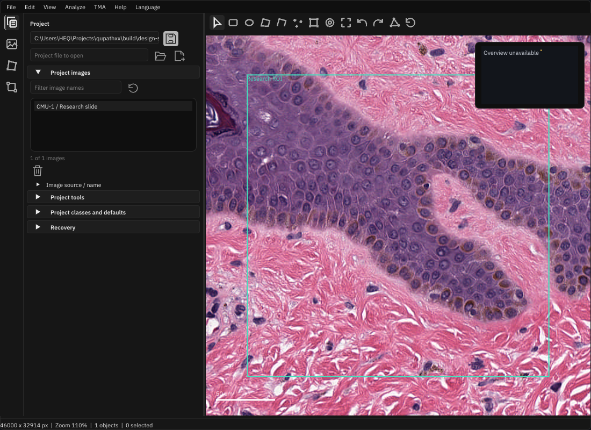

# RmlUi desktop presentation

The default docked desktop uses RmlUi 6.3 for the activity rail and the toolbar
above the slide. Their structure, wrapping, spacing, themes and button states
come from [workspace.rml](../assets/ui/workspace.rml) and
[workspace.rcss](../assets/ui/workspace.rcss). The advanced inspectors, menus,
dialogs and dock host remain native ImGui in this first migration. The compact
API layout also retains its native toolbar.

[Light Chinese view](images/rmlui-light-zh-CN.png) ·
[Validation evidence](benchmarks/rmlui-shell/README.md)

## Boundary

`cpp/gui_shell.hpp` exposes an owned `ShellSnapshot`, typed `ShellCommand` values
and screen rectangles. It contains no RmlUi/ImGui types, Document/Project pointers,
Python calls or scientific operations. RML element IDs map to an allowlist of
commands, checked against the native snapshot. The native application consumes
them on its GUI thread through the same actions as menus and shortcuts.

`cpp/gui_shell.cpp` owns the RmlUi context, retained icon geometry, fonts, input
adapter and OpenGL backend. It shares the existing vector icon family and the
authenticated IBM Plex Sans / Noto font bytes. Changed selections, permissions,
labels and appearance update existing elements. No per-frame document rebuild
or Python interpreter is involved.

Icon meshes retain both vertex alpha and texture coordinates. ImGui1.93 stroke
edges sample a coverage texture; the adapter repacks only the used atlas rows
into an owned premultiplied white-alpha strip. Geometry cache invalidation
includes icon size/color and atlas replacement/dimensions. This preserves edge
antialiasing without borrowing the font GPU texture, copying its full atlas or
changing scientific image filtering. Native GL tests inspect intermediate
ellipse edge coverage at normal/fractional/200% scales in both themes.

The native dock host reserves the rail and toolbar rectangles measured by RmlUi.
RmlUi draws through an ImGui draw callback before popup windows; the callback
restores the native render state. Slide textures, camera transforms, raw-channel
display, overlays and scientific result services retain their existing owners.
The remaining native host/input bridge can be replaced in a later panel migration.

The rail remains rendered through the workspace draw list if a docked tool covers
the Slide tab. The slide toolbar hides on that transition, with no hidden hit
targets; reopening Slide restores it. Visibility changes only on transitions,
and resource reload retains it. Tool tabs/close controls use ordinary native
docking chrome; only primary workbench nodes hide tabs.

## Edit and reload

The build copies `assets/ui` to `ui/` beside `qupathxx_app` and the optional native
module. Installation includes these files. Resources resolve relative to the
owning binary, independent of the working directory.

Edit the packaged `ui/workspace.rml` or `ui/workspace.rcss`, then choose
**View → Reload UI resources** or press **Ctrl+Shift+R**. Valid reloads retain the
native project, jobs, tool/pane selection and camera. Parsing errors, missing
required controls and unsupported schemas retain the last valid document and
show a recoverable resource error. Reload never writes project files or settings.
Each text resource is bounded to 1 MiB. Resource files are trusted local UI code;
they are not a plugin scripting interface.

Use `dp` units for visual sizes. The adapter handles monitor/user scaling and
framebuffer density separately. Current resources use `schema="2"`, including
the bottom workspace-settings command; schema1 resources remain readable with
their original controls. Keep required IDs; native C++
owns command semantics. Tooltips use the existing sixteen-language catalogue and
keyboard shortcuts. Light/dark/system appearance uses the existing preference.

RCSS uses semantic token references (for example `${activity-width}` and
`${light.foreground}`) resolved from `gui_design_tokens.hpp` through
`gui_stylesheet.hpp`. Native controls consume the same values. Unknown or
incomplete token references reject reload and retain the current document.
Literal RCSS remains available for deliberate local overrides. The activity bar
uses full48px rows and a separate utility group; its settings command opens the
existing native workspace menu without receiving runtime/scientific pointers.

## Build and verify

Enable `QUPATHXX_BUILD_GUI=ON` in the normal native CMake build. GUI-only static
dependencies are RmlUi (MIT, pinned `ba95ffe8`) and FreeType (FTL, pinned
`534ad345`); Lua, SVG, Lottie and scripting engines are disabled. They are absent
from GUI-disabled configurations. Python remains optional and defaults off.

With a graphical OpenGL 3.3 desktop (macOS core 4.1), build
`qupathxx_gui_shell_tests` and run it with `QUPATHXX_TEST_GUI=1`. An optional first
argument selects a retained evidence directory. The native test covers typed
events, disabled controls, logical/framebuffer scaling, translated labels,
successful and rejected reloads, and an integrated docked slide capture.

This delivers the native presentation boundary. A browser build, remote backend,
complete inspector migration and performance advantage over ImGui are separate
claims and are not provided by this change.
