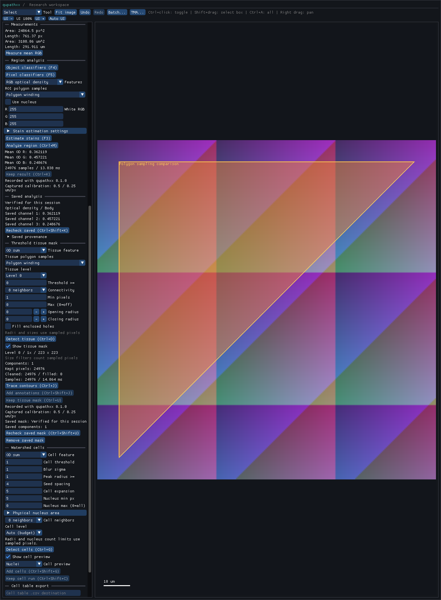

# Explicit polygon sampling

ROI channel means and tissue detection accept `RoiSamplingPolicy`:

- `GEOMETRY_COVERAGE` is the existing default. Polygon boundaries participate
  in membership, subject to the existing half-open sample-grid bounds.
- `POLYGON_WINDING` uses a half-open ray-crossing rule for polygon boundary
  sample centers. Shells subtract their holes; multipart areas form a union.
  Ring orientation does not change the result. Analytic shapes, lines and
  points retain their existing predicates.

`Roi.contains` and interactive picking retain their geometry contract.
`Roi.contains_sample(point, policy)` makes the chosen sampling rule explicit.
This policy applies to ROI OD/stain means and tissue masks; cell segmentation,
raw measurements, classifiers and stain estimation retain their existing domains.

```python
import qupathxx as q

request = q.AnalysisRequest(document, object_id, transform,
    sampling_policy=q.RoiSamplingPolicy.POLYGON_WINDING)
result = q.analyze(request)
parameters = q.TissueParameters()
parameters.sampling_policy = q.RoiSamplingPolicy.POLYGON_WINDING
mask = q.detect_tissue(q.TissueRequest(document, object_id, transform, parameters))
```

The request captures a native value. Later changes to Python parameter objects
cannot change an executing job. ROI request/result properties expose the policy.
Tissue result parameters retain it. Replay restores the captured policy.

The ImGui Region analysis and Threshold tissue mask panels have separate polygon
sample controls. `GuiOptions.roi_sampling_policy` and `tissue_sampling_policy`
initialize them. Project batches either copy image analysis settings or use
explicit presets. `ProjectBatchOptions.roi_sampling_policy` controls ROI batches;
`tissue.sampling_policy` controls tissue batches. Manifests distinguish nondefault
policies, and checkpoint hashes prevent cross-policy reuse. A nondefault setting
on an unrelated workflow is rejected.

The native batch CLI accepts `--roi-sampling coverage|winding` and
`--tissue-sampling coverage|winding`. The managed viewer provides
`analyze_with_sampling_policy(image_id, object_id, transform, sampling_policy,
kind=..., nucleus=False)`; its existing `analyze` method retains coverage.
Tissue viewer commands capture the policy in their existing parameter argument.

Winding ROI means use algorithm `qpx.roi-channel-means/winding-1`; their input
format is `qpx.rgba-tiles/winding-1`. Winding tissue algorithms use
`qpx.threshold-components/winding-1`, `winding-2` (pyramid), or `winding-3`
(morphology). Pyramid input digests use `qpx.rgba-level-tiles/winding-1`.
Coverage identifiers and archive encoding remain unchanged. Tissue winding
archives use QTM2 with a checked policy field; coverage keeps QTM1. Unknown
versions or policies reject even when the checksum is valid. ROI analysis
archives recover the policy from their validated algorithm identifier.

Prepared geometry predicates handle ordinary interior and exterior samples;
only exact boundary points traverse rings. There is no per-sample geometry copy.
End-to-end performance and scientific acceptance require separate measurements.

The corrected source `14788f23325d74dcb2ff016d82d994786eecd999` passes
43 Windows native suites and 393 focused Python/desktop cases, with three
isolated-cell scientific expected failures. All 35 sampling cases pass, including
robust diagonal crossings, pyramid/morphology archives, producer commands and
ImGui equivalence. Installed workflows, generated stubs and strict positive/
negative typing pass. A larger triangle exposed four incorrectly included centers
in the first binary; robust orientation fixes that defect without interpolated
intersections. Earlier full passes and run 40037162200 predate the fix and cannot
accept it; that hosted run is cancelled.

Explicit winding matches all 42 pinned reference compartment masks/counts and
OD/stain means across three declared tile sizes and unchanged tolerances.
Coverage characterization and the three isolated-cell segmentation failures
remain visible. Corrected Windows full regression passes 2,107 cases with 13 optional skips
and three scientific expected failures. The [hosted artifact audit](benchmarks/roi-sampling-ci-windows-linux.json)
accepts all five jobs in [run 40039352934](https://github.com/bipxx/qupathxx/actions/runs/40039352934).
Desktop passes 2,109 Python/43 native, Windows headless 1,721/42, Linux headless
1,719/42, and minimal/sanitizer each pass 42 native suites. All 35 policy cases
pass desktop; 32 pass headless with three desktop skips. The nine new robust
diagonal regressions pass each Python cohort. Engineering scope is accepted;
three isolated-cell scientific expected failures remain per Python cohort. The local Linux filesystem became read-only after host disk
exhaustion; current-source Linux qualification comes from the hosted full/native,
runtime and sanitizer evidence. Pre-fix local results remain historical.
This does not establish segmentation parity or biological accuracy.

The [desktop record](benchmarks/roi-sampling-desktop-windows.json) binds a visually
inspected frame with both winding selectors, saved ROI/tissue results at 24,976
samples and zero reported UI overflow. The [paired timing observations](roi-sampling-performance.md)
record exact outputs and measurable overhead separately from performance acceptance.


