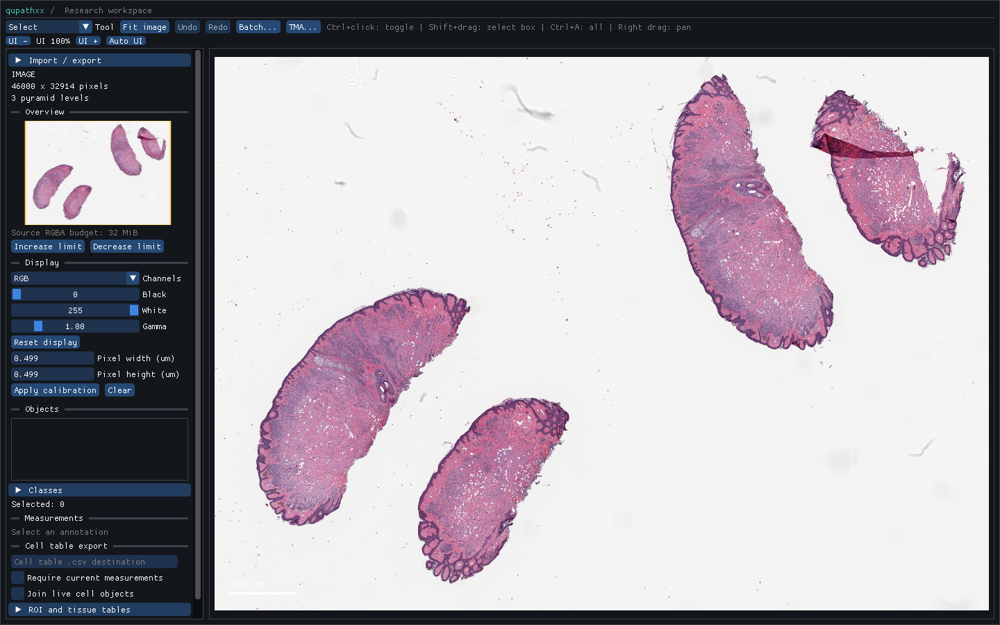

# Complete bounded thumbnails

`plan_thumbnail(metadata, options)` selects a complete natural pyramid level
before decoding. `read_thumbnail(server, options)` reads that level once at
origin zero and returns a `ThumbnailResult` with its plan, elapsed time and
owning RGBA8 `PixelBuffer`. Both calls are native; Python releases the GIL for
the synchronous read/filter. NumPy is optional, and the returned read-only
NumPy view retains its storage after the result, job and reader are released.

```python
import qupathxx as q

server = q.open_slide("slide.svs")
options = q.ThumbnailOptions()
options.max_width, options.max_height = 250, 150
plan = q.plan_thumbnail(server.metadata, options)
thumbnail = q.read_thumbnail(server, options)
rgba = thumbnail.pixels.numpy()
server.close()
```

The bounding box defaults to 256 x 256; each edge must be 1..4096. Fit uses
integer arithmetic, floors the shorter edge, keeps each edge at least one
pixel and never enlarges the base image. The plan records actual horizontal
and vertical base/output ratios; integer rounding can make them differ.

The selected level is the smallest pixel area whose width and height can
supply the complete output without enlargement and whose area fits the source
budget. Ties retain the earlier level. Selection uses dimensions, including
irregular pyramids; it does not assume powers of two or derive dimensions from
the advertised downsample. The actual full-level read still uses the reader's
normal level/downsample contract. One origin-zero request avoids joining tiles
with potentially ambiguous fractional-downsample alignment.

Filtering computes exact integer rectangular area overlaps in encoded device
RGB. Color weights include alpha, then convert to straight-alpha output;
transparent colors cannot bleed into visible colors. Alpha and colors round
half up. Pixels whose rounded alpha is zero have zero RGB. This is a display
reduction policy, with no linear-light conversion or ICC transformation. It
does not replace the level/ROI sampling policy used by scientific measurements.

The default source budget is 4,194,304 pixels (16 MiB RGBA), and the default
output budget is 1,048,576 pixels (4 MiB). Configurable maximums are 67,108,864
source pixels (256 MiB) and 16,777,216 output pixels (64 MiB). Invalid options,
inadequate levels and output-budget failures reject before reading pixels.
These bound requested pixel buffers, not process RSS or decoder internals;
OpenSlide can additionally hold its ARGB decode buffer and backend caches.
A huge single-level image can therefore be explicitly unavailable under this
policy. The API never returns a partial preview to satisfy a budget.

`ThumbnailJob` is a single-owner controller with `request`, `poll`, `wait`,
`cancel`, `busy` and `result`. Busy requests return false. Invalid requests
preserve a previously completed result. Starting an accepted request clears
the old result. Poll/wait publish `succeeded`, `failed` or `cancelled`; the
completed counter counts successful publications. Cancellation is cooperative:
it cannot interrupt a synchronous backend decode, but prevents publication
even when decoding/filtering finished before the owner next polls. Destruction
cancels and joins. `wait` releases the Python GIL. Reader lifetime extends
through native worker completion; callers must serialize controller methods.

The ImGui overview now uses this job and one complete texture, with a 250 x 150
bounding box. It displays loading/unavailable status instead of a truncated
tile set. Image/workspace switches clear the old texture immediately, cancel
the previous job and reject its output. Display LUT changes transform the
retained raw preview without another read. All GL operations stay on the
context thread. `GuiReport.overview_state`, `overview_error`, `overview_result`,
`overview_gpu_bytes` and `overview_peak_gpu_bytes` expose publication and
payload. Overview texture payload is at most 150,000 bytes, separately counted
from the main canvas tile LRU. During replacement two overview textures can
briefly coexist; driver allocations remain outside payload accounting.
`settle_tiles` also waits for overview success or explicit failure, while an
empty workspace settles without a thumbnail.

`GuiOptions.overview_source_pixel_limit` sets the overview source budget in
pixels (default 4,194,304, maximum 67,108,864). The inspector shows its source
RGBA allocation budget and provides **Increase limit** and **Decrease limit**
buttons. Increasing doubles the budget up to the maximum (or returns a
sub-default limit to the default); decreasing halves it
back toward the default. Explicit API limits below the default remain supported.
The final value is exposed as `GuiReport.overview_source_pixel_limit`.

An already completed preview that fits the new limit retains its pixels and
texture without another decode. Otherwise, changing the limit immediately clears
the old preview and cancels the previous request. The controller polls its completion before starting one replacement,
so repeated changes do not accumulate decoder jobs. A synchronous decode cannot
be interrupted; its cancelled output is rejected. Source changes preserve the
window's selected limit. This setting is temporary presentation state, separate
from project content and its undo history. The displayed budget covers source
RGBA bytes; decoder buffers, caches, output and driver allocations are additional.

For the full CMU-1 Aperio fixture, the lowest level contains 5,913,875 pixels.
The default budget reports unavailability. An explicit 8,388,608-pixel budget
allows a complete overview without changing the viewport tile cache limits:

```python
options = q.GuiOptions()
options.overview_source_pixel_limit = 8 * 1024 * 1024
q.show(q.Document(q.open_slide("CMU-1.svs")), options=options)
```

The standalone native command requires no Python:

```text
qupathxx_region --thumbnail IMAGE MAX_WIDTH MAX_HEIGHT OUTPUT.pam [--source-pixels PIXELS]
qupathxx_app IMAGE --overview-source-pixels 8388608
python -m qupathxx IMAGE --overview-source-pixels 8388608
```

The region command writes straight-alpha RGBA PAM using the selected source
budget, default output budget and the same
filter as Python/GUI. The original explicit region syntax remains available.
Output cannot be the input image. As with existing region export, filesystem
write failure can leave a partial output file.

Native tests compare small random RGBA images against an independent area
oracle, plus transparent-color exclusion, full-level origin/read counts,
irregular-level selection, 64-bit aspect fitting, budget-before-decode rejection,
malformed reader buffers, cancellation and retained results. Python tests use
an exact Fraction RGB oracle, buffer lifetime, job transitions, a real synthetic
OpenSlide pyramid and native CLI output. GUI tests inspect the captured preview,
source switching, separate GPU payload, empty projects and unavailable levels.
These checks establish this defined policy, not QuPath thumbnail pixel parity.

The overview-budget increment passes [local validation](benchmarks/overview-budget-local-windows-linux.json):
1,969 Windows Python/desktop tests, 41 Windows native tests, 40 Linux native tests
and 50 focused thumbnail/budget/vendor cases. Generated stubs, strict typing,
installed workflows and Linux dense CLI checks also pass. The local Linux native
configuration disables OpenSlide and GUI; it does not establish new real-vendor
Linux acceptance for the budget increment. Extended hosted acceptance is pending.

The [four-case software-OpenGL probe](benchmarks/gui-overview-windows.json)
checks default rejection, an explicit complete preview, interactive increase and
interactive decrease, all with zero UI overflow. Complete previews contain
125,400 GPU payload bytes and have identical RGBA hashes. On this run the
complete-overview workers took about 165–171 ms; recorded maximum CPU frame times
stayed below 40 ms. These local startup-inclusive samples do not establish hardware
frame-time or RSS acceptance. Decoder buffers and driver allocations are additional.



The first [Linux CI attempt](https://github.com/bipxx/qupathxx/actions/runs/39771927905)
returned unexpected color/alpha from a generated 8 x 4 TIFF natural level
stored in a 16 x 16 tile, along with a raster-width warning. The same fixture
passed on the bundled Windows reader stack. Packet 62 initially retained a
complete-tile acceptance fixture. Packet 63 reproduces the corruption with
Ubuntu OpenSlide 3.4.1 and verifies exact pixels with the pinned 4.0.1 SDK.
Linux development wheels now bundle that SDK runtime; regression cases include
8 x 4, 9 x 5 and portrait small levels and independently check every decoded
level before thumbnail reduction. See [reader runtime validation](reader-runtime.md).

The final [five-configuration CI run](https://github.com/bipxx/qupathxx/actions/runs/39773391727)
passes, including 1273 Windows GUI Python cases and 34 native GUI tests.
Windows/Linux headless, minimal native, sanitizer, installed workflow,
stub/typing and standalone gates also pass. The
[validation record](benchmarks/thumbnail-ci-windows-linux.json) identifies
artifacts, skips and the separately checked final local TIFF fixture.

## Local timing evidence

[Default-budget samples](benchmarks/thumbnails-windows.json) retain seven
whole-call timings and output hashes per available input on Windows x64.
The 100352 x 2048 synthetic slide selects level 8, reads 392 x 8 RGBA pixels
(12,544 bytes) and produces 250 x 5 pixels (5,000 bytes); median call time is
0.079 ms. The 2048-square dense input reads 16 MiB and produces a 150-square
preview, with a 17.02 ms median. These repeated inputs may be warm; the data
does not establish cold latency, process RSS or a before/after speedup.

The pinned 2220 x 2967 small Aperio fixture has no adequate reduced natural
level and explicitly exceeds the default source budget. A separate
[8-megapixel budget run](benchmarks/thumbnails-aperio-8mp-windows.json) selects
its complete base level (26,346,960 RGBA bytes), produces 112 x 150 pixels and
has a 134.57 ms median whole-call time. The GUI retains its stricter default
budget and displays unavailable for this fixture. Backend ARGB/caches add
memory beyond the RGBA payload above.

Reproduce with the current installed wheel and NumPy:

```text
python -I tools/benchmark_thumbnails.py --output build/thumbnails.json --slide build/fixtures/large-pyramid.tif
python -I tools/benchmark_thumbnails.py --source-pixel-limit 8388608 --output build/aperio-thumbnail.json --slide build/fixtures/CMU-1-Small-Region.svs
```
