# Desktop organization review

Three reviewers independently inspected the desktop at `917590da`. Each reviewed
the overall workspace, with separate emphasis on information hierarchy, research
workflows and interaction/responsive behavior. They wrote findings before seeing
one another's conclusions. The implementation below combines overlapping evidence;
it does not replace the native scientific services or the RmlUi shell.

## Current project browsing

### Dialog contract audit, 2026-11-09

Scope: all nine native modal controllers, their shared frame and menu entry points.
Implementation, component design and UX behavior were inspected in separate
passes before combining these three findings. This is a sequential re-audit;
no new independent-agent review is claimed. No deceptive pattern was found.

| Finding | Category; severity; confidence | Evidence before correction | Correction and decisive check |
| --- | --- | --- | --- |
| A recipe could be bypassed or measured differently from what it drew | Design debt; medium; high | Public `BeginDialog`, `DialogHeader`, `DialogBody` and `DialogFooter`; duplicated `DialogActionLayout` label lists in controllers | Register nine owned kinds and typed action definitions; one renderer measures, styles and dispatches them. Source guards reject bypasses; C++ tests reject malformed actions and verify localized stable IDs. |
| Escape could close a parent after dismissing its child | Interaction defect; medium; high | Old header used `IsKeyPressed(ImGuiKey_Escape)` without previous-frame popup/text ownership | Snapshot input ownership before ImGui consumes the key; nested-popup and text-editing native tests distinguish first and second Escape. |
| Modal state and available space were implicit | Implementation/UX debt; medium; high | Controller-specific disabled scopes, multiple error heights and a non-wrapping header title | Mandatory immutable owner/busy snapshots, local submit guard, one joint scrollable notice budget and wrapping titles. Visual review also found that re-enabling after BeginPopupModal left its background translucent; re-enable before drawing the surface. Native tests cover invalid owners, ambient disabled input and opaque contrast, refused/pending handlers, long errors and resized translated forms. |

The [enforceable contract](ui-dialog-contract.md) names component ownership,
action semantics and validation coverage. Native metadata setters, source review,
save/recovery and checked deletion remain the authorities. Body callbacks edit
local drafts; only typed handlers publish. File choice never writes output data.
Coverage is bounded to registered modal workflows and common menu composition;
nonmodal specialist tools and scientific algorithms are outside this audit.
The matched receipt is `build/ui-dialog-contract/results-final.json`: native
replay and workflow checks, nine source guards,47 UI captures, standalone startup
and38 retained binding hashes pass. Visual review confirmed the corrected
metadata opacity, narrow French header, long notices and bounded picker.

### Dialog design system, 2026-11-09

The owner identified disorganized close-project and metadata popups. Existing
close UI placed two path inputs and four unrelated action rows together;
metadata editing mixed reload/cancel, a key list, right-labelled text areas,
destructive draft tools and Apply controls in one unstructured flow.

The shared [dialog recipe](design-system.md#dialog-and-popup-recipes) separates
context, scrollable form content, errors and action footers. It is applied to
metadata, close, workspace replacement and image removal. Metadata inputs now
have labels above their values, draft tools share one toolbar, and Apply/Cancel
stay in the footer. Close groups Save/Discard/Cancel and keeps recovery as a
secondary choice. Popup menu rows use the same sizing and spacing role.
Native validation, ownership, persistence and recovery authorities remain in
place; these presentation components do not create a second application runtime.
See the native [metadata form](images/dialog-metadata.png),
[description and tags](images/dialog-details.png), [close confirmation](images/dialog-close.png)
and [aligned menu shortcuts](images/dialog-menu.png). The matched native receipt
is `build/ui-dialog-system/results-final.json`; its39 captures include small
high-DPI and translated forms. At that delivery, specialized dialogs inherited the common surface. The
registered contract audit above completes their migration to the shared frame.

### Simplification audit, 2026-11-09

Scope: Project, Image, Annotations and the seven Workflow tasks, using native
captures from `build/ui-project-inspector/native-artifacts-final` and the matching
frontend source. Implementation and UX notes were reviewed separately before
combining the following three small fixes. These are usability issues, with no
evidence of deception or coercion.

| Finding | Category; severity; confidence | Evidence | Impact and improvement | Validation |
| --- | --- | --- | --- | --- |
| Source details require another disclosure inside the inspector | Design smell; low; high | `Source and files` in `cpp/gui.cpp`, plus `review-default.png` | Adds a click and a second hierarchy for ordinary metadata. Show source and reader as rows in the same metadata table; retain native repair. | Populated inspector and missing-source relink captures/checks |
| Catalog status interrupts the boundary between images and metadata | Design smell; low; high | `%zu of %zu images` in `cpp/gui.cpp`, plus `review-default.png` | An informational count competes with the inspector heading. Move it into the global bottom status bar, retaining filtered versus total semantics. | Normal/scaled/narrow footer captures |
| Dedicated file-check task hides all its controls behind another heading | Design smell; medium; high | `File checksum` and `File checksum: %s` in `cpp/gui.cpp`, plus `workflow-files.png` | The chosen task still looks empty until expanded. Expose its fields directly and omit the idle-status line. | Matched Files-task capture; retain native polling/error/review paths |

Backlog, deliberately outside these three fixes:

- **Low severity, high confidence:** Image details repeats dimensions already
  visible in the status bar (`%lld x %lld pixels`), while nesting imported facts
  and saved analysis defaults. Consolidate its read-only identity presentation in
  a later pass with a representative imported image; retain the distinction
  between historical facts and live measurements.
- **Low severity, medium confidence:** Annotations repeats `Selected: %zu` above
  `Selected object` and the footer selection count. The local count also anchors
  bulk-edit commands, so validate multi-selection and primary-object clarity
  before removing it.
- **Low severity, high confidence:** Workflow Tools uses `Tools` followed by
  `Open a tool...` (`workflow-tools.png`), adding a second picker before any
  command is visible. A searchable command list could make this more direct;
  check the longer tool names, keyboard navigation and localized layouts before
  changing the launcher.

| Coverage | Result |
| --- | --- |
| Reviewed | Frontend composition, design and usability; native-authority boundaries preserved |
| Not applicable | No deceptive/coercive mechanism or commerce/consent flow in the inspected UI; no architecture-wide anti-pattern claim |
| Tooling | Source search/contracts, matched native organization interactions and populated captures; final receipt: `build/ui-simplification/results-final.json` |
| Investigated but not reported | Calibration, historical/live fact distinctions and source-verification warnings convey scientific meaning and should stay explicit |
| Residual risk | Specialist classifier, omics and batch dialogs were not audited; scientific parameters and result-retention controls remain unchanged |

Owner steering now uses a named project switcher, thumbnail image rows and
collapsible metadata groups. One row click opens its image. More actions reveal
on hover/focus or remain accessible by right-click; project administration lives
in the selector. The upper catalog now shares the Project pane with a resizable
lower Image metadata inspector. It follows the selected entry while the full-row
highlight continues to identify the open image. Metadata editing moves to the
inspector header, leaving entry and file-location actions in row menus.
Source repair now belongs entirely to image rows: Relink in linked-image menus,
or direct Locate file for missing sources. The inspector has no repair button.
This replaces the earlier separate image details window. Recent projects, the
inspector divider and group choice are UI
preferences; switching still uses native unsaved-project guards. Groups never
move source files or infer clinical case identity. See the
[current component rules](design-system.md#panel-workflow-recipes).

The [lower inspector](images/project-metadata.png) shows wrapped metadata in the
Project pane. The [reduced row menu](images/project-metadata-menu.png) can select
an unopened entry for inspection without changing the viewed slide or its camera.

The original [QuPath project workflow](https://qupath.readthedocs.io/en/stable/docs/tutorials/projects.html)
provides image thumbnails, recent-project reopening and metadata organization.
Its [default folder structure](https://qupath.readthedocs.io/en/stable/docs/reference/projects_structure.html)
contains image-list metadata, per-image data/thumbnails, scripts and classifiers;
images usually remain elsewhere. The current qupathxx adaptation retains its
native single-file project format and one active project, with native bounded
preview reads and a small cache. It does not claim folder-format parity.

## Current renderer and docking repairs

Repeated stroke/style changes did not fix pixelated shell icons because the
RmlUi bridge copied positions/colors but replaced every UV with zero and rendered
without a texture. ImGui1.93 strokes put side-edge antialiasing coverage in the
atlas texture. The corrected bridge retains the UV coverage in a small owned
strip, with premultiplied color/alpha, instead of borrowing the dynamic font
texture or copying the full atlas. Native GPU checks inspect intermediate shades
along a closed ellipse's sides at normal/fractional/200% scale in both themes.
The scientific framebuffer and image filtering are unchanged.

The owner's live Object classifiers panel was docked on the right without a
title/close bar. Its content X was Cancel classifier work; F4 dismissed the
panel without closing the project. The root dockspace previously hid tabs
globally, including specialist tools. Only primary-owned workbench nodes now
hide tabs. Tool/mixed/detached groups recover normal title/close controls, and
their selected tabs are not replaced by the activity-view selection. Legacy
hidden flags migrate during layout preparation. Native checks exercise a real
title close button, reopening and undocking/redocking while preserving the
primary activity layout.

The actual classifier saved-layout replay also found that its Appearing position
override undocked/re-centered it on load and reopen. FirstUseEver preserves saved
placement. The idle cancellation X is removed; active work uses a labeled Cancel
classifier work action, distinct from panel closure.

The activity rail now has a workspace draw-list fallback when Slide is hidden.
Only the slide toolbar hides, and its input/bounds remain disabled through UI
reload. Six saved-dock captures check rail pixels as well as close/reopen, so
navigation cannot silently disappear when a tool occupies the slide node.

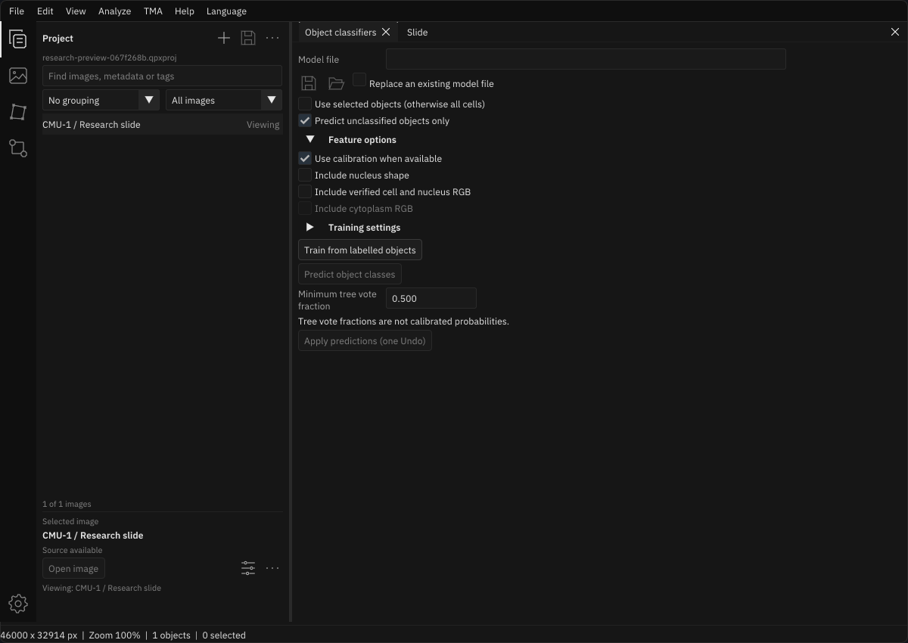

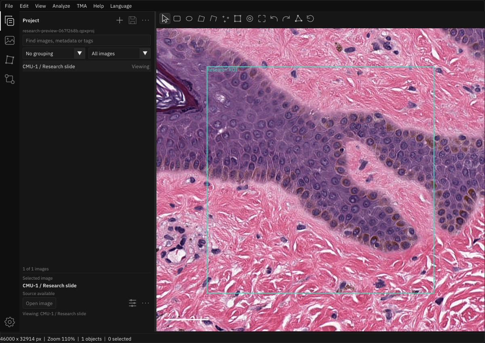

Workspace-root `build/ui-render-docking/results.json` records 73 final GUI/source
passes, two native suites and 35 checked views. These include actual saved Object/
Pixel docks, title close/F4 reopen, 100/125/150/200% edge coverage, dark/light and
translated layouts. Native RGB, camera/generation, source bytes, classifier
train/predict/apply/Undo/save and project persistence remain covered. All 38
binding-object hashes match; standalone startup from System32 without Python
exits 0. No scientific campaign, wheel or merge.

## Previous type, spacing and icon refinement

The owner finds the text/padding balance weak and the icons too heavy. Body
values now use 16px, secondary captions use 14px, section headings use 16px
semibold, and modal titles use 18px semibold. Controls retain their 28px role;
the larger body reduces excess vertical padding. Label/checkbox gaps are 4px
and text-action padding is 8px. Workspace geometry now follows the base style
instead of the temporarily selected font size, so caption/title scopes cannot
shrink or enlarge adjacent controls.

Icons use a lighter 1.35-unit stroke on the existing 32-unit grid, with antialiasing
on stroke ends as well as edges. Filled nodes and overflow dots are reduced to
match the thinner lines. The explicit hollow rectangle paths are retained.
The shared owners apply these choices to native panels and the RmlUi shell.

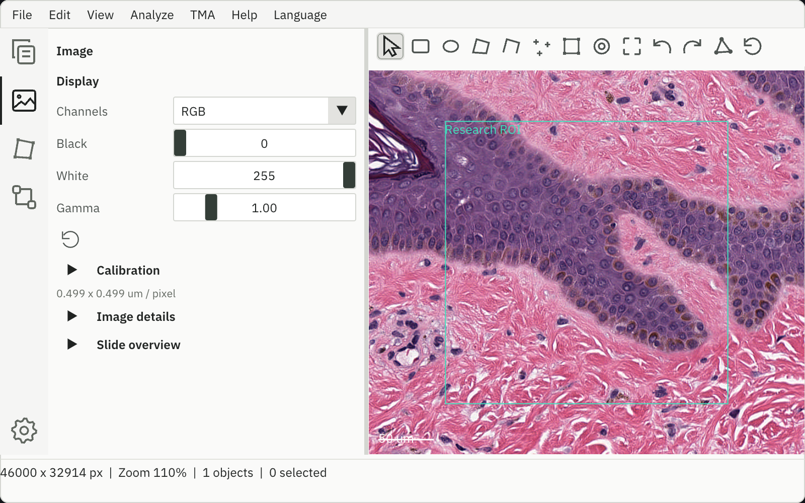

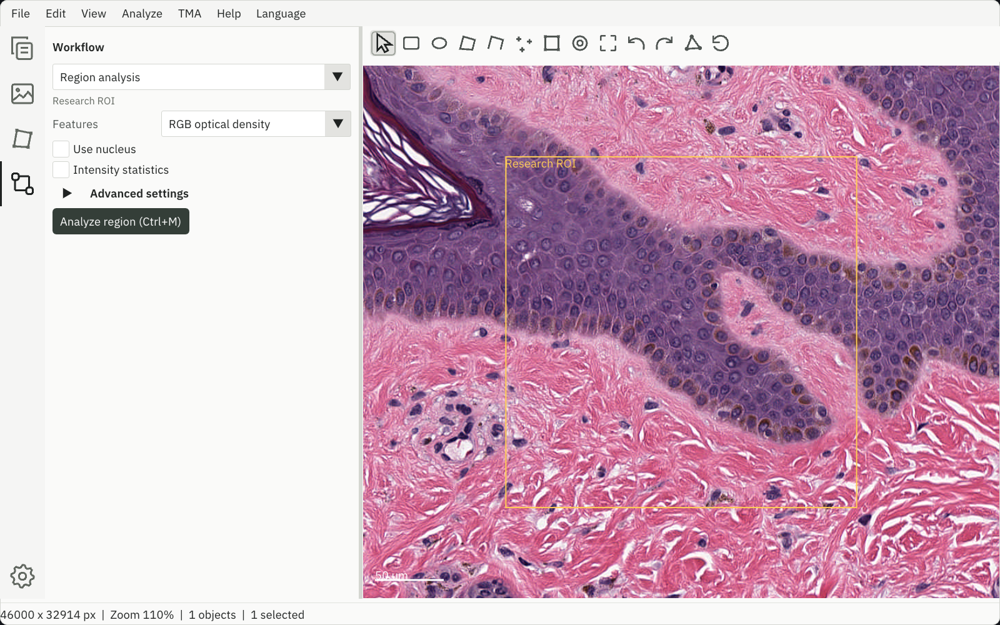

Workspace-root `build/ui-type-spacing/results.json` records 47 final GUI/source
passes, four native suites and 27 checked views, including 125%/150%/200%, dark/
light and Chinese/German. A new component assertion caught ImGui changing the
base font size during PushFont; the role scope now retains the outer geometry
scale. Caption/title changes preserve hit target sizes. Native font-atlas and
entry/class authoring checks, RGB, camera/generation, source bytes and real saves
remain covered. All 38 binding objects are unchanged; standalone startup without
Python from System32 exits 0. No scientific campaign, wheel or merge.

## Previous button polish

Owner finds the remaining buttons rough. Three shared presentation problems are
addressed: hover surfaces previously darkened on some native actions, native
selected tools differed from the retained toolbar, and text actions had cramped
widths compared with their hit targets. Buttons now use a4px corner role,
balanced10px text padding, restrained outlined secondary actions and consistent
hover/pressed/selected/focus states. Input corners and compact icon hit areas
retain their existing geometry. Ghost glyphs brighten with interaction and
disabled commands retain their reduced opacity without hover availability cues.

The vector family has a consistent1.75-unit stroke, smoother curved outlines,
cleaner pointer/save/slider shapes and explicit rectangle strokes. Enlarged
previewing caught a texture-dependent rounded-rectangle optimization leaking
into the RmlUi geometry-only icon bridge; explicit strokes preserve hollow
interiors at normal and200% scales. The keyboard ring is independent of selection
and appears for keyboard navigation without leaving a pointer-focus outline.
Action IDs, shortcut routes and native data/persistence authorities are retained.

The [shared button recipe](design-system.md#tokens-and-components) owns these
choices; individual panels do not introduce new styles. Existing native entry/
class authoring replays now target the shared checkbox's scoped value ID instead
of its pre-migration ID. All original nullable/order/alpha/save/Undo assertions
remain intact.

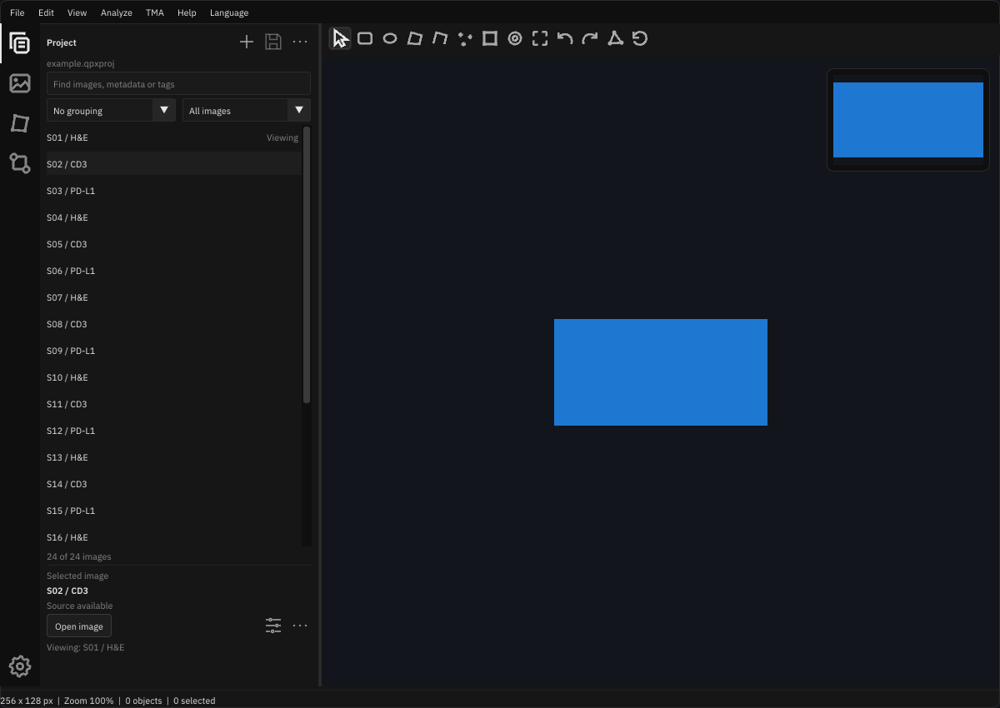

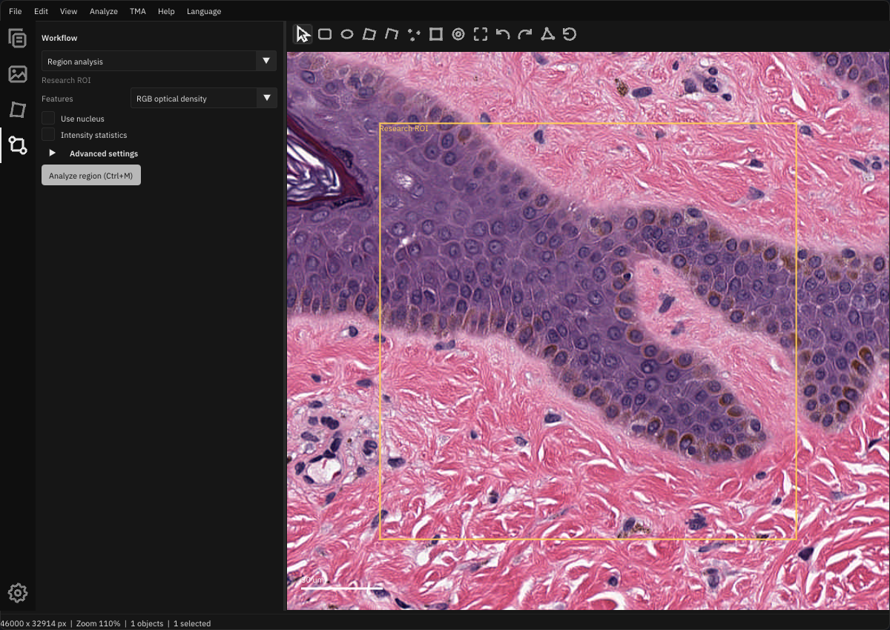

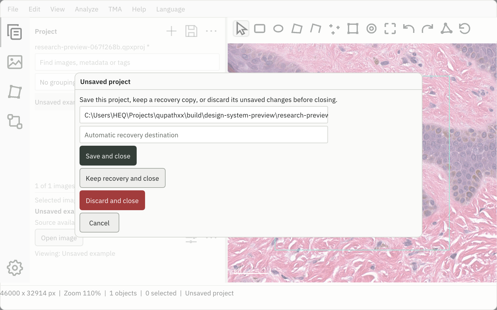

Workspace-root `build/ui-button-polish/results.json` records47 final passing
GUI/source checks,4 native suites and20 checked views. Normal/200% dark/light,
Chinese/German, hover/pressed and confirmation layouts pass. Non-modal captures
also check that the unselected rectangle icon has a hollow center. Exact native
RGB, camera/generation, saved project bytes, actual saves and native entry/class
authoring remain covered. All38 binding objects are unchanged. The standalone
candidate starts from System32 with Windows-only PATH and no Python path (exit0).
The matching runtime includes concurrent feature inputs; this UI evidence does
not qualify their scientific behavior. No wheel, science campaign or merge.

## Reference review: Project explorer implementation

The owner rejected the remaining Project workflow and asked for comparison with
similar and related software. This review uses official documented interactions
and the accompanying QuPath, Cytomine and Bridge screenshots. It is a design
comparison, not clinical usability validation or feature-parity qualification.

| Reference | Observed pattern | Adaptation in qupathxx |
| --- | --- | --- |
| [QuPath projects](https://qupath.readthedocs.io/en/stable/docs/tutorials/projects.html) | A central image list, metadata sorting, per-image context actions and explicit missing-path repair. Thumbnail/name masking are optional. | Keep browsing dominant; filter native metadata/tags and group by an actual metadata key. Expose source availability and Locate without requiring an unrelated slide to open. |
| [OMERO browsing](https://omero-guides.readthedocs.io/en/latest/introduction/docs/data-management.html) | Project/Dataset browsing is distinct from the selected image's metadata/preview and full-image viewing. | Maintain a UI selection separate from the native active image. Read inspector values from the owned catalog snapshot without decoding the selected slide. Avoid imposing a dataset hierarchy on existing projects. |
| [Cytomine viewer](https://doc.uliege.cytomine.org/user-guide/image-viewer) | Project navigation and image-specific information/controls occupy distinct regions. | Preserve the existing Image/Annotations/Workflow panel owners; remove project administration from the image-browsing surface. |
| [Adobe Bridge workspace](https://helpx.adobe.com/bridge/desktop/workspaces-and-panels/overview-of-the-workspace.html) | Content, filtering and selected-file metadata/preview are separate; the content region uses available space. | A filling, clipped catalog plus a bounded selected-entry inspector. Rare editing/settings move to dedicated windows. |
| [VS Code views](https://code.visualstudio.com/api/ux-guidelines/views) and [Photoshop panels](https://helpx.adobe.com/photoshop/using/panels-menus.html) | A restrained action toolbar, shallow organization, and selection/context-specific commands. | Three familiar project actions and one overflow menu. The same row commands work on unopened entries. |

The choice to single-click for selection and use Enter/double-click/Open for
viewer activation is an adaptation for whole-slide browsing; it is not a claim
that all references use that exact interaction. A selected entry may differ from
the viewed slide, and both states are labeled. Group names and search results do
not infer clinical case identity, review state or scientific result validity.

Implementation stays in the native GUI consumer. `gui_project_browser.hpp` owns
only catalog presentation; native Project, reader, save/recovery and editing
services retain all write/science authority. Search/group rebuilding occurs when
inputs change. The clipped rows do not open image documents. Bounded thumbnail
caching, multi-selection batch actions and clinical review flags remain separate
workflows rather than additions to this navigation correction.

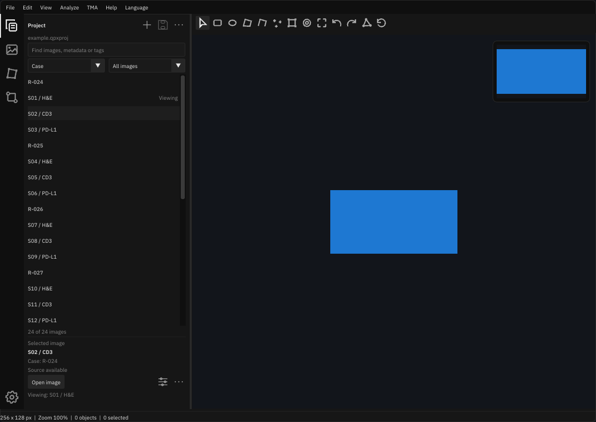

This example uses synthetic images and explicitly supplied Case/Stain metadata.
It does not assign case or stain information to the user's research project.

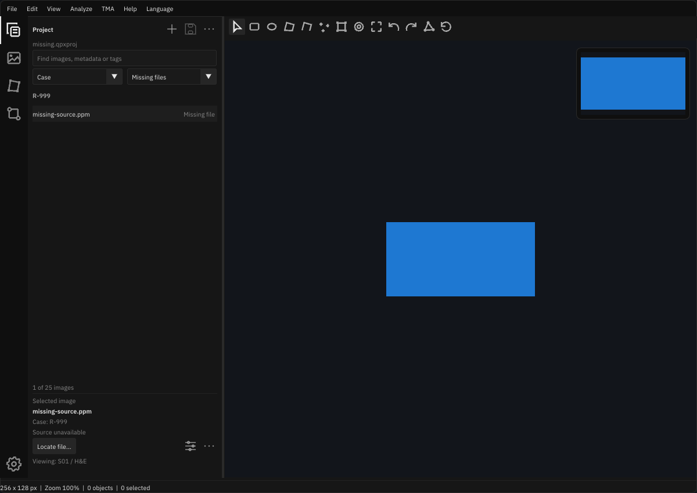

Evidence: workspace-root `build/ui-project-explorer/results.json` records66
distinct latest-passing GUI/source checks,5 native suites and14 checked views,
plus the project menu capture. Normal/200% layouts, Chinese/German labels,
grouping, missing-source repair entry and Project settings remain usable.
Native checks prove that selection preserves active image, generation, project
bytes and camera, that Enter opens explicitly, and that removing an unopened
entry leaves the viewer intact. Computer Use typed CONTROL into the native
search (8/24 tag matches), selected S02 while S01 remained viewed, and chose Case
grouping. The isolated test window closed without saving. The final scale and
inspector changes have their own replay/capture checks.

All38 retained binding-object hashes match; only affected native consumers were
built/linked. The final standalone app starts from System32 with Windows-only
PATH and no Python path (exit0). Earlier compatible56 GUI passes are retained;
the final affected layout/activity cases supersede six diagnosed scale-width
failures. No scientific campaign, wheel, clinical usability acceptance or merge
is claimed. Specialist dialogs retain their existing recipes.

## Current panel simplification

The owner accepts the shared style direction and asks for less workflow complexity.
Scope is the four workspace panels and their task bodies. These are usability
issues, with medium severity and high confidence, rather than deceptive choices.

| Finding / lane | Concrete evidence | Impact and change | Decisive validation |
| --- | --- | --- | --- |
| Everyday and advanced inputs have equal prominence / design | `gui.cpp`, Image body: `SeparatorText("Calibration")`; Region: `InputScalarN("White RGB"`; Tissue: `InputScalar("Tissue memory (MiB)"` | Common display/run actions compete with calibration editing, model files and resource controls. Summarize calibration, fold details/advanced recipes and retain main scientific choices and run actions. | Real panel captures; open/edit advanced controls; exact custom-white run/keep and RGB checks. |
| Annotation actions precede their context / UX | `gui.cpp`, annotation body: `CollapsingHeader("Classes")` before `SeparatorText("Selected object")`; `SeparatorText("Appearance and reported values")` | Users must scan class administration and imported-value controls to name/classify an object. Lead with selection, name/class/apply and lock. Group multi-object combination and specialist properties; give an empty-state drawing cue. | Empty/single/multiple selection, lock/property Undo, combine shortcuts, exchange and persistence. |
| Tool entry is an unstructured command wall / UX | `gui.cpp`, Tools body: consecutive `Button("Object classifiers (F4)")`, `Button("Spatial...")`, `Button("Batch analysis...")` | Twelve equal buttons require scanning unrelated tools. Use one searchable chooser with classifier, spatial/fluorescence and project groups; selection opens the same native tool directly. | Search and choose a tool with no image/ROI, translated/scaled popup and existing F4/F5/F2 routes. |

Independent design notes: the shared component/style boundary is useful and is
retained. No new wizard, recipe abstraction, scientific implementation or public
API is needed. Independent UX notes: the common flow is select context, configure
essential inputs, run, inspect, then retain/export. Advanced settings remain
explicitly available; failures and cancellation must stay visible. Merged changes
address those three findings across the main panels.

Project keeps its explorer, adds a useful empty-state Add action and contextual
image commands, and groups class administration with project tools. Image leads
with display, calibrated pixel-size summary and secondary image/overview details.
Annotations leads with its current selection. Workflow gives its chooser the full
panel width, folds advanced recipes, emphasizes Run, and presents Keep after a
result exists. Table capture extras are secondary; current/stale export policy
remains explicit. Scientific settings and application polling retain native owners.

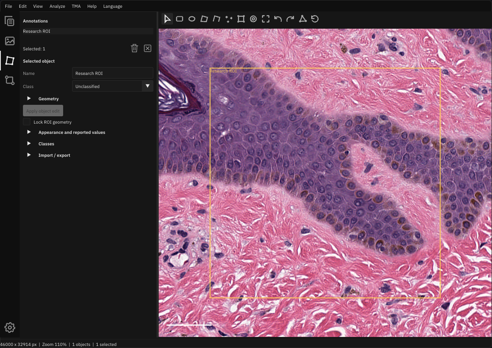

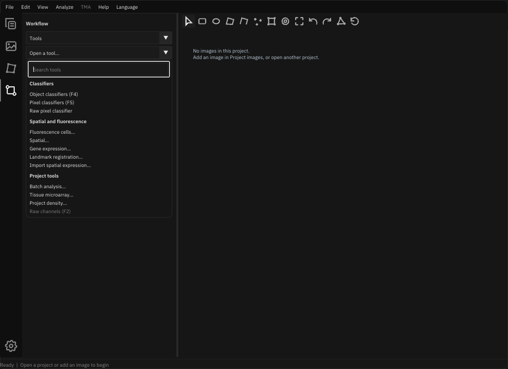

Validation: workspace-root `build/ui-panel-workflows/results.json` records191
distinct latest-passing cases (187 GUI plus4 source contracts),5 native suites
and42 distinct views. Final affected workflows and captures supersede compatible
earlier evidence. Coverage includes scaled/translated/empty/expanded panels,
actual tool selection without an image, native detection/retention/export, exact
custom scientific settings, lock/properties/history and saved project identity.
All38 binding objects are unchanged; standalone startup without Python exits0.
Computer Use observed the preview but declined input because the user was active;
that live window is preserved and manual search typing is not claimed.

Reviewed: design hierarchy, common/empty workflows, disclosure, shortcut routes
and consumer boundaries. No deceptive behavior found. Residual scope: specialist
tool dialogs retain their existing workflows; this change does not redesign their
individual recipes or the concurrent fluorescence/dark-flat feature work.

## Current workbench style system

The owner's subsequent review rejected inconsistent activity buttons, form
spacing and section framing. Navigation now follows the VS Code activity-bar
pattern: full48px rows, unboxed icons, an outer-edge selection indicator and
bottom workspace settings. Pointer focus stays unboxed; Tab/Enter/Space retain
keyboard feedback. The slide toolbar remains above the canvas.

Both renderers consume the [shared design system](design-system.md). Native
metrics/palettes expand into RCSS at load/reload; unknown tokens retain the live
document. Fields share a label column, narrow forms stack, vectors use a full
row, section headers stay flat and inline text actions share28px height.
Eleven native tool modules now use the common control adapters. Settings exposes
the existing appearance, language, reset and resource-reload commands.

Local evidence is retained under workspace-root `build/ui-style-system`:
163 distinct latest-passing GUI/source checks,5 native suites and26 captures
cover panes/tasks at1×/2×, Chinese/light views, classifiers, TMA and settings.
The final pointer-only decoration has separate native/focus checks; unchanged
workflow evidence retains its tested inputs. Native RGB, camera, project bytes
and generation assertions remain exact. All38 binding objects are unchanged;
the matching standalone app starts without Python on PATH. These checks establish
control behavior and data preservation; design acceptance remains the owner's.

The independent findings below describe the earlier organization baseline.

## Independent findings

Evidence locations refer to the reviewed baseline, before reordering.

| Reviewer | Evidence | Finding |
| --- | --- | --- |
| Structure | `gui.cpp:1746` — `"Import / export"`; `:1839` — `"Display"` | Image begins with object exchange and historical data rather than display controls. |
| Structure | `gui.cpp:1553` — `"Remove image (F12)"`; `:1565` — `"Add image (F8)"` | Add is inside collapsed source details while Remove is immediately visible. |
| Structure | `gui.cpp:1952` — `"Use object color override"`; `:1987` — `"Name"` | Basic annotation identity is below appearance and imported measurements. |
| Structure | `gui.cpp:2060` — `"Region analysis"`; `:2329` — `"Watershed cells"` | Distinct tasks, results and exports occupy one long selection-dependent form. |
| Structure | `gui.cpp:1539` — `"Project image list",{0,100}` | Collection sizes do not grow with their text and controls. |
| Workflows | `gui.cpp:1638` — `ImGui::IsKeyPressed(ImGuiKey_F5)`; `gui_pixel_classifier.hpp:173` — `ImGuiKey_F5` | One key opens classifiers and starts unrelated recovery discovery. |
| Workflows | `gui.cpp:2021` — `if (selected)`; `:2063` — `"Raw pixel classifier"` | Raw-file/model inspection is concealed behind an unrelated selection prerequisite. |
| Workflows | `gui_batch.hpp:270` — `"Cancel batch"` | Progress/cancellation sit after the complete scrolling recipe. |
| Workflows | `gui_batch.hpp:168` — `"settings in the image inspector."` | Instructions point to a pane that no longer owns those controls. |
| Workflows | Same Image/Workflow evidence above | Pane purpose and run → inspect → retain/export sequence need clearer hierarchy. |
| Interaction | `gui.cpp:2843` — `"Overview unavailable"` | A large failed map covers tissue and still captures navigation input. |
| Interaction | `gui.cpp:1866` — `ui::Button("Clear")` | Calibration removal is mixed with display transforms and ambiguously named. |
| Interaction | `gui.cpp:1876` — `"Object list",{0,90}` | Larger UI scales reduce visible collection rows. |
| Interaction | `gui_project_density.hpp:53` — `{760,720}` | Some tool windows exceed small viewports and differ from bounded classifier windows. |
| Interaction | `gui_layout.hpp:161` — `ImGui::IsItemHovered` | Native icon commands lack the translated focus hints already used by the RmlUi shell. |
| Interaction | `gui.cpp:1555` — `"Image source / name"` | Prominent section/failure captions bypass localization. |

These findings have medium severity/high confidence, except the stale instructions
and untranslated captions, which have lower severity. They are transparent
usability problems; no reviewer found evidence of deceptive behavior.

## Changes

1. **Pane ownership and essentials.** Project exposes Add beside its collection
   and separates Open/Add menu routes. Image starts with Display and a distinct
   Calibration section; its clear action names the metadata being removed.
   Read-only historical facts are secondary. Annotations puts Name/Class/Apply
   before appearance and imported data, groups geometry separately, and owns
   object exchange. Lists use readable row counts and bounded available height.
2. **Tasks and actions.** Workflow has a persistent chooser for Measurements,
   Region, Tissue, Cells, Tables, Tools, and Source/files. The chooser stays above
   its scrolling content. Analyze exposes the same tasks; shortcuts reveal the
   relevant task. Tools and raw-file inspection do not require selecting an ROI.
   Native prerequisites still gate actual analysis. F5 opens Pixel classifiers;
   Ctrl+Shift+F5 discovers recovery files. F6/F7 reveal and open the Annotations
   exchange group before running the existing export/import action.
   Batch status/Cancel and Run remain
   outside its scrolling recipe, with corrected prerequisite instructions.
3. **Reachability and feedback.** Spatial, Density and Batch share viewport bounds
   while retaining valid user sizing. Native icons show translated keyboard-focus
   hints. An unavailable overview supplies diagnostics/retry in Image rather than
   a canvas-blocking card. Both its navigation and stale canvas exclusion require
   a ready map. Budget controls precede variable status/map content to prevent
   click targets moving during retries. New navigation captions cover all16 locales.

Task navigation is separate workspace state. It does not cancel jobs, replace
recipes, discard results, change images or write projects. Polling, source checks,
verification and finalization remain independent of the visible task. The compact
API layout retains its continuous inspector rather than nesting a filling child
inside an already scrolling form.

## Coverage and validation

| Surface | Independent coverage | Decisive checks |
| --- | --- | --- |
| Rail, toolbar, menus | All3 | Existing RmlUi DPI, events, keyboard, reload and exact RGB checks |
| Project, collections, save/recovery | All3 | Add/switch/save/reopen, scaled Save, persistence and distinct F5 intents |
| Image, calibration, overview | All3 | Independent display settings, explicit calibration labels, failed-map selection and retry |
| Annotations, classes, exchange | All3 | Primary identity ordering, selection/locks, native class/entry checks and exchange routes |
| Measurements, region, tissue, cells, tables | All3 | All tasks, with1×/2× captures; native run/keep and existing result/checkpoint replay |
| Object/pixel/raw tools, quantitative channels, TMA | All3 | Entry-point/prerequisite review and existing classifier/raw GUI scenarios |
| Spatial, density, batch | All3 | Shared small-viewport/user-size checks, progress/Cancel reachability and batch replay |
| Language, theme, dialogs, keyboard | All3 | Native catalogue/design tests, focused hints and Chinese captures |

The native organization test preserves exact saved-project bytes, generation,
object count and camera during navigation. It also selects an annotation through
the former failed-map rectangle without panning. Scientific values and native
failure/identity assertions remain unchanged. Capture checks establish readability,
reachability and meaningful overlay order rather than cosmetic pixel equivalence.

Results on Windows x64, using the existing integration cache and the candidate
under workspace-root `build/ui-organization`:

| Check | Result | Retained evidence inside that directory |
| --- | --- | --- |
| Native replay, shell, organization, design and i18n suites | 5/5 pass | `ctest-final.log` |
| Affected Python-native GUI replay | 145 distinct cases have a passing latest result | `replay-results.json` and six JUnit XML files |
| New empty-project Tools and F6 exchange routes | 2/2 pass | `organization-final.log`, `organization-final.xml` |
| Pane/task navigation,1×/2×, run/keep, failed-map hit testing | Pass, exact project/camera checks | `checks-1/`, `checks-1.log`; final organization CTest |
| Real CMU-1 Project/Image/Annotations/Region and Chinese light Image | Readable; exact saved bytes/generation/camera unchanged | `preview/`, `preview.log` |
| Standalone project startup, System32 working directory, Windows-only PATH | Exit0 | `startup-smoke.log` |
| Retained binding objects | All38 SHA256s unchanged | `binding-objects-before.json`, `binding-objects-final.json` |

The replay total deduplicates cases across the initial broad pass and focused
repairs; it is not one full-suite run. Initial failures and corrections are kept
in their logs and summarized in the [current task card](current-task.md).
The optional replay module links existing objects into an isolated package;
there is no binding compilation, wheel or new science qualification. Concurrent
native expression/registration changes keep their separate evidence and scope.

## Current Project pane: explorer and contextual file actions

The owner rejected the standing highlighted Save and the remaining permanent
form rows. The prior alignment checks established usability, not design acceptance.
Project now leads with filename/identity and neutral New/Open/Save commands;
Images has Add/Refresh above its filter/list. Save is disabled for a clean saved
project; a filename asterisk indicates unsaved changes. Paths and reader choices
appear in one contextual Open/Save As/Add/Relink form. First Save requests its
destination, and leaving unconfirmed Save As restores the current native path.
Existing configured shortcuts and QuPath review/import keep their native owners.

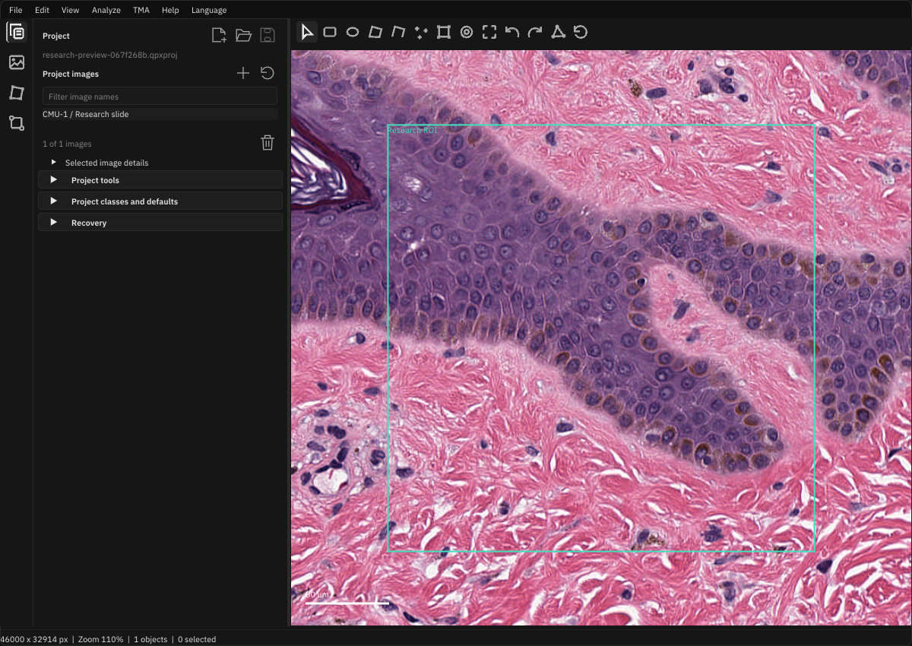

Focused captures and file-command checks are retained under workspace-root
`build/ui-organization/project-explorer`; the current task card records their
final results. Earlier images below document the previous pass.

## Screenshot follow-up: sidebar forms

The owner's Project-pane screenshot exposed a remaining composition problem:
fixed-width inputs leave different gaps before their icons, heights differ, and
the primary image list sits inside a second rounded surface. The shared
`ActionRow` now reserves trailing command space and gives the growing field and
its icons the same height; narrow rows stack without changing command semantics.
Save/Open have explicit captions, New belongs to the Project heading, and filter,
source and rename rows follow the same alignment. Image/object collections use
the pane surface and fit small row counts; image count and Remove share a footer.
Primary images remain visible while secondary entry details can fold.

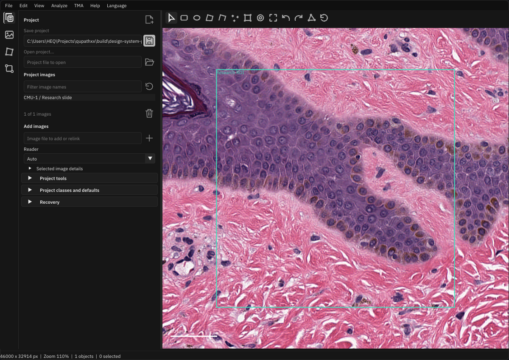

Focused capture/replay evidence is retained under workspace-root
`build/ui-organization/sidebar-polish`; the current task card records final
results. Earlier screenshots above remain evidence of their original delivery.

## Remaining scope

Advanced panels still use ImGui. This review does not migrate every parameter
form to RML, introduce native file pickers, qualify every dialog/locale/state
combination, implement new scientific features or establish performance parity.
