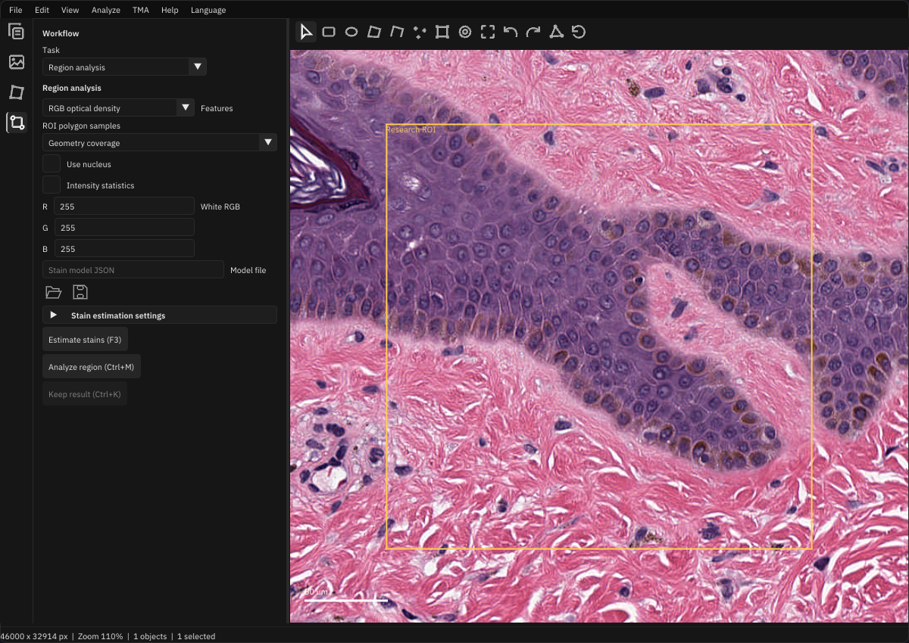
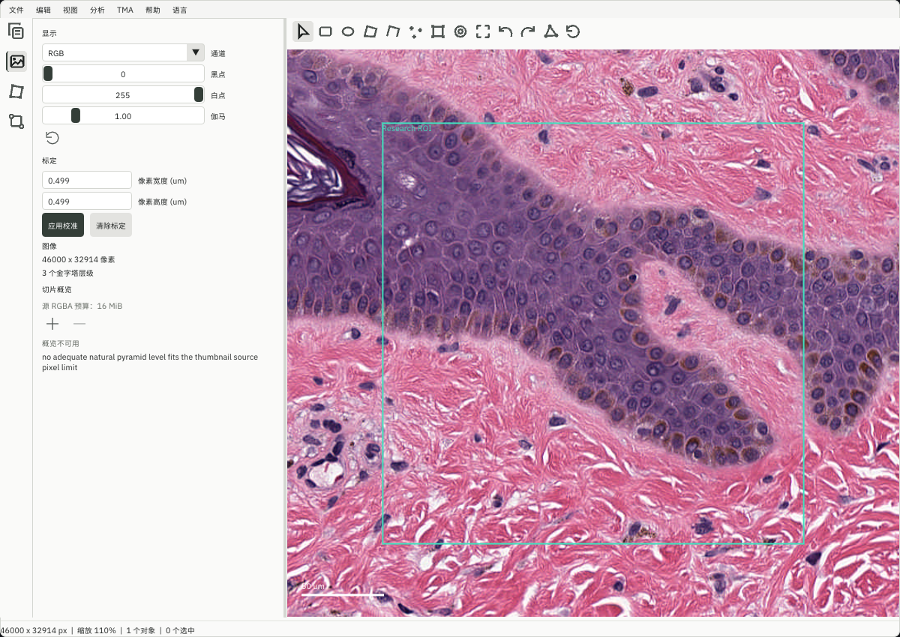

# Desktop organization review

Three reviewers independently inspected the desktop at `917590da`. Each reviewed
the overall workspace, with separate emphasis on information hierarchy, research
workflows and interaction/responsive behavior. They wrote findings before seeing
one another's conclusions. The implementation below combines overlapping evidence;
it does not replace the native scientific services or the RmlUi shell.

## Independent findings

Evidence locations refer to the reviewed baseline, before reordering.

| Reviewer | Evidence | Finding |
| --- | --- | --- |
| Structure | `gui.cpp:1746` — `"Import / export"`; `:1839` — `"Display"` | Image begins with object exchange and historical data rather than display controls. |
| Structure | `gui.cpp:1553` — `"Remove image (F12)"`; `:1565` — `"Add image (F8)"` | Add is inside collapsed source details while Remove is immediately visible. |
| Structure | `gui.cpp:1952` — `"Use object color override"`; `:1987` — `"Name"` | Basic annotation identity is below appearance and imported measurements. |
| Structure | `gui.cpp:2060` — `"Region analysis"`; `:2329` — `"Watershed cells"` | Distinct tasks, results and exports occupy one long selection-dependent form. |
| Structure | `gui.cpp:1539` — `"Project image list",{0,100}` | Collection sizes do not grow with their text and controls. |
| Workflows | `gui.cpp:1638` — `ImGui::IsKeyPressed(ImGuiKey_F5)`; `gui_pixel_classifier.hpp:173` — `ImGuiKey_F5` | One key opens classifiers and starts unrelated recovery discovery. |
| Workflows | `gui.cpp:2021` — `if (selected)`; `:2063` — `"Raw pixel classifier"` | Raw-file/model inspection is concealed behind an unrelated selection prerequisite. |
| Workflows | `gui_batch.hpp:270` — `"Cancel batch"` | Progress/cancellation sit after the complete scrolling recipe. |
| Workflows | `gui_batch.hpp:168` — `"settings in the image inspector."` | Instructions point to a pane that no longer owns those controls. |
| Workflows | Same Image/Workflow evidence above | Pane purpose and run → inspect → retain/export sequence need clearer hierarchy. |
| Interaction | `gui.cpp:2843` — `"Overview unavailable"` | A large failed map covers tissue and still captures navigation input. |
| Interaction | `gui.cpp:1866` — `ui::Button("Clear")` | Calibration removal is mixed with display transforms and ambiguously named. |
| Interaction | `gui.cpp:1876` — `"Object list",{0,90}` | Larger UI scales reduce visible collection rows. |
| Interaction | `gui_project_density.hpp:53` — `{760,720}` | Some tool windows exceed small viewports and differ from bounded classifier windows. |
| Interaction | `gui_layout.hpp:161` — `ImGui::IsItemHovered` | Native icon commands lack the translated focus hints already used by the RmlUi shell. |
| Interaction | `gui.cpp:1555` — `"Image source / name"` | Prominent section/failure captions bypass localization. |

These findings have medium severity/high confidence, except the stale instructions
and untranslated captions, which have lower severity. They are transparent
usability problems; no reviewer found evidence of deceptive behavior.

## Changes

1. **Pane ownership and essentials.** Project exposes Add beside its collection
   and separates Open/Add menu routes. Image starts with Display and a distinct
   Calibration section; its clear action names the metadata being removed.
   Read-only historical facts are secondary. Annotations puts Name/Class/Apply
   before appearance and imported data, groups geometry separately, and owns
   object exchange. Lists use readable row counts and bounded available height.
2. **Tasks and actions.** Workflow has a persistent chooser for Measurements,
   Region, Tissue, Cells, Tables, Tools, and Source/files. The chooser stays above
   its scrolling content. Analyze exposes the same tasks; shortcuts reveal the
   relevant task. Tools and raw-file inspection do not require selecting an ROI.
   Native prerequisites still gate actual analysis. F5 opens Pixel classifiers;
   Ctrl+Shift+F5 discovers recovery files. F6/F7 reveal and open the Annotations
   exchange group before running the existing export/import action.
   Batch status/Cancel and Run remain
   outside its scrolling recipe, with corrected prerequisite instructions.
3. **Reachability and feedback.** Spatial, Density and Batch share viewport bounds
   while retaining valid user sizing. Native icons show translated keyboard-focus
   hints. An unavailable overview supplies diagnostics/retry in Image rather than
   a canvas-blocking card. Both its navigation and stale canvas exclusion require
   a ready map. Budget controls precede variable status/map content to prevent
   click targets moving during retries. New navigation captions cover all16 locales.

Task navigation is separate workspace state. It does not cancel jobs, replace
recipes, discard results, change images or write projects. Polling, source checks,
verification and finalization remain independent of the visible task. The compact
API layout retains its continuous inspector rather than nesting a filling child
inside an already scrolling form.

## Coverage and validation

| Surface | Independent coverage | Decisive checks |
| --- | --- | --- |
| Rail, toolbar, menus | All3 | Existing RmlUi DPI, events, keyboard, reload and exact RGB checks |
| Project, collections, save/recovery | All3 | Add/switch/save/reopen, scaled Save, persistence and distinct F5 intents |
| Image, calibration, overview | All3 | Independent display settings, explicit calibration labels, failed-map selection and retry |
| Annotations, classes, exchange | All3 | Primary identity ordering, selection/locks, native class/entry checks and exchange routes |
| Measurements, region, tissue, cells, tables | All3 | All tasks, with1×/2× captures; native run/keep and existing result/checkpoint replay |
| Object/pixel/raw tools, quantitative channels, TMA | All3 | Entry-point/prerequisite review and existing classifier/raw GUI scenarios |
| Spatial, density, batch | All3 | Shared small-viewport/user-size checks, progress/Cancel reachability and batch replay |
| Language, theme, dialogs, keyboard | All3 | Native catalogue/design tests, focused hints and Chinese captures |

The native organization test preserves exact saved-project bytes, generation,
object count and camera during navigation. It also selects an annotation through
the former failed-map rectangle without panning. Scientific values and native
failure/identity assertions remain unchanged. Capture checks establish readability,
reachability and meaningful overlay order rather than cosmetic pixel equivalence.

Results on Windows x64, using the existing integration cache and the candidate
under workspace-root `build/ui-organization`:

| Check | Result | Retained evidence inside that directory |
| --- | --- | --- |
| Native replay, shell, organization, design and i18n suites | 5/5 pass | `ctest-final.log` |
| Affected Python-native GUI replay | 145 distinct cases have a passing latest result | `replay-results.json` and six JUnit XML files |
| New empty-project Tools and F6 exchange routes | 2/2 pass | `organization-final.log`, `organization-final.xml` |
| Pane/task navigation,1×/2×, run/keep, failed-map hit testing | Pass, exact project/camera checks | `checks-1/`, `checks-1.log`; final organization CTest |
| Real CMU-1 Project/Image/Annotations/Region and Chinese light Image | Readable; exact saved bytes/generation/camera unchanged | `preview/`, `preview.log` |
| Standalone project startup, System32 working directory, Windows-only PATH | Exit0 | `startup-smoke.log` |
| Retained binding objects | All38 SHA256s unchanged | `binding-objects-before.json`, `binding-objects-final.json` |

The replay total deduplicates cases across the initial broad pass and focused
repairs; it is not one full-suite run. Initial failures and corrections are kept
in their logs and summarized in the [current task card](current-task.md).
The optional replay module links existing objects into an isolated package;
there is no binding compilation, wheel or new science qualification. Concurrent
native expression/registration changes keep their separate evidence and scope.

## Remaining scope

Advanced panels still use ImGui. This review does not migrate every parameter
form to RML, introduce native file pickers, qualify every dialog/locale/state
combination, implement new scientific features or establish performance parity.
